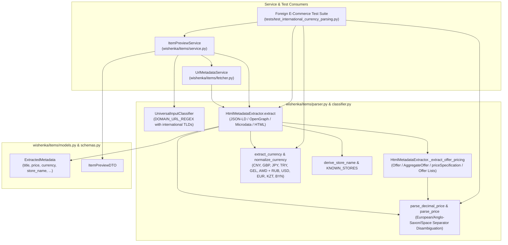

# WISHENKA-98: Expand International Currency Recognition and Foreign E-Commerce Price Extraction

## Research

### 1. Audit of Current Metadata Extraction, Currency Normalization, and Price Parsing

In the [`wishenka/items/`](file:///home/src/wishenka/items) package, HTML product metadata extraction and normalization are implemented in [`wishenka/items/parser.py`](file:///home/src/wishenka/items/parser.py) and orchestrated by [`ItemPreviewService`](file:///home/src/wishenka/items/service.py#L58) and [`UrlMetadataService`](file:///home/src/wishenka/items/fetcher.py#L118). A detailed inspection against the approved requirements in [`ai-tasks/WISHENKA-98/10-requirements.md`](file:///home/src/ai-tasks/WISHENKA-98/10-requirements.md) identified four concrete functional gaps:

1. **Incomplete International Currency Symbol & Designation Normalization ([`CURRENCY_MAP`](file:///home/src/wishenka/items/parser.py#L17-L36) & [`normalize_currency`](file:///home/src/wishenka/items/parser.py#L113-L123))**:
   - Currently, `CURRENCY_MAP` maps only `₽`, `руб`, `руб.`, `rub`, `rur`, `$`, `usd`, `€`, `eur`, `₸`, `kzt`, `byn`, `br`, `£`, `gbp`, `¥`, `cny`, and `jpy`.
   - **Missing target currency symbols and localized designations**:
     - **Turkish Lira (`TRY`)**: `₺`, `tl`, `тл`, `trl`, `лир`, `лира`, `лиры` are missing. Because `normalize_currency` only falls back to 3-letter `.isalpha()` strings, `normalize_currency("₺")` and `normalize_currency("TL")` silently return `DEFAULT_CURRENCY` (`"RUB"`).
     - **Georgian Lari (`GEL`)**: `₾`, `ლ`, `лари`, `lari` are missing (`normalize_currency("₾")` and `normalize_currency("лари")` return `"RUB"`).
     - **Armenian Dram (`AMD`)**: `֏`, `դր`, `դր.`, `драм`, `драма`, `драмов`, `dram` are missing (`normalize_currency("֏")` and `normalize_currency("драм")` return `"RUB"`).
     - **Chinese Yuan (`CNY`)**: `￥` (fullwidth `\uffe5`), `cn¥`, `cn￥`, `rmb`, `元`, `юан`, `юань`, `юаля`, `юаней` are missing. Critically, `"RMB"` is a 3-letter alphabetic string, so `normalize_currency("RMB")` currently hits `len(upper) == 3 and upper.isalpha()` and returns `"RMB"` instead of normalizing to `"CNY"`.
     - **Japanese Yen (`JPY`)**: `jp¥`, `jp￥`, `jpy¥`, `円`, `йен`, `йена`, `йены`, `иен`, `иена`, `иены`, `yen` are missing (`normalize_currency("JP¥")` and `normalize_currency("円")` return `"RUB"`).
     - **British Pound (`GBP`)**: `￡` (fullwidth `\uffe1`), `gb£`, `uk£`, `фунт`, `фунта`, `фунтов` are missing.
   - **Missing inline currency extraction from combined price strings**:
     - `normalize_currency` only performs exact dictionary lookup or 3-letter `isalpha()` check. When a foreign store embeds the currency inside a price string or social preview tag without a separate currency field (e.g., `<meta property="product:price:amount" content="1.299,99 €">`, `<span itemprop="price">1 450,50 ₺</span>`, `"JP¥ 12,800"`, `"120,00 ₾"`, `"15.000 ֏"`, `"£49.99"`), `currency_raw` is `None` and `HtmlMetadataExtractor.extract` defaults `currency` to `"RUB"`.

2. **Localized Number Separator Misinterpretation and Edge-Case Bugs in [`parse_price`](file:///home/src/wishenka/items/parser.py#L78-L110)**:
   - **European thousand-dot format without comma decimal (`"15.000"`, `"1.299"`, `"1.234.567"`)**:
     - `parse_price` handles `"," in num_str and "." in num_str` and `elif "," in num_str:`, but has **no** `elif "." in num_str:` branch.
     - For `"15.000"` (e.g. `15.000 ₺` or `15.000 ֏`), `float("15.000")` evaluates to `15.0` (`15`), losing a factor of $1\,000$.
     - For multi-group dot separators like `"1.234.567"`, `float("1.234.567")` raises `ValueError` and returns `None`.
   - **Multi-group comma separators with decimal tail or 3-digit grouping (`"1,234,567"`, `"12,800"`)**:
     - While `12,800` strips commas because `len(parts[1]) == 3`, dot-separated equivalents (`12.800`, `15.000`) fail.
   - **Unicode thin / narrow non-breaking spaces (`\u202f`, `\u2009`, `\u2007`)**:
     - Line 85 only normalizes `\xa0` to `" "`, while line 89 uses `\s` in `r"(\d+(?:[\s.,]\d+)*)"` and line 93 only removes ASCII `" "` (`match.group(1).replace(" ", "")`). When a price contains `\u202f` (narrow no-break space used by `Intl.NumberFormat` in European/Russian locales) or `\u2009` (thin space), `\u202f` remains inside `num_str` and `float(num_str)` fails with `ValueError`, returning `None`.
   - **Zero and negative prices (`0`, `-100`, `"-15.99"`, `"0,00"`, `bool`)**:
     - Line 82 checks `if isinstance(raw_price, (int, float)): return int(raw_price)`. In Python, `isinstance(True, int)` is `True` (returning `1`), `parse_price(0)` returns `0`, `parse_price(-50)` returns `-50`, and `parse_price("-500 ₽")` matches `"500"` after the minus sign and returns `+500` instead of rejecting negative and zero prices (`None`).
   - **Exact decimal parsing vs integer major-unit representation**:
     - Preview extraction uses `parse_decimal_price` and carries fractional values through
       `ExtractedMetadata`, `ItemPreviewDTO`, form submission, persistence, and gifter projection.
       Whole values remain integers. SQLite INTEGER affinity stores non-integral numeric values
       as REAL; existing rows and schema remain compatible without a table migration.

3. **Complex JSON-LD Offer & `priceSpecification` Structures in [`HtmlMetadataExtractor.extract`](file:///home/src/wishenka/items/parser.py#L238-L319)**:
   - Currently, `HtmlMetadataExtractor.extract` only inspects `products[0]` and, when `prod.get("offers")` is a list, blindly takes `offers[0]`.
   - If `offers` is a list where the first offer has a missing, empty (`""`), or zero price (e.g., an out-of-stock placeholder variant) and the second offer has a valid positive price, extraction fails.
   - If an `Offer` or `AggregateOffer` stores its price inside a nested `priceSpecification` object or list of `UnitPriceSpecification` / `PriceSpecification` objects (common in European and Asian e-commerce platforms adhering to Schema.org / Google Merchant Center specs), or inside nested `AggregateOffer.offers` arrays, `HtmlMetadataExtractor` ignores `priceSpecification` and nested `offers` and returns `price=None`.
   - If `offers.get("price")` is `""` (empty string), `offer_price is None` is `False`, so the current code does not even fall back to `lowPrice` or `highPrice`.

4. **Shared `¥` (`\u00a5` / `\uffe5`) Disambiguation Between `CNY` and `JPY`**:
   - Per Schema.org and ISO 4217 conventions (and `10-requirements.md` DoD 1 / Q&A 2), both Chinese Yuan and Japanese Yen use `¥` / `￥`.
   - When a page provides an explicit currency code or unambiguous token (`JPY`, `JP¥`, `円`, `йен`, `иен` vs `CNY`, `CN¥`, `RMB`, `元`, `юан`), that explicit designation must take precedence over a bare `¥` in the price string.
   - Conversely, when `currency_raw` is bare `"¥"` (or `None`) and `price_raw` contains an unambiguous Yen marker (`"JP¥ 12,800"` or `"12,800 円"`), the parser must resolve `"JPY"`. When only a bare `"¥"` / `"￥"` is present with no disambiguating marker, it deterministically defaults to `"CNY"`.

---

## Implementation Plan

1. **Expand Currency Recognition and Inline Extraction in [`wishenka/items/parser.py`](file:///home/src/wishenka/items/parser.py)**:
   - Expand `CURRENCY_MAP` with full coverage of target international and regional currencies:
     - `CNY`: `"¥"`, `"￥"`, `"cny"`, `"cn¥"`, `"cn￥"`, `"rmb"`, `"元"`, `"юан"`, `"юань"`, `"юаня"`, `"юаней"`.
     - `GBP`: `"£"`, `"￡"`, `"gbp"`, `"gb£"`, `"uk£"`, `"фунт"`, `"фунта"`, `"фунтов"`, `"фунт стерлингов"`.
     - `JPY`: `"jpy"`, `"jp¥"`, `"jp￥"`, `"jpy¥"`, `"円"`, `"йен"`, `"йена"`, `"йены"`, `"иен"`, `"иена"`, `"иены"`, `"yen"`.
     - `TRY`: `"₺"`, `"try"`, `"tl"`, `"тл"`, `"trl"`, `"лир"`, `"лира"`, `"лиры"`, `"турецкая лира"`.
     - `GEL`: `"₾"`, `"ლ"`, `"gel"`, `"лари"`, `"lari"`.
     - `AMD`: `"֏"`, `"amd"`, `"դր"`, `"դր."`, `"драм"`, `"драма"`, `"драмов"`, `"dram"`.
     - Existing currencies (`RUB`, `USD`, `EUR`, `KZT`, `BYN`): preserve and enrich aliases (`"тг"`, `"тенге"`, `"бел. руб."`, `"us$"`, etc.).
   - Implement `extract_currency(raw_text: Any) -> str | None`:
     - Inspects a standalone currency string or an inline price-with-currency string (e.g., `"1.299,99 €"`, `"JP¥ 12,800"`, `"1 450,50 ₺"`, `"120 ₾"`, `"15.000 ֏"`, `"£49.99"`, `"¥ 199"`).
     - Evaluates unambiguous multi-character prefixes/tokens (`JP¥`, `CN¥`, `RMB`, `TRY`, `TL`, `GEL`, `AMD`, `GBP`, `EUR`, `USD`, `KZT`, `BYN`, `RUB`, `円`, `元`, `лари`, `драм`, `dram`, `лир`, `йен`, `иен`, `юан`) before single-character symbols (`₺`, `₾`, `֏`, `£`, `€`, `₸`, `₽`, `$`, `¥`, `￥`) so that `"JP¥ 12,800"` resolves to `"JPY"` rather than matching bare `"¥"` as `"CNY"`.
   - Enhance `normalize_currency(raw_currency: str | None, *, fallback_text: Any = None) -> str`:
     - Resolves `raw_currency` via `extract_currency(raw_currency)`.
     - If `raw_currency` is an ambiguous bare Yen/Yuan symbol (`"¥"` or `"￥"`) and `fallback_text` contains an explicit `"JPY"` / `"CNY"` disambiguator (such as `"JP¥"` or `"円"`), uses the disambiguated code.
     - If `raw_currency` is missing or yields no recognized currency, inspects `fallback_text` via `extract_currency(fallback_text)`.
     - Falls back to `DEFAULT_CURRENCY` (`"RUB"`).

2. **Implement Localized Number Disambiguation in [`wishenka/items/parser.py`](file:///home/src/wishenka/items/parser.py)**:
   - Implement `parse_decimal_price(raw_price: Any) -> float | None`:
     - Rejects `None` and `bool` (`isinstance(raw_price, bool)`).
     - For `int | float`: rejects `NaN`, `Inf`, and values `<= 0`; returns `float(raw_price)`.
     - Normalizes all Unicode whitespace characters (`\xa0`, `\u202f`, `\u2009`, `\u2007`, etc.) to standard spaces.
     - Detects and rejects negative numeric tokens (when the first numeric token is immediately preceded by a negative sign `-` or `−`, e.g., `"-100"`, `"- 49.99"`, `"-$25.00"`, while still parsing positive price ranges like `"от 1 490 - 2 500 ₽"` where `-` separates two positive numbers).
     - Disambiguates separators on the extracted digit/separator sequence:
       - **Mixed `.` and `,`**: The rightmost separator is the decimal point (`1.299,99` / `1.234.567,89` $\rightarrow$ `.` is thousand, `,` is decimal $\rightarrow$ `1299.99` / `1234567.89`; `1,299.99` / `1,234,567.89` $\rightarrow$ `,` is thousand, `.` is decimal $\rightarrow$ `1299.99` / `1234567.89`).
       - **Multiple identical separators** (`1.234.567`, `1,234,567`, `1.000.000`): If the final group has 1 or 2 digits, the last separator is decimal and earlier ones are thousands; otherwise all are thousand separators (`1234567.0`, `1000000.0`).
       - **Single `,` or single `.`**:
         - If the trailing part has 1 or 2 digits (`12,50`, `12.50`, `12,5`, `49.99`), treated as a decimal separator.
         - If the trailing part has 3 digits and the integer prefix is non-zero (`12,800`, `15.000`, `1.299`), treated as a thousand separator (`12800.0`, `15000.0`, `1299.0`).
         - Otherwise, for `,` stripped as thousand separator and for `.` parsed as decimal if prefix is `"0"` (`0.125`) or stripped as thousand separator.
     - Rejects parsed values `<= 0` (`return None`).
   - Update `parse_price(raw_price: Any) -> int | None`:
     - Retains its legacy integer behavior. Preview extraction calls `parse_decimal_price` directly and preserves fractional values.

3. **Enhance Structured Offer & Fallback Extraction in [`HtmlMetadataExtractor`](file:///home/src/wishenka/items/parser.py#L196)**:
   - Implement `_extract_offer_pricing(cls, offers_node: Any, url_domain: str | None = None, inherited_currency: str | None = None) -> tuple[Any, str | None]`:
     - Recursively / iteratively (with bounded depth) resolves `(price_raw, currency_raw)` from:
       - Single `Offer` or `AggregateOffer` dict (`price`, `lowPrice`, `minPrice`, `highPrice`, `maxPrice`, verifying `parse_decimal_price(candidate) is not None`).
       - Nested `priceSpecification` dict or list of dicts (`UnitPriceSpecification`, `PriceSpecification`, `CompoundPriceSpecification`).
       - Nested `offers` list or dict inside `AggregateOffer` or multi-offer arrays (selecting the first offer that yields a valid positive price, preserving its `priceCurrency` or inherited parent `priceCurrency`).
     - Preserves existing `jsonld_aggregate_offer_extracted` structured debug log when an `AggregateOffer` price is extracted.
   - Iterate across all discovered JSON-LD `Product` nodes (instead of only `products[0]`) when earlier product nodes lack `offers` or valid prices.
   - Support social preview / meta fallback selectors (`meta[property="product:price:amount"]`, `meta[property="og:price:amount"]`, `meta[name="product:price:amount"]`, `meta[name="og:price:amount"]`, `meta[name="twitter:data1"]` when it contains a valid price and currency) and resolve `normalized_curr = normalize_currency(currency_raw, fallback_text=price_raw)`.
   - Expand `KNOWN_STORES` in [`wishenka/items/parser.py`](file:///home/src/wishenka/items/parser.py) with common international domain aliases (`amazon.co.uk`, `amazon.de`, `amazon.co.jp`, `trendyol.com`, `taobao.com`, `jd.com`) and `DOMAIN_URL_REGEX` in [`wishenka/items/classifier.py`](file:///home/src/wishenka/items/classifier.py) with regional TLDs (`.uk`, `.de`, `.jp`, `.cn`, `.tr`, `.ge`, `.am`, `.eu`).
   - Export `extract_currency` and `parse_decimal_price` in [`wishenka/items/parser.py`](file:///home/src/wishenka/items/parser.py) and [`wishenka/items/__init__.py`](file:///home/src/wishenka/items/__init__.py).

**Mandatory — Failing Repro (next Step 3):**
Before modifying any production code, create the automated failing test module [`tests/test_international_currency_parsing.py`](file:///home/src/tests/test_international_currency_parsing.py) (with `pytestmark = pytest.mark.timeout(10)` per `do-testing`, running completely offline without live network dependencies):

1. **Target International Currency Normalization & Inline Extraction (`CNY`, `GBP`, `JPY`, `TRY`, `GEL`, `AMD`)**:
   - Asserts `normalize_currency` and `extract_currency` normalize all target symbols, localized names, and ISO codes:
     - `CNY`: `"CNY"`, `"¥"`, `"￥"`, `"CN¥"`, `"RMB"`, `"元"`, `"юань"`, `"199 元"`, `"CN¥ 88.50"`.
     - `GBP`: `"GBP"`, `"£"`, `"￡"`, `"GB£"`, `"фунт"`, `"£49.99"`.
     - `JPY`: `"JPY"`, `"JP¥"`, `"円"`, `"йен"`, `"иен"`, `"JP¥ 12,800"`, `"12,800 円"`.
     - `TRY`: `"TRY"`, `"₺"`, `"TL"`, `"лир"`, `"1.450,50 ₺"`, `"899 TL"`.
     - `GEL`: `"GEL"`, `"₾"`, `"лари"`, `"120,00 ₾"`, `"85 лари"`.
     - `AMD`: `"AMD"`, `"֏"`, `"драм"`, `"dram"`, `"15.000 ֏"`, `"25000 драм"`.
   - Fails before the fix because `"₺"`, `"TL"`, `"₾"`, `"лари"`, `"֏"`, `"драм"`, `"JP¥"`, `"円"`, `"CN¥"`, `"元"` all return `"RUB"`, and `"RMB"` returns `"RMB"` instead of `"CNY"`.
2. **Localized Number Format & Separator Disambiguation (`parse_decimal_price` and `parse_price`)**:
   - European thousand dots + decimal comma: `"1.299,99 €"` $\rightarrow$ `1299.99` (`parse_price` $\rightarrow$ `1299`), `"1.234.567,89"` $\rightarrow$ `1234567.89` (`1234567`).
   - Anglo-Saxon thousand commas + decimal dot: `"1,299.99"` $\rightarrow$ `1299.99` (`1299`), `"1,234,567.89"` $\rightarrow$ `1234567.89` (`1234567`).
   - Whole-number thousand separators without decimals: `"¥ 12,800"` $\rightarrow$ `12800`, `"15.000 ₺"` $\rightarrow$ `15000`, `"15.000 ֏"` $\rightarrow$ `15000`, `"1.234.567"` $\rightarrow$ `1234567`, `"1,234,567"` $\rightarrow$ `1234567`, distinguished from 2-digit decimal fractions `"12,50"` $\rightarrow$ `12.5` (`12`) and `"12.50"` $\rightarrow$ `12.5` (`12`).
   - Unicode narrow no-break space / thin space separators: `"12\u202f990,50 ₺"` $\rightarrow$ `12990.5` (`12990`), `"1\u2009250\u2009000 ֏"` $\rightarrow$ `1250000`.
   - Non-positive price rejection: `0`, `-100`, `"-500 ₽"`, `"0,00 €"`, `False`, `True` $\rightarrow$ `None`.
   - Fails before the fix on `"15.000 ₺"` (returns `15` instead of `15000`), `"1.234.567"` (returns `None`), `"12\u202f990,50 ₺"` (returns `None`), and `"-500 ₽"` / `0` (returns `500` / `0` instead of `None`).
3. **Complex JSON-LD Structured Pricing & Foreign E-Commerce Fixtures (`HtmlMetadataExtractor.extract` & `ItemPreviewService.fetch_preview`)**:
   - JSON-LD `Offer` with nested `priceSpecification` (`UnitPriceSpecification` dict and list) in `EUR` / `TRY` with European price formatting (`"1.299,99"`).
   - JSON-LD multi-offer list where `offers[0]` has no valid price (`"price": ""` or `None`) and `offers[1]` has a valid price and currency (`GBP`).
   - JSON-LD `AggregateOffer` containing nested `offers` array when top-level `lowPrice`/`highPrice` are absent.
   - Explicit `priceCurrency: "JPY"` with `"price": "¥ 12,800"` (Amazon JP fixture) disambiguating `¥` to `"JPY"`, contrasted with bare `"¥ 199.00"` (Chinese store fixture) resolving to `"CNY"`, and inline `"JP¥ 12,800"` / `"12,800 円"` without `priceCurrency` resolving to `"JPY"`.
   - OpenGraph and Microdata foreign e-commerce fixtures for Turkish (`TRY`, `₺`), Georgian (`GEL`, `₾`), Armenian (`AMD`, `֏`), and British (`GBP`, `£`) stores where currency is embedded inline in the price tag without a separate currency tag.
   - End-to-end `ItemPreviewService.fetch_preview` verification with mocked `UrlMetadataService` across all six target international currencies.

**Sequencing**: Research & architecture (Step 2) $\rightarrow$ write red test suite `tests/test_international_currency_parsing.py` and confirm it fails against current production code (Step 3) $\rightarrow$ implement currency/number/JSON-LD extraction improvements in `wishenka/items/parser.py`, `wishenka/items/classifier.py`, and `wishenka/items/__init__.py` until all red and existing tests pass (Step 4).

---

## Architecture

### 1. System Module Diagram



### 2. Description of Modules and Responsibilities

| Module | Responsibility |
| :--- | :--- |
| [`wishenka/items/parser.py`](file:///home/src/wishenka/items/parser.py) | Core HTML metadata extraction (`HtmlMetadataExtractor`), complex JSON-LD offer/priceSpecification traversal (`_extract_offer_pricing`), localized number parsing (`parse_decimal_price`, `parse_price`), international currency normalization and inline currency detection (`CURRENCY_MAP`, `extract_currency`, `normalize_currency`), and store name derivation (`KNOWN_STORES`, `derive_store_name`). |
| [`wishenka/items/classifier.py`](file:///home/src/wishenka/items/classifier.py) | Universal input text classification (`UniversalInputClassifier`), supporting implicit domain URLs across domestic and international TLDs (`.ru`, `.com`, `.uk`, `.de`, `.jp`, `.cn`, `.tr`, `.ge`, `.am`, `.eu`, `.by`, `.kz`, etc.). |
| [`wishenka/items/__init__.py`](file:///home/src/wishenka/items/__init__.py) | Public package facade exporting `parse_price`, `parse_decimal_price`, `normalize_currency`, `extract_currency`, `HtmlMetadataExtractor`, and preview services. |
| [`wishenka/items/service.py`](file:///home/src/wishenka/items/service.py) | Asynchronous link preview orchestrator (`ItemPreviewService`) invoking `HtmlMetadataExtractor.extract` in a worker thread and mapping `ExtractedMetadata` into `ItemPreviewDTO`. |
| [`tests/test_international_currency_parsing.py`](file:///home/src/tests/test_international_currency_parsing.py) | Automated unit and integration verification suite covering `CNY`, `GBP`, `JPY`, `TRY`, `GEL`, and `AMD` normalization, European/Anglo-Saxon separator disambiguation, complex JSON-LD offer structures, and end-to-end foreign e-commerce page previews. |

### 3. Module Interaction Scheme

```mermaid
sequenceDiagram
    participant Caller as ItemPreviewService / Caller
    participant Ext as HtmlMetadataExtractor
    participant Offer as _extract_offer_pricing
    participant Num as parse_decimal_price / parse_price
    participant Cur as extract_currency / normalize_currency

    Caller->>Ext: extract(html, base_url)
    Ext->>Ext: _find_jsonld_products(data)
    loop For each Product node in JSON-LD
        Ext->>Offer: _extract_offer_pricing(prod["offers"])
        Offer->>Num: parse_decimal_price(candidate_price)
        Note over Offer: Checks Offer.price -> lowPrice -> minPrice -> highPrice -> maxPrice -> priceSpecification -> nested offers[]
        Offer-->>Ext: (price_raw, currency_raw)
    end
    alt price_raw or currency_raw still missing
        Ext->>Ext: Fallback to OpenGraph (product:price:*, og:price:*)
        Ext->>Ext: Fallback to Microdata (itemprop="price", itemprop="priceCurrency")
    end
    Ext->>Num: parse_decimal_price(price_raw)
    Num->>Num: Disambiguate . and , separators & reject <= 0
    Num-->>Ext: parsed_price (int | float | None)
    Ext->>Cur: normalize_currency(currency_raw, fallback_text=price_raw)
    Note over Cur: Explicit currency_raw takes precedence; disambiguates ¥ via fallback_text; extracts inline symbols if currency_raw is None
    Cur-->>Ext: normalized_currency (ISO 4217 uppercase)
    Ext-->>Caller: ExtractedMetadata(price=parsed_price, currency=normalized_currency, ...)
```

### 4. Selected Architectural Patterns and Justification

1. **Hierarchical Cascading Extraction with Precedence Disambiguation**:
   - *Justification*: E-commerce platforms vary widely in how they expose pricing: some emit flat JSON-LD `Offer` nodes, others emit `AggregateOffer` or `UnitPriceSpecification` blocks, and others embed both price and currency symbol into a single OpenGraph or Microdata attribute. Separating structured offer traversal (`_extract_offer_pricing`) from inline currency fallback (`normalize_currency(currency_raw, fallback_text=price_raw)`) guarantees that explicit structured ISO codes (such as `priceCurrency: "JPY"`) always override ambiguous inline glyphs (`"¥"`), while pages lacking `priceCurrency` still recover the currency from inline symbols (`"1.450,50 ₺"` $\rightarrow$ `"TRY"`).
2. **Deterministic Positional & Grouping Heuristic for Locale-Independent Number Parsing**:
   - *Justification*: Relying on OS `locale.atof` is non-deterministic across containers and cannot handle mixed foreign store pages in a single process. By analyzing the relative positions and repetition counts of `.` and `,` separators along with trailing digit group lengths (1–2 digits for decimal cents vs 3 digits for thousand groupings on non-zero prefixes), `parse_decimal_price` deterministically parses European (`1.299,99`, `15.000`), Anglo-Saxon (`1,299.99`, `12,800`), and Unicode space-grouped (`12\u202f990,50`) prices in $< 0.05\text{ ms}$ with zero external dependencies.
3. **Preview and Persistence Price Boundaries**:
   - `parse_decimal_price` feeds the preview DTO without truncation; `parse_price` retains its
     legacy integer behavior. Forms, domain models, DTOs and repository reads accept fractional
     values. Existing SQLite INTEGER affinity stores non-integers as REAL without a migration,
     while existing integer values remain unchanged.

### 5. Definition of Main Interfaces / APIs Between Modules

```python
# wishenka/items/parser.py

CURRENCY_MAP: dict[str, str]
KNOWN_STORES: dict[str, str]

def extract_currency(raw_text: Any) -> str | None:
    """Extract normalized 3-letter ISO 4217 currency code from standalone or inline text.

    Returns None when no recognized currency code, symbol, or localized designation is present.
    """

def normalize_currency(
    raw_currency: str | None,
    *,
    fallback_text: Any = None,
) -> str:
    """Normalize raw currency symbol, code, or fallback price string into ISO 4217 uppercase code.

    Precedence:
    1. Unambiguous currency in `raw_currency` (e.g. 'JPY', 'TRY', '₺', '₾', '֏', '£', 'CN¥', 'JP¥').
    2. If `raw_currency` is an ambiguous bare Yen/Yuan symbol ('¥' / '￥'), check `fallback_text`
       for explicit 'JPY' markers ('JP¥', '円', 'JPY', 'йен', 'иен') before defaulting to 'CNY'.
    3. If `raw_currency` is None or unrecognized, extract inline currency from `fallback_text`.
    4. Fall back to `DEFAULT_CURRENCY` ('RUB').
    """

def parse_decimal_price(raw_price: Any) -> float | None:
    """Clean and convert localized string or numeric price to an exact positive float (> 0)."""

def parse_price(raw_price: Any) -> int | None:
    """Clean and convert localized string or numeric price to positive integer units (> 0)."""

class HtmlMetadataExtractor:
    @classmethod
    def extract(cls, html: str, base_url: str) -> ExtractedMetadata: ...

    @classmethod
    def _extract_offer_pricing(
        cls,
        offers_node: Any,
        *,
        url_domain: str | None = None,
        inherited_currency: str | None = None,
    ) -> tuple[Any, str | None]:
        """Extract first valid positive (price_raw, currency_raw) from Offer, AggregateOffer,
        nested priceSpecification, or multi-offer list/dict structures.
        """
```

---

## Q&A

1. **Question**: How does `parse_price` distinguish a 3-digit thousand separator (`"12,800"` or `"15.000"`) from a decimal fraction (`"12,50"` or `"49.99"`) when only a single separator is present?
   - **Answer**: In e-commerce retail pricing, fractional minor units use 1 or 2 digits (`12,5`, `12,50`, `49.99`), whereas zero-decimal or whole-thousand prices with grouping punctuation (`¥ 12,800`, `15.000 ₺`, `15.000 ֏`) have a non-zero integer prefix followed by a separator and 3 trailing digits. Therefore, when a single `,` or `.` separates a non-zero integer prefix from 3 trailing digits (or when the same separator is repeated multiple times, such as `1.234.567` or `1,234,567`), it is treated as a thousand separator; when followed by 1 or 2 digits, it is treated as a decimal separator.
2. **Question**: Why retain both numeric interfaces?
   - **Answer**: Existing callers use `parse_price` for whole units; previews use
     `parse_decimal_price` to retain fractional values through storage and display.

3. **Question**: How does the edit form preserve international currencies?
   - **Answer**: `CURRENCY_OPTIONS` includes the six newly supported currencies alongside existing
     options. The form adds a selected option for any other stored currency, so editing a wish does
     not silently replace its currency with the default.
