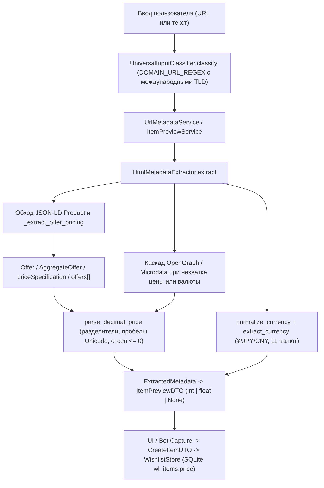

# Спецификация: WISHENKA-98 — Расширение распознавания международных валют и извлечения цен с зарубежных интернет-магазинов

**Задача в Jira:** WISHENKA-98  
**Язык реализации:** Python  
**Область:** Подсистема извлечения метаданных, классификации ссылок, предпросмотра и сохранения желаний (`wishenka.items`, `wishenka.wishlists`, `wishenka.web`, `wishenka.bot`)  
**Исходные артефакты:** `ai-tasks/WISHENKA-98/10-requirements.md`, `ai-tasks/WISHENKA-98/20-architecture.md`, `ai-tasks/WISHENKA-98/40-code-cleanup.md`, `ai-tasks/WISHENKA-98/50-observability.md`, `ai-tasks/WISHENKA-98/60-tech-debt.md`, `doc/dev/items.md`

---

## 1. Назначение и бизнес-цель

### 1.1. Постановка проблемы

Пользователи сервиса часто добавляют в вишлисты ссылки на товары из международных и региональных интернет-магазинов (Китай, Европа, Великобритания, Япония, Турция, Грузия, Армения). При вставке ссылки сервис автоматически формирует предпросмотр карточки желания (название, изображение, цену, валюту, магазин), избавляя автора списка от ручного ввода и обеспечивая дарителям точное представление о стоимости подарка.

По результатам аудита технического долга подсистемы предпросмотра ссылок (`WISHENKA-12`, зафиксировано как `WISHENKA-98`) были выявлены следующие пробелы:

1. **Неполное покрытие международных и региональных валют:** нормализация кодов и символов в `CURRENCY_MAP` и `normalize_currency` не распознавала китайский юань в расширенных обозначениях (`RMB`, `CN¥`, `元`, `юан*`), японскую иену (`JP¥`, `円`, `йен*`, `иен*`), турецкую лиру (`TRY`, `₺`, `TL`, `лир*`), грузинский лари (`GEL`, `₾`, `лари`) и армянский драм (`AMD`, `֏`, `драм`), а также ряд обозначений фунта стерлингов (`￡`, `GB£`, `UK£`, `фунт*`). Символ `₺` или `TL` приводил к откату на валюту по умолчанию (`RUB`), а `"RMB"` возвращалось как трёхбуквенный код `"RMB"` вместо `"CNY"`.
2. **Отсутствие встроенного (inline) распознавания валюты из строки цены:** зарубежные площадки нередко помещают символ или код валюты непосредственно внутрь тега цены (например, `product:price:amount` или `itemprop="price"` вида `"1.299,99 €"`, `"1 450,50 ₺"`, `"120,50 ₾"`, `"15.000 ֏"`, `"JP¥ 12,800"`), не задавая отдельного тега валюты.
3. **Ошибки интерпретации локализованных разделителей чисел и потеря дробной части:**
   - Европейский формат с точками-разделителями тысяч без запятой (`"15.000"`, `"1.299"`, `"1.234.567"`) не обрабатывался корректно (значение `"15.000"` искажалось в `15`, то есть в 1 000 раз, а `"1.234.567"` вызывало ошибку парсинга).
   - Узкий и тонкий неразрывные пробелы Unicode (`\u202f`, `\u2009`, `\u2007`), применяемые в `Intl.NumberFormat`, не удалялись перед разбором числа.
   - Отрицательные и нулевые значения, а также `bool` (`True`/`False`) не отклонялись единообразно (например, `"-500 ₽"` превращалось в `+500`).
   - Предпросмотр и модель хранения округляли/отбрасывали дробную часть цены до целого числа (`int`), искажая стоимость зарубежных товаров с центами или копейками (например, `0,50 €` или `1.299,99 €`).
4. **Недостаточная обработка сложных структур Schema.org JSON-LD:** извлечение проверяло только первый узел `Product` и первый элемент массива `offers[0]`, игнорируя пустые/нулевые ведущие предложения, вложенные узлы `priceSpecification` (`UnitPriceSpecification`) и вложенные списки `offers` внутри `AggregateOffer`.
5. **Ограниченное покрытие зарубежных доменов и тестовых сценариев:** классификатор неравнозначно распознавал неявные домены региональных зон (`.uk`, `.de`, `.jp`, `.cn`, `.tr`, `.ge`, `.am` и др.) и не имел офлайн-регрессионного набора для зарубежных витрин.

### 1.2. Цели задачи

1. Обеспечить точное распознавание и нормализацию целевых международных валют (`CNY`, `GBP`, `JPY`, `TRY`, `GEL`, `AMD`) с сохранением всех ранее поддерживаемых валют (`RUB`, `USD`, `EUR`, `KZT`, `BYN`) и детерминированным разрешением неоднозначности символа `¥` между `CNY` и `JPY`.
2. Гарантировать безошибочный разбор локализованных ценовых строк (европейских, англосаксонских, пробельных форматов) с сохранением точной дробной стоимости (`int | float | None`) от этапа предпросмотра до хранения в SQLite, редактирования в интерфейсе и отображения дарителю.
3. Поддержать извлечение цен и валют из сложных структурированных предложений JSON-LD (`Offer`, `AggregateOffer`, `priceSpecification`, массивы предложений, множественные узлы `Product`) с корректным каскадом на OpenGraph и Microdata.
4. Закрыть все новые форматы и сценарии зарубежного e-commerce автономным офлайн-набором автоматических тестов.

### 1.3. Ценность для пользователей и системы

- **Для авторов и соавторов вишлистов:** автоматическое и точное заполнение цены и валюты при вставке ссылок на зарубежные и региональные площадки без необходимости ручного исправления в 1 000 раз искажённых сумм или потерянной валюты.
- **Для дарителей:** корректный бюджет подарка (включая дробные суммы и редкие региональные валюты) на карточке вишлиста без потери точности при сохранении.
- **Для сопровождения и развития платформы:** единый детерминированный парсер без зависимости от локали ОС и защищённая от регрессий база автотестов с предсказуемой наблюдаемостью.

### 1.4. Границы области (Out of Scope)

- Конвертация валют по актуальному биржевому или банковскому курсу (желание хранит цену в извлечённой или указанной пользователем валюте).
- Рендеринг JavaScript-витрин в headless-браузере (отдельная задача `WISHENKA-99`).
- Вынос правил маркетплейсов во внешние конфигурационные файлы (отдельная задача `WISHENKA-96`).

---

## 2. Функциональные требования и пользовательские сценарии

### 2.1. Нормализация и встроенное распознавание валют

Система поддерживает 11 приоритетных валют, приводимых к трёхбуквенному коду стандарта ISO 4217 в верхнем регистре, а также сохраняет произвольные корректные 3-буквенные ASCII-коды при прямом задании.

| Валюта (ISO 4217) | Поддерживаемые символы, префиксы и локализованные обозначения |
| --- | --- |
| `CNY` (китайский юань) | `cny`, `¥`, `￥`, `cn¥`, `cn￥`, `rmb`, `元`, `юан`, `юань`, `юаня`, `юаней` |
| `GBP` (фунт стерлингов) | `gbp`, `£`, `￡`, `gb£`, `uk£`, `фунт`, `фунта`, `фунтов`, `фунт стерлингов` |
| `JPY` (японская иена) | `jpy`, `jp¥`, `jp￥`, `jpy¥`, `円`, `йен`, `йена`, `йены`, `иен`, `иена`, `иены`, `yen` |
| `TRY` (турецкая лира) | `try`, `₺`, `tl`, `тл`, `trl`, `лир`, `лира`, `лиры`, `турецкая лира` |
| `GEL` (грузинский лари) | `gel`, `₾`, `ლ`, `лари`, `lari` |
| `AMD` (армянский драм) | `amd`, `֏`, `դր`, `դր.`, `драм`, `драма`, `драмов`, `dram` |
| `RUB`, `USD`, `EUR`, `KZT`, `BYN` | Все ранее поддерживаемые коды, символы и названия (`₽`, `руб.`, `$`, `us$`, `€`, `₸`, `тг`, `тенге`, `br`, `бел. руб.` и др.) |

#### Правила встроенного распознавания (`extract_currency`)

1. Входные значения `None`, `bool`, `int`, `float` и пустые строки возвращают `None`.
2. Сначала выполняется точный поиск нормализованной в нижний регистр строки (и варианта без завершающей точки) в словаре `CURRENCY_MAP`. Благодаря этому `"RMB"` сопоставляется с `"CNY"`, а не возвращается как буквальный код `"RMB"`.
3. Если точного совпадения в `CURRENCY_MAP` нет, а очищенная строка состоит ровно из трёх ASCII-букв (`text.isascii() and text.isalpha()`), возвращается `text.upper()` (например, `"CHF"`).
4. Для смешанных строк (цена + валюта) проверяются в строгом порядке:
   - Многосимвольные префиксы `_INLINE_PREFIX_CURRENCIES`: `jpy¥`, `jp¥`, `jp￥`, `cn¥`, `cn￥`, `gb£`, `uk£`, `us$` (чтобы `"JP¥ 12,800"` не совпало с голым `"¥"`).
   - Словесные токены по регулярному выражению `_WORD_TOKEN_RE` (латиница, кириллица, армянский блок `\u0530-\u058f`, грузинский блок `\u10a0-\u10ff`) с поиском каждого токена в `CURRENCY_MAP`.
   - Односимвольные обозначения `_INLINE_SYMBOL_CURRENCIES`: `円`, `元`, `₺`, `₾`, `֏`, `£`, `￡`, `€`, `₸`, `₽`, `$`, `¥`, `￥`.

#### Правила приоритета и разрешения неоднозначности символа `¥` (`normalize_currency`)

1. Явный однозначный код или обозначение в `raw_currency` имеет высший приоритет и переопределяет встроенный символ цены (например, `raw_currency="JPY"`, `fallback_text="¥ 12,800"` даёт `"JPY"`).
2. Если `raw_currency` является голым символом `"¥"` или `"￥"`, функция проверяет `fallback_text` через `extract_currency`: при наличии маркеров `"JPY"` или `"CNY"` возвращается уточнённый код (`"JP¥ 12,800"` или `"12,800 円"` дают `"JPY"`), иначе детерминированно возвращается `"CNY"`.
3. Если `raw_currency` отсутствует или не распознан, выполняется попытка извлечь валюту из `fallback_text`.
4. При отсутствии распознаваемой валюты в обоих аргументах возвращается `DEFAULT_CURRENCY` (`"RUB"`).

#### Сохранение валюты в интерфейсе редактирования

Список доступных валют `CURRENCY_OPTIONS` в `wishenka/currency.py` расширен позициями `CNY (¥)`, `GBP (£)`, `JPY (¥)`, `TRY (₺)`, `GEL (₾)`, `AMD (֏)`. В модальном окне редактирования (`item_edit_modal.html`) при наличии у желания ранее сохранённой валюты вне `CURRENCY_OPTIONS` (например, `CHF`) для неё динамически добавляется выбранный `<option>`, предотвращая молчаливую замену валюты на `RUB`.

### 2.2. Локализованный разбор числовых цен и сквозное сохранение дробных значений

#### Правила разбора (`parse_decimal_price` и `parse_price`)

1. **Валидация типов и положительности:**
   - `None` и `bool` (`True`/`False`) отклоняются (`return None`).
   - Числовые значения `int` и `float` проверяются на конечность (`math.isfinite(val)`) и строго положительное значение (`val > 0`); `0`, `0.0`, отрицательные числа, `NaN` и `Inf` возвращают `None`.
   - В строковых входах все пробельные символы, включая `\xa0`, `\u202f` (узкий неразрывный пробел), `\u2009` (тонкий пробел) и `\u2007` (цифровой пробел), приводятся к обычному пробелу.
2. **Защита от отрицательных цен:**
   - Извлекается первый числовой токен вида `\d+(?:[\s.,]\d+)*`.
   - Если префикс непосредственно перед токеном указывает на знак минус (`-` или `−`), в том числе перед валютой или после кода/названия валюты (`"-500 ₽"`, `"-$25.00"`, `"-USD 25.00"`, `"EUR − 12,50"`), функция возвращает `None`.
   - Позитивные ценовые диапазоны с разделительным дефисом между двумя числами (например, `"from 12 - 25 EUR"`) продолжают извлекать первую положительную границу (`12.0`).
3. **Детерминированное разрешение разделителей `.` и `,`:**

| Шаблон разделителей в числе | Правило интерпретации | Примеры (вход → `parse_decimal_price` → `parse_price`) |
| --- | --- | --- |
| Оба разделителя (`.` и `,`) | Самый правый разделитель — десятичный; другой удаляется как разделитель тысяч | `"1.299,99 €"` → `1299.99` → `1299`; `"$1,299.99"` → `1299.99` → `1299` |
| Несколько одинаковых (`,` или `.`) | Если последняя группа содержит 1–2 цифры — последний разделитель десятичный; иначе все — разделители тысяч | `"1.234.567"` → `1234567.0` → `1234567`; `"1.234.567,89"` → `1234567.89` |
| Один разделитель с 1–2 цифрами после него | Десятичный разделитель | `"12,50 €"` → `12.5` → `12`; `"12,5 €"` → `12.5`; `"49.99"` → `49.99` |
| Один разделитель с 3 цифрами и ненулевым префиксом | Разделитель тысяч (конвенция цен без дробной части) | `"¥ 12,800"` → `12800.0`; `"15.000 ₺"` → `15000.0`; `"1.299 €"` → `1299.0` |
| Один разделитель с 3 цифрами и нулевым префиксом | Десятичный разделитель (дробная доля меньше единицы) | `"0,125 EUR"` → `0.125`; `"0.005 EUR"` → `0.005` |
| Один разделитель `,` с 4+ цифрами после него | Запятая удаляется как разделитель тысяч (для `.` остаётся десятичной) | `"1,2345"` → `12345.0` |

4. **Разделение числовых интерфейсов и сквозная передача дробных цен:**
   - `parse_decimal_price` возвращает `float | None`. В `HtmlMetadataExtractor.extract` целые значения приводятся к `int` (`int(decimal_price) if decimal_price.is_integer() else decimal_price`), а дробные сохраняются как `float`.
   - `parse_price` сохраняет обратную совместимость для вызывающего кода, ожидающего целые единицы (`int(val)` если `int_val > 0`, иначе `None`).
   - Дробные цены без усечения проходят через `ExtractedMetadata`, `ItemPreviewDTO`, скрытые поля карточки быстрого предпросмотра (`quick_add_item`), форму редактирования (`_parse_optional_price`, HTML-атрибут `step="any"`), диалоговый захват в боте (`wishenka/bot/capture.py`), `CreateItemDTO`, `UpdateItemDTO`, хранение в таблице `wl_items.price` (колонка с аффинностью `INTEGER` в SQLite сохраняет нецелые значения как `REAL` без миграции схемы), чтение в `WishlistRepository`/`WishlistStore` и проекции получателя, дарителя, броней и подаренного (`WishItemRecipientViewDTO`, `WishItemGifterViewDTO`, `MyReservationItemDTO`, `GiftedItemDTO`).

### 2.3. Извлечение сложных предложений и классификация международных доменов

1. **Обход всех узлов `Product` в JSON-LD:** `HtmlMetadataExtractor.extract` перебирает все найденные узлы `Product` (а не только `products[0]`), выбирая первый валидный положительный оффер и привязывая цену и валюту строго к одному и тому же валидному предложению.
2. **Рекурсивное извлечение предложения (`_extract_offer_pricing`):**
   - Поддерживает одиночный `Offer` / `AggregateOffer`, список предложений, вложенный узел `priceSpecification` (объект или список `UnitPriceSpecification` / `PriceSpecification`) и вложенное поле `offers` внутри `AggregateOffer`.
   - Поля цены проверяются в строгом порядке: `price` → `lowPrice` → `minPrice` → `highPrice` → `maxPrice`. Кандидат считается валидным только при `parse_decimal_price(val) is not None`, поэтому пустая строка `""`, `None`, `0` и нечисловые объекты пропускаются, позволяя перейти к следующему полю, `priceSpecification` или вложенному предложению.
   - Наследуемое `priceCurrency` родительского узла передаётся вниз по иерархии; невалидное вложенное предложение (например, с ценой `"0"` и другой валютой) не загрязняет валюту последующего валидного предложения.
3. **Приоритет встроенной валюты выбранного предложения:** для JSON-LD сначала используется `extracted_curr` самого предложения, при его отсутствии — `extract_currency(extracted_price)` из строки выбранной цены, и лишь затем выполняется каскад на теги OpenGraph (`meta[property|name="product:price:*"]`, `meta[property|name="og:price:*"]`) и Microdata (`[itemprop="price"]`, `[itemprop="priceCurrency"]`). Это гарантирует, что встроенная валюта выбранного JSON-LD предложения не будет перезаписана несвязанным OpenGraph-тегом.
4. **Международные магазины и неявные URL:**
   - Словарь `KNOWN_STORES` дополнен доменами `amazon.co.uk`, `amazon.de`, `amazon.co.jp` (`"Amazon"`), `trendyol.com` (`"Trendyol"`), `taobao.com` (`"Taobao"`), `jd.com` (`"JD"`).
   - Регулярное выражение `DOMAIN_URL_REGEX` в `wishenka/items/classifier.py` расширено региональными зонами `.uk`, `.de`, `.jp`, `.cn`, `.tr`, `.ge`, `.am`, `.eu`, `.fr`, `.it`, `.es`, `.pl`.

### 2.4. Пользовательские сценарии

- **Сценарий 1 (Добавление ссылки на зарубежный товар в Mini App или боте):** автор вишлиста вставляет ссылку на товар (с протоколом или без, например `amazon.co.uk/dp/...`, `trendyol.com/...`, `shop.example.ge/...`). Система классифицирует ввод, извлекает цену в локализованном формате и ISO-код валюты (`CNY`, `GBP`, `JPY`, `TRY`, `GEL`, `AMD` и др.), сохраняя дробную часть в предпросмотре и при быстром добавлении.
- **Сценарий 2 (Просмотр и оценка бюджета дарителем):** даритель открывает публичную ссылку вишлиста и видит точную цену желания (целую или дробную, например `1299.99 EUR`, `12800 JPY`, `1450.5 TRY`, `15000 AMD`) в корректной валюте. При этом тайна сюрприза (статусы и владельцы броней) для получателя полностью сохраняется.
- **Сценарий 3 (Товар со сложной разметкой вариантов или диапазоном цен):** продавец публикует товар с несколькими вариантами (`offers[]`, где первый вариант недоступен с пустой ценой `""`), вложенным `UnitPriceSpecification` или `AggregateOffer`. Система пропускает пустые/нулевые варианты и извлекает первый валидный положительный вариант с соответствующей валютой.
- **Сценарий 4 (Редактирование сохранённого желания):** автор открывает модальное окно редактирования желания с международной или нестандартной валютой (например, `TRY` или `CHF`) и дробной ценой (`12.5`), корректирует название и сохраняет — исходные валюта и дробная цена сохраняются без принудительного сброса к `RUB` или округлению.

### 2.5. Продуктовые и доменные инварианты

1. **Инвариант детерминизма:** разбор цен и нормализация валют не зависят от системной локали сервера (`LC_ALL`/`LANG`).
2. **Инвариант связности цены и валюты:** в JSON-LD итоговая валюта всегда относится к тому же валидному предложению или продукту, из которого была взята положительная цена.
3. **Инвариант положительности и конечности цены:** автоматический парсер никогда не возвращает `0`, отрицательное число, `bool`, `NaN` или `Inf`.
4. **Инвариант тайны сюрприза:** расширение типа цены (`int | float | None`) и списка валют во всех DTO проекций (`WishItemRecipientViewDTO`, `WishItemGifterViewDTO`) не изменяет правил изоляции получателя от сведений о бронировании и покупке.

---

## 3. Архитектура, компоненты и интерфейсы

### 3.1. Архитектурная схема взаимодействия



### 3.2. Модули и ответственности

| Модуль | Ответственность и внесённые изменения |
| --- | --- |
| `wishenka/currency.py` | Единый справочник `CURRENCY_OPTIONS` для UI (добавлены `CNY`, `GBP`, `JPY`, `TRY`, `GEL`, `AMD`) и `DEFAULT_CURRENCY = "RUB"`. |
| `wishenka/items/parser.py` | Словарь `CURRENCY_MAP`, таблицы `_INLINE_PREFIX_CURRENCIES`, `_INLINE_SYMBOL_CURRENCIES`, `KNOWN_STORES`, функции `extract_currency`, `normalize_currency`, `parse_decimal_price`, `parse_price`, экстрактор `HtmlMetadataExtractor` с `_extract_offer_pricing`. |
| `wishenka/items/classifier.py` | `UniversalInputClassifier` и `DOMAIN_URL_REGEX` с поддержкой региональных TLD (`.uk`, `.de`, `.jp`, `.cn`, `.tr`, `.ge`, `.am`, `.eu`, `.fr`, `.it`, `.es`, `.pl`). |
| `wishenka/items/__init__.py` | Публичный фасад пакета: добавлены экспорты `extract_currency` и `parse_decimal_price` в `__all__`. |
| `wishenka/items/models.py`, `wishenka/items/schemas.py` | Расширение поля `price` до `int | float | None` в `ExtractedMetadata`, `ItemPreviewDTO`, `CreateItemDTO`, `UpdateItemDTO` (при сохранении `ge=0, le=999_999_999`). |
| `wishenka/items/service.py` | `ItemPreviewService`: оркестрация предпросмотра с передачей `price` и `currency` в логи события `item_preview_success`. |
| `wishenka/web/routes/items_ui.py`, `wishenka/web/templates/partials/item_edit_modal.html` | Хелпер `_parse_optional_price` (с проверкой `math.isfinite`, сохраняющий `int` для целых значений), поле ввода цены с `step="any"`, сохранение нестандартного кода валюты в `<select id="item-currency-select">`. |
| `wishenka/bot/capture.py` | Удаление принудительного приведения `price` к `int(value)` при пошаговом редактировании черновика желания в боте (валидация через `CreateItemDTO`). |
| `wishenka/wishlists/{db_models,models,repository,schemas,service,store}.py` | Сквозная поддержка `int | float | None` для `WishItem.price` и DTO (`WishItemRecipientViewDTO`, `WishItemGifterViewDTO`, `MyReservationItemDTO`, `GiftedItemDTO`) без миграции таблицы `wl_items`. |

### 3.3. Ключевые программные интерфейсы (API)

```python
# wishenka/items/parser.py

def extract_currency(raw_text: Any) -> str | None:
    """Извлекает нормализованный 3-буквенный код ISO 4217 из отдельного или встроенного текста."""

def normalize_currency(
    raw_currency: str | None,
    *,
    fallback_text: Any = None,
) -> str:
    """Нормализует валюту с учётом приоритета явного кода, дизамбигуации ¥ и fallback_text."""

def parse_decimal_price(raw_price: Any) -> float | None:
    """Разбирает локализованную цену в конечное положительное число float (> 0) либо None."""

def parse_price(raw_price: Any) -> int | None:
    """Устаревший/целочисленный разбор цены в положительные целые единицы (> 0) либо None."""

class HtmlMetadataExtractor:
    @classmethod
    def extract(cls, html: str, base_url: str) -> ExtractedMetadata: ...

    @classmethod
    def _extract_offer_pricing(
        cls,
        offers_node: Any,
        *,
        url_domain: str | None = None,
        inherited_currency: str | None = None,
        _depth: int = 0,
    ) -> tuple[Any, str | None]: ...
```

### 3.4. Контракты данных и схема извлечения цены

1. **Контракт `price` на уровне предпросмотра и хранения:**
   - В `ExtractedMetadata`, `ItemPreviewDTO`, `CreateItemDTO`, `UpdateItemDTO`, `WishItem` и проекциях `WishItemRecipientViewDTO`, `WishItemGifterViewDTO`, `MyReservationItemDTO`, `GiftedItemDTO` используется тип `int | float | None`.
   - При чтении из SQLite (`WishlistRepository`, `WishlistStore`) значение `row.price` больше не усекается через `int(row.price)`: целые значения считываются как `int`, дробные (`REAL`) — как `float`.
   - В формах `CreateItemDTO` / `UpdateItemDTO` допустимы значения `0 <= price <= 999_999_999`, а в ручном вводе UI (`_parse_optional_price`) проверяется конечность числа (`math.isfinite`).
2. **Поток состояний разбора предложения в `HtmlMetadataExtractor`:**

```text
Product[] -> Offer / Offer[] / AggregateOffer
  ├─ проверка прямых полей: price -> lowPrice -> minPrice -> highPrice -> maxPrice (через parse_decimal_price)
  ├─ при None -> рекурсия в priceSpecification (с передачей inherited_currency, _depth <= 16)
  ├─ при None -> рекурсия во вложенный список/объект offers (с передачей inherited_currency, _depth <= 16)
  └─ возврат (price_raw, curr) первого валидного положительного узла
```

---

## 4. Нефункциональные требования, безопасность и наблюдаемость

### 4.1. Производительность и ресурсные ограничения

- **Локаль-независимый детерминизм и скорость:** функции `parse_decimal_price`, `extract_currency` и `normalize_currency` выполняются полностью в памяти без сетевых вызовов и без использования `locale.atof`.
- **Ограничение глубины и числа узлов JSON-LD:**
  - Поиск продуктов `_find_jsonld_products` и проверка `@type` (`_is_product_type`) ограничены максимум `20_000` посещённых узлов и глубиной `128`.
  - Рекурсивный обход `_extract_offer_pricing` жёстко ограничен глубиной `_depth > 16`, предотвращая переполнение стека на циклически или глубоко вложенных документах.
- **Сетевые и потоковые лимиты подсистемы предпросмотра:** сохраняются без изменений — таймаут HTTP-запроса (`4.0 с` всего, `2.0 с` на соединение), лимит тела ответа `2 МБ` (`MAX_RESPONSE_BYTES`), выгрузка синхронного парсинга HTML в пул потоков через `asyncio.to_thread`, а также `DNSCache` (TTL `60 с`, ёмкость `512` записей) и `PreviewCache`.

### 4.2. Безопасность и приватность

- **Защита от инъекций в журналы (Log Injection) и утечки сырых данных продавца:**
  - Событие `currency_fallback_default` **никогда** не записывает распознаваемый или нераспознанный исходный текст валюты от стороннего сайта (включая символы перевода строки и управляющие символы), фиксируя только нормализованное значение по умолчанию (`"RUB"`).
  - События `jsonld_price_specification_extracted` и `jsonld_aggregate_offer_extracted` записывают только ограниченное числовое представление цены (`format(..., ".15g")`) и (для первого события) уже нормализованный и распознанный код валюты из `extract_currency`; сырые словари `Offer`, сырые строки цены и верхние/нижние границы `AggregateOffer` в журналы не попадают.
- **Защита от некорректных числовых и булевых данных:** `parse_decimal_price` отклоняет `bool`, `NaN`, `Inf`, `0` и отрицательные значения; `_parse_optional_price` в веб-маршруте отклоняет нечисловые и бесконечные значения (`NaN`, `Inf`).
- **Сетевая и ролевая безопасность:** SSRF-защита (`SSRFSafeTransport`, пиннинг IP) и принцип тайны сюрприза для получателя подарка остаются неизменными.

### 4.3. Структурированное логирование и метрики

Все события публикуются через логгер `wishenka.items` в структурированных `extra`-полях:

| Событие (`event`) | Уровень | Поля и назначение |
| --- | --- | --- |
| `metadata_extraction_completed` | `INFO` | `url_domain`, `parser_stage="complete"`, `duration_ms`, `has_title`, `has_price`, `price` (разобранная `int \| float \| None`), `currency`, `has_image`. |
| `item_preview_success` | `INFO` | `url_domain`, `input_type`, `duration_ms`, `price`, `currency`, `is_fallback=False`. |
| `jsonld_price_specification_extracted` | `DEBUG` | `url_domain`, `offer_price` (формат `.15g`), `currency` (только распознанный код или `None`). |
| `jsonld_aggregate_offer_extracted` | `DEBUG` | `url_domain`, `offer_price` (формат `.15g`); без сырых объектов и `low`/`high`. |
| `inline_currency_extracted` | `DEBUG` | `currency` — при успешном извлечении встроенной валюты из `fallback_text`. |
| `currency_fallback_default` | `DEBUG` | `currency="RUB"` — при нераспознанном токене валюты (без записи сырого токена). |

Отдельные бэкенды метрик или дашборды в рамках задачи не добавлялись; поля `duration_ms` и исходы в событиях `INFO` поддерживают существующий анализ по логам.

---

## 5. Верификация и критерии приёмки

### 5.1. Автоматизированные тестовые сценарии и результаты проверок

Вся верификация построена на автономных офлайн-тестах с явными ограничениями по времени (`pytestmark = pytest.mark.timeout(10)`):

1. **`tests/test_international_currency_parsing.py` (`141 passed`):**
   - `TestInternationalCurrencyNormalization`: нормализация отдельных кодов, символов и названий для `CNY`, `GBP`, `JPY`, `TRY`, `GEL`, `AMD` и регрессионная проверка `RUB`, `USD`, `EUR`, `KZT`, `BYN`; извлечение встроенной валюты из текстовых цен; разрешение неоднозначности `¥` между `JPY` и `CNY`.
   - `TestLocalizedNumericPriceParsing`: разбор европейских (`1.299,99 €`, `1.234.567`), англосаксонских (`$1,299.99`), 3-значных тысячных групп без дроби (`¥ 12,800`, `15.000 ₺`, `15.000 ֏`), дробных сумм (`12,50 €`, `0,125 EUR`, `0.005 EUR`), пробелов Unicode (`\xa0`, `\u202f`, `\u2009`), а также отклонение `0`, `bool` и отрицательных значений со знаком `-`/`−` для каждой валюты из `CURRENCY_MAP`.
   - `TestComplexStructuredPricingAndForeignFixtures`: вложенный `UnitPriceSpecification`, списки `offers` с пустой ценой на первом элементе, `AggregateOffer` со вложенными `offers`, изоляция валют при нескольких `Product` и невалидном `priceSpecification`, приоритет встроенной валюты JSON-LD над OpenGraph, фикстуры Amazon UK/JP, Trendyol, Taobao, грузинского (`.ge`) и армянского (`.am`) магазинов, классификация неявных региональных доменов и сквозной `ItemPreviewService.fetch_preview` с проверкой сохранения дробных цен (`1299.99`, `0.5`).
2. **`tests/test_preview_resource_reuse.py` (UI и сквозное сохранение):**
   - `test_fractional_preview_persists_for_gifter`: предпросмотр, быстрое добавление, чтение из SQLite и публичный экран дарителя сохраняют точную дробную цену (`1299.99 EUR`, `0.5 EUR`).
   - `test_imported_currency_survives_wish_edit`: импортированные валюты (`GBP`, `JPY`, `CNY`, `TRY`, `GEL`, `AMD`) и ранее сохранённый нестандартный код (`CHF`) сохраняются при открытии и отправке формы редактирования.
3. **`tests/test_currency_defaults.py`:** проверка `CURRENCY_OPTIONS`, сохранения явных валют и значения по умолчанию `RUB` на границах моделей и форм.
4. **`tests/test_item_observability.py` (`5` сфокусированных проверок наблюдаемости и агрегированных предложений пройдено):**
   - `test_unknown_currency_fallback_does_not_log_source_text`: подтверждает отсутствие утечки и log injection из неизвестного токена валюты продавца.
   - `test_offer_logs_do_not_include_untrusted_payloads`: подтверждает отсутствие сырых словарей и текста офферов в событиях `jsonld_price_specification_extracted` и `jsonld_aggregate_offer_extracted`.
5. **Статический анализ и общий прогон:**
   - `make analyze` (`ruff check .`, `ruff format --check .`, `mypy .`) пройден по всем `246` файлам без ошибок и предупреждений; в `tests/test_international_currency_parsing.py` все `141` тестов пройдены, по объединённому набору тестов элементов, парсера, валют и наблюдаемости пройдено `195` тестов.
   - Полный прогон `make test PYTEST_JOBS=4`: `1465 passed`, `17 failed`, `2 skipped`; все `17` падений воспроизведены на базовом коммите `7ef1b53` и не относятся к изменениям `WISHENKA-98`.

### 5.2. Критерии приёмки

1. Все 6 целевых международных валют (`CNY`, `GBP`, `JPY`, `TRY`, `GEL`, `AMD`) и 5 ранее поддерживаемых (`RUB`, `USD`, `EUR`, `KZT`, `BYN`) распознаются по кодам ISO, символам и локализованным обозначениям как отдельно, так и внутри строк цены, с приоритетом явной валюты при дизамбигуации `¥`.
2. Локализованные цены в европейском, англосаксонском и пробельнoм (включая Unicode `\xa0`, `\u202f`, `\u2009`, `\u2007`) форматах разбираются без искажения порядка величины; нецелые суммы сохраняются через предпросмотр, быстрое добавление, редактирование, БД SQLite и отображение дарителю, а нулевые, отрицательные, нечисловые и булевы значения отклоняются.
3. Сложные структуры JSON-LD (`Offer`, `AggregateOffer`, `priceSpecification`, массивы `offers`, несколько узлов `Product`) и каскад OpenGraph/Microdata корректно извлекают первую положительную цену и её связанную валюту.
4. Отладочные и информационные журналы `wishenka.items` не содержат сырых объектов предложений и нераспознанных строк валюты от сторонних сайтов.
5. Статический анализ (`ruff`, `mypy`) и все целевые наборы тестов (`test_international_currency_parsing.py`, тесты UI-сохранения дробных цен и валют, тесты наблюдаемости) проходят полностью без регрессий.

### 5.3. Известные ограничения и дальнейшие задачи (из `60-tech-debt.md`)

- **Эвристическая неоднозначность без локали источника:** при отсутствии метаданных локали голый символ `¥` детерминированно приводится к `CNY`, а одиночный разделитель с тремя цифрами после него при ненулевой целой части трактуется как разделитель тысяч (`12,800` → `12800`, `15.000` → `15000`).
- **Двоичная плавающая точка:** `float` в Python и `REAL` в колонке `wl_items.price` (SQLite с аффинностью `INTEGER`) достаточны для отображения цен вишлиста, но не предназначены для точного финансового учёта с фиксированной точностью.
- **Статические справочники:** `CURRENCY_MAP`, `KNOWN_STORES` и `DOMAIN_URL_REGEX` заданы в коде и требуют обновления при расширении списка площадок или доменных зон (вынесение правил маркетплейсов в конфигурацию отслеживается в `WISHENKA-96`).
- **Офлайн-фикстуры и JS-витрины:** офлайн-тесты не гарантируют устойчивости к будущим изменениям вёрстки живых сайтов; поддержка клиентского рендеринга JavaScript отслеживается в `WISHENKA-99`.
- **Производительность обхода JSON-LD:** анализ стоимости обхода больших графов JSON-LD отслеживается в [WISHENKA-116](https://pypost.atlassian.net/browse/WISHENKA-116) (отдельных бенчмарков в рамках `WISHENKA-98` не проводилось).
- **Предсуществующие фоновые задачи (NON-BLOCKER):** `17` падений полного прогона воспроизводятся на базовом коммите `7ef1b53` и отслеживаются отдельно: [WISHENKA-264](https://pypost.atlassian.net/browse/WISHENKA-264), [WISHENKA-235](https://pypost.atlassian.net/browse/WISHENKA-235), [WISHENKA-245](https://pypost.atlassian.net/browse/WISHENKA-245), [WISHENKA-226](https://pypost.atlassian.net/browse/WISHENKA-226), [WISHENKA-265](https://pypost.atlassian.net/browse/WISHENKA-265), [WISHENKA-220](https://pypost.atlassian.net/browse/WISHENKA-220), [WISHENKA-232](https://pypost.atlassian.net/browse/WISHENKA-232), [WISHENKA-266](https://pypost.atlassian.net/browse/WISHENKA-266), [WISHENKA-267](https://pypost.atlassian.net/browse/WISHENKA-267), а также нестабильный [WISHENKA-283](https://pypost.atlassian.net/browse/WISHENKA-283) (`tests/test_i18n_unit.py`).
