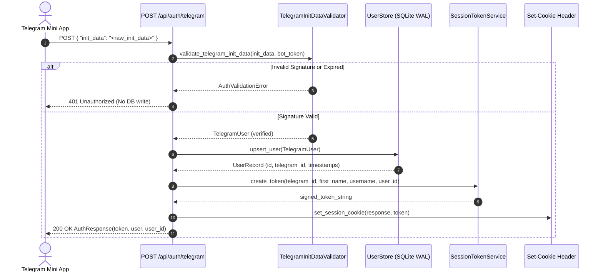

# Authentication and User Persistence

## Overview

The `wishenka.auth` and `wishenka.users` modules provide end-to-end cryptographic authentication,
stateless session management, and durable user profile persistence for the **Wishlist Service
(«Вишенка»)** Telegram Mini App (TMA).

Because the application runs inside Telegram WebView and serves dynamic interfaces using
**FastAPI + Jinja2 + HTMX**, the authentication and identity architecture satisfies four goals:
1. **Cryptographic verification**: Validate the initial Telegram WebApp `initData` using
   HMAC-SHA256 and the Telegram Bot API token.
2. **Durable user persistence**: Idempotently persist and synchronize user profiles in SQLite WAL
   storage, generating an internal `user_id` decoupled from external platform identifiers.
3. **Stateless signed sessions**: Issue lightweight HMAC-SHA256 signed session tokens embedding
   internal `user_id` and Telegram attributes, allowing $O(1)$ memory verification without
   database queries on subsequent requests.
4. **Dual-mode credentials**: Support native browser cookie transmission for HTMX requests while
   simultaneously accepting `Authorization: Bearer <token>` headers for REST API clients and tests.

> [!NOTE]
> **Implemented Baseline & `WISHENKA-33` vs. Planned `WISHENKA-32` Extensions (`WISHENKA-34/35`):** The sections below describe the shipped authentication and `users` baseline plus the implemented `locale` / `locale_source` synchronization (`WISHENKA-33`, see [i18n.md](i18n.md)). Agreed target extensions from `WISHENKA-32` — `TelegramUser.photo_url` extraction (`WISHENKA-34`) and `users.id` liveness plus `deleted_session_revocations` session invalidation (`WISHENKA-35`) — are **not shipped in runtime code yet** and are documented as target contracts in [users.md](users.md) and the targeted notes below.

```
+------------------------------------------------------------------------------------+
|                             Telegram Client / Mini App                             |
| 1. Launch TMA -> window.Telegram.WebApp.initData                                   |
| 2. POST /api/auth/telegram {"init_data": "..."}                                    |
+------------------------------------------------------------------------------------+
                                         |
                                         v
+------------------------------------------------------------------------------------+
|                                 FastAPI Backend                                    |
| 1. validate_telegram_init_data(...)                                                |
|    - Verify HMAC-SHA256 signature using bot_token                                  |
|    - Check auth_date freshness & clock drift -> TelegramUser                       |
| 2. UserStore.upsert_user(user)                                                     |
|    - Atomic SQLite ON CONFLICT(telegram_id) DO UPDATE ... RETURNING                |
|    - Logs user_created (first login) or user_updated (profile sync)                |
|    - Produces persistent UserRecord(id=<internal_user_id>, ...)                    |
| 3. SessionTokenService.create_token(...)                                           |
|    - Pack SessionClaims (user_id, telegram_id, username, exp, iat)                 |
|    - Sign token (<payload_b64>.<sig_b64>) with secret_key                          |
| 4. Set-Cookie: session_id=<token>; HttpOnly; Secure; SameSite=None                 |
|    Return JSON: {"token": "...", "user": {...}, "user_id": <int>}                  |
+------------------------------------------------------------------------------------+
                                         |
                                         v
+------------------------------------------------------------------------------------+
|                         Subsequent HTMX / API Requests                             |
| - HTMX sends Cookie: session_id=<token>                                            |
| - API clients send Authorization: Bearer <token>                                   |
| - Depends(get_current_user) verifies token -> AuthenticatedUser(user_id, ...)       |
+------------------------------------------------------------------------------------+
```

---

## Architecture & Components

The authentication and user identity subsystem is organized into modular packages under
`wishenka.auth`, `wishenka.users`, and `wishenka.web.routes.auth`:

```
wishenka/
├── auth/
│   ├── __init__.py           # Public exports (models, session, validator)
│   ├── models.py             # DTOs, schemas, and exception hierarchy
│   ├── init_data.py          # Telegram initData cryptographic validation
│   ├── session.py            # Signed session tokens and cookie helpers
│   └── dependencies.py       # FastAPI dependencies (get_current_user, get_user_store)
├── users/
│   ├── __init__.py           # Public exports (UserRecord, UserStore)
│   ├── models.py             # UserRecord domain entity dataclass
│   └── store.py              # UserStore async SQLite repository
└── web/
    ├── routes/
    │   └── auth.py           # Endpoints: /api/auth/telegram, /logout, /me, /csrf
    └── security.py           # CSRF and Origin verification (see doc/dev/miniapp.md)
```

### 1. `wishenka.auth.init_data`
Provides cryptographic parsing and verification for Telegram WebApp initialization data:
- `validate_telegram_init_data(init_data_raw, bot_token, max_age_seconds, clock_drift_seconds)`:
  Parses query parameters, verifies HMAC-SHA256 signature against `bot_token`, enforces timestamp
  freshness, and returns a validated `TelegramUser`.
- `parse_telegram_init_data(init_data_raw)`: Parses query string into `TelegramInitData` DTO
  without cryptographic verification.
- `TelegramInitDataValidator`: Stateful validator class encapsulating `bot_token` and TTL settings.

### 2. `wishenka.users.store` & `wishenka.users.models`
Provides transactional SQLite storage and domain models for persisted user accounts:
- `UserRecord`: Frozen dataclass representing a persisted user profile in the database (`id`,
  `telegram_id`, `first_name`, `last_name`, `username`, `language_code`, `is_premium`,
  `created_at`, `updated_at`).
- `UserStore`: Asynchronous repository providing atomic upsert and fast lookup operations:
  - `initialize()`: Sets SQLite WAL pragmas and creates table and index structures idempotently.
  - `upsert_user(user)`: Inserts new user or updates mutable fields on returning login.
  - `get_by_telegram_id(telegram_id)`: Fetches user record by 64-bit Telegram ID.
  - `get_by_id(user_id)`: Fetches user record by internal integer primary key.
  - `dispose()`: Disposes SQLAlchemy async engine connection pool.

### 3. `wishenka.auth.session`
Handles stateless session token issuance, signature verification, and HTTP cookie lifecycle:
- `SessionTokenService`: Generates and verifies URL-safe signed tokens in `<payload_b64>.<sig_b64>`
  format using HMAC-SHA256.
- `SessionClaims`: Pydantic model representing claims embedded inside the token payload
  (`telegram_id`, `first_name`, `username`, `user_id`, `iat`, `exp`).
- `set_session_cookie(response, token, settings)`: Sets the `HttpOnly`, `SameSite=None`, `Secure`
  session cookie on outgoing responses.
- `delete_session_cookie(response, settings)`: Clears the session cookie on logout.

### 4. `wishenka.auth.dependencies`
FastAPI dependency injection utilities for protecting route handlers and resolving storage:
- `get_current_user`: Enforces valid authentication. Returns `AuthenticatedUser` containing
  `user_id` and Telegram attributes, or raises `HTTPException(401)`.
- `get_optional_current_user`: Resolves `AuthenticatedUser` if valid credentials exist, or returns
  `None` for public/guest requests.
- `get_user_store`: Resolves `UserStore` instance from `request.app.state.user_store` with fallback
  to configured database URL.
- `get_settings`: Resolves `Settings` instance from `request.app.state` or instantiates defaults.

### 5. `wishenka.auth.models`
Defines domain models, request/response schemas, and exception types:
- `AuthenticatedUser`: Request caller identity (`telegram_id`, `first_name`, `username`,
  `auth_method`, `user_id`).
- `TelegramUser`: Telegram user profile extracted from `initData` (`id`, `first_name`, `last_name`,
  `username`, `language_code`, `is_premium`).
- `TelegramInitData`: Parsed representation of raw initData query parameters.
- `TelegramAuthRequest`: Request schema for `POST /api/auth/telegram` containing `init_data: str`.
- `AuthResponse`: Response schema containing `token: str`, `user: TelegramUser`, and
  `user_id: int | None`.
- Exception hierarchy:
  - `AuthValidationError`: Base exception for all authentication failures.
  - `InvalidSignatureError`: Raised when HMAC signature does not match.
  - `ExpiredInitDataError`: Raised when `auth_date` is expired or too far in the future.
  - `MalformedInitDataError`: Raised when query string is empty, missing required keys (`hash`,
    `auth_date`, `user`), or contains invalid JSON.

### 6. `wishenka.web.routes.auth`
FastAPI APIRouter mounted at `/api/auth`:
- `POST /api/auth/telegram`: Cryptographically validates `initData`, upserts user profile into
  storage, issues signed session token containing `user_id`, sets cookie, and returns
  `AuthResponse`.
- `POST /api/auth/logout`: Clears the session cookie and logs audit event.
- `GET /api/auth/me`: Returns identity attributes (`telegram_id`, `first_name`, `username`,
  `auth_method`, `user_id`) of the current caller.
- `GET /api/auth/csrf`: Issues session-bound CSRF token for browser-initiated mutations.

### Planned Target Contracts (`WISHENKA-32` -> `WISHENKA-33/34/35`)

> [!IMPORTANT]
> The contracts below are agreed in `WISHENKA-32` and **not yet implemented** in runtime code.

- **`TelegramUser.photo_url` & Avatar Sync (`WISHENKA-34`)**: `wishenka.auth.models.TelegramUser` adds optional `photo_url` extracted from verified `initData`, accepting `https://` URLs only (Bot API proxy URLs `api.telegram.org/file/bot<TOKEN>/...` are rejected to protect `bot_token`). `UserStore.upsert_user(..., sync_avatar=True)` updates or clears `avatar_url` when `photo_url` is omitted in `initData`, while bot updates pass `sync_avatar=False` so missing `photo_url` on `aiogram.types.User` does not erase an existing avatar.
- **`locale` / `locale_source` Sync (`WISHENKA-33`, Implemented)**: `UserStore.upsert_user` uses atomic SQL `CASE WHEN users.locale_source = 'explicit' THEN users.locale ELSE excluded.locale END` with `'ru'`/`'en'` normalization (`'en'` default fallback). Explicit switching via `PATCH /api/profile/locale` (`UserStore.set_locale`) persists `locale_source = 'explicit'` in SQLite WAL; `locale` is **not** cached inside `SessionClaims` so TMA SSR, Bot `LocaleMiddleware`, and notice workers stay immediately consistent (see [i18n.md](i18n.md)).
- **Session Revocation on Account Deletion (`WISHENKA-35`)**: Currently `get_optional_current_user` verifies tokens purely in memory. In `WISHENKA-35`, `AccountDeletionService` deletes `users` and writes `(subject_hash, revoked_before, expires_at)` into `deleted_session_revocations` (`subject_hash = HMAC-SHA256(secret_key, f"deleted:{telegram_id}")`) inside a single `BEGIN IMMEDIATE` transaction, and `get_optional_current_user` enforces:
  - For tokens with `claims.user_id is not None`: `SELECT 1 FROM users WHERE id = :user_id AND telegram_id = :tg_id` (returning `401` if absent; skipped only if the `users` table does not exist in isolated route tests). Because `users.id` uses `AUTOINCREMENT`, immediate re-registration gets a new `users.id` while old tokens on all devices remain permanently invalid.
  - For tokens with `claims.user_id is None`: lookup in `deleted_session_revocations` by `subject_hash`, returning `401` when `claims.iat <= revoked_before`.

---

## Cryptographic Validation Protocol

Telegram Mini Apps sign initialization query strings with the bot token. The backend verifies
this signature before trusting any data or performing storage operations.

### Step-by-Step Verification Algorithm

1. **Parse Query String**:
   The raw query string (e.g. `auth_date=1700000000&user=...&hash=...`) is parsed into key-value
   pairs using `urllib.parse.parse_qsl(keep_blank_values=True)`.

2. **Extract and Isolate Hash**:
   The `hash` parameter is removed from the dictionary and kept as `received_hash`. If `hash` is
   missing, validation fails with `MalformedInitDataError`.

3. **Construct Data Check String**:
   All remaining key-value pairs are sorted alphabetically by key and concatenated with newline
   characters `\n`:
   ```python
   data_check_string = "\n".join(f"{k}={v}" for k, v in sorted(params.items()))
   ```

4. **Derive Secret Key**:
   A secret key is derived using HMAC-SHA256 with constant string `"WebAppData"` as key, and
   the bot token as message:
   ```python
   secret_key = hmac.new(
       b"WebAppData", bot_token.encode("utf-8"), hashlib.sha256
   ).digest()
   ```

5. **Compute Expected Hash**:
   The signature is computed over `data_check_string` using `secret_key`:
   ```python
   expected_hash = hmac.new(
       secret_key, data_check_string.encode("utf-8"), hashlib.sha256
   ).hexdigest()
   ```

6. **Constant-Time Comparison**:
   The received hash is verified against the expected hash using `hmac.compare_digest` to prevent
   timing attacks:
   ```python
   if not hmac.compare_digest(expected_hash, received_hash):
       raise InvalidSignatureError("Telegram initData signature verification failed")
   ```

7. **Timestamp Freshness & Clock Drift Checks**:
   The `auth_date` parameter (Unix timestamp) is validated against the server clock:
   - **Future drift**: If `auth_date > now + clock_drift_seconds` (default 60s), reject with
     `ExpiredInitDataError`.
   - **Replay / age check**: If `now - auth_date > max_age_seconds` (default 86400s / 24 hours),
     reject with `ExpiredInitDataError`.

8. **User Deserialization**:
   The `user` JSON string is parsed and validated against `TelegramUser`.

---

## User Persistence Subsystem (`wishenka.users`)

The user persistence subsystem provides durable storage for user identities within the Wishenka
SQLite database, decoupling internal database relationships from external Telegram identifiers.

### 1. SQLite Storage Architecture & Pragmas

Wishenka uses SQLite with `aiosqlite` and Write-Ahead Logging (WAL) per project architecture:
- `PRAGMA journal_mode = WAL;`: Enables concurrent readers to execute without blocking writers,
  and writers to operate without blocking readers.
- `PRAGMA foreign_keys = ON;`: Enforces referential integrity for child tables (`wishlists`,
  `reservations`).
- `PRAGMA busy_timeout = 5000;`: Waits up to 5000ms during concurrent write contention, preventing
  `sqlite3.OperationalError: database is locked`.

### 2. Database Schema: `users` Table

```sql
CREATE TABLE IF NOT EXISTS users (
    id INTEGER PRIMARY KEY AUTOINCREMENT,
    telegram_id INTEGER NOT NULL UNIQUE,
    first_name TEXT NOT NULL,
    last_name TEXT,
    username TEXT,
    language_code TEXT,
    is_premium INTEGER NOT NULL DEFAULT 0,
    created_at TEXT NOT NULL,
    updated_at TEXT NOT NULL
);

CREATE UNIQUE INDEX IF NOT EXISTS idx_users_telegram_id ON users(telegram_id);
CREATE INDEX IF NOT EXISTS idx_users_username ON users(username);
```

#### Field Specifications

| Column | Type | Nullable | Constraints & Defaults | Description |
|---|---|---|---|---|
| `id` | INTEGER | NO | PRIMARY KEY AUTOINCREMENT | Internal unique user surrogate ID |
| `telegram_id` | INTEGER | NO | UNIQUE | External 64-bit Telegram user ID |
| `first_name` | TEXT | NO | None | User's display first name |
| `last_name` | TEXT | YES | DEFAULT NULL | Optional user last name |
| `username` | TEXT | YES | DEFAULT NULL | Optional Telegram handle (without `@`) |
| `language_code` | TEXT | YES | DEFAULT NULL | Optional language code (e.g. `'ru'`, `'en'`) |
| `is_premium` | INTEGER | NO | DEFAULT 0 | Telegram Premium flag (`0` or `1`) |
| `created_at` | TEXT | NO | ISO-8601 UTC string | Initial account registration timestamp |
| `updated_at` | TEXT | NO | ISO-8601 UTC string | Latest profile synchronization timestamp |

### 3. Domain Model: `UserRecord`

Defined in `wishenka.users.models`:

```python
from dataclasses import dataclass
from datetime import datetime


@dataclass(frozen=True)
class UserRecord:
    """Represents a persisted user profile in the database."""

    id: int
    telegram_id: int
    first_name: str
    last_name: str | None
    username: str | None
    language_code: str | None
    is_premium: bool
    created_at: datetime
    updated_at: datetime
```

### 4. Repository: `UserStore`

Implemented in `wishenka.users.store.UserStore`. Key methods include:

#### `initialize() -> None`
Idempotently establishes SQLite connection settings (`WAL`, `foreign_keys=ON`, `busy_timeout=5000`)
and creates the `users` table and indexes if they do not already exist.

#### `upsert_user(user: TelegramUser) -> UserRecord`
Atomically inserts a new user record or updates mutable profile attributes (`first_name`,
`last_name`, `username`, `language_code`, `is_premium`, `updated_at`) for existing accounts.
- Uses SQLite native `ON CONFLICT(telegram_id) DO UPDATE ... RETURNING ...` to ensure zero race
  conditions under concurrent logins.
- Detects whether the account is newly created or returning, emitting structured audit logs:
  - `user_created` when an unrecognized `telegram_id` registers.
  - `user_updated` when a returning user authenticates.
- Returns the complete `UserRecord` including internal `id` and timestamps in a single round-trip.

#### `get_by_telegram_id(telegram_id: int) -> UserRecord | None`
Searches for a user by external 64-bit Telegram ID using index `idx_users_telegram_id`. Returns
`UserRecord` or `None`.

#### `get_by_id(user_id: int) -> UserRecord | None`
Searches for a user by internal primary key `id`. Returns `UserRecord` or `None`.

#### `dispose() -> None`
Gracefully disposes the SQLAlchemy async connection pool on application shutdown.

---

## Authentication Flow & Session Linkage

The complete lifecycle for authenticating a user and issuing an attributed session:



### Route Handler Implementation

```python
@router.post("/telegram", response_model=AuthResponse)
async def auth_telegram(
    payload: TelegramAuthRequest,
    response: Response,
    settings: Annotated[Settings, Depends(get_settings)],
    user_store: Annotated[UserStore, Depends(get_user_store)],
) -> AuthResponse:
    # 1. Cryptographic validation of initData
    try:
        user = validate_telegram_init_data(
            init_data_raw=payload.init_data,
            bot_token=settings.bot_token,
            max_age_seconds=settings.telegram_auth_max_age_seconds,
        )
    except AuthValidationError as err:
        raise HTTPException(
            status_code=status.HTTP_401_UNAUTHORIZED,
            detail=f"Invalid initData: {err}",
        ) from err

    # 2. Persist or synchronize user profile in storage
    user_record = await user_store.upsert_user(user)

    # 3. Create signed session token embedding internal user_id
    service = SessionTokenService(
        secret_key=settings.secret_key,
        default_ttl_seconds=settings.session_ttl_seconds,
    )
    token = service.create_token(
        telegram_id=user.id,
        first_name=user.first_name,
        username=user.username,
        user_id=user_record.id,
    )

    # 4. Set session cookie and emit success response
    set_session_cookie(response=response, token=token, settings=settings)
    return AuthResponse(token=token, user=user, user_id=user_record.id)
```

### Identity and Claims Linkage

- **Internal Surrogate Key**: Decouples domain entities (e.g., `wishlists.owner_id`) from
  third-party Telegram IDs.
- **Embedded `user_id`**: Storing `user_id` inside `SessionClaims` allows `get_current_user` to
  resolve both `current_user.user_id` and `current_user.telegram_id` without hitting SQLite on
  every subsequent request ($O(1)$ memory verification).
- **Backward Compatibility**: `user_id` defaults to `None` in `SessionClaims`, `AuthenticatedUser`,
  and `AuthResponse`. Existing active sessions issued before user persistence continue to work
  seamlessly without breaking.
- **Target Revocation Linkage (`WISHENKA-35`, planned)**: Once account deletion lands,
  `get_optional_current_user` will verify `users.id` + `telegram_id` existence (and check
  `deleted_session_revocations` when `claims.user_id is None`) so deleted accounts cannot keep
  using stateless tokens on any device, even after immediate re-registration (`AUTOINCREMENT`).
  See [users.md](users.md) for the full contract.

---

## Session Token and Cookie Architecture

Wishenka uses a **stateless signed token** pattern designed for high-throughput HTMX interactions
without database lookup overhead on protected routes.

### Token Structure

Session tokens are formatted as:
```text
<payload_b64>.<sig_b64>
```

- `<payload_b64>`: URL-safe Base64-encoded JSON representation of `SessionClaims` (without
  trailing padding `=`).
- `<sig_b64>`: URL-safe Base64-encoded HMAC-SHA256 digest of `<payload_b64>` signed with
  `settings.secret_key`.

```python
claims = SessionClaims(
    telegram_id=279058397,
    first_name="Vladislav",
    username="vlad",
    user_id=42,
    iat=1700000000,
    exp=1702592000,
)
```

### Dual-Mode Authentication

FastAPI dependencies check credentials in the following order:
1. **Authorization Header**: `Authorization: Bearer <token>`
   - Detected first.
   - Sets `AuthenticatedUser.auth_method = "bearer"`.
   - Used by API clients, automated scripts, and test cases.
2. **Session Cookie**:
   - Checked if no Bearer header is present.
   - Looks for `settings.session_cookie_name` (default `session_id`), with fallback to
     `wishenka_session`.
   - Sets `AuthenticatedUser.auth_method = "cookie"`.
   - Used by HTMX and Mini App WebView browsers.

### Cookie Configuration for Telegram Mini Apps

Telegram Mini Apps frequently run in cross-site iframes (e.g. `https://web.telegram.org` embedding
`https://your-domain.com`). This requires specific cookie attributes:

| Cookie Attribute | Production Setting | Purpose |
| :--- | :--- | :--- |
| `HttpOnly` | `True` | Prevents JavaScript access, protecting against session theft via XSS. |
| `SameSite` | `None` | Allows browser to attach cookie in cross-site iframe contexts. |
| `Secure` | `True` | Required by browsers when `SameSite=None`. Cookie sent over HTTPS only. |
| `Path` | `/` | Applies to all application routes and API endpoints. |
| `Max-Age` | `2592000` (30 days) | Provides seamless user experience without frequent re-logins. |
| `Domain` | `None` (or custom) | Restricts or shares cookies across subdomains. |

> [!NOTE]
> In local development environments operating over plain HTTP (`http://localhost`), set
> `session_cookie_secure: False` and `session_cookie_samesite: "lax"`.

### CSRF Protection for Cookie Sessions

Because `SameSite=None` allows cookies to be sent across origins, all state-changing browser
requests (`POST`, `PATCH`, `DELETE`) are protected by `BrowserSecurityMiddleware` and require:
1. An `Origin` header matching `WISHENKA_APPLICATION_ORIGIN`.
2. A session-bound CSRF token obtained via `GET /api/auth/csrf` and passed in `X-CSRF-Token`.
For full details, see [miniapp.md](miniapp.md).

---

## Observability & Security Guarantees

### Structured Logging Events

Structured logging across authentication and user persistence uses dedicated loggers
(`wishenka.users`, `wishenka.auth`, `wishenka.web`):

- **`user_created`** (`wishenka.users`, level `INFO`):
  - Emitted when an unrecognized `telegram_id` registers for the first time.
  - Context fields: `event="user_created"`, `user_id`, `telegram_id`.
- **`user_updated`** (`wishenka.users`, level `INFO`):
  - Emitted when a returning user authenticates and updates mutable profile fields.
  - Context fields: `event="user_updated"`, `user_id`, `telegram_id`.
- **`auth_success`** (`wishenka.auth`, level `INFO`):
  - Emitted upon successful cryptographic validation and session token generation.
  - Context fields: `event="auth_success"`, `user_id`, `telegram_id`, `username`.
- **`auth_failure`** (`wishenka.auth`, level `WARNING`):
  - Emitted on authentication rejection (signature failure, expired `initData`, invalid token).
  - Context fields: `event="auth_failure"`, `reason`.
- **`logout`** (`wishenka.auth`, level `INFO`):
  - Emitted upon session termination.
  - Context fields: `event="logout"`, `telegram_id`, `username`.
- **`csrf_token_issued`** (`wishenka.auth`, level `INFO`):
  - Emitted when a CSRF token is issued for an authenticated cookie session.
  - Context fields: `event="csrf_token_issued"`, `telegram_id`.
- **`csrf_cookie_missing`** (`wishenka.auth`, level `WARNING`):
  - Emitted when a CSRF token request is attempted without an active session cookie.
  - Context fields: `event="csrf_cookie_missing"`, `telegram_id`.
- **`init_data_validated`** (`wishenka.auth`, level `DEBUG`):
  - Emitted when Telegram `initData` signature is cryptographically verified.
  - Context fields: `event="init_data_validated"`, `telegram_id`.
- **`auth_session_resolved`** (`wishenka.auth`, level `DEBUG`):
  - Emitted when session credentials decode into authenticated user claims.
  - Context fields: `event="auth_session_resolved"`, `telegram_id`, `auth_method`.

### Zero Secret Leakage Guarantees

All authentication and persistence components enforce strict security and privacy invariants:
- **Bot Secret Protection**: The Telegram Bot API token (`bot_token`) is strictly excluded from
  all log messages, exception details, and structured context attributes.
- **Session Token Protection**: Issued session tokens (cookies and Bearer headers) are never
  printed or attached to log records.
- **HMAC Signature Redaction**: Raw `hash` parameters from Telegram `initData` and expected digests
  are never written to logs.
- **Constant-Time Verification**: Constant-time comparison (`hmac.compare_digest`) prevents
  timing side-channel attacks during signature verification.
- **Guest Request Isolation**: Unauthenticated guest requests to public endpoints do not trigger
  database writes to the `users` table or generate user identity logs.
- **Planned `WISHENKA-33/34/35` Observability Contract**: Target events for avatar validation
  (`profile_avatar_rejected`), explicit/auto locale sync, and revoked-session rejection
  (`session_rejected_revoked_or_deleted` using pseudonymous `subject_hash_prefix` without logging
  `telegram_id`, PII, tokens, or Bot API file URLs) are specified in [users.md](users.md#observability-and-privacy-contract).

---

## FastAPI Dependencies Usage

### Enforcing Authentication (`get_current_user`)

Use `get_current_user` for protected endpoints that require an authenticated caller. If the caller
is unauthenticated or the session has expired, FastAPI automatically responds with
`401 Unauthorized`.

```python
from typing import Annotated
from fastapi import APIRouter, Depends
from wishenka.auth import AuthenticatedUser, get_current_user

router = APIRouter()


@router.get("/api/wishlists/my")
async def get_my_wishlists(
    current_user: Annotated[AuthenticatedUser, Depends(get_current_user)],
):
    return {
        "user_id": current_user.user_id,
        "telegram_id": current_user.telegram_id,
        "name": current_user.first_name,
        "auth_method": current_user.auth_method,
    }
```

### Optional Authentication (`get_optional_current_user`)

Use `get_optional_current_user` for endpoints accessible to both guests and authenticated users
(e.g., viewing a public wishlist).

```python
from typing import Annotated
from fastapi import APIRouter, Depends
from wishenka.auth import AuthenticatedUser, get_optional_current_user

router = APIRouter()


@router.get("/w/{public_slug}")
async def view_public_wishlist(
    public_slug: str,
    user: Annotated[AuthenticatedUser | None, Depends(get_optional_current_user)],
):
    if user is not None:
        # Authenticated view: show user's existing reservations
        return {"slug": public_slug, "viewer_id": user.user_id, "is_guest": False}
    # Guest view: allow reserving with guest prompt
    return {"slug": public_slug, "viewer_id": None, "is_guest": True}
```

### Accessing User Storage (`get_user_store`)

```python
from typing import Annotated
from fastapi import APIRouter, Depends
from wishenka.auth.dependencies import get_user_store
from wishenka.users.store import UserStore

router = APIRouter()


@router.get("/api/users/{user_id}")
async def get_user_profile(
    user_id: int,
    user_store: Annotated[UserStore, Depends(get_user_store)],
):
    user = await user_store.get_by_id(user_id)
    if user is None:
        raise HTTPException(status_code=404, detail="User not found")
    return {"id": user.id, "first_name": user.first_name}
```

---

## Configuration Reference

All settings can be configured via environment variables with `WISHENKA_` prefix or via `.env`:

- **`database_url`** (`WISHENKA_DATABASE_URL`):
  - Type: `str` | Default: `"sqlite+aiosqlite:///wishenka.db"`
  - Description: SQLite database connection URL for user and domain persistence.
- **`bot_token`** (`WISHENKA_BOT_TOKEN`):
  - Type: `str` | Default: `"dummy_bot_token"`
  - Description: Telegram Bot API token used to derive HMAC key for `initData` validation.
- **`secret_key`** (`WISHENKA_SECRET_KEY`):
  - Type: `str` | Default: `"wishenka_default_secret_key_change_in_prod"`
  - Description: Secret key used to sign and verify session tokens.
- **`session_secret_key`** (`WISHENKA_SESSION_SECRET_KEY`):
  - Type: `str` | Default: `"wishenka_default_secret_key_change_in_prod"`
  - Description: Dedicated session signing key (falls back to `secret_key`).
- **`session_cookie_name`** (`WISHENKA_SESSION_COOKIE_NAME`):
  - Type: `str` | Default: `"session_id"`
  - Description: Name of HTTP session cookie.
- **`session_ttl_seconds`** (`WISHENKA_SESSION_TTL_SECONDS`):
  - Type: `int` | Default: `2592000` (30 days)
  - Description: Session token validity duration in seconds.
- **`session_cookie_secure`** (`WISHENKA_SESSION_COOKIE_SECURE`):
  - Type: `bool` | Default: `False`
  - Description: Require HTTPS for session cookie. Set to `True` in production.
- **`session_cookie_samesite`** (`WISHENKA_SESSION_COOKIE_SAMESITE`):
  - Type: `str` | Default: `"none"`
  - Description: SameSite policy (`"none"`, `"lax"`, or `"strict"`).
- **`session_cookie_domain`** (`WISHENKA_SESSION_COOKIE_DOMAIN`):
  - Type: `str | None` | Default: `None`
  - Description: Optional cookie domain for sharing sessions across subdomains.
- **`telegram_auth_max_age_seconds`** (`WISHENKA_TELEGRAM_AUTH_MAX_AGE_SECONDS`):
  - Type: `int` | Default: `86400` (24h)
  - Description: Maximum allowable age of `initData` `auth_date` before expiration.

---

## Troubleshooting & Failure Modes

### 1. `401 Invalid initData: Telegram initData signature verification failed`
- **Root Cause**: The computed HMAC-SHA256 signature does not match `hash`.
- **Diagnosis**:
  - Verify that `WISHENKA_BOT_TOKEN` matches the exact bot that launched the Mini App.
  - Ensure client sends raw query string without double-decoding or modifying parameter order.
  - Verify that parameters are sorted by key with `\n` separator.

### 2. `401 Invalid initData: initData auth_date has expired`
- **Root Cause**: `auth_date` in `initData` is older than `telegram_auth_max_age_seconds` (24h).
- **Diagnosis**:
  - Mini App was left open in background or restored from stale cache.
  - Trigger `Telegram.WebApp.close()` or call `initData` refresh on the client.

### 3. `401 Invalid initData: initData auth_date is in the future`
- **Root Cause**: Server clock is out of sync with Telegram servers by more than 60 seconds.
- **Diagnosis**:
  - Verify NTP synchronization on the host (`timedatectl status` or `chrony`).

### 4. Database Busy / Locked (`sqlite3.OperationalError: database is locked`)
- **Root Cause**: Heavy concurrent write bursts exceeding SQLite default lock wait.
- **Diagnosis**:
  - Verify `PRAGMA busy_timeout = 5000;` is applied on startup.
  - Verify SQLite WAL journal mode is active (`PRAGMA journal_mode = WAL;`).

### 5. Session Cookies Not Saved in Browser / Mini App
- **Root Cause**: Browser rejected cookie due to SameSite / Secure policy mismatch.
- **Diagnosis**:
  - In modern browsers, `SameSite=None` **must** be paired with `Secure=True` over HTTPS.
  - If developing locally over HTTP, ensure `session_cookie_samesite` is set to `"lax"` or use an
    HTTPS tunnel (e.g., ngrok / cloudflared).

### 6. `401 Invalid session token: Session token expired`
- **Root Cause**: Client token `exp` timestamp is earlier than current server time.
- **Diagnosis**:
  - The user's 30-day session expired. Frontend should capture 401 and re-initiate TMA handshake.

### 7. `401 Invalid session token: Session token signature verification failed`
- **Root Cause**: Token was signed with a different `secret_key` or tampered with.
- **Diagnosis**:
  - Ensure `WISHENKA_SECRET_KEY` is persistent across backend restarts and shared across replicas.
