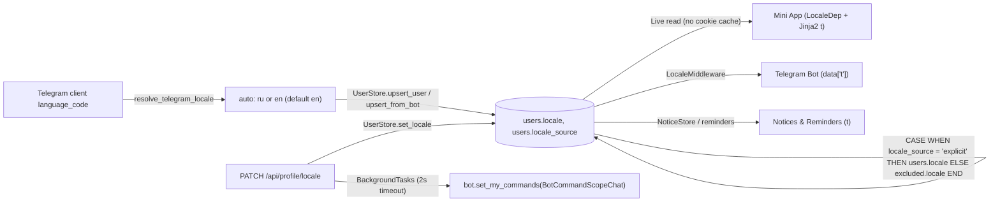

# Bilingual Localization (`RU` / `EN` i18n)

## Overview

The `wishenka.i18n` subsystem provides synchronized Russian (`ru`) and English (`en`) localization across all user-facing channels:

- **Telegram Mini App (TMA)**: Server-side rendered Jinja2 templates, HTMX fragments, JSON responses, and client-side shell labels (`miniapp.js`).
- **Telegram Bot (`aiogram` v3)**: Localized replies, inline/reply keyboards, and per-chat Telegram command menus (`setMyCommands`).
- **Asynchronous Notifications & Reminders**: Outbox gift notices (`NoticeStore` / `NoticeWorker`) and birthday/event reminders (`wishenka/notices/reminders.py`).

A single persisted preference in SQLite WAL (`users.locale` and `users.locale_source`) acts as the source of truth across all channels, with `'en'` as the universal default fallback.

---

## Architecture

### Key Components

- **`wishenka/i18n/locale.py`**: Language tag normalization (`resolve_optional_locale`, `resolve_telegram_locale`), HTTP `Accept-Language` quality-factor parsing (`resolve_accept_language`), and strict explicit-choice validation (`validate_locale`).
- **`wishenka/i18n/catalog.py`**: Centralized `CATALOG` (`"en"` and `"ru"` dictionaries) and `t(key, locale, **kwargs)` lookup with safe fallback to `"en"` (or `key` if absent) and `WARNING` logging (`i18n_missing_translation_key`).
- **`wishenka/i18n/dependencies.py`**: FastAPI `get_request_locale` / `LocaleDep` dependency. Reads live `users.locale` from `UserStore` for authenticated requests (never cached in `SessionClaims` cookies) and falls back to `?lang=` -> `Accept-Language` -> `'en'` for anonymous visitors.
- **`wishenka/users/store.py` & `wishenka/wishlists/alembic/versions/add_user_locale.py`**: Persists `locale` (`'ru'` | `'en'`) and `locale_source` (`'auto'` | `'explicit'`). Both `UserStore.initialize()` and Alembic revision `add_user_locale` maintain identical DDL and backfill existing rows from `language_code`.
- **`wishenka/web/routes/profile.py` & `wishenka/web/templates/`**: Exposes `GET /settings` (`settings.html`) and `PATCH /api/profile/locale` (returning `HX-Refresh: true` and scheduling best-effort bot command sync via `BackgroundTasks`). Jinja2 environment (`wishenka/web/templates.py`) injects `t` and `supported_locales` globals.
- **`wishenka/bot/i18n.py`**: Outer `LocaleMiddleware` (attached to `entry.create_router`) that upserts the private-chat user via `UserStore.upsert_from_bot` and injects `data["locale"]` and `data["t"]`, plus `sync_user_bot_commands` for timeout-bounded per-chat `setMyCommands`.
- **`wishenka/notices/store.py` & `wishenka/notices/reminders.py`**: Resolve recipient locale from `users.locale` (with `'en'` fallback) at claim/refresh time right before Telegram delivery, so pending outbox items reflect recent language switches.

### Locale Resolution & Precedence

1. **First login / bot `/start`**: `locale_source` starts as `'auto'`. `language_code` starting with `'ru'` (e.g. `'ru'`, `'ru-RU'`, `'ru_RU'`) maps to `'ru'`; everything else maps to `'en'`.
2. **Automatic updates (`locale_source = 'auto'`)**: Subsequent Mini App logins or private bot interactions update `users.locale` atomically if the user's Telegram client `language_code` changes.
3. **Explicit override (`locale_source = 'explicit'`)**: Calling `PATCH /api/profile/locale` locks `locale_source = 'explicit'`. Future Telegram logins or bot updates still refresh `users.language_code`, but never overwrite `users.locale`.

---

## API / Usage

### Python Functions and Classes (`wishenka.i18n`)

#### `resolve_optional_locale(language_code)`

Normalizes a language tag (e.g. `"ru-RU"`, `"en_US"`) to `"ru"` or `"en"` if supported, otherwise returns `None`.

- **language_code**: `str | None`
- **Returns**: `SupportedLocale | None` (`"ru"`, `"en"`, or `None`)

#### `resolve_telegram_locale(language_code)`

Normalizes a Telegram or client language code to `"ru"` or `"en"`, falling back to `DEFAULT_LOCALE` (`"en"`).

- **language_code**: `str | None`
- **Returns**: `SupportedLocale`

#### `resolve_accept_language(header)`

Parses an HTTP `Accept-Language` header, respects `q=` quality weights (ignoring invalid or `q=0` entries), and resolves the highest-priority tag via `resolve_telegram_locale`.

- **header**: `str | None`
- **Returns**: `SupportedLocale`

#### `validate_locale(raw)`

Validates an explicit user locale choice.

- **raw**: `object`
- **Returns**: `SupportedLocale` (`"ru"` or `"en"`)
- **Raises**: `ValueError` if `raw` is not `"ru"` or `"en"`.

#### `t(key, locale=DEFAULT_LOCALE, **kwargs)`

Renders a translated string from `CATALOG` for the given `locale` (`"ru"` or `"en"`, defaulting to `"en"`). If `key` is missing in `"ru"`, falls back to `"en"` (and logs `WARNING`); if missing in both, logs `WARNING` and returns `key`.

- **key**: `str` — dot-namespaced catalog key (e.g. `"settings.title"`).
- **locale**: `str | None` — target locale (`"ru"` or `"en"`).
- **kwargs**: `Any` — `str.format(**kwargs)` placeholders.
- **Returns**: `str`

#### `LocaleDep` / `get_request_locale`

FastAPI dependency (`Annotated[SupportedLocale, Depends(get_request_locale)]`) that resolves the request locale from `UserStore` for authenticated users, or `?lang=` -> `Accept-Language` -> `"en"` for anonymous requests, and stores it on `request.state.locale`.

### Persistence & Bot Helpers

- **`UserStore.set_locale(telegram_id: int, locale: SupportedLocale) -> UserRecord`**: Persists `locale` and sets `locale_source = 'explicit'`; raises `UserNotFoundError` if the user does not exist.
- **`LocaleMiddleware(dependencies)`** (`wishenka/bot/i18n.py`): `aiogram` v3 outer middleware injecting `data["locale"]`, `data["t"]`, and `data["user_record"]` (for private chats).
- **`sync_user_bot_commands(bot, chat_id, locale, *, user_id=None, timeout_seconds=2.0) -> bool`**: Best-effort per-chat `set_my_commands` bounded by `asyncio.wait_for`. Skips when `bot.token` is empty or `PLACEHOLDER_TOKEN`.

### Mini App HTTP Endpoints

| Method & Path | Auth / CSRF | Description |
| --- | --- | --- |
| `GET /settings` | Authenticated user | Renders `settings.html` with current `locale` and `locale_source`. |
| `PATCH /api/profile/locale` | Authenticated user + CSRF | Accepts JSON `{"locale": "ru" \| "en"}` or form `locale=...`; returns `{"locale": ..., "locale_source": "explicit"}` with `HX-Refresh: true` and schedules background bot command sync. Returns `422` on invalid locale. |

### Adding New Translation Keys

1. Add the key to **both** `CATALOG["en"]` and `CATALOG["ru"]` in `wishenka/i18n/catalog.py`.
2. Keep `{placeholder}` names identical between `"en"` and `"ru"`.
3. Run `tests/test_i18n_unit.py` (which enforces key parity and placeholder parity across both catalogs).

---

## Configuration

| Setting | Env Variable | Behavior |
| --- | --- | --- |
| `database_url` | `WISHENKA_DATABASE_URL` | SQLite WAL database storing `users.locale` and `users.locale_source`. |
| `bot_token` | `WISHENKA_BOT_TOKEN` | Used by `PATCH /api/profile/locale` background task to call `setMyCommands`. Skipped when unset or equal to `PLACEHOLDER_TOKEN`. |

---

## Troubleshooting

- **User's language does not update when they change Telegram client language**:
  - Check `users.locale_source`. Once a user switches language via `PATCH /api/profile/locale`, `locale_source` becomes `'explicit'` and intentionally ignores `language_code` changes from Telegram.
- **Telegram bot command menu stays in the previous language after switching in Mini App**:
  - `sync_user_bot_commands` is best-effort with a `2.0s` timeout and requires an active row in `bot_destinations` (`active = 1`). Check logs for `event="bot_commands_locale_sync_failed"` (`WARNING`) or verify `WISHENKA_BOT_TOKEN` is not `PLACEHOLDER_TOKEN`.
  - The user's next `/start` in private chat also triggers `sync_user_bot_commands`.
- **Untranslated key rendered literally in UI or bot**:
  - Check logs for `event="i18n_missing_translation_key"` (`WARNING`) with `i18n_key` and `locale`, then add the missing key to `CATALOG` in `wishenka/i18n/catalog.py`.
- **Private bot interaction logs missing `wishenka.users` debug lines**:
  - Expected behavior: `_PrivateUserLogFilter` in `wishenka/bot/i18n.py` suppresses `wishenka.users` logs during private bot updates to avoid leaking user identifiers.
- **Legacy SQLite fixture missing `users.locale` column in reminders**:
  - `wishenka/notices/reminders.py` catches `sqlite3.OperationalError` (`"no such column"`) and falls back to `'en'`. For production DBs, run Alembic migrations (`upgrade_to_head_sync`).
