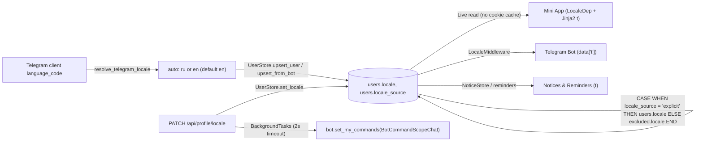

# Bilingual Localization (`RU` / `EN` i18n)

## Overview

The `wishenka.i18n` subsystem provides synchronized Russian (`ru`) and English (`en`) localization across all user-facing channels:

- **Telegram Mini App (TMA)**: Server-side rendered Jinja2 templates, HTMX fragments, JSON responses, and client-side shell labels (`miniapp.js`).
- **SSR Web Views & Sharing Pages**: Server-side rendered wishlist, sharing, invite, receipt, and reservation pages/partials (`base.html`, `sharing.py`, `items_ui.py`, `receipts_ui.py`, `reservations_ui.py`) and SSR-coupled scripts (`wishlist.js`, `receipt.js`).
- **Telegram Bot (`aiogram` v3)**: Localized replies, inline/reply keyboards, and per-chat Telegram command menus (`setMyCommands`).
- **Asynchronous Notifications & Reminders**: Outbox gift notices (`NoticeStore` / `NoticeWorker`) and birthday/event reminders (`wishenka/notices/reminders.py`).

A single persisted preference in SQLite WAL (`users.locale` and `users.locale_source`) acts as the source of truth across all channels, with `'en'` as the universal default fallback.

---

## Architecture

### Key Components

- **`wishenka/i18n/locale.py`**: Language tag normalization (`resolve_optional_locale`, `resolve_telegram_locale`), HTTP `Accept-Language` quality-factor parsing (`resolve_accept_language`), and strict explicit-choice validation (`validate_locale`).
- **`wishenka/i18n/catalog.py`**: Centralized `CATALOG` (`"en"` and `"ru"` dictionaries) covering `nav.*`, `settings.*`, `bot.*`, `notices.*`, `miniapp.*`, and `web.*` namespaces, `miniapp_catalog()` (re-exported by `wishenka/i18n/__init__.py`) projecting `nav.*` and `miniapp.*` keys for the Mini App, and `t(key, locale, **kwargs)` lookup with safe fallback to `"en"` (or `key` if absent) and `WARNING` logging (`i18n_missing_translation_key`).
- **`wishenka/i18n/formatters.py`**: Zero-dependency, OS-locale-independent date formatting (`format_date`, re-exported by `wishenka/i18n/__init__.py`) producing `DD.MM.YYYY` for `"ru"` and `MMM D, YYYY` for `"en"`.
- **`wishenka/web/routes/miniapp.py` & `wishenka/web/static/miniapp.js`**: `GET /` embeds `miniapp_catalog()` as `<script id="miniapp-i18n" type="application/json">` with XSS-safe JSON escaping (`\u003c`, `\u003e`, `\u0026`) under the strict `script-src 'self' https://telegram.org` CSP (no `'unsafe-inline'`, no extra network requests) and emits a `DEBUG` log (`miniapp_catalog_embedded`). `miniapp.js` renders all Mini App screens using `t()`, `activeLocale()`, `roleLabel()`, and `formatDateTime()`.
- **`wishenka/i18n/dependencies.py`**: FastAPI `get_request_locale` / `LocaleDep` dependency. Reads live `users.locale` from `UserStore` for authenticated requests (never cached in `SessionClaims` cookies) and falls back to `?lang=` -> `Accept-Language` -> `'en'` for anonymous visitors, setting `request.state.locale`.
- **`wishenka/users/store.py` & Alembic (`add_user_locale`, `unify_user_keys_and_cascades`)**: Persists `locale` (`'ru'` | `'en'`) and `locale_source` (`'auto'` | `'explicit'`). `UserStore.initialize()` delegates schema setup to `upgrade_to_head()`, and Alembic manages the `users` DDL and `language_code` backfill.
- **`wishenka/web/routes/profile.py` & `wishenka/web/templates.py`**: Exposes `GET /settings` (`settings.html`) and `PATCH /api/profile/locale` (returning `HX-Refresh: true` and scheduling best-effort bot command sync via `BackgroundTasks`). Jinja2 environment (`wishenka/web/templates.py`) registers `_locale_context_processor` (injecting `locale` from `request.state.locale`), `format_date` filter & global, and `t`, `DEFAULT_LOCALE`, `SUPPORTED_LOCALES`, `LOCALE_LABELS` globals.
- **SSR Web Routes & Templates (`sharing.py`, `items_ui.py`, `receipts_ui.py`, `reservations_ui.py`, `gifted_view.py`)**: All SSR page and HTMX partial routes depend on `LocaleDep` and localize route messages and dates with `t()` and `format_date()`. `base.html`, page templates, and SSR partials render localized copy and pass `data-i18n-*` attributes on `<body>` for `receipt.js`, `wishlist.js`, and inline HTMX error handlers.
- **`wishenka/bot/i18n.py`**: Outer `LocaleMiddleware` (attached to `entry.create_router`) that upserts the private-chat user via `UserStore.upsert_from_bot` and injects `data["locale"]` and `data["t"]`, plus `sync_user_bot_commands` for timeout-bounded per-chat `setMyCommands`.
- **`wishenka/notices/store.py` & `wishenka/notices/reminders.py`**: Resolve recipient locale from `users.locale` (with `'en'` fallback) at claim/refresh time right before Telegram delivery, so pending outbox items reflect recent language switches.

### Locale Resolution & Precedence

1. **First login / bot `/start`**: `locale_source` starts as `'auto'`. `language_code` starting with `'ru'` (e.g. `'ru'`, `'ru-RU'`, `'ru_RU'`) maps to `'ru'`; everything else maps to `'en'`.
2. **Automatic updates (`locale_source = 'auto'`)**: Subsequent Mini App logins or private bot interactions update `users.locale` atomically if the user's Telegram client `language_code` changes.
3. **Explicit override (`locale_source = 'explicit'`)**: Calling `PATCH /api/profile/locale` locks `locale_source = 'explicit'`. Future Telegram logins or bot updates still refresh `users.language_code`, but never overwrite `users.locale`.

---

## API / Usage

### Python Functions and Classes (`wishenka.i18n`)

#### `resolve_optional_locale(language_code)`

Normalizes a language tag (e.g. `"ru-RU"`, `"en_US"`) to `"ru"` or `"en"` if supported, otherwise returns `None`.

- **language_code**: `str | None`
- **Returns**: `SupportedLocale | None` (`"ru"`, `"en"`, or `None`)

#### `resolve_telegram_locale(language_code)`

Normalizes a Telegram or client language code to `"ru"` or `"en"`, falling back to `DEFAULT_LOCALE` (`"en"`).

- **language_code**: `str | None`
- **Returns**: `SupportedLocale`

#### `resolve_accept_language(header)`

Parses an HTTP `Accept-Language` header, respects `q=` quality weights (ignoring invalid or `q=0` entries), and resolves the highest-priority tag via `resolve_telegram_locale`.

- **header**: `str | None`
- **Returns**: `SupportedLocale`

#### `validate_locale(raw)`

Validates an explicit user locale choice.

- **raw**: `object`
- **Returns**: `SupportedLocale` (`"ru"` or `"en"`)
- **Raises**: `ValueError` if `raw` is not `"ru"` or `"en"`.

#### `t(key, locale=DEFAULT_LOCALE, **kwargs)`

Renders a translated string from `CATALOG` for the given `locale` (`"ru"` or `"en"`, defaulting to `"en"`). If `key` is missing in `"ru"`, falls back to `"en"` (and logs `WARNING`); if missing in both, logs `WARNING` and returns `key`.

- **key**: `str` — dot-namespaced catalog key (e.g. `"settings.title"`).
- **locale**: `str | None` — target locale (`"ru"` or `"en"`).
- **kwargs**: `Any` — `str.format(**kwargs)` placeholders.
- **Returns**: `str`

#### `miniapp_catalog()`

Projects the bilingual Mini App dictionary (`"en"` and `"ru"`) from `CATALOG`, keeping only keys prefixed with `"nav."` or `"miniapp."`.

- **Returns**: `dict[SupportedLocale, dict[str, str]]`

#### `format_date(value, locale=DEFAULT_LOCALE)`

Formats a `datetime`, `date`, or `None` for `"ru"` (`DD.MM.YYYY`, e.g., `25.12.2026`) or `"en"` (`MMM D, YYYY`, e.g., `Dec 25, 2026`) using static month abbreviations without OS `LC_TIME` dependence. Naive `datetime` values are normalized to UTC; `None` returns `""`.

- **value**: `datetime | date | None`
- **locale**: `SupportedLocale | str | None`
- **Returns**: `str`

#### `LocaleDep` / `get_request_locale`

FastAPI dependency (`Annotated[SupportedLocale, Depends(get_request_locale)]`) that resolves the request locale from `UserStore` for authenticated users, or `?lang=` -> `Accept-Language` -> `"en"` for anonymous requests, and stores it on `request.state.locale`.

### Persistence & Bot Helpers

- **`UserStore.set_locale(telegram_id: int, locale: SupportedLocale) -> UserRecord`**: Persists `locale` and sets `locale_source = 'explicit'`; raises `UserNotFoundError` if the user does not exist.
- **`LocaleMiddleware(dependencies)`** (`wishenka/bot/i18n.py`): `aiogram` v3 outer middleware injecting `data["locale"]`, `data["t"]`, and `data["user_record"]` (for private chats).
- **`sync_user_bot_commands(bot, chat_id, locale, *, user_id=None, timeout_seconds=2.0) -> bool`**: Best-effort per-chat `set_my_commands` bounded by `asyncio.wait_for`. Skips when `bot.token` is empty or `PLACEHOLDER_TOKEN`.

### Mini App Client Localization (`GET /` & `miniapp.js`)

`GET /` (`wishenka/web/routes/miniapp.py`) renders `<html lang="{locale}">` and `<main id="app" data-locale="{locale}" data-retention-days="{N}">` (`data-retention-days`: `wishlist_retention_days`, WISHENKA-295), embeds `miniapp_catalog()` in `<script id="miniapp-i18n" type="application/json">` with `<`, `>`, and `&` escaped as `\u003c`, `\u003e`, and `\u0026`, and emits a `DEBUG` log (`event="miniapp_catalog_embedded"`, `locale`, `key_count`) on `wishenka.web.miniapp`. Embedding both `"en"` and `"ru"` in a non-executable JSON data block satisfies the strict `script-src 'self' https://telegram.org` CSP without extra network requests and allows `bootstrap()` to apply `profileLocale` immediately after `/api/auth/me` or `/api/auth/telegram`.

`wishenka/web/static/miniapp.js` parses `#miniapp-i18n` once at startup via `loadI18nCatalog()` (falling back to `{}` with `console.warn` if missing or invalid) and exposes:

- **`activeLocale()`**: Returns `profileLocale` when authenticated via `bootstrap()`; otherwise resolves guest locale in order: `bridge?.initDataUnsafe?.user?.language_code` -> `root?.dataset?.locale` -> `document.documentElement.lang` -> `navigator.language` -> `'en'`, normalizing any `'ru*'` primary subtag to `'ru'` and all others to `'en'`.
- **`t(key, params = {})`**: Looks up `I18N_CATALOG[activeLocale()][key]`, falls back to `I18N_CATALOG.en[key]`, and finally returns `key` (emitting a once-per-key `console.warn` when `I18N_CATALOG` is non-empty). Replaces `{name}` placeholders using `String(params[name])` before DOM insertion via `textContent`.
- **`roleLabel(role)`**: Translates known roles (`'owner'`, `'admin'`, `'member'`, `'favorite'`) via `t('miniapp.role.' + role)` and falls back to `role ? String(role) : ''` for unknown roles.
- **`formatDateTime(iso)`**: Formats ISO timestamps with `new Date(iso).toLocaleString(tag)` using `'ru-RU'` when `activeLocale() === 'ru'` and `'en-US'` otherwise.

### Mini App HTTP Endpoints

| Method & Path | Auth / CSRF | Description |
| --- | --- | --- |
| `GET /` | Anonymous or authenticated (`LocaleDep`) | Renders Mini App HTML shell with `data-locale` and `<script id="miniapp-i18n" type="application/json">` (`miniapp_catalog()`). |
| `GET /settings` | Authenticated user | Renders `settings.html` with current `locale` and `locale_source`. |
| `PATCH /api/profile/locale` | Authenticated user + CSRF | Accepts JSON `{"locale": "ru" \| "en"}` or form `locale=...`; returns `{"locale": ..., "locale_source": "explicit"}` with `HX-Refresh: true` and schedules background bot command sync. Returns `422` on invalid locale. |

### SSR Template & Script Localization

1. **Route Wiring (`LocaleDep`)**: Every SSR page and HTMX partial/action endpoint in `wishenka/web/routes/sharing.py`, `items_ui.py`, `receipts_ui.py`, and `reservations_ui.py` declares `locale: LocaleDep`. Because `get_request_locale` stores `request.state.locale`, `_locale_context_processor` in `wishenka/web/templates.py` automatically injects `locale` into every `templates.TemplateResponse(...)` call (including partial fragments and error responses).
2. **`web.*` Catalog Namespaces**: SSR pages, partials, modals, and route error/notice messages live in `CATALOG` under:
   - `web.common.*` — shared buttons, member/owner fallbacks, and generic request/busy errors.
   - `web.wishlist.*` — wishlist detail, public share headers, archived/gifted sections, and empty states.
   - `web.item.*` — item cards, priority/reservation badges, quick-add/edit/archive modals, and validation errors.
   - `web.receipt.*` — receipt modal, live summary template, refusal messages, and OOB confirmation notices.
   - `web.share.*` — share modal, public/invite link actions, and member list.
   - `web.invite.*` — invitation preview, join confirmation, and invalid/expired token errors.
   - `web.reservations.*` — reservations cabinet, home card summary, and status labels.
   - `web.unavailable.*` — the HTML unavailable page (`unavailable.html`).
3. **Jinja2 `t` and `format_date`**: Templates render `<html lang="{{ locale|default('en') }}">`, translate copy via `{{ t('web....', locale) }}`, and format dates via the `format_date` filter or global (`{{ wishlist.event_date | format_date(locale) }}`).
4. **SSR Script `data-i18n-*` Attributes**: `wishenka/web/templates/base.html` renders localized strings on `<body>` so `wishenka/web/static/app.js`, `wishenka/web/static/receipt.js`, and `wishenka/web/static/wishlist.js` read them from the DOM without duplicating `CATALOG` in JS (leaving `miniapp.js` untouched):
   - `data-i18n-prepare-error` (`web.common.request_prepare_error`) — read by `app.js` CSRF/HTMX handler.
   - `data-i18n-busy-error` (`web.common.wish_busy_error`) — read by `app.js` `503` handler.
   - `data-i18n-receipt-failure` (`web.receipt.generic_failure`) — read by `receipt.js`.
   - `data-i18n-receipt-summary` (`web.receipt.summary_template` with `{chosen}` / `{remaining}`) — read by `receipt.js`.
   - `data-i18n-item-unavailable` (`web.item.unavailable`) — read by `wishlist.js`.
   - `data-i18n-list-changed` (`web.wishlist.list_changed`) — read by `wishlist.js`.
   - `data-i18n-request-failed` (`web.common.request_failed`) — read by `app.js` for the htmx
     failure text in `#feedback` (WISHENKA-294).

5. **Settings page (`WISHENKA-291`)**: `settings.html` also exposes `settings.*` strings for
   pending, rejection, reconciliation, retry, reload and deletion outcome as `data-i18n-*`
   attributes on `.settings-page`, read by `settings.js` `getI18n()`; locale buttons call
   `PATCH /api/profile/locale` through a CSRF fetch and reload only on confirmed success. Key list:
   [miniapp.md](miniapp.md#personal-settings-screen-wishenka-291).
6. **History screen (`WISHENKA-292`)**: `miniapp.history.*` keys (16, 9 added; RU and EN, same
   placeholders: `{date}`, `{count}`) are read through `t()` in `showHistory`; time text uses
   `activeLocale()` with `Intl`. Key list and rules:
   [miniapp.md](miniapp.md#8-viewing-history--automated-tracking).

7. **Comfort and reliability layer (`WISHENKA-294`)**: five keys, each in RU and EN with no
   placeholders:
   - `nav.working` (`Working...` / `Выполняется...`) — default pending text of `withPending()`
     in `miniapp.js`; projected into `#miniapp-i18n` by the `nav.` prefix.
   - `web.common.request_failed` — htmx failure text, exposed as `data-i18n-request-failed`.
   - `web.unavailable.heading`, `web.unavailable.description`, `web.unavailable.auth` — heading
     and body of `unavailable.html` (`auth` for a 401). The page also reuses
     `web.invite.go_home`. The locale is resolved by `get_request_locale` with an
     `Accept-Language` fallback; details in
     [miniapp.md](miniapp.md#cross-screen-comfort-and-reliability-layer-wishenka-294).

### Wishlist Delete Texts (WISHENKA-295)

Thirteen keys `miniapp.wishlist_delete.*` exist in both `CATALOG["en"]` and `CATALOG["ru"]` and
reach `#miniapp-i18n` through the `miniapp.` prefix. UI flow: [miniapp.md](miniapp.md#wishlist-delete-zone-wishenka-295).

| Key | Placeholders | Used for |
| --- | --- | --- |
| `heading`, `hint` | none | zone heading and one-line hint |
| `open` | none | trigger button ("Delete wishlist...") |
| `confirm_title` | `{title}` | panel title, the exact list title |
| `consequences` | none | visible for everyone, links stop working, reservations cancelled |
| `restore_promise` | `{days}` | restore from "Recently deleted", cancelled reservations stay cancelled |
| `purge_promise` | `{days}` | permanent deletion after `{days}` days |
| `cancel` | none | visible label of the delete Cancel ("Cancel" / "Отмена") |
| `cancel_name` | `{title}` | accessible name of that button (`aria-label`) |
| `confirm` | none | confirm button ("Yes, delete wishlist") |
| `pending` | none | `#status` text while the request runs |
| `done` | `{title}`, `{days}` | success status on the home screen |
| `failed` | none | one generic failure text for every error, including a `410` |

Catalog constraints pinned by `tests/test_wishlist_delete_api.py` (checked per locale):

- The catalog has thirteen keys in each locale. `DELETE_KEYS` in that module still lists the
  original twelve and does not include `cancel_name`. Those twelve use the placeholders in the
  table (`done` has exactly `title` and `days`; both promises contain `days`). `cancel_name` has
  exactly `{title}`. The UI and browser delete modules pin its wording:
  `Cancel deleting "{title}"` / `Отменить удаление «{title}»`.
- No text promises immediate removal and none names a count, state or person.
- Reservation wording is allowed **only** in `consequences` and `restore_promise`, and only as the
  fixed clauses defined in the test (`RESERVATION_CLAUSES`); any other key, or any other wording
  in those two, fails `test_reservation_wording_is_limited_to_two_keys_and_fixed_clauses`.
- `restore_promise` names the "Recently deleted" heading and "Gifted" / "Подаренные";
  `purge_promise` says "permanent" / "окончательно"; `consequences` mentions links; `confirm`
  differs from `cancel`.
- `miniapp.wishlist_delete.cancel` still repeats the visible text of
  `miniapp.wishlist_settings.cancel` ("Cancel" / "Отмена"). The delete Cancel's accessible name
  is `cancel_name` in both languages. The settings Cancel has no `aria-label` and is unchanged.

### Wishlist Creation Texts (WISHENKA-296)

Eight keys `miniapp.create.*` exist in both `CATALOG["en"]` and `CATALOG["ru"]`
(`wishenka/i18n/catalog.py`, next to `miniapp.home.create_wishlist`) and reach `#miniapp-i18n`
through the `miniapp.` prefix. The design (`20-architecture.md` D-4) said nine keys; the code and
the tests have eight, the ninth candidate was never needed. UI flow:
[miniapp.md](miniapp.md#wishlist-creation-form-wishenka-296).

| Key | Placeholders | Used for |
| --- | --- | --- |
| `title` | none | `<h1>` of the creation screen ("Create wishlist") |
| `lead` | none | one-line lead under the heading |
| `field_title` | none | label of the required title field ("Title (required)") |
| `submit` | none | Create button |
| `pending` | none | Create button and `#status` text while the request runs |
| `error_title_required` | none | inline error for an empty title; also the text for any 422 on `name` |
| `error_title_too_long` | `{max}` | inline error for a title over 255 code points |
| `error_date_invalid` | none | inline error for an invalid date |

Reused keys, not duplicated: `miniapp.wishlist_settings.field_description`, `field_event`,
`field_date` (labels), `hint_title`, `hint_description`, `hint_event`, `hint_date` (hints) and
`miniapp.wishlist_settings.cancel` (Cancel button). The generic failure keeps
`miniapp.home.create_failed`, and a failed list load after creation uses
`miniapp.list.load_failed`. The button on the home screen still uses
`miniapp.home.create_wishlist`.

### Adding New Translation Keys

1. Add the key to **both** `CATALOG["en"]` and `CATALOG["ru"]` in `wishenka/i18n/catalog.py`.
2. Keep `{placeholder}` names identical between `"en"` and `"ru"`.
3. Run `tests/test_i18n_unit.py` (enforces key parity, placeholder parity, and `#miniapp-i18n` projection), `tests/test_miniapp_i18n_repro.py` (verifies `GET /` `#miniapp-i18n` embedding and RU/EN Mini App rendering), and `tests/test_ssr_i18n_repro.py` (verifies `format_date`, `LocaleDep` wiring, and RU/EN rendering across SSR routes and templates).

---

## Configuration

| Setting | Env Variable | Behavior |
| --- | --- | --- |
| `database_url` | `WISHENKA_DATABASE_URL` | SQLite WAL database storing `users.locale` and `users.locale_source`. |
| `bot_token` | `WISHENKA_BOT_TOKEN` | Used by `PATCH /api/profile/locale` background task to call `setMyCommands`. Skipped when unset or equal to `PLACEHOLDER_TOKEN`. |

---

## Troubleshooting

- **User's language does not update when they change Telegram client language**:
  - Check `users.locale_source`. Once a user switches language via `PATCH /api/profile/locale`, `locale_source` becomes `'explicit'` and intentionally ignores `language_code` changes from Telegram.
- **Telegram bot command menu stays in the previous language after switching in Mini App**:
  - `sync_user_bot_commands` is best-effort with a `2.0s` timeout and requires an active row in `bot_destinations` (`active = 1`). Check logs for `event="bot_commands_locale_sync_failed"` (`WARNING`) or verify `WISHENKA_BOT_TOKEN` is not `PLACEHOLDER_TOKEN`.
  - The user's next `/start` in private chat also triggers `sync_user_bot_commands`.
- **Untranslated key rendered literally in UI or bot**:
  - Check backend logs for `event="i18n_missing_translation_key"` (`WARNING`) with `i18n_key` and `locale`, then add the missing key to `CATALOG` in `wishenka/i18n/catalog.py`.
- **Mini App UI renders raw `miniapp.*` / `nav.*` keys or falls back to English**:
  - Check browser console for `miniapp.js: #miniapp-i18n catalog missing or empty`, `failed to parse #miniapp-i18n catalog`, or `missing i18n key "..."`.
  - Enable `DEBUG` logging for `wishenka.web.miniapp` and verify `event="miniapp_catalog_embedded"` reports the expected `locale` and `key_count`.
  - Ensure any newly added `nav.*` or `miniapp.*` key is present in both `CATALOG["en"]` and `CATALOG["ru"]`.
- **Private bot interaction logs missing `wishenka.users` debug lines**:
  - Expected behavior: `_PrivateUserLogFilter` in `wishenka/bot/i18n.py` suppresses `wishenka.users` logs during private bot updates to avoid leaking user identifiers.
- **SSR route or HTMX partial renders in English (`'en'`) despite user's `'ru'` locale or `?lang=ru`**:
  - Verify the FastAPI route declares `locale: LocaleDep`. Without `LocaleDep`, `request.state.locale` is not populated and `_locale_context_processor` falls back to `DEFAULT_LOCALE` (`'en'`).
  - For client-side notices in `receipt.js`, `wishlist.js`, or `base.html`, verify the corresponding `data-i18n-*` attribute is rendered on `<body>` in `wishenka/web/templates/base.html`.
- **Legacy SQLite fixture missing `users.locale` column in reminders**:
  - `wishenka/notices/reminders.py` catches `sqlite3.OperationalError` (`"no such column"`) and falls back to `'en'`. For production DBs, run Alembic migrations (`upgrade_to_head_sync`).
