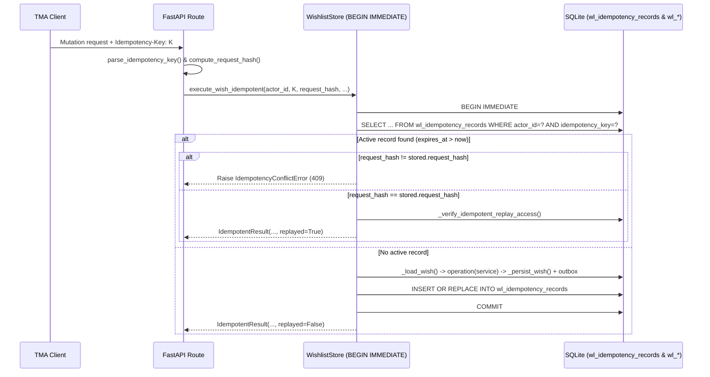

# Client Idempotency Keys (Booking & Gift Receipt)

Introduced in [WISHENKA-61](https://pypost.atlassian.net/browse/WISHENKA-61). Protects booking and
gift-receipt mutation endpoints against duplicate side effects caused by mobile network retries,
double-taps, or `503 Service Unavailable` lock-contention retries.

## Overview

- **Opt-in & backward compatible:** Clients may send an optional `Idempotency-Key` HTTP header on
  supported mutation endpoints. Omitting the header preserves legacy non-idempotent execution.
- **Per-actor scoping:** Keys are scoped to `(actor_id, idempotency_key)` so different users can
  never collide or read each other's cached responses.
- **Payload & target binding:** Each key is bound to a canonical SHA-256 fingerprint of the
  operation, target IDs, and request payload. Reusing an active key with a different operation,
  target, or payload is rejected with `409 Conflict`.
- **No cached failures:** Domain refusals (`400`/`403`/`404`/`409`) and transient lock errors
  (`503`) roll back the transaction without writing an idempotency record, allowing safe retries.

### Protected Endpoints

| Endpoint | Route Handler | `operation` | Response Media Type |
| --- | --- | --- | --- |
| `POST /api/wishlists/{wishlist_id}/items/{item_id}/reservations` | `reservations.create_reservation` | `create_reservation` | `application/json` |
| `PATCH /api/wishlists/{wishlist_id}/items/{item_id}/reservations/{reservation_id}` | `reservations.update_reservation_quantity` | `update_reservation_quantity` | `application/json` |
| `POST /api/wishlists/{wishlist_id}/items/{item_id}/reservations/{reservation_id}/cancel` | `reservations.cancel_reservation` | `cancel_reservation` | `application/json` |
| `POST /api/wishlists/{wishlist_id}/items/{item_id}/reservations/{reservation_id}/purchase` | `reservations.purchase_reservation` | `purchase_reservation` | `application/json` |
| `POST /api/wishlists/{wishlist_id}/items/{item_id}/reservations/{reservation_id}/undo-purchase` | `reservations.undo_reservation_purchase` | `undo_reservation_purchase` | `application/json` |
| `POST /api/public/wishlists/{token}/items/{item_id}/reservations` | `wishlists.reserve_from_public_link` | `create_reservation` | `application/json` |
| `POST /api/wishlists/{wishlist_id}/items/{item_id}/receipts` | `receipts.record_receipt` | `record_receipt` | `application/json` |
| `POST /web/wishlists/{wishlist_id}/items/{item_id}/receipt` | `receipts_ui.record_receipt_ui` | `record_receipt_ui` | `text/html; charset=utf-8` |

## Architecture

### Database Schema (`wl_idempotency_records`)

Created by Alembic revision `add_idempotency_records` in
[`wishenka/wishlists/alembic/versions/add_idempotency_records.py`](../../wishenka/wishlists/alembic/versions/add_idempotency_records.py):

- `actor_id INTEGER NOT NULL`
- `idempotency_key TEXT NOT NULL`
- `request_hash TEXT NOT NULL`
- `response_status INTEGER NOT NULL`
- `response_content_type TEXT NOT NULL`
- `response_body TEXT NOT NULL`
- `created_at TEXT NOT NULL` (UTC ISO-8601)
- `expires_at TEXT NOT NULL` (UTC ISO-8601)
- `PRIMARY KEY (actor_id, idempotency_key)`
- Index `idx_wl_idempotency_expires_at ON wl_idempotency_records (expires_at)` for bounded-cost
  retention cleanup.

### Web Layer (`wishenka/web/idempotency.py`)

- `parse_idempotency_key(request)` validates the optional `Idempotency-Key` header against
  `^[A-Za-z0-9._:-]{1,128}$`. Empty, whitespace-only, overlong, or malformed values raise
  `HTTPException(400)` before any database access and log `idempotency_key_invalid`.
- `compute_request_hash(operation, target, payload)` returns a deterministic `SHA-256` hex digest
  over `json.dumps({"operation": operation, "target": dict(target), "payload": ...}, sort_keys=True, separators=(",", ":"))`.
- `serialize_dto_response(dto, status_code)` serializes Pydantic DTOs to
  `(status_code, "application/json", dto.model_dump_json())`.
- `build_replay_response(status_code, content_type, body)` reconstructs a FastAPI `Response` for
  both JSON and HTMX HTML fragments.
- `retention_hours_from_request(request)` reads `Settings.idempotency_retention_hours` (default
  `24`).

### Store Layer (`WishlistStore.execute_wish_idempotent`)

Implemented in [`wishenka/wishlists/store.py`](../../wishenka/wishlists/store.py):

- **Single-transaction atomicity (`BEGIN IMMEDIATE`):** Lookup, business mutation (`_load_wish` ->
  `operation(service)` -> `_persist_wish`), transactional outbox flushes (`notification_outbox`,
  `reminder_outbox`), and `INSERT OR REPLACE INTO wl_idempotency_records` execute inside one
  `self._immediate(work)` transaction.
- **Concurrency:** Concurrent duplicate requests serialize on SQLite's write lock (up to
  `PRAGMA busy_timeout = 5000`). The first request commits the mutation and idempotency record; the
  second immediately reads and replays the committed response. If contention exceeds
  `busy_timeout`, `InventoryBusyError` (`503`) is raised and rolled back without writing a record.
- **Replay access & Surprise Invariant guards (`_verify_idempotent_replay_access`):** Before
  returning a stored response, the store verifies that:
  1. The wish item still exists (`ItemNotFoundError`).
  2. The parent wishlist is not `DELETED` (`WishlistDeletedError`).
  3. When `check_not_recipient=True` (reservation mutations), `actor_id != recipient_user_id`
     (`SelfReservationError`, preserving the Surprise Invariant if ownership/recipient changes).
  4. When `require_member=True` (gift-receipt mutations), `actor_id` is still the wishlist owner
     or a member in `wl_members` (`PermissionDeniedError`).

> [!NOTE]
> When unit tests inject a mock `app.state.wishlist_service` (bypassing `WishlistStore`), routes
> execute directly against the injected service without idempotency deduplication.

## TMA Frontend Key Lifecycle

All three TMA client surfaces generate a per-action key (`window.crypto.randomUUID()` with an
`idem-<timestamp>-<random>` fallback) and reuse it across transient retries:

- **Wish-card & cabinet HTMX controls**
  ([`wishenka/web/templates/base.html`](../../wishenka/web/templates/base.html)):
  `htmx:configRequest` attaches `elt.dataset.idempotencyKey` (generating one if absent) to any
  non-GET `/reservations` request. `htmx:afterRequest` deletes `elt.dataset.idempotencyKey` when
  `status !== 0 && status !== 503`, preserving the key on network failures (`0`) and lock
  contention (`503`).
- **Gift-receipt modal**
  ([`wishenka/web/static/receipt.js`](../../wishenka/web/static/receipt.js)):
  `submitReceipt` stores `form.dataset.idempotencyKey` alongside `form.dataset.idempotencyQty` and
  rotates the key if the user edits the quantity before retrying. `htmx:afterRequest` clears both
  attributes when `status !== 0 && status !== 503`.
- **Public share-link Reserve button**
  ([`wishenka/web/static/miniapp.js`](../../wishenka/web/static/miniapp.js)):
  `publicView` keeps `pendingKey` in closure scope for the Reserve button, clearing it on success
  or any non-`503` HTTP error while preserving it on `503` or network errors.

## Configuration & Retention Cleanup

- **`WISHENKA_IDEMPOTENCY_RETENTION_HOURS`** (`Settings.idempotency_retention_hours` in
  [`wishenka/config.py`](../../wishenka/config.py)): integer `>= 1`, default `24`. Controls
  `expires_at = effective_now + timedelta(hours=retention_hours)` on new records.
- **Periodic purge:** `WishlistStore.cleanup_expired_idempotency_records(now=None)` deletes rows
  where `expires_at <= now` and returns the deleted count. It is invoked on every
  `run_cleanup_cycle()` in [`wishenka/wishlists/cleanup.py`](../../wishenka/wishlists/cleanup.py),
  which records the count in `CleanupReport.idempotency_records_cleaned`.

## Observability

Structured log events (privacy-safe: raw `Idempotency-Key` values, `request_hash`, `response_body`,
public invite tokens, wish titles, and Surprise Invariant details are never logged):

| Event | Level | Logger | Fields |
| --- | --- | --- | --- |
| `idempotency_replay_hit` | `INFO` | `wishenka.wishlists.store` | `item_id`, `operation`, `response_status` |
| `idempotency_records_purged` | `INFO` | `wishenka.wishlists.store` | `purged_count` (emitted only when `> 0`) |
| `background_cleanup_completed` | `INFO` | `wishenka.wishlists.cleanup` | includes `idempotency_records_cleaned` |
| `idempotency_key_invalid` | `WARNING` | `wishenka.web.idempotency` | `method`, `route_path`, `key_length` |
| `reservation_idempotency_conflict` | `WARNING` | `wishenka.web.reservations` | `reason="idempotency_conflict"`, `operation`, `item_id` / `reservation_id` |
| `receipt_idempotency_conflict` | `WARNING` | `wishenka.web.receipts` | `reason="idempotency_conflict"`, `item_id` |
| `receipt_refused` | `WARNING` | `wishenka.web.receipts_ui` | `reason="idempotency_conflict"`, `item_id` |

## Troubleshooting

- **`400 Bad Request` (`Idempotency-Key must be 1..128 characters matching [A-Za-z0-9._:-]`):**
  The client sent an empty, whitespace-containing, overlong (`> 128`), or non-ASCII/special-char
  `Idempotency-Key`. Check `idempotency_key_invalid` logs for `route_path` and `key_length`.
- **`409 Conflict` (`IdempotencyConflictError`):**
  The same `(actor_id, idempotency_key)` was reused for a different `operation`, target ID, or
  request payload within the retention window. Ensure the client generates a fresh key whenever
  inputs or target actions change.
- **`503 Service Unavailable` (`InventoryBusyError`):**
  SQLite write-lock contention exceeded `busy_timeout = 5000` ms. No idempotency record was
  written; the client should retry with the same `Idempotency-Key`.
- **`403` / `404` on replay:**
  The initial request succeeded, but before the retry the wishlist was deleted, the item was
  removed, the actor lost membership (for receipts), or the actor became the wish recipient
  (Surprise Invariant). `_verify_idempotent_replay_access` blocks replay in these cases.
