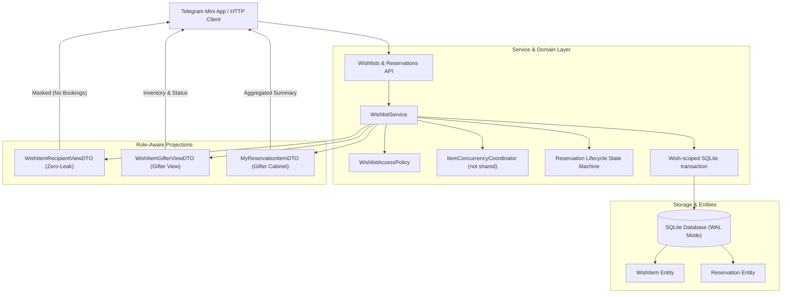
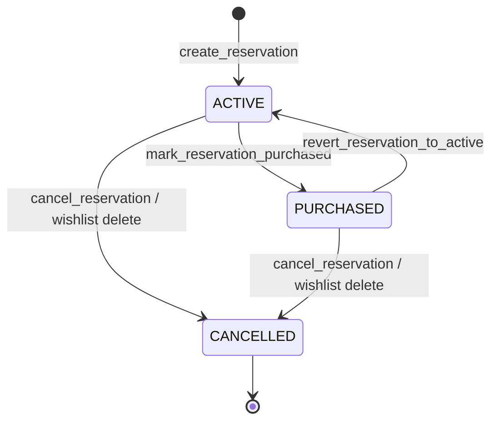

# Reservations Domain: Gift Booking, Lifecycle State Machine, Concurrency, and Surprise Invariant

## Overview

The reservation subsystem in the **Wishlist Service («Вишенка»)** Telegram Mini App coordinates the commitment and purchase workflow for gifts. It enables gifters to book individual units of multi-quantity wish items, mark them as purchased in the real world, cancel bookings, or adjust reserved counts, while guaranteeing strict data confidentiality for the gift recipient.

Clients reach that workflow through five authenticated HTTP routes on
one wish. The contract is under [HTTP promise actions](#http-promise-actions).
The wish card calls those same routes. Giver controls sit on the existing
card summary, compact and expanded. See
[Wish-card giver controls](#6-wish-card-giver-controls).

```
+-------------------------------------------------------------------------------------------------------+
|                                         Wish Item Inventory                                           |
|   desired_quantity = 5   |   received_quantity = 1 (fulfilled)   |   active + purchased = 3 (locked)  |
+-------------------------------------------------------------------------------------------------------+
                                                   |
                                                   v
+-------------------------------------------------------------------------------------------------------+
|                                      Piece Accounting Formula                                         |
|              available_quantity = max(0, desired - fulfilled - (active + purchased))                 |
|                             available_quantity = max(0, 5 - 1 - 3) = 1                                |
+-------------------------------------------------------------------------------------------------------+
                           |                                                |
                           v                                                v
+----------------------------------------------------+   +----------------------------------------------+
|            Recipient Projection View               |   |              Gifter Projection View          |
|      (WishItemRecipientViewDTO: ZERO-LEAK)         |   |          (WishItemGifterViewDTO)             |
| - desired_quantity: 5                              |   | - desired_quantity: 5                        |
| - received_quantity: 1                             |   | - available_quantity: 1                      |
| - NO available_quantity, status, or gifter fields  |   | - is_reserved_by_me: True, my_reserved_qty: 2|
+----------------------------------------------------+   +----------------------------------------------+
```

### Key Capabilities

1. **Piece Accounting & Multi-Quantity Inventory**:
   Supports items with requested quantities up to 1000 units. Available balance is calculated dynamically:
   $$\text{available\_quantity} = \max(0, \text{desired} - \text{fulfilled} - (\text{active} + \text{purchased}))$$
2. **Surprise Invariant (Zero-Leak Guarantee)**:
   The recipient of a gift must never observe or infer whether an item is reserved, who reserved it, how many units remain, or whether it has been purchased. Recipient projections completely omit booking metadata.
3. **Discrete Lifecycle State Machine**:
   Explicit states (`ACTIVE`, `PURCHASED`, `CANCELLED`) track a gifter's
   promise. Receipt is not a status change.
4. **Wish-scoped write exclusion**:
   Concurrent booking is excluded by the wish-scoped SQLite transaction
   (`BEGIN IMMEDIATE`). `execute_wish` builds a new `WishlistService` per
   call, so `ItemConcurrencyCoordinator` (`asyncio.Lock`) is not shared
   across requests or processes. That lock is not the cross-process
   mechanism.
5. **Reduction Lock Invariant**:
   Prevents wishlist authors from reducing an item's desired quantity below the sum of active, purchased, and fulfilled units ($\text{desired} \ge \text{active} + \text{purchased} + \text{fulfilled}$).
6. **My reservations cabinet**:
   An identified caller sees the home card «Мои бронирования». The badge
   is `total_distinct_items`: distinct wishes with an occupying promise.
   The cabinet lists only that caller's occupying promises. See
   [My reservations cabinet](#7-my-reservations-cabinet).
7. **Authenticated promise HTTP API**:
   Five routes under
   `/api/wishlists/{wishlist_id}/items/{item_id}/reservations`
   create, resize, cancel, purchase, or undo one promise. Each call goes
   through `execute_wish`. There is no second lock. Success is
   `PromiseActionDTO`: the promise just changed, plus the gifter wish view.

---

## Architecture & Components

The reservation subsystem is located in `wishenka.wishlists` and consists of models, schemas, concurrency coordinators, and service methods.



### 1. Reservation Lifecycle State Machine

The reservation lifecycle is governed by [`ReservationStatus`](file:///home/src/wishenka/wishlists/models.py#L26-L33):



- **`ACTIVE`**: The initial state when a gifter reserves units of an item. Locks inventory from other gifters.
- **`PURCHASED`**: The gifter confirmed purchasing the gift in the physical world. Crucially, **`PURCHASED` reservations continue locking inventory** so other gifters cannot book the same units.
- **`CANCELLED`**: The gifter cancelled the reservation or the parent wishlist was deleted. The reserved units are immediately released back to `available_quantity`. This is a terminal state.
- **Receipt leaves the promise open**:
  [`record_item_fulfillment`](file:///home/src/wishenka/wishlists/service.py#L1948)
  only adds `received_quantity`. It does not cancel the reservation or set
  `ReservationStatus.COMPLETED`. There is no `FULFILLED` status. The promise
  stays `ACTIVE` or `PURCHASED`.

> [!IMPORTANT]
> Both `ACTIVE` and `PURCHASED` states contribute to
> [`reserved_quantity`](file:///home/src/wishenka/wishlists/models.py#L122).
> `execute_wish` builds a new `WishlistService` per call. The shared write
> is the wish-scoped `BEGIN IMMEDIATE` transaction.

### 2. Item Concurrency Coordinator (`KeyedMutex`)

[`execute_wish`](file:///home/src/wishenka/wishlists/store.py#L942-L997) builds a new
`WishlistService` on every call
([`_load_wish`](file:///home/src/wishenka/wishlists/store.py#L1016) assigns
`WishlistService()`). That instance owns a fresh
[`ItemConcurrencyCoordinator`](file:///home/src/wishenka/wishlists/concurrency.py#L8-L24).
The `asyncio.Lock` lives on that instance. It is not shared across requests
or processes, and it is not the cross-process exclusion.

Exclusion is the wish-scoped SQLite transaction. The class below is only the per-instance lock:

```python
class ItemConcurrencyCoordinator:
    """Coordinates per-item critical sections using keyed asyncio.Lock instances."""

    def __init__(self) -> None:
        self._locks: dict[int, asyncio.Lock] = {}
        self._master_lock = asyncio.Lock()

    @asynccontextmanager
    async def acquire(self, item_id: int) -> AsyncIterator[None]:
        async with self._master_lock:
            if item_id not in self._locks:
                self._locks[item_id] = asyncio.Lock()
            lock = self._locks[item_id]

        async with lock:
            yield
```

**Wish-scoped SQLite exclusion**:

- Several service copies write one SQLite file. The shared exclusion is
  `Connection.begin()` on the wishlist engine. The `begin` listener emits
  `BEGIN IMMEDIATE` (`isolation_level = None`, WAL selected at migration startup,
  `PRAGMA busy_timeout = 5000`).
- A second writer waits on that reserved lock. The quantity check runs
  inside the transaction, so two calls cannot both commit the same free
  units.
- If the wait exceeds `busy_timeout`, the store raises `InventoryBusyError`
  and changes nothing. `asyncio.Lock` does not cover another request or
  another process.

**WISHENKA-49 verification**:

- This database transaction is the cross-process reservation boundary; do not
  add a second process-local lock around `execute_wish`.
- Run its bounded regression contract from the repository root:

  ```bash
  make test PYTEST=".venv/bin/pytest tests/test_booking_ceiling_r5.py"
  ```

  The R5 suite covers same-process and spawned-process contention. A busy
  writer is an explicit retryable `InventoryBusyError`, never a partial
  reservation.

### 3. Role-Aware DTO Projections & Zero-Leak Guarantees

To enforce the **Surprise Invariant**,
[`WishlistService`](file:///home/src/wishenka/wishlists/service.py#L217)
projects items into role-specific DTOs defined in
[`wishenka.wishlists.schemas`](file:///home/src/wishenka/wishlists/schemas.py#L11):

| DTO Schema | Target Audience | Reservation Attributes |
|---|---|---|
| [`WishItemRecipientViewDTO`](file:///home/src/wishenka/wishlists/schemas.py#L11) | Gift Recipient / Wishlist Owner | **Strictly None**. Exposes `quantity` and `received_quantity`. Fields like `available_quantity`, `is_fully_reserved`, `my_reserved_quantity`, and gifter names **do not exist**. |
| [`WishItemGifterViewDTO`](file:///home/src/wishenka/wishlists/schemas.py#L39) | Gifters / Public Viewers | Exposes `available_quantity`, `is_fully_reserved`, `is_reserved_by_me`, `my_reserved_quantity`, `my_reservation_status`, `my_reservation_id`, `my_latest_reservation_quantity`, and `my_occupying_reservation_count`. Masks identities of other gifters. |
| `MyReservationItemDTO` | Caller cabinet | One occupying promise of the caller. |
| `UserReservationsSummaryDTO` | Home card badge | Badge is `total_distinct_items`. |

### 4. Self-Reservation Guards

A recipient must never be allowed to reserve an item designated for themselves.
[`WishlistAccessPolicy.is_recipient`](file:///home/src/wishenka/wishlists/policy.py#L115)
is the shared predicate. A missing user is not a recipient.

- **Personal wishlists**: The owner is the recipient of every wish,
  including a wish that has only a display name. The check is
  `wishlist` present, `is_collaborative` false, and
  `wishlist.owner_id == user.telegram_id`. A display name is never
  compared to a user.
- **Collaborative wishlists**: The recipient is `recipient_user_id` on
  that wish. The caller is the recipient only when
  `item.recipient_user_id == user.telegram_id`. A display name alone
  does not make a recipient.
- [`WishlistAccessPolicy.can_reserve_item`](file:///home/src/wishenka/wishlists/policy.py#L134)
  returns false for a recipient. Attempting self-reservation raises
  [`SelfReservationError`](file:///home/src/wishenka/wishlists/exceptions.py#L28)
  and logs a warning with event `self_reservation_blocked`.

### 5. HTTP promise routes

The client promise API is
[`wishenka/web/routes/reservations.py`](file:///home/src/wishenka/web/routes/reservations.py),
included from `wishenka/web/app.py`. `execute` in that module is the HTTP
adapter. Unless tests inject `app.state.wishlist_service`, the action is
passed to
[`WishlistStore.execute_wish`](file:///home/src/wishenka/wishlists/store.py#L942-L997).
Create passes `item_id`. Quantity change, cancel, purchase, and undo pass
`reservation_id`. The store accepts exactly one of those keys. The service
loaded inside `execute_wish` does not open a second transaction.

The routes add no second lock. They do not call `WishlistStore.execute`,
`SELECT FOR UPDATE`, or Redis, and they do not add an `asyncio.Lock`.
Cross-process exclusion stays the wish-scoped SQLite transaction
(`BEGIN IMMEDIATE`) in the section above. `execute_wish` still builds a new
`WishlistService` per call, so `ItemConcurrencyCoordinator` is not shared
across requests or processes.

[`project_reservation_action`](file:///home/src/wishenka/wishlists/service.py#L196-L214)
builds
[`PromiseActionDTO`](file:///home/src/wishenka/wishlists/schemas.py#L119-L129)
from the promise the method just returned and from `project_wish_item`. If
the caller is the recipient, the projector raises `ReservationNotFoundError`
and builds nothing. Receipt still does not introduce a `FULFILLED` status.

### 6. Wish-card giver controls

Giver controls live on the existing wish card
[`partials/item_card.html`](file:///home/src/wishenka/web/templates/partials/item_card.html).
One block, `.item-giver`, sits inside `.item-card-summary`. The summary
stays on screen when the details open, so the same block is the compact
card and the expanded card. Writes use the five routes above and
[`execute_wish`](file:///home/src/wishenka/wishlists/store.py#L942-L997).
This card adds no reservation write route. The cabinet reads are
[My reservations cabinet](#7-my-reservations-cabinet). They load
[`get_user_reservations`](file:///home/src/wishenka/wishlists/service.py)
and [`MyReservationItemDTO`](file:///home/src/wishenka/wishlists/schemas.py).
The archive title row
[`archived_items_section.html`](file:///home/src/wishenka/web/templates/partials/archived_items_section.html)
is a separate list and has no giver controls.

The list page `wishlist_detail.html` and the share page
`share_wishlist.html` both extend `base.html` and include the card through
`partials/items_list.html`. Quick-add, edit, move, reorder, and restore in
[`items_ui.py`](file:///home/src/wishenka/web/routes/items_ui.py) render the
same partial. The refresh target is the existing partial
`GET /wishlists/{wishlist_id}/items/{item_id}/card`
([`get_item_card_partial`](file:///home/src/wishenka/web/routes/sharing.py#L93)).

`.item-giver` is rendered when `item.is_recipient` is false. That flag is
`is_recipient` above, shared with `project_wish_item` and
`can_reserve_item`. On a personal list the owner is the recipient of every
wish, including a display-name-only wish, and the card omits the block.
A display name is never compared to a user. On a collaborative list the
block is omitted only for the caller whose `telegram_id` equals that
wish's `recipient_user_id`. A recipient projection is
`WishItemRecipientViewDTO` and has no booking fields, so the HTML contains
no availability line, own line, or promise button.

For a gifter the summary shows these lines together when they apply:

- **Availability.** `Доступно: {available_quantity} из {quantity}` when
  `available_quantity >= 1`. Otherwise the line is `Забронировано`.
- **Own line.** When `is_reserved_by_me`, the line is
  `Забронировано вами (N)`. `N` is `my_reserved_quantity`, the sum of the
  caller's occupying promises (`ACTIVE` and `PURCHASED`). The suffix
  ` · Куплено` is added only when `my_occupying_reservation_count == 1`
  and `my_reservation_status` is `purchased`. That is the latest occupying
  promise, and it is the only one. A bought latest promise beside another
  occupying promise leaves the own line as `Забронировано вами (N)`.

`my_reservation_id`, `my_reservation_status`, and
`my_latest_reservation_quantity` come from `user_reservations[-1]` in
[`project_wish_item`](file:///home/src/wishenka/wishlists/service.py#L121).
Occupying rows are `ACTIVE` and `PURCHASED`. Store loads order them by id
ascending, and the in-memory service appends on create, so `[-1]` is the
highest id. The projection does not sort by `updated_at`.
`my_occupying_reservation_count` is the length of that list.
`my_reserved_quantity` is the sum of those quantities.

Buttons render when `viewer_identified` and `wishlist_active` are both
true (`can_promise` in the template). The list page, the share page, and
the card partial pass the real values. Quick-add, edit, move, reorder,
and restore pass both as true through `_editor_card_flags`, because those
routes already required an identified caller and an active list. A guest
still sees the availability line. The buttons stay off the guest card.

| Control | Shown when | Request |
| ------- | ---------- | ------- |
| `Забронировать` | `can_promise`, item not archived, caller holds nothing, `available_quantity >= 1` | `POST` the prefix, JSON `{"quantity": N}` |
| `Изменить` | `can_promise`, caller holds a promise, `my_latest_reservation_quantity + available_quantity > 1` | `PATCH /{my_reservation_id}`, JSON `{"quantity": N}` |
| `Отменить бронь` | `can_promise` and the caller holds a promise | `POST /{my_reservation_id}/cancel` |
| `Куплено` | those, and the latest status is `active` | `POST /{my_reservation_id}/purchase` |
| `Вернуть в бронь` | those, and the latest status is `purchased` | `POST /{my_reservation_id}/undo-purchase` |

The book form sends quantity `1` as a hidden field when one unit is free,
and a select of `1..available_quantity` otherwise. The selected book
option is `1`. `Изменить` selects `1..latest + available` and the selected
option is `my_latest_reservation_quantity`, the latest row's size. The
combined own-line total is a separate number. `Куплено` and
`Вернуть в бронь` follow that latest row even when the own line has no
`Куплено` suffix. An archived item omits `Забронировать`. Cancel,
purchase, and undo stay for a caller who already holds units, when
`can_promise` is true. `Изменить` stays only when that ceiling is greater
than 1. Editor controls (edit, move, archive) stay in
`.item-card-details`.

Quantity forms set `hx-ext="json-enc"` (`json-enc.js` for HTMX 1.9.12,
loaded from `base.html`) so the body is `ReservationQuantityDTO`.
`Изменить` also sets `hx-include="closest form"` on the button. Every
promise control sets `hx-swap="none"`, so HTMX leaves the JSON body out of
the card. The refresh script below decides whether to replace the card.
`.item-giver` and its controls set `data-no-toggle`. The delegated toggle in
[`wishlist.js`](../../wishenka/web/static/wishlist.js) ignores clicks on `a`,
`button`, `input`, `select`, `textarea`, and `[data-no-toggle]`, so a control
click does not collapse an expanded card before that refresh. The toggle is
described in [miniapp.md](miniapp.md#981-client-script-staticwishlistjs-wishenka-108).

#### Refresh

`htmx:afterRequest` in
[`base.html`](file:///home/src/wishenka/web/templates/base.html)
runs when the control path contains `/reservations`.

- **HTTP 200 or 201.** The script requests
  `GET /wishlists/{wishlist_id}/items/{item_id}/card` with `is_first` and
  `is_last` copied from the card's data attributes, and with no `notice`.
  `swapWishCard` replaces `#item-card-{id}` via `outerHTML`. The partial
  always renders `.item-card-details` with `hidden`. When the swapped
  summary had `aria-expanded="true"`, the script sets that attribute on
  the new summary and clears `hidden` on the new details
  (`nextDetails.hidden = false`). Edit, move, and archive stay visible.
- **HTTP 409.** The same GET adds `notice=shortage` when the response
  text contains `available`, and `notice=refused` otherwise. The card
  does not echo `detail`. Shortage text is
  `Бронь не изменилась. Свободно: {available_quantity}.`
- **HTTP 401, 403, or 404.** The same GET adds `notice=refused`. The
  sentence is `Бронь не изменилась.`
- **HTTP 503.** The current card stays in place. The script does not
  request the partial and does not read `detail`. It shows
  `Желание занято, бронь не изменилась. Повторите попытку.` on
  `[data-giver-busy]`. The sentence names nobody.

[`get_item_card_partial`](file:///home/src/wishenka/web/routes/sharing.py#L93)
passes `notice` into the template only when the projected item is
`WishItemGifterViewDTO`. A recipient card omits `notice`, including
`Бронь не изменилась.`

`get_item_card_partial` renders the partial and writes no reservation
event. Mutation logs stay on `wishenka.web.reservations`, from `execute`
in `wishenka/web/routes/reservations.py`. The three refresh outcomes map
to records that already exist: `reservation_action_completed` (200 or
201), the matching refusal WARNING (`notice=refused` or
`notice=shortage`), and `reservation_inventory_busy` (the busy sentence).

#### Cookie CSRF on the card

Cookie mutations need `Origin` and `X-CSRF-Token`
([`BrowserSecurityMiddleware`](file:///home/src/wishenka/web/security.py#L21)).
Bearer calls skip that check. When `body` has `data-viewer-identified`,
`base.html` calls `GET /api/auth/csrf` after `DOMContentLoaded` and stores
`csrf_token`. `htmx:configRequest` sets `X-CSRF-Token` on an unsafe
request only after that value is non-empty. A click before the fetch
returns, and a fetch that fails, sends no header.
`BrowserSecurityMiddleware` answers HTTP 403
`{"detail":"Invalid CSRF token"}`. The refresh script maps every 403 to
`notice=refused`, so the card currently shows `Бронь не изменилась.`
The promise handler does not run, and no row is stored. The follow-up is
[WISHENKA-123](https://pypost.atlassian.net/browse/WISHENKA-123).
The token stays out of the HTML.

### 7. My reservations cabinet

The home card and the cabinet are read-only HTML. The router is
[`wishenka/web/routes/reservations_ui.py`](../../wishenka/web/routes/reservations_ui.py),
included from `wishenka/web/app.py`. Writes stay on the five routes in
[HTTP promise actions](#http-promise-actions). These reads use the
snapshot load below. Writes stay on those five routes.

A missing session is HTTP 401 `{"detail":"Authentication required"}`.
The body does not contain «Мои бронирования», «Нет бронирований», or
`.reservations-badge`. `get_current_user` rejects the call before a
read.

| Method | Path | HTML |
| ------ | ---- | ---- |
| `GET` | `/web/reservations/card` | `partials/reservations_card.html` |
| `GET` | `/web/reservations` | `reservations_cabinet.html` |
| `GET` | `/web/reservations/list` | `partials/reservations_list.html` |

A read uses `WishlistStore.execute` (a full snapshot), or the injected
service when tests set `app.state.wishlist_service`.

#### Home card

`GET /web/reservations/card` renders
[`partials/reservations_card.html`](../../wishenka/web/templates/partials/reservations_card.html).
The title is «Мои бронирования». The badge is
`UserReservationsSummaryDTO.total_distinct_items`, including `0`.
That number is the count of distinct `wish_item_id` values among the
caller's occupying promises (`ACTIVE` and `PURCHASED`). A second
occupying promise on the same wish does not increment it. Units do
not increment it. A `CANCELLED` promise does not increment it.
`total_active_reservations` is the row count and is not the badge.
The link target is `/web/reservations`.

`showHome` in
[`wishenka/web/static/miniapp.js`](../../wishenka/web/static/miniapp.js)
requests this fragment after the three wishlist sections have loaded.
It copies the title text, the badge text, and the href through
`node()` (`textContent`) and inserts the link before the first
`.wishlist-section`. The badge span keeps the class
`reservations-badge`.
A response that is not OK, a fragment missing the link, title, or
badge, and a failed fetch, leave the three sections in place.
`publicView` and `invitationView` do not request
the card. `GET /` and `GET /share/{public_token}` do not render it.

#### Cabinet list

`GET /web/reservations` extends `base.html`, sets `viewer_identified`,
and includes
[`partials/reservations_list.html`](../../wishenka/web/templates/partials/reservations_list.html).
The page title and the `h1` are «Мои бронирования».
`GET /web/reservations/list` returns that same list. Optional query
`notice` is kept only when it is `shortage` or `refused`. Any other
value is omitted. `reservation_id` is used only for a shortage
remainder.

Both routes load `get_user_reservations` for the caller. The method
keeps a row when `user_id` is the caller and the status is `ACTIVE`
or `PURCHASED`. It skips `CANCELLED`. It skips another gifter's
promise. The web layer groups the rows by `wishlist_id`. Groups are
ordered by `title.casefold()`, then `wishlist_id`. Rows inside a
group follow `created_at`, then `reservation_id`.

Each group shows the wishlist title. A non-empty event title, after
stripping, is shown. An event date is shown as the UTC calendar day
`YYYY-MM-DD`. A list without those fields omits them. An empty
cabinet shows «Нет бронирований» and no `.reservation-group`.

Each row shows the wish title, that promise's quantity,
«Забронировано» or «Куплено», and `Для: {name}` when the name is
non-empty. An archived wish adds «Желание в архиве». An archived
list adds «Вишлист в архиве». The row does not print another
gifter's name, id, or quantity.

The name comes from `_cabinet_recipient_name`. A personal list names
the owner (`owner_name`, or `Участник #{owner_id}` when that name is
blank). It does not use a display name on the wish. A collaborative
list names the designated member (`owner_name` when that member is
the owner, otherwise `Участник #{id}`), or the display name when
nobody is designated.

On a personal list the owner is the recipient of every wish,
including a wish that has only a display name
(`WishlistAccessPolicy.is_recipient`). A display name is never
compared to a user. That owner cannot hold a promise on those
wishes, so they are not shown as the owner's promises. They do not
increase the owner's badge, and the cabinet omits them. The query
does not add a second recipient filter. It returns the caller's
occupying promises, and the owner has none on that list.

Deleting a list sets its occupying promises to `CANCELLED`. Those
rows then leave the cabinet and the distinct-wish count. The cabinet
does not add a second cancel path.

#### Link and the four actions

Every row includes «К желанию». The href is
`/web/wishlists/{wishlist_id}#item-card-{wish_item_id}`.

While the wish card still has giver controls, the row offers only
that link. That is an active wish on an active list. The row does
not render «Изменить», «Отменить бронь», «Куплено», or
«Вернуть в бронь», and it does not contain a write URL under
`/reservations/`. An earlier promise on that wish is listed the same
way. The card edits the latest promise. See
[Wish-card giver controls](#6-wish-card-giver-controls).

The four actions render only when the wish is archived and the list
is active (`is_item_archived` and not `is_wishlist_archived`). Each
control posts that row's `reservation_id` on the five existing
promise routes. Create stays on the wish card. An earlier promise
keeps its own id.

| Control | Request |
| ------- | ------- |
| `Изменить` | `PATCH` that row, JSON quantity, `hx-ext="json-enc"` |
| `Отменить бронь` | `POST` `{row}/cancel` |
| `Куплено` | `POST` `{row}/purchase` when the label is «Забронировано» |
| `Вернуть в бронь` | `POST` `{row}/undo-purchase` when the label is «Куплено» |

`{row}` is
`/api/wishlists/{wishlist_id}/items/{item_id}/reservations/{reservation_id}`
and `reservation_id` is that row's id. The quantity form sends
`hx-patch`, `hx-ext="json-enc"`, and `hx-swap="none"`. The select
runs from 1 through `change_ceiling`. That ceiling is this promise's
quantity plus the wish's `available_quantity`. The selected option
is this row's quantity. Cancel, purchase, and undo are buttons with
`hx-post` and `hx-swap="none"`. HTMX does not insert the JSON body.

An archived list keeps the row and «К желанию», shows
«Вишлист в архиве», and omits the four actions. The four writes on
an archived list return HTTP 409 (`WishlistArchivedError`). A
deleted list cancels occupying promises, so the group leaves the
cabinet. A write that still reaches those routes is HTTP 404
`{"detail":"Resource not found"}`.

#### Cabinet refresh

`htmx:afterRequest` in
[`base.html`](../../wishenka/web/templates/base.html) runs when the
control path contains `/reservations`. A closest `.reservation-row`
takes the cabinet branch. The branch does not fetch the wish-card
partial and does not write the action `responseText` into the page.

- **HTTP 200 or 201.** The script requests
  `GET /web/reservations/list` and replaces `#reservations-cabinet`
  with that partial (`outerHTML`), then calls `htmx.process`. The
  list is the caller's occupying promises only, so the refresh does
  not name another gifter.
- **HTTP 409.** The same GET adds `notice=shortage` when the
  response text contains `available`, and `notice=refused`
  otherwise. Shortage also sends this row's `reservation_id`.
  Shortage text is `Бронь не изменилась. Свободно: {N}.` `N` is
  `max(0, change_ceiling - reserved_quantity)` for that row. The
  partial does not echo `detail`.
- **HTTP 401, 403, or 404.** The same GET adds `notice=refused`.
  The sentence is `Бронь не изменилась.`
- **HTTP 503.** The cabinet stays in place. The script does not
  request the list. It shows
  `Желание занято, бронь не изменилась. Повторите попытку.`
  on `[data-reservation-busy]` of the row already on screen. The
  sentence names nobody. The stored promise is unchanged.

#### Cookie CSRF

The cabinet page sets `data-viewer-identified`, so it uses the same
`DOMContentLoaded` listener as
[Cookie CSRF on the card](#cookie-csrf-on-the-card). The empty-token
window is unchanged. A click before `GET /api/auth/csrf` resolves,
and a fetch that fails,
sends no `X-CSRF-Token`. `BrowserSecurityMiddleware` answers HTTP
403 `{"detail":"Invalid CSRF token"}`. The row branch maps that 403
to `notice=refused`. The promise handler does not run, and no row
is stored. The follow-up remains
[WISHENKA-123](https://pypost.atlassian.net/browse/WISHENKA-123).
The home-card fetch in `showHome` is a GET and does not use this
token.

#### Logs

The three cabinet GETs write no event on `wishenka.web.reservations`.
`reservations_ui.py` has no logger. A missing session is the
existing `auth_failure` on `wishenka.auth`. It is not a cabinet
mutation record. Promise writes stay on `wishenka.web.reservations`,
from `execute` in `wishenka/web/routes/reservations.py`. A successful
cabinet action is `reservation_action_completed`. A refused refresh
is the matching WARNING under
[HTTP route logs](#http-route-logs). HTTP 503 is
`reservation_inventory_busy`.

---

## API & Usage

### HTTP promise actions

Five authenticated routes share the prefix
`/api/wishlists/{wishlist_id}/items/{item_id}/reservations`.
The router is `wishenka/web/routes/reservations.py`, included from
`wishenka/web/app.py`. Each handler depends on `get_current_user`.

A missing session is HTTP 401 `{"detail":"Authentication required"}`.
The reservation method is not called, and no row is written.

Each handler calls one existing method through `execute` in that module.
`execute` passes the action to `WishlistStore.execute_wish`. Create passes
`item_id`. The other four pass `reservation_id`. There is no second lock.
Cross-process exclusion remains `BEGIN IMMEDIATE` on the wish.

| Method  | Path under the prefix             | Success |
| ------- | --------------------------------- | :-----: |
| `POST`  | the prefix                        | `201`   |
| `PATCH` | `/{reservation_id}`               | `200`   |
| `POST`  | `/{reservation_id}/cancel`        | `200`   |
| `POST`  | `/{reservation_id}/purchase`      | `200`   |
| `POST`  | `/{reservation_id}/undo-purchase` | `200`   |

The wish card sends these five calls from `.item-giver`. Which control
sends which method is in
[Wish-card giver controls](#6-wish-card-giver-controls).
The cabinet sends the four mutation calls, each with that row's
reservation id, only for an archived wish on an active list. See
[My reservations cabinet](#7-my-reservations-cabinet).

Create calls `create_reservation`. Quantity change calls
`update_reservation_quantity`. Cancel calls `cancel_reservation`. Purchase
calls `mark_reservation_purchased`. Undo calls `revert_reservation_to_active`.

The success body is `PromiseActionDTO`. `response_model` is that model
alone. It is the promise the call just changed, plus the gifter wish view:

- `reservation_id`, `wish_item_id`, `quantity`, and `status` come from that
  one row. `status` is `active`, `purchased`, or `cancelled`.
- `available_quantity` is the wish balance after the change.
- `item` is `WishItemGifterViewDTO` from `project_wish_item`.

Top-level quantity and status stay on the row that changed, including when
the caller holds another promise on the same wish. `item` keeps the combined
`my_reserved_quantity` and the latest promise on that wish. The body has no
`user_id`. A recipient never receives this DTO. There is no `FULFILLED`
status.

Create and quantity change read `ReservationQuantityDTO`: a required integer
`quantity` and no extra fields. On a wish `execute_wish` can load, a
quantity below 1 is HTTP 400
`{"detail":"Reservation quantity must be at least 1"}`. No row is stored or
resized.

The recipient of the wish cannot create a promise. The route returns HTTP
403 with body exactly `{"detail":"Cannot promise this wish"}`. That body is
the same whether a promise already exists. The route does not send the
`SelfReservationError` text.

A recipient mutation is refused before any write.
`_guard_reservation_mutation` raises `ReservationNotFoundError` when the
caller is the recipient, before ownership and before a status or quantity
change. The route returns HTTP 404 `{"detail":"Resource not found"}`. A
missing promise id uses that same body.

`PermissionDeniedError` is HTTP 403 with body exactly
`{"detail":"Forbidden"}`. Quantity change, cancel, purchase, and undo by a
caller who does not hold the promise use that body.

`InsufficientQuantityError`, `ReservationError`, and
`WishlistArchivedError` are HTTP 409. The `detail` is the exception text.
A shortage is this 409. A quantity below 1 on a loaded wish is HTTP 400
`{"detail":"Reservation quantity must be at least 1"}`.
`ReservationNotFoundError` stays the HTTP 404 body above.

```python
import httpx


async def promise_one_unit(
    client: httpx.AsyncClient,
    wishlist_id: int,
    item_id: int,
    token: str,
) -> dict:
    response = await client.post(
        f"/api/wishlists/{wishlist_id}/items/{item_id}/reservations",
        json={"quantity": 1},
        headers={"Authorization": f"Bearer {token}"},
    )
    response.raise_for_status()
    # 201: this promise, plus the gifter wish view in "item"
    return response.json()
```

Quantity change, cancel, purchase, and undo use that same prefix plus
`/{reservation_id}`, `/{reservation_id}/cancel`,
`/{reservation_id}/purchase`, or `/{reservation_id}/undo-purchase`. Those
four return 200 and the same `PromiseActionDTO`.

### Domain methods

The examples below call `WishlistService` in process. The HTTP routes above
are the client path. They call these same methods through `execute_wish`.

### 1. Creating a Reservation

```python
import asyncio
from wishenka.auth.models import AuthenticatedUser
from wishenka.wishlists.service import WishlistService
from wishenka.wishlists.models import ReservationStatus

async def reserve_gift():
    service = WishlistService()

    # Setup author and gifter
    author = AuthenticatedUser(telegram_id=1001, first_name="Alice")
    gifter = AuthenticatedUser(telegram_id=2002, first_name="Bob")

    # Author creates a wishlist with a multi-piece item
    wishlist = await service.create_wishlist(owner=author, title="Birthday Wishlist")
    item = await service.add_wish_item(
        wishlist_id=wishlist.id,
        actor=author,
        title="Ceramic Coffee Mug",
        quantity=3,
    )

    # Gifter reserves 2 pieces
    reservation = await service.create_reservation(
        item_id=item.id,
        user=gifter,
        quantity=2,
    )

    print(f"Reservation ID: {reservation.id}")
    print(f"Status: {reservation.status}")  # ReservationStatus.ACTIVE
    print(f"Reserved: {reservation.quantity}, Available: {item.available_quantity}")  # Reserved: 2, Available: 1

asyncio.run(reserve_gift())
```

### 2. Marking as Purchased and Reverting to Active

```python
async def manage_purchase_status(service: WishlistService, reservation_id: int, gifter: AuthenticatedUser):
    # Transition: ACTIVE -> PURCHASED
    purchased_res = await service.mark_reservation_purchased(
        reservation_id=reservation_id,
        user=gifter,
    )
    assert purchased_res.status == ReservationStatus.PURCHASED
    # Inventory reserve is still held:
    assert purchased_res.wish_item.reserved_quantity == purchased_res.quantity

    # Gifter can revert back: PURCHASED -> ACTIVE
    active_res = await service.revert_reservation_to_active(
        reservation_id=reservation_id,
        user=gifter,
    )
    assert active_res.status == ReservationStatus.ACTIVE
```

### 3. Cancelling a Reservation

```python
async def cancel_booking(service: WishlistService, reservation_id: int, gifter: AuthenticatedUser):
    # Transition: ACTIVE / PURCHASED -> CANCELLED
    # Immediately returns quantity back to available_quantity
    cancelled_res = await service.cancel_reservation(
        reservation_id=reservation_id,
        user=gifter,
    )
    assert cancelled_res.status == ReservationStatus.CANCELLED
    print(f"Item available balance restocked: {cancelled_res.wish_item.available_quantity}")
```

### 4. Adjusting Reserved Quantity

```python
async def adjust_quantity(service: WishlistService, reservation_id: int, gifter: AuthenticatedUser):
    # Adjust reservation from 2 to 3 units (if balance permits)
    updated_res = await service.update_reservation_quantity(
        reservation_id=reservation_id,
        user=gifter,
        new_quantity=3,
    )
    print(f"Updated reservation quantity: {updated_res.quantity}")

    # Partial release: reduce reservation from 3 to 1 unit
    reduced_res = await service.update_reservation_quantity(
        reservation_id=reservation_id,
        user=gifter,
        new_quantity=1,
    )
    print(f"Reduced quantity: {reduced_res.quantity}, Restocked to item")
```

### 5. Fetching "My Reservations" and Summary Badge

```python
async def view_my_reservations(service: WishlistService, gifter: AuthenticatedUser):
    # Occupying promises only: ACTIVE and PURCHASED, this caller.
    my_reservations = await service.get_user_reservations(user_id=gifter.telegram_id)
    for res in my_reservations:
        print(f"Item: {res.item_title} (x{res.reserved_quantity}) for {res.recipient_name}")
        print(f"Status: {res.status.value}, Archived: {res.is_item_archived}")

    # The home badge is the distinct-wish count, not the row count.
    summary = await service.get_user_reservations_summary(user_id=gifter.telegram_id)
    print(f"Occupying rows: {summary.total_active_reservations}")
    print(f"Home badge: {summary.total_distinct_items}")
```

The HTTP card and page call these same methods. The badge text is
`total_distinct_items`. See
[My reservations cabinet](#7-my-reservations-cabinet).

### 6. Recording Item Fulfillment by Recipient

```python
async def fulfill_item(service: WishlistService, item_id: int, author: AuthenticatedUser):
    # Author records receipt of 2 units
    item = await service.record_item_fulfillment(
        item_id=item_id,
        actor=author,
        received_quantity=2,
    )
    print(f"Item fulfilled: {item.received_quantity}/{item.quantity}")
```

---

## Configuration & Observability

### HTTP route configuration

The five promise routes add no environment variable and no second lock.
The wish card adds none either. The cabinet reads add none either.
Cookie clicks on the card and on the cabinet use the existing
`GET /api/auth/csrf` token and `csrf_secret_key`, as in
[Cookie CSRF on the card](#cookie-csrf-on-the-card).
The cabinet page uses that same listener. The empty-token window
is unchanged. See
[My reservations cabinet](#7-my-reservations-cabinet).
Authentication is the existing `get_current_user` dependency (session
cookie or bearer token). A missing session on a promise route is HTTP
401 before `execute_wish` runs. A missing session on a cabinet GET is
that same HTTP 401, before the snapshot read. That GET writes no
mutation log.
SQLite exclusion stays `BEGIN IMMEDIATE` with `busy_timeout` of 5000 ms, as
in [`doc/dev/architecture.md`](architecture.md). `asyncio.Lock` inside
`ItemConcurrencyCoordinator` is not the cross-process mechanism.

The route logger is `wishenka.web.reservations`. Domain events in the matrix
below stay on `wishenka.wishlists` and are a separate stream.

### Structured Logging Matrix

All reservation operations emit structured logs using `wishenka.wishlists` logger with standardized `extra={"event": "<event_name>", ...}` fields compatible with JSON and syslog log aggregators.

| Event Name | Log Level | Context Fields | Description |
|---|---|---|---|
| `item_reserved` | INFO | `event`, `wishlist_id`, `item_id`, `user_id`, `reservation_id`, `quantity` | Emitted when a gifter successfully reserves item units |
| `reservation_purchased` | INFO | `event`, `wishlist_id`, `item_id`, `user_id`, `reservation_id`, `quantity` | Emitted when a gifter transitions reservation to `PURCHASED` |
| `reservation_reverted` | INFO | `event`, `wishlist_id`, `item_id`, `user_id`, `reservation_id`, `quantity` | Emitted when a reservation is reverted from `PURCHASED` to `ACTIVE` |
| `reservation_cancelled` | INFO | `event`, `wishlist_id`, `item_id`, `user_id`, `reservation_id`, `quantity` | Emitted when a reservation is cancelled and restocked |
| `reservation_quantity_updated` | INFO | `event`, `wishlist_id`, `item_id`, `user_id`, `reservation_id`, `quantity`, `old_quantity` | Emitted when a reservation's quantity is increased or decreased |
| `item_fulfilled` | INFO | `event`, `wishlist_id`, `item_id`, `user_id`, `quantity`, `received_quantity`, `total_quantity` | Emitted when an author records gift receipt and item fulfillment |
| `self_reservation_blocked` | WARNING | `event`, `wishlist_id`, `item_id`, `user_id`, `recipient_user_id` | Emitted when recipient attempts self-reservation (Surprise Invariant) |
| `insufficient_quantity_blocked` | WARNING | `event`, `wishlist_id`, `item_id`, `user_id`, `requested_quantity`, `available_quantity` | Emitted when create or update reservation exceeds unallocated quantity |
| `item_quantity_reduction_rejected`| WARNING | `event`, `item_id`, `wishlist_id`, `actor_id`, `requested_quantity`, `locked_quantity` | Emitted when author tries reducing desired quantity below locked reserve |
| `invalid_reservation_transition` | WARNING | `event`, `reservation_id`, `from_status`, `to_status` | Emitted on invalid status leap (e.g. from `CANCELLED` to `PURCHASED`) |
| `reservation_already_cancelled` | WARNING | `event`, `reservation_id`, `user_id`, `actor_id` | Emitted when cancelling an already cancelled reservation |
| `reservation_not_found` | WARNING | `event`, `reservation_id`, `actor_id` | Emitted when accessing non-existent reservation ID |

> [!NOTE]
> In compliance with the Surprise Invariant, log records emitted during recipient interactions (e.g. viewing personal wishlist details) never include gifter identities, reservation IDs, or booking status.

### HTTP route logs

`execute` in `wishenka/web/routes/reservations.py` writes these records on
`wishenka.web.reservations`. They are not the domain events above. None of
them includes a gifter id, name, or token.

- **INFO** `reservation_action_completed`: a promise action returned
  `PromiseActionDTO`. Fields are `operation`, `item_id`, `reservation_id`,
  and `status`. `status` is that promise (`active`, `purchased`, or
  `cancelled`), not the HTTP code. The record has no quantity and no wish
  view.
- **WARNING** `reservation_action_refused`: the fixed recipient answers.
  Create is HTTP 403. A mutation the recipient must not see, and a missing
  promise, are HTTP 404 `Resource not found`. Fields are `http_status`,
  `operation`, and the path `item_id` or `reservation_id` when that id is
  in the URL. The message does not say whether a promise row was found.
- **WARNING** `reservation_inventory_busy`: `InventoryBusyError` became
  HTTP 503. Fields are `operation` and the path ids. The wish-scoped
  transaction rolled back and changed nothing.
- **WARNING** `reservation_permission_denied`: `PermissionDeniedError`
  became HTTP 403 `{"detail":"Forbidden"}`. Fields are `operation` and the
  path ids. The record has no gifter id.
- **WARNING** `reservation_conflict`: `InsufficientQuantityError`,
  `ReservationError`, or `WishlistArchivedError` became HTTP 409. The
  response `detail` is the exception text. Fields are `operation` and the
  path ids. The record has no gifter id.

`operation` is the route function name: `create_reservation`,
`update_reservation_quantity`, `cancel_reservation`,
`purchase_reservation`, or `undo_reservation_purchase`.

`GET /wishlists/{wishlist_id}/items/{item_id}/card` writes none of these
records. The wish-card refresh reads that partial, or the browser shows
the busy sentence, and the mutation log stays on this logger.

`GET /web/reservations/card`, `GET /web/reservations`, and
`GET /web/reservations/list` write none of these records either.
A cabinet refresh reads the list partial, or the browser shows the
busy sentence on the row. The mutation log stays on this logger.

`reservation_action_completed` is written only after the action returns the
promise DTO. `reservation_action_refused`, `reservation_permission_denied`,
`reservation_conflict`, `reservation_validation_error`, and
`reservation_inventory_busy` are separate records. A non-positive quantity
on a loaded wish is `reservation_validation_error`. That record names no
gifter.

### Business & Operational Metrics

Key metrics derived from structured log events:
- `wishlist_reservations_created_total` (`event="item_reserved"`): Total count of bookings created.
- `wishlist_reservations_purchased_total` (`event="reservation_purchased"`): Total reservations confirmed as purchased.
- `wishlist_reservations_cancelled_total` (`event="reservation_cancelled"`): Total reservations cancelled.
- `wishlist_items_fulfilled_total` (`event="item_fulfilled"`): Total gift units fulfilled by recipient.
- `wishlist_self_reservations_blocked_total` (`event="self_reservation_blocked"`): Security metric tracking attempted surprise invariant violations.

---

## Troubleshooting

### 1. Concurrency Contention and Race Conditions
- **Symptom**: High volume of concurrent gifters booking the same limited-quantity gift simultaneously.
- **Resolution**:
  - Exclusion is the wish-scoped SQLite transaction (`BEGIN IMMEDIATE`).
    The writer that commits is the one whose balance check is stored. The
    next writer loads that committed balance.
  - [`execute_wish`](file:///home/src/wishenka/wishlists/store.py#L942-L997)
    builds a new `WishlistService` per call, so
    [`ItemConcurrencyCoordinator`](file:///home/src/wishenka/wishlists/concurrency.py#L8-L24)
    (`asyncio.Lock`) is not shared across requests or processes. That lock
    is not the cross-process mechanism.
  - A writer that waits past `busy_timeout` gets `InventoryBusyError` and
    changes nothing. A quantity that no longer fits raises
    [`InsufficientQuantityError`](file:///home/src/wishenka/wishlists/exceptions.py#L48).

### 2. `InsufficientQuantityError`
- **Cause**: Requested reservation quantity exceeds available unreserved units:
  $$\text{quantity} > \text{available\_quantity}$$
- **Common Scenarios**:
  - Another gifter booked the remaining unit seconds earlier.
  - The gifter called
    [`update_reservation_quantity`](file:///home/src/wishenka/wishlists/service.py#L1777)
    with a delta greater than the remaining available balance.
- **HTTP 409**: `execute` returns 409 for `InsufficientQuantityError`. The
  `detail` is the exception text. `ReservationError` and
  `WishlistArchivedError` use that same 409, and the `detail` is their
  exception text.
- **HTTP 403**: `execute` returns 403 `{"detail":"Forbidden"}` for
  `PermissionDeniedError`.
- **HTTP 400**: A quantity below 1 on a loaded wish is
  `{"detail":"Reservation quantity must be at least 1"}`.
- **Resolution**: The UI reads `available_quantity` from
  [`WishItemGifterViewDTO`](file:///home/src/wishenka/wishlists/schemas.py#L39)
  and prompts a refresh after the shortage 409.

### 3. `CannotReduceQuantityBelowReservedError`
- **Cause**: Wishlist author attempts to update `desired_quantity` below the units already promised or fulfilled:
  $$\text{new\_quantity} < \text{reserved\_quantity} + \text{received\_quantity}$$
- **Resolution**:
  - The author cannot unilaterally invalidate existing reservations.
  - The author must coordinate with gifters to cancel bookings or accept the existing minimum quantity threshold.

### 4. `SelfReservationError`
- **Cause**: The authenticated user is recognized as the recipient of the gift (either as the owner of a personal wishlist or designated `recipient_user_id` on a collaborative list) and attempted to reserve it.
- **Resolution**: Prevented by design. Users cannot book their own gifts.

### 5. Archived Items & Wishlists
- **New Reservations**: Calling
  [`create_reservation`](file:///home/src/wishenka/wishlists/service.py#L1380)
  on an archived wishlist or archived item raises
  [`WishlistArchivedError`](file:///home/src/wishenka/wishlists/exceptions.py#L16).
- **Existing Reservations**: When an author archives an item with existing
  bookings, the reservations are **not deleted**. They remain in the
  caller's cabinet with `is_item_archived=True`. The four actions are
  offered only while that list is still active. See
  [My reservations cabinet](#7-my-reservations-cabinet).
  `cancel_reservation` and `mark_reservation_purchased` still accept an
  archived item on an active list. An archived list raises
  `WishlistArchivedError`.

### 6. Missing session (HTTP 401)

- **Symptom**: Any of the five promise routes without a session returns
  `401` and `{"detail":"Authentication required"}`.
- **Cause**: `get_current_user` rejected the call. `execute_wish` does not
  run, and no promise row is written.
- **Resolution**: Send the existing session cookie or bearer token. These
  routes do not add a second session mechanism.

### 7. Non-positive quantity on a loaded wish (HTTP 400)

- **Symptom**: Create or quantity change with `quantity` below 1, on a wish
  `execute_wish` can load, returns `400` and
  `{"detail":"Reservation quantity must be at least 1"}`.
- **Cause**: `create_reservation` and `update_reservation_quantity` raise
  that `ValueError` before a row is stored or resized. The route logs
  `reservation_validation_error` and names no gifter.
- **Resolution**: Send an integer quantity of at least 1. A create whose
  wish the store cannot load is `404` `Resource not found` instead: the
  store resolves the wish before the quantity floor.

### 8. Recipient create (HTTP 403)

- **Symptom**: The recipient of the wish receives `403` with body exactly
  `{"detail":"Cannot promise this wish"}`. There is no other key.
- **Cause**: `SelfReservationError` is raised before a row is inserted. The
  route replaces the exception text with that fixed detail. The body is the
  same when the wish has no promise and when nothing is free.
- **Resolution**: Only a caller who is not the recipient can promise the
  wish. The route log is `reservation_action_refused` at WARNING. It names
  no gifter and, on create, omits `reservation_id`.

### 9. Recipient mutation (HTTP 404)

- **Symptom**: Quantity change, cancel, purchase, or undo by the recipient
  returns `404` and `{"detail":"Resource not found"}` only.
- **Cause**: `_guard_reservation_mutation` raises `ReservationNotFoundError`
  when the caller is the recipient, before ownership, before a status
  comparison, and before any write. A missing id uses the same body.
- **Resolution**: Do not treat this `404` as proof that a promise row
  exists. The route log is `reservation_action_refused` at WARNING. It
  carries the path id and names no gifter.

### 10. Wish busy on a promise route (HTTP 503)

- **Symptom**: One of the five routes returns `503`. The attempt changed
  nothing.
- **Cause**: The wish-scoped `BEGIN IMMEDIATE` writer waited past
  `busy_timeout`. `execute_wish` raised `InventoryBusyError`. The route log
  is `reservation_inventory_busy` at WARNING and names no gifter. This is
  not an `asyncio.Lock` failure, and the promise is not moved to a
  `FULFILLED` status.
- **Resolution**: Repeat the same action. Confirm
  `reservation_inventory_busy` on `wishenka.web.reservations` and
  `wishlist_inventory_busy` on `wishenka.wishlists.store`.

### 11. Wish card left in place on HTTP 503

- **Symptom**: A giver control on the wish card shows
  `Желание занято, бронь не изменилась. Повторите попытку.` The card
  markup is the one already on screen. The sentence names nobody.
- **Cause**: The promise route returned HTTP 503 `InventoryBusyError`.
  `htmx:afterRequest` in `base.html` does not replace the card and does
  not request `GET .../card`. The server record is
  `reservation_inventory_busy` on `wishenka.web.reservations`. The card
  GET writes no mutation log.
- **Resolution**: Repeat the same control. See
  [Wish-card giver controls](#6-wish-card-giver-controls).

### 12. Cookie click before the CSRF token (HTTP 403 shown as a refused booking)

- **Symptom**: An identified cookie session clicks a giver control and the
  card refreshes to `Бронь не изменилась.` The promise row is unchanged.
- **Cause**: `base.html` stores `csrf_token` only after
  `GET /api/auth/csrf` resolves. Until then, and when that GET fails,
  `htmx:configRequest` sends no `X-CSRF-Token`.
  `BrowserSecurityMiddleware` returns HTTP 403
  `{"detail":"Invalid CSRF token"}`. The card maps every 403, including
  this one, to `notice=refused`. The promise handler does not run.
- **Resolution**: After the token is stored, the next click sends
  `X-CSRF-Token`. Bearer calls skip the cookie check. The current card
  still paints this 403 as a refused booking. The follow-up is
  [WISHENKA-123](https://pypost.atlassian.net/browse/WISHENKA-123).

### 13. Recipient card refresh shows no booking sentence

- **Symptom**: A recipient's card refresh has no `giver-notice`, including
  when the browser asked for `notice=refused` or `notice=shortage`.
- **Cause**: `get_item_card_partial` passes `notice` only for
  `WishItemGifterViewDTO`. On a personal list the owner is that recipient
  for every wish, including a display-name-only wish. On a collaborative
  list the recipient is `recipient_user_id` only. A display name is never
  compared to a user.
- **Resolution**: Expected. The recipient HTML omits `.item-giver`.
  `get_item_card_partial` writes no reservation event. Mutation logs stay
  on `wishenka.web.reservations`.

### 14. Anonymous cabinet request (HTTP 401)

- **Symptom**: `GET /web/reservations/card`, `GET /web/reservations`, or
  `GET /web/reservations/list` returns `401` and
  `{"detail":"Authentication required"}`. The body has no
  «Мои бронирования», «Нет бронирований», or `.reservations-badge`.
- **Cause**: `get_current_user` rejected the call. The snapshot read
  does not run. The record is `auth_failure` on `wishenka.auth`, not a
  reservation mutation log.
- **Resolution**: Send the existing session cookie or bearer token.
  These routes do not add a second session mechanism.

### 15. Cabinet row left in place on HTTP 503

- **Symptom**: A cabinet action shows
  `Желание занято, бронь не изменилась. Повторите попытку.` on the
  row already on screen. The cabinet markup is unchanged. The sentence
  names nobody.
- **Cause**: The promise route returned HTTP 503 `InventoryBusyError`.
  The `.reservation-row` branch in `base.html` does not request
  `GET /web/reservations/list` and does not replace
  `#reservations-cabinet`. The server record is
  `reservation_inventory_busy` on `wishenka.web.reservations`. The
  cabinet GET writes no mutation log.
- **Resolution**: Repeat the same action. See
  [My reservations cabinet](#7-my-reservations-cabinet).

### 16. Cabinet cookie click before the CSRF token

- **Symptom**: An identified cookie session clicks a cabinet action and
  the list refreshes to `Бронь не изменилась.` The promise row is
  unchanged.
- **Cause**: The cabinet page uses the same `base.html` listener as the
  wish card. `csrf_token` is stored only after `GET /api/auth/csrf`
  resolves. Until then, and when that GET fails, the click sends no
  `X-CSRF-Token`. The middleware returns HTTP 403
  `{"detail":"Invalid CSRF token"}`. The row branch maps every 403,
  including this one, to `notice=refused`. The promise handler does
  not run. The empty-token window is unchanged.
- **Resolution**: After the token is stored, the next click sends
  `X-CSRF-Token`. Bearer calls skip the cookie check. The follow-up
  remains
  [WISHENKA-123](https://pypost.atlassian.net/browse/WISHENKA-123).

### 17. Personal-list owner sees no promise for those wishes

- **Symptom**: The owner of a personal list does not see those wishes
  under «Мои бронирования», including a wish that has only a display
  name. They do not increase the badge.
- **Cause**: That owner is the recipient of every wish on the list
  (`WishlistAccessPolicy.is_recipient`). A display name is never
  compared to a user. The owner holds no occupying promise there.
  Another gifter's promise is not an owner row.
- **Resolution**: Expected. The gifter's cabinet lists the promise and
  names the list owner. See
  [My reservations cabinet](#7-my-reservations-cabinet).

### 18. Shared or invite view has no reservations card

- **Symptom**: A public gift link or a collaborator invitation does not
  show «Мои бронирования».
- **Cause**: `publicView` and `invitationView` do not request
  `GET /web/reservations/card`. `GET /share/{public_token}` and the
  `GET /` shell do not render the card. Only `showHome` requests it.
- **Resolution**: Expected. Open the home screen with a session. See
  [My reservations cabinet](#7-my-reservations-cabinet).
