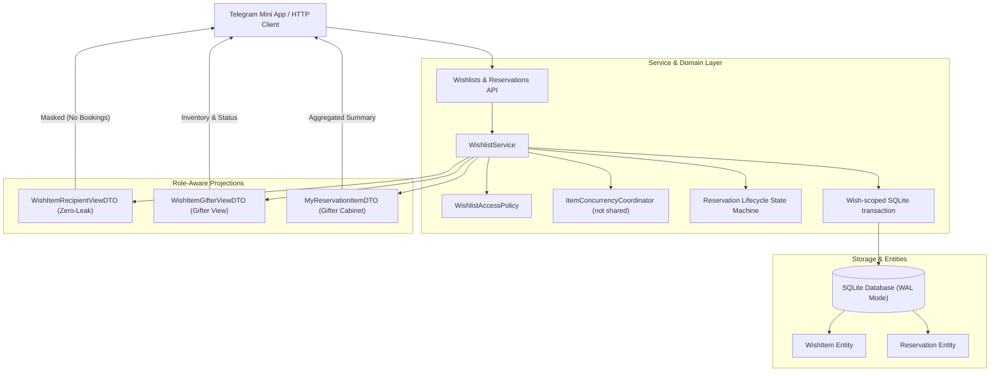
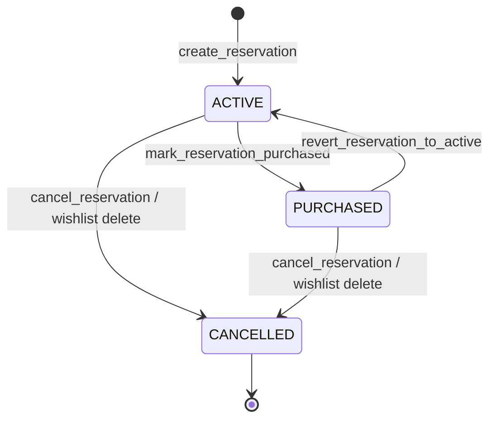

# Reservations Domain: Gift Booking, Lifecycle State Machine, Concurrency, and Surprise Invariant

## Overview

The reservation subsystem in the **Wishlist Service («Вишенка»)** Telegram Mini App coordinates the commitment and purchase workflow for gifts. It enables gifters to book individual units of multi-quantity wish items, mark them as purchased in the real world, cancel bookings, or adjust reserved counts, while guaranteeing strict data confidentiality for the gift recipient.

```
+-------------------------------------------------------------------------------------------------------+
|                                         Wish Item Inventory                                           |
|   desired_quantity = 5   |   received_quantity = 1 (fulfilled)   |   active + purchased = 3 (locked)  |
+-------------------------------------------------------------------------------------------------------+
                                                   |
                                                   v
+-------------------------------------------------------------------------------------------------------+
|                                      Piece Accounting Formula                                         |
|              available_quantity = max(0, desired - fulfilled - (active + purchased))                 |
|                             available_quantity = max(0, 5 - 1 - 3) = 1                                |
+-------------------------------------------------------------------------------------------------------+
                           |                                                |
                           v                                                v
+----------------------------------------------------+   +----------------------------------------------+
|            Recipient Projection View               |   |              Gifter Projection View          |
|      (WishItemRecipientViewDTO: ZERO-LEAK)         |   |          (WishItemGifterViewDTO)             |
| - desired_quantity: 5                              |   | - desired_quantity: 5                        |
| - received_quantity: 1                             |   | - available_quantity: 1                      |
| - NO available_quantity, status, or gifter fields  |   | - is_reserved_by_me: True, my_reserved_qty: 2|
+----------------------------------------------------+   +----------------------------------------------+
```

### Key Capabilities

1. **Piece Accounting & Multi-Quantity Inventory**:
   Supports items with requested quantities up to 1000 units. Available balance is calculated dynamically:
   $$\text{available\_quantity} = \max(0, \text{desired} - \text{fulfilled} - (\text{active} + \text{purchased}))$$
2. **Surprise Invariant (Zero-Leak Guarantee)**:
   The recipient of a gift must never observe or infer whether an item is reserved, who reserved it, how many units remain, or whether it has been purchased. Recipient projections completely omit booking metadata.
3. **Discrete Lifecycle State Machine**:
   Explicit states (`ACTIVE`, `PURCHASED`, `CANCELLED`) track a gifter's
   promise. Receipt is not a status change.
4. **Wish-scoped write exclusion**:
   Concurrent booking is excluded by the wish-scoped SQLite transaction
   (`BEGIN IMMEDIATE`). `execute_wish` builds a new `WishlistService` per
   call, so `ItemConcurrencyCoordinator` (`asyncio.Lock`) is not shared
   across requests or processes. That lock is not the cross-process
   mechanism.
5. **Reduction Lock Invariant**:
   Prevents wishlist authors from reducing an item's desired quantity below the sum of active, purchased, and fulfilled units ($\text{desired} \ge \text{active} + \text{purchased} + \text{fulfilled}$).
6. **Aggregated "My Reservations" Cabinet**:
   Cross-wishlist personal cabinet for gifters displaying all active and purchased gifts with status flags, event dates, and archived item indicators.

---

## Architecture & Components

The reservation subsystem is located in `wishenka.wishlists` and consists of models, schemas, concurrency coordinators, and service methods.



### 1. Reservation Lifecycle State Machine

The reservation lifecycle is governed by [`ReservationStatus`](file:///home/src/wishenka/wishlists/models.py#L26-L33):



- **`ACTIVE`**: The initial state when a gifter reserves units of an item. Locks inventory from other gifters.
- **`PURCHASED`**: The gifter confirmed purchasing the gift in the physical world. Crucially, **`PURCHASED` reservations continue locking inventory** so other gifters cannot book the same units.
- **`CANCELLED`**: The gifter cancelled the reservation or the parent wishlist was deleted. The reserved units are immediately released back to `available_quantity`. This is a terminal state.
- **Receipt leaves the promise open**:
  [`record_item_fulfillment`](file:///home/src/wishenka/wishlists/service.py#L1861-L1945)
  only adds `received_quantity`. It does not cancel the reservation or set
  `ReservationStatus.COMPLETED`. There is no `FULFILLED` status. The promise
  stays `ACTIVE` or `PURCHASED`.

> [!IMPORTANT]
> Both `ACTIVE` and `PURCHASED` states contribute to [`reserved_quantity`](file:///home/src/wishenka/wishlists/models.py#L101-L108). Reverting a purchased reservation back to active or cancelling a reservation adjusts inventory atomically within the concurrency coordinator.

### 2. Item Concurrency Coordinator (`KeyedMutex`)

[`execute_wish`](file:///home/src/wishenka/wishlists/store.py#L942-L997) builds a new
`WishlistService` on every call
([`_load_wish`](file:///home/src/wishenka/wishlists/store.py#L1136) assigns
`WishlistService()`). That instance owns a fresh
[`ItemConcurrencyCoordinator`](file:///home/src/wishenka/wishlists/concurrency.py#L8-L24).
The `asyncio.Lock` lives on that instance. It is not shared across requests
or processes, and it is not the cross-process exclusion.

Exclusion is the wish-scoped SQLite transaction. The class below is only the per-instance lock:

```python
class ItemConcurrencyCoordinator:
    """Coordinates per-item critical sections using keyed asyncio.Lock instances."""

    def __init__(self) -> None:
        self._locks: dict[int, asyncio.Lock] = {}
        self._master_lock = asyncio.Lock()

    @asynccontextmanager
    async def acquire(self, item_id: int) -> AsyncIterator[None]:
        async with self._master_lock:
            if item_id not in self._locks:
                self._locks[item_id] = asyncio.Lock()
            lock = self._locks[item_id]

        async with lock:
            yield
```

**Wish-scoped SQLite exclusion**:

- Several service copies write one SQLite file. The shared exclusion is
  `Connection.begin()` on the wishlist engine. The `begin` listener emits
  `BEGIN IMMEDIATE` (`isolation_level = None`, `PRAGMA journal_mode = WAL`,
  `PRAGMA busy_timeout = 5000`).
- A second writer waits on that reserved lock. The quantity check runs
  inside the transaction, so two calls cannot both commit the same free
  units.
- If the wait exceeds `busy_timeout`, the store raises `InventoryBusyError`
  and changes nothing. `asyncio.Lock` does not cover another request or
  another process.

### 3. Role-Aware DTO Projections & Zero-Leak Guarantees

To enforce the **Surprise Invariant**, [`WishlistService`](file:///home/src/wishenka/wishlists/service.py#L42-L1635) projects items into role-specific DTOs defined in [`wishenka.wishlists.schemas`](file:///home/src/wishenka/wishlists/schemas.py#L10-L102):

| DTO Schema | Target Audience | Reservation Attributes |
|---|---|---|
| [`WishItemRecipientViewDTO`](file:///home/src/wishenka/wishlists/schemas.py#L10-L30) | Gift Recipient / Wishlist Owner | **Strictly None**. Exposes `quantity` and `received_quantity`. Fields like `available_quantity`, `is_fully_reserved`, `my_reserved_quantity`, and gifter names **do not exist**. |
| [`WishItemGifterViewDTO`](file:///home/src/wishenka/wishlists/schemas.py#L32-L68) | Gifters / Public Viewers | Exposes `available_quantity`, `is_fully_reserved`, `is_reserved_by_me`, `my_reserved_quantity`, `my_reservation_status`, and `my_reservation_id`. Masks identities of other gifters. |
| [`MyReservationItemDTO`](file:///home/src/wishenka/wishlists/schemas.py#L69-L92) | Gifter Personal Cabinet | Contains aggregated item details, wishlist title, recipient name, event dates, booking status (`ACTIVE` vs `PURCHASED`), and `is_item_archived`. |
| [`UserReservationsSummaryDTO`](file:///home/src/wishenka/wishlists/schemas.py#L94-L102) | Home Screen Badge | Aggregates `total_active_reservations` and `total_distinct_items` across all wishlists for a user. |

### 4. Self-Reservation Guards

A recipient must never be allowed to reserve an item designated for themselves:
- **Personal Wishlists**: The owner is the recipient for all items (`wishlist.owner_id == user.telegram_id`).
- **Collaborative Wishlists**: Items can specify an explicit [`recipient_user_id`](file:///home/src/wishenka/wishlists/models.py#L94). If `item.recipient_user_id == user.telegram_id`, the user is recognized as the recipient.
- [`WishlistAccessPolicy.can_reserve_item`](file:///home/src/wishenka/wishlists/policy.py#L129-L142) evaluates this invariant. Attempting self-reservation raises [`SelfReservationError`](file:///home/src/wishenka/wishlists/exceptions.py#L29-L31) and logs a warning with event `self_reservation_blocked`.

---

## API & Usage

Below are concrete, runnable Python examples demonstrating typical reservation workflows using [`WishlistService`](file:///home/src/wishenka/wishlists/service.py#L42-L1635).

### 1. Creating a Reservation

```python
import asyncio
from wishenka.auth.models import AuthenticatedUser
from wishenka.wishlists.service import WishlistService
from wishenka.wishlists.models import ReservationStatus

async def reserve_gift():
    service = WishlistService()

    # Setup author and gifter
    author = AuthenticatedUser(telegram_id=1001, first_name="Alice")
    gifter = AuthenticatedUser(telegram_id=2002, first_name="Bob")

    # Author creates a wishlist with a multi-piece item
    wishlist = await service.create_wishlist(owner=author, title="Birthday Wishlist")
    item = await service.add_wish_item(
        wishlist_id=wishlist.id,
        actor=author,
        title="Ceramic Coffee Mug",
        quantity=3,
    )

    # Gifter reserves 2 pieces
    reservation = await service.create_reservation(
        item_id=item.id,
        user=gifter,
        quantity=2,
    )

    print(f"Reservation ID: {reservation.id}")
    print(f"Status: {reservation.status}")  # ReservationStatus.ACTIVE
    print(f"Reserved: {reservation.quantity}, Available: {item.available_quantity}")  # Reserved: 2, Available: 1

asyncio.run(reserve_gift())
```

### 2. Marking as Purchased and Reverting to Active

```python
async def manage_purchase_status(service: WishlistService, reservation_id: int, gifter: AuthenticatedUser):
    # Transition: ACTIVE -> PURCHASED
    purchased_res = await service.mark_reservation_purchased(
        reservation_id=reservation_id,
        user=gifter,
    )
    assert purchased_res.status == ReservationStatus.PURCHASED
    # Inventory reserve is still held:
    assert purchased_res.wish_item.reserved_quantity == purchased_res.quantity

    # Gifter can revert back: PURCHASED -> ACTIVE
    active_res = await service.revert_reservation_to_active(
        reservation_id=reservation_id,
        user=gifter,
    )
    assert active_res.status == ReservationStatus.ACTIVE
```

### 3. Cancelling a Reservation

```python
async def cancel_booking(service: WishlistService, reservation_id: int, gifter: AuthenticatedUser):
    # Transition: ACTIVE / PURCHASED -> CANCELLED
    # Immediately returns quantity back to available_quantity
    cancelled_res = await service.cancel_reservation(
        reservation_id=reservation_id,
        user=gifter,
    )
    assert cancelled_res.status == ReservationStatus.CANCELLED
    print(f"Item available balance restocked: {cancelled_res.wish_item.available_quantity}")
```

### 4. Adjusting Reserved Quantity

```python
async def adjust_quantity(service: WishlistService, reservation_id: int, gifter: AuthenticatedUser):
    # Adjust reservation from 2 to 3 units (if balance permits)
    updated_res = await service.update_reservation_quantity(
        reservation_id=reservation_id,
        user=gifter,
        new_quantity=3,
    )
    print(f"Updated reservation quantity: {updated_res.quantity}")

    # Partial release: reduce reservation from 3 to 1 unit
    reduced_res = await service.update_reservation_quantity(
        reservation_id=reservation_id,
        user=gifter,
        new_quantity=1,
    )
    print(f"Reduced quantity: {reduced_res.quantity}, Restocked to item")
```

### 5. Fetching "My Reservations" and Summary Badge

```python
async def view_my_reservations(service: WishlistService, gifter: AuthenticatedUser):
    # Aggregated cabinet view across all wishlists
    my_reservations = await service.get_user_reservations(user_id=gifter.telegram_id)
    for res in my_reservations:
        print(f"Item: {res.item_title} (x{res.reserved_quantity}) for {res.recipient_name}")
        print(f"Status: {res.status.value}, Archived: {res.is_item_archived}")

    # Summary badge count for home screen
    summary = await service.get_user_reservations_summary(user_id=gifter.telegram_id)
    print(f"Active commitments: {summary.total_active_reservations}")
    print(f"Distinct wish items booked: {summary.total_distinct_items}")
```

### 6. Recording Item Fulfillment by Recipient

```python
async def fulfill_item(service: WishlistService, item_id: int, author: AuthenticatedUser):
    # Author records receipt of 2 units
    item = await service.record_item_fulfillment(
        item_id=item_id,
        actor=author,
        received_quantity=2,
    )
    print(f"Item fulfilled: {item.received_quantity}/{item.quantity}")
```

---

## Configuration & Observability

### Structured Logging Matrix

All reservation operations emit structured logs using `wishenka.wishlists` logger with standardized `extra={"event": "<event_name>", ...}` fields compatible with JSON and syslog log aggregators.

| Event Name | Log Level | Context Fields | Description |
|---|---|---|---|
| `item_reserved` | INFO | `event`, `wishlist_id`, `item_id`, `user_id`, `reservation_id`, `quantity` | Emitted when a gifter successfully reserves item units |
| `reservation_purchased` | INFO | `event`, `wishlist_id`, `item_id`, `user_id`, `reservation_id`, `quantity` | Emitted when a gifter transitions reservation to `PURCHASED` |
| `reservation_reverted` | INFO | `event`, `wishlist_id`, `item_id`, `user_id`, `reservation_id`, `quantity` | Emitted when a reservation is reverted from `PURCHASED` to `ACTIVE` |
| `reservation_cancelled` | INFO | `event`, `wishlist_id`, `item_id`, `user_id`, `reservation_id`, `quantity` | Emitted when a reservation is cancelled and restocked |
| `reservation_quantity_updated` | INFO | `event`, `wishlist_id`, `item_id`, `user_id`, `reservation_id`, `quantity`, `old_quantity` | Emitted when a reservation's quantity is increased or decreased |
| `item_fulfilled` | INFO | `event`, `wishlist_id`, `item_id`, `user_id`, `quantity`, `received_quantity`, `total_quantity` | Emitted when an author records gift receipt and item fulfillment |
| `self_reservation_blocked` | WARNING | `event`, `wishlist_id`, `item_id`, `user_id`, `recipient_user_id` | Emitted when recipient attempts self-reservation (Surprise Invariant) |
| `insufficient_quantity_blocked` | WARNING | `event`, `wishlist_id`, `item_id`, `user_id`, `requested_quantity`, `available_quantity` | Emitted when create or update reservation exceeds unallocated quantity |
| `item_quantity_reduction_rejected`| WARNING | `event`, `item_id`, `wishlist_id`, `actor_id`, `requested_quantity`, `locked_quantity` | Emitted when author tries reducing desired quantity below locked reserve |
| `invalid_reservation_transition` | WARNING | `event`, `reservation_id`, `from_status`, `to_status` | Emitted on invalid status leap (e.g. from `CANCELLED` to `PURCHASED`) |
| `reservation_already_cancelled` | WARNING | `event`, `reservation_id`, `user_id`, `actor_id` | Emitted when cancelling an already cancelled reservation |
| `reservation_not_found` | WARNING | `event`, `reservation_id`, `actor_id` | Emitted when accessing non-existent reservation ID |

> [!NOTE]
> In compliance with the Surprise Invariant, log records emitted during recipient interactions (e.g. viewing personal wishlist details) never include gifter identities, reservation IDs, or booking status.

### Business & Operational Metrics

Key metrics derived from structured log events:
- `wishlist_reservations_created_total` (`event="item_reserved"`): Total count of bookings created.
- `wishlist_reservations_purchased_total` (`event="reservation_purchased"`): Total reservations confirmed as purchased.
- `wishlist_reservations_cancelled_total` (`event="reservation_cancelled"`): Total reservations cancelled.
- `wishlist_items_fulfilled_total` (`event="item_fulfilled"`): Total gift units fulfilled by recipient.
- `wishlist_self_reservations_blocked_total` (`event="self_reservation_blocked"`): Security metric tracking attempted surprise invariant violations.

---

## Troubleshooting

### 1. Concurrency Contention and Race Conditions
- **Symptom**: High volume of concurrent gifters booking the same limited-quantity gift simultaneously.
- **Resolution**:
  - Exclusion is the wish-scoped SQLite transaction (`BEGIN IMMEDIATE`).
    The writer that commits is the one whose balance check is stored. The
    next writer loads that committed balance.
  - [`execute_wish`](file:///home/src/wishenka/wishlists/store.py#L942-L997)
    builds a new `WishlistService` per call, so
    [`ItemConcurrencyCoordinator`](file:///home/src/wishenka/wishlists/concurrency.py#L8-L24)
    (`asyncio.Lock`) is not shared across requests or processes. That lock
    is not the cross-process mechanism.
  - A writer that waits past `busy_timeout` gets `InventoryBusyError` and
    changes nothing. A quantity that no longer fits raises
    [`InsufficientQuantityError`](file:///home/src/wishenka/wishlists/exceptions.py#L33-L35).

### 2. `InsufficientQuantityError`
- **Cause**: Requested reservation quantity exceeds available unreserved units:
  $$\text{quantity} > \text{available\_quantity}$$
- **Common Scenarios**:
  - Another gifter booked the remaining unit seconds earlier.
  - The gifter called [`update_reservation_quantity`](file:///home/src/wishenka/wishlists/service.py#L1239-L1340) with a delta greater than remaining available balance.
- **Resolution**: UI displays real-time `available_quantity` from [`WishItemGifterViewDTO`](file:///home/src/wishenka/wishlists/schemas.py#L32-L68) and handles HTTP 409 / 400 with a prompt to refresh the wishlist.

### 3. `CannotReduceQuantityBelowReservedError`
- **Cause**: Wishlist author attempts to update `desired_quantity` below the units already promised or fulfilled:
  $$\text{new\_quantity} < \text{reserved\_quantity} + \text{received\_quantity}$$
- **Resolution**:
  - The author cannot unilaterally invalidate existing reservations.
  - The author must coordinate with gifters to cancel bookings or accept the existing minimum quantity threshold.

### 4. `SelfReservationError`
- **Cause**: The authenticated user is recognized as the recipient of the gift (either as the owner of a personal wishlist or designated `recipient_user_id` on a collaborative list) and attempted to reserve it.
- **Resolution**: Prevented by design. Users cannot book their own gifts.

### 5. Archived Items & Wishlists
- **New Reservations**: Calling [`create_reservation`](file:///home/src/wishenka/wishlists/service.py#L880-L1013) on an archived wishlist or archived item raises [`WishlistArchivedError`](file:///home/src/wishenka/wishlists/exceptions.py#L21-L23).
- **Existing Reservations**: When an author archives an item with existing bookings, the reservations are **not deleted**. They remain in the gifter's "My Reservations" cabinet with `is_item_archived=True`. The gifter retains full ability to cancel ([`cancel_reservation`](file:///home/src/wishenka/wishlists/service.py#L1169-L1237)) or mark as purchased ([`mark_reservation_purchased`](file:///home/src/wishenka/wishlists/service.py#L1030-L1095)).
