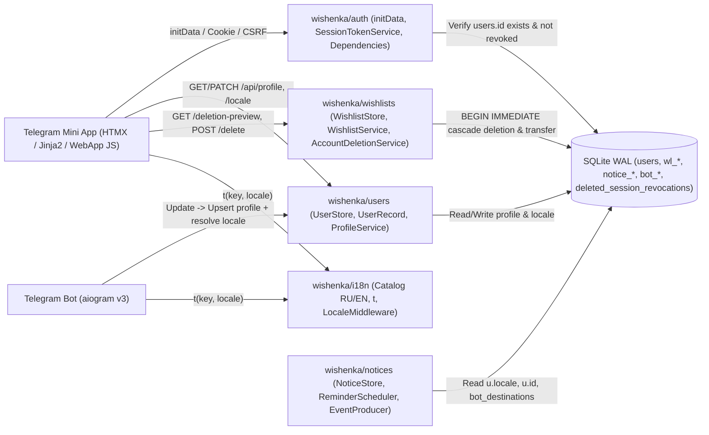

# Users Domain, i18n Synchronization, and Account Deletion

> [!NOTE]
> **Implementation Status (`WISHENKA-32/33/34/35`):** The `users` baseline, **`WISHENKA-33`** (`RU`/`EN` bilingual i18n — see [i18n.md](i18n.md)), **`WISHENKA-34`** (profile birthdate fields, `NotificationPreferencesStore`, and Mini App `/settings` & `/api/profile/*` preferences/notification APIs), and **`WISHENKA-35`** (`AccountDeletionService`, `deleted_session_revocations`, session liveness/revocation checks, `/api/profile/deletion-preview`, and `/api/profile/delete`) are **implemented**. (`avatar_url` and `ChatFullInfo.birthdate` sync remain future enhancements.)

---

## Overview

The `wishenka.users` subsystem manages durable Telegram user identity, profile synchronization, `RU`/`EN` localization state, notification preferences exposure, and transactional account deletion across the Telegram Mini App (TMA), `aiogram` bot, and asynchronous notification workers.

| Scope | Status | Responsibility |
| --- | --- | --- |
| Baseline (`wishenka/users/`) | Implemented | `users` table (imperatively created by `UserStore.initialize()`), `UserRecord`, `UserStore.upsert_user` / `get_by_telegram_id` / `get_by_id`, unconditional `language_code` sync. |
| `WISHENKA-33` | Implemented | `RU`/`EN` i18n across TMA, Bot, and Outbox; Alembic revision `add_user_locale` adding `locale` & `locale_source` (synced with `UserStore.initialize()`); `wishenka/i18n/`; `GET /settings` & `PATCH /api/profile/locale`; `wishenka/bot/i18n.py` `LocaleMiddleware`. |
| `WISHENKA-34` | Implemented (Profile & Preferences) | `birth_day`, `birth_month`, `birth_year`, `birthdate_source` (`'auto'` \| `'explicit'`) in `users`/`UserRecord`, `validate_birthdate`, `set_birthdate`/`clear_birthdate`, `NotificationPreferencesStore` (`wishenka/notices/preferences.py`), `birthday_reminders` priority in `reminders.py`, and Mini App `/settings` UI + `/api/profile/preferences`, `/api/profile/birthdate`, `/api/profile/notifications/*` APIs. (`avatar_url` and `ChatFullInfo.birthdate` sync remain future enhancements.) |
| `WISHENKA-35` | Implemented | `AccountDeletionService` (`BEGIN IMMEDIATE` cascade), deterministic collaborative ownership transfer (`is_collaborative = 1` preserved), item recipient anonymization, PII purge across `telegram_id` and `users.id` tables, `deleted_session_revocations`, auth liveness/revocation checks, `GET /api/profile/deletion-preview`, `POST /api/profile/delete`, and Settings UI confirmation. |

> [!IMPORTANT]
> **Coordination with sibling tasks (`WISHENKA-73`, `WISHENKA-89`, and `WISHENKA-31`):** Any profile, settings, or role changes in the `WISHENKA-31` epic must build on the single `users` Alembic revision and the `UserRecord`/`locale`/`AccountDeletionService` contracts documented here rather than creating parallel profile tables or competing migrations.

---

## Architecture

### Baseline vs. Target Module Layout

| Component | Location | Status | Role |
| --- | --- | --- | --- |
| User models & store | `wishenka/users/models.py`, `wishenka/users/store.py` | Implemented (`WISHENKA-33/34`) | `UserRecord` (including `birth_day`, `birth_month`, `birth_year`, `birthdate_source`) and async SQLite repository (`UserStore`). |
| Notification preferences | `wishenka/notices/preferences.py` | Implemented (`WISHENKA-34`) | `NotificationPreferencesStore` for global and per-wishlist notification overrides and effective resolution. |
| Auth models & dependencies | `wishenka/auth/models.py`, `wishenka/auth/dependencies.py` | Implemented (extended in `WISHENKA-35`) | DB liveness and `deleted_session_revocations` checks (`WISHENKA-35`). |
| i18n catalog & helpers | `wishenka/i18n/`, `wishenka/bot/i18n.py` | Implemented (`WISHENKA-33`) | `resolve_telegram_locale()`, `RU`/`EN` `CATALOG`, Jinja2 global `t()`, FastAPI `LocaleDep`, `aiogram` `LocaleMiddleware`. |
| Account deletion & cleanup | `wishenka/wishlists/deletion.py`, `wishenka/wishlists/cleanup.py` | Implemented (`WISHENKA-35`) | `AccountDeletionService` (`BEGIN IMMEDIATE` cascade + transfer) and expired `deleted_session_revocations` purge. |
| Notification workers | `wishenka/notices/store.py`, `wishenka/notices/reminders.py` | Implemented (`WISHENKA-33/34`) | Reads `u.locale` with `'en'` fallback; checks `birthday_reminders` before `reminders` for birthday reminders; re-checks `JOIN users` + `JOIN bot_destinations` in `BEGIN IMMEDIATE` right before send. |
| Bot routers | `wishenka/bot/entry.py`, `capture.py`, `birthdays.py`, `support.py` | Implemented (`WISHENKA-33`) | Outer `LocaleMiddleware` (`WISHENKA-33`). |
| Web / Mini App routes | `wishenka/web/routes/profile.py`, `wishenka/web/templates/settings.html` | Implemented (`WISHENKA-33/34/35`) | `GET /settings`, `PATCH /api/profile/locale` (`WISHENKA-33`); `GET /api/profile/preferences`, `PATCH /api/profile/birthdate`, `PUT /api/profile/notifications/global`, `GET/PUT /api/profile/notifications/wishlists/{wishlist_id}` (`WISHENKA-34`); `GET /api/profile/deletion-preview`, `POST /api/profile/delete` (`WISHENKA-35`). |

### Target Interaction Flow (`WISHENKA-33/34/35`)



### Critical Schema Invariant: Identifier Split (`telegram_id` vs. `users.id`)

All tables live in a single SQLite WAL database (`settings.database_url`, `PRAGMA foreign_keys = ON`, `PRAGMA busy_timeout = 5000`), but historical schemas split user references across two keys:

| Identifier Key | Tables & Columns (Baseline) | Notes |
| --- | --- | --- |
| **`users.telegram_id`** | `wl_lists.owner_id`, `wl_members.user_id`, `wl_items.recipient_user_id`, `wl_reservations.user_id`, `wl_favorites.user_id`, `wl_view_history.user_id`, `wl_idempotency_records.actor_id`, `notification_outbox.giver_user_id`, `notice_receipt_keys.giver_user_id`, `user_notification_settings.user_id`, `wl_list_notification_settings.user_id`, `reminder_outbox.user_id` | Wishlist domain, notification preferences, and outbox rows. `wl_items` has no separate `created_by` column. |
| **`users.id`** (internal PK) | `bot_destinations.user_id`, `birthday_entries.owner_id`, `support_tickets.owner_id` (also has `telegram_id`) | Bot delivery, private birthdays, and support rate-limiting. |
| **Bot dialog state** | `birthday_input(owner_id, chat_id)`, `support_input(owner_id, chat_id)`, `bot_drafts(owner, chat)`, `bot_capture_order(owner, chat)` | `WISHENKA-35` deletion must clear these using the exact key conventions of `bot/birthdays.py`, `bot/support.py`, and `bot/capture.py`. |

---

## Data Model & Alembic Schema Delta

### Baseline vs. Target `users` Schema

Currently (`auth.md`), `users` is created imperatively in `UserStore.initialize()` with `id`, `telegram_id`, `first_name`, `last_name`, `username`, `language_code`, `is_premium`, `created_at`, `updated_at`.

Implemented DDL for `users` (`WISHENKA-33` + `WISHENKA-34`):

```sql
CREATE TABLE IF NOT EXISTS users (
    id INTEGER PRIMARY KEY AUTOINCREMENT,
    telegram_id INTEGER NOT NULL UNIQUE,
    first_name TEXT NOT NULL,
    last_name TEXT,
    username TEXT,
    language_code TEXT,
    locale TEXT NOT NULL DEFAULT 'en' CHECK (locale IN ('ru', 'en')),
    locale_source TEXT NOT NULL DEFAULT 'auto' CHECK (locale_source IN ('auto', 'explicit')),
    birth_day INTEGER,
    birth_month INTEGER,
    birth_year INTEGER,
    birthdate_source TEXT NOT NULL DEFAULT 'auto' CHECK (birthdate_source IN ('auto', 'explicit')),
    is_premium INTEGER NOT NULL DEFAULT 0 CHECK (is_premium IN (0, 1)),
    created_at TEXT NOT NULL,
    updated_at TEXT NOT NULL
);
```

Implemented DDL for stateless session revocations (`WISHENKA-35`, Alembic revision `add_deleted_session_revocations`):

```sql
CREATE TABLE IF NOT EXISTS deleted_session_revocations (
    subject_hash TEXT PRIMARY KEY,
    revoked_before INTEGER NOT NULL,
    expires_at INTEGER NOT NULL
);
CREATE INDEX IF NOT EXISTS idx_deleted_session_revocations_expires
    ON deleted_session_revocations (expires_at);
```

- **`subject_hash`**: Hex digest of `HMAC-SHA256(settings.secret_key, f"deleted:{telegram_id}")`. Irreversible without `secret_key`, stores zero PII, and is purged by `wishenka/wishlists/cleanup.py` once `expires_at` (`now_epoch + session_ttl_seconds`) passes.

### Profile Field Contracts (`WISHENKA-34`)

- **`display_name`** (computed `@property` on `UserRecord`, not a DB column): `f"{first_name} {last_name or ''}".strip()` or `first_name`.
- **`username`**: Synced on Telegram login and bot updates; cleared to `None` when omitted in subsequent updates.
- **`birth_day`, `birth_month`, `birth_year` & `birthdate_source`**:
  - Stored as separate nullable integer columns (`birth_day`, `birth_month`, `birth_year`) plus `birthdate_source TEXT NOT NULL DEFAULT 'auto' CHECK (birthdate_source IN ('auto', 'explicit'))`.
  - `validate_birthdate(day, month, year=None)` in `wishenka/users/store.py` validates calendar dates using `datetime.date` (with leap year `2000` when `year is None`, so February 29 without a year is valid, while invalid dates like February 30 raise `ValueError`) and restricts `year` to `1900..current_utc_year`.
  - Precedence rules:
    - `UserStore.set_birthdate(telegram_id, day=..., month=..., year=...)` and `UserStore.clear_birthdate(telegram_id)` set `birthdate_source = 'explicit'`.
    - `UserStore.upsert_user(...)` preserves existing `birth_day`, `birth_month`, `birth_year`, and `birthdate_source` when `birthdate_source = 'explicit'` so Telegram re-logins or bot syncs never overwrite or clear manual edits.
- **Notification settings linkage**: Existing tables `user_notification_settings(user_id, event_type, enabled, updated_at)` and `wl_list_notification_settings(user_id, wishlist_id, event_type, enabled, updated_at)` both key `user_id` on `users.telegram_id`, managed via `NotificationPreferencesStore` (`wishenka/notices/preferences.py`). Supported global `event_type` values: `wishlist_changes` (default `True`), `reservation_changes` (opt-in, default `False`), `gift_received` (default `True`), `reminders` (default `True`), and `birthday_reminders` (default `True`). Per-wishlist overrides support `wishlist_changes`, `reservation_changes`, `gift_received`, and `reminders` (`True`, `False`, or `None` to inherit global). See [notifications.md](notifications.md) for delivery-time resolution.

### Alembic Migration Strategy (`WISHENKA-33` / `WISHENKA-35`)

The Alembic revisions in `wishenka/wishlists/alembic/versions/` include `add_user_locale` (`WISHENKA-33`) and `add_deleted_session_revocations` (`WISHENKA-35`, `down_revision = "add_user_locale"`, see [migrations.md](migrations.md)):

1. `add_user_locale`: idempotently creates `users` (if absent in DBs initialized solely by `WishlistStore`) or adds missing `locale` / `locale_source` columns and backfills `locale` from `language_code`.
2. `add_deleted_session_revocations`: creates `deleted_session_revocations` and `idx_deleted_session_revocations_expires` (`CREATE TABLE IF NOT EXISTS` / `CREATE INDEX IF NOT EXISTS`).
3. `UserStore.initialize()` remains aligned on the same `users` DDL and `PRAGMA table_info(users)` check so isolated unit tests that initialize `UserStore` without `WishlistStore.initialize()` get the identical schema.

---

## i18n Protocol (`RU` / `EN` Sync — Implemented `WISHENKA-33`)

> [!NOTE]
> See [i18n.md](i18n.md) for the complete `wishenka.i18n` developer guide, API reference, and troubleshooting.

### Normalization and Atomic Precedence

```python
SupportedLocale = Literal["ru", "en"]
LocaleSource = Literal["auto", "explicit"]


def resolve_telegram_locale(language_code: str | None) -> SupportedLocale:
    if language_code and language_code.strip().lower().startswith("ru"):
        return "ru"
    return "en"
```

- **Supported locales**: Only `"ru"` and `"en"`, with `"en"` as default fallback.
- **Automatic sync (`locale_source = 'auto'`)**: On `UserStore.upsert_user(...)` (Mini App login and Bot updates), raw `language_code` always updates, while `locale` updates atomically in SQL:
  `CASE WHEN users.locale_source = 'explicit' THEN users.locale ELSE excluded.locale END`.
- **Explicit switch (`locale_source = 'explicit'`)**: `PATCH /api/profile/locale` calls `UserStore.set_locale(telegram_id, locale)`, locking `locale_source = 'explicit'`. Subsequent Telegram logins/updates with a different client `language_code` do not overwrite `users.locale`.

### Channel Synchronization

1. **Telegram Mini App (SSR + HTMX)**:
   - `locale` is **never cached** in `SessionClaims` or cookies.
   - `get_request_locale` reads the live `users.locale` from SQLite WAL via `UserStore.get_by_telegram_id` for authenticated requests.
   - Anonymous visitors to public share links (`/s/{token}`) resolve locale via `resolve_telegram_locale` from `?lang=` or `Accept-Language` (fallback `'en'`).
   - `wishenka/i18n/` exposes `t(key, locale, **params)` as a Jinja2 global and for localized route responses.
   - `PATCH /api/profile/locale` returns `{"locale": ..., "locale_source": "explicit"}` and supports `HX-Refresh: true` for instant HTMX page re-render.
2. **Telegram Bot (`aiogram` v3)**:
   - A single outer `LocaleMiddleware` on `Dispatcher` (before `entry`, `capture`, `birthdays`, `support` routers) calls `UserStore.upsert_from_bot(event.from_user)` and injects `data["locale"]` and `data["t"]`.
   - When switching locale via `PATCH /api/profile/locale`, if an active `Bot` and `bot_destinations.chat_id` exist, a non-blocking best-effort call updates `bot.set_my_commands(..., scope=BotCommandScopeChat(chat_id=chat_id))`.
3. **Asynchronous Notices & Reminders**:
   - `NoticeStore._eligible` (`claim_next`, `refresh_claim`) and `claim_reminder` / `refresh_reminder` switch from `u.language_code` to `u.locale` with fallback `'en'`.
   - Because `refresh_claim` and `refresh_reminder` re-read `users` right before sending to Telegram, pending outbox items queued prior to a language switch are delivered in the newly selected language.

---

## Account Deletion & Session Revocation (`AccountDeletionService` — Implemented `WISHENKA-35`)

### Transaction & Locking Contract

All account deletion steps execute inside a **single `BEGIN IMMEDIATE` transaction** (`WishlistStore.transaction`) with `PRAGMA foreign_keys = ON` and `PRAGMA busy_timeout = 5000`, serializing deletion against concurrent reservations, gift receipts, `ReminderScheduler`, and `NoticeStore` workers. Any mid-transaction error rolls back completely.

At transaction start, the service computes `subject_hash = compute_revocation_subject_hash(telegram_id, secret_key)` (defined in `wishenka/auth/session.py`), resolves `internal_user_id = users.id` (if `users` table exists), and queries owned lists, memberships, and reservations for `telegram_id`.

### Six-Step Cascade Specification

1. **Idempotency guard**: Check `users` (if table exists), `wl_lists`, `wl_members`, and `wl_reservations` for `telegram_id`. If none exist, return `DeletionResultDTO(already_deleted=True, deleted_lists=0, transferred_lists=0, cancelled_reservations=0, anonymized_items=0)`.
2. **Handle owned wishlists (`wl_lists WHERE owner_id = :tg_id`, ordered by `id ASC`)**:
   - **A. Personal (`is_collaborative = 0`) or solo collaborative (no other `wl_members`)**: Hard-delete `DELETE FROM wl_lists WHERE id IN :ids` (FK `ON DELETE CASCADE` removes `wl_items`, other gifters' `wl_reservations`, `wl_receipts`, `wl_members`, `wl_favorites`, `wl_view_history`, `notification_outbox`, and `notice_receipt_keys`), plus explicit cleanup of `wl_list_notification_settings`, `wl_tokens`, and `wl_invite_tokens`.
   - **B. Collaborative with other members (`active` or `archived`)**:
     - Query `wl_members WHERE wishlist_id = :wid AND user_id != :tg_id` joined with `LEFT JOIN users u ON u.telegram_id = m.user_id`.
     - Select a single successor deterministically by ascending `(_role_rank(role), _parse_utc_datetime(joined_at), _parse_utc_datetime(user_created_at), user_id)`:
       1. `_role_rank`: `admin -> 1`, `coauthor` / `collaborator` `-> 2`, `member` / other `-> 3`.
       2. `joined_at`: earliest `wl_members.joined_at` normalized to UTC `datetime`.
       3. `user_created_at`: earliest `users.created_at` (`datetime.max` UTC if no `users` row).
       4. `user_id` (`telegram_id`): smallest numeric Telegram ID.
     - Update `wl_lists`: set `owner_id = new_owner_id`, `owner_name = new_owner_name`, `updated_at = now_iso`, and **keep `is_collaborative = 1`** even if no other members remain (otherwise `WishlistAccessPolicy.is_recipient_id` would treat the new owner as recipient of all wishes and violate surprise/visibility rules).
     - Remove both the outgoing owner and the promoted successor from `wl_members`.
     - Anonymize items on that list where `recipient_user_id = :tg_id` or legacy `(recipient_user_id IS NULL AND recipient_name IS NOT NULL)` by clearing `recipient_user_id = NULL, recipient_name = NULL`.
     - Queue a neutral `SharedEvent(kind="membership_changed", ...)` via `EventProducer` **only** to remaining participants (never mentioning the deleted user or reservations).
3. **Exit others' collaborative wishlists & anonymize wishes**:
   - Anonymize `wl_items` where `recipient_user_id = :tg_id` (`recipient_user_id = NULL, recipient_name = NULL`), then `DELETE FROM wl_members WHERE wishlist_id = :wl_id AND user_id = :tg_id`.
   - Queue a neutral `SharedEvent(kind="membership_changed", ...)` to the list owner and remaining members.
   - Wishes, other gifters' active/purchased reservations, and `wl_receipts` remain intact without revealing surprise data.
4. **Cancel own reservations across others' wishlists**: `DELETE FROM wl_reservations WHERE user_id = :tg_id` (across all statuses).
   - Immediately reduces `occupied` and frees `available_quantity` for other gifters.
   - `wl_receipts` stores no `user_id` or `reservation_id` and stays intact.
   - Zero notifications are sent to list recipients (Surprise Invariant).
5. **Purge remaining PII & bot state**:
   - By `tg_id`: delete from `wl_favorites`, `wl_view_history`, `user_notification_settings`, `wl_list_notification_settings`, `notification_outbox` (`giver_user_id`), `notice_receipt_keys` (`giver_user_id`), `reminder_outbox` (`user_id`), and `wl_idempotency_records` (`actor_id`).
   - By `internal_user_id` / `tg_id` / `chat_id`: delete from `birthday_entries`, `birthday_input`, `bot_destinations`, `support_input`, `support_tickets`, `bot_drafts`, and `bot_capture_order`, then `DELETE FROM users WHERE telegram_id = :tg_id`.
6. **Revoke stateless sessions & allow instant re-registration**:
   - Upsert `(subject_hash, revoked_before = now_epoch, expires_at = now_epoch + max(1, session_ttl_seconds))` into `deleted_session_revocations` (`ON CONFLICT(subject_hash) DO UPDATE SET revoked_before = MAX(...), expires_at = MAX(...)`) inside the same transaction.
   - `get_optional_current_user` (`wishenka/auth/dependencies.py`, via `_is_session_active`) checks:
     - When `claims.user_id is not None`: `SELECT 1 FROM users WHERE id = :user_id AND telegram_id = :tg_id` (skipped only if `users` table does not exist in isolated route tests; otherwise returns `401 Unauthorized` with `"Session revoked or account deleted"`). Because `users.id` uses `AUTOINCREMENT`, immediate re-registration assigns a fresh `users.id` while all pre-deletion tokens on every device remain permanently rejected.
     - When `claims.user_id is None` (legacy/direct tokens): checks `deleted_session_revocations` by `subject_hash` and returns `401` if `claims.iat <= revoked_before`.
   - `POST /api/profile/delete` calls `delete_session_cookie(response=response, settings=settings)`.
   - In-flight outbox safety: `NoticeStore.refresh_claim` and `refresh_reminder` already re-check `JOIN users` + `JOIN bot_destinations` inside `BEGIN IMMEDIATE` prior to Telegram delivery and abort if the user was deleted.

---

## API / Usage

### Python Interfaces

- **`UserStore` (`wishenka/users/store.py`)**:
  - `upsert_user(user: TelegramUser, *, channel: str = "miniapp") -> UserRecord` (`WISHENKA-33/34`; preserves `explicit` `locale` and `birthdate`)
  - `upsert_from_bot(tg_user: Any) -> UserRecord` (`WISHENKA-33`)
  - `set_locale(telegram_id: int, locale: SupportedLocale) -> UserRecord` (`WISHENKA-33`)
  - `set_birthdate(telegram_id: int, *, day: int, month: int, year: int | None = None) -> UserRecord` (`WISHENKA-34`, sets `birthdate_source = 'explicit'`)
  - `clear_birthdate(telegram_id: int) -> UserRecord` (`WISHENKA-34`, clears `birth_day`/`birth_month`/`birth_year` and sets `birthdate_source = 'explicit'`)
  - `validate_birthdate(day: object, month: object, year: object = None) -> tuple[int, int, int | None]` (`WISHENKA-34`)
- **`NotificationPreferencesStore` (`wishenka/notices/preferences.py`, `WISHENKA-34`)**:
  - `get_global_settings(telegram_id: int) -> dict[str, bool]`
  - `update_global_settings(telegram_id: int, updates: dict[str, bool]) -> dict[str, bool]`
  - `list_accessible_wishlists_with_preferences(telegram_id: int) -> list[WishlistNotificationSummary]`
  - `get_wishlist_preferences(telegram_id: int, wishlist_id: int) -> WishlistNotificationSummary | None`
  - `update_wishlist_overrides(telegram_id: int, wishlist_id: int, overrides: dict[str, bool | None]) -> WishlistNotificationSummary | None`
- **`wishenka/i18n/` & `wishenka/bot/i18n.py` (`WISHENKA-33`, implemented — see [i18n.md](i18n.md))**:
  - `resolve_telegram_locale(language_code: str | None) -> SupportedLocale`
  - `t(key: str, locale: str | None = DEFAULT_LOCALE, **kwargs: Any) -> str`
  - `get_request_locale(...) -> SupportedLocale` / `LocaleDep` (FastAPI dependency)
  - `LocaleMiddleware` (`aiogram` outer middleware setting `data["locale"]`, `data["t"]`, and `data["user_record"]`)
- **`AccountDeletionService` (`wishenka/wishlists/deletion.py`, Implemented `WISHENKA-35`)**:
  - `preview_account_deletion(telegram_id: int) -> DeletionPreviewDTO` (`personal_lists_count`, `collaborative_transferred_count`, `collaborative_deleted_count`, `reservations_count`; reveals no foreign booking/recipient data)
  - `delete_account(telegram_id: int, *, secret_key: str, session_ttl_seconds: int, now: datetime | None = None) -> DeletionResultDTO` (`already_deleted`, `deleted_lists`, `transferred_lists`, `cancelled_reservations`, `anonymized_items`)

### Mini App HTTP Endpoints

The settings screen client behavior (pending, restore vs reconcile, unknown state, deletion
without retries) is documented in
[miniapp.md](miniapp.md#personal-settings-screen-wishenka-291); endpoint contracts are unchanged.

| Method & Path | Task | Purpose |
| --- | --- | --- |
| `PATCH /api/profile/locale` | `WISHENKA-33` (Implemented) | Switch `locale` (`ru` \| `en`) with `locale_source = "explicit"`, `HX-Refresh: true` + CSRF, and background bot command sync. |
| `GET /settings` | `WISHENKA-33/34` (Implemented) | HTML settings screen (language selector, birthdate preferences, `birthday_reminders` toggle, global notification switches, and per-wishlist notification overrides). |
| `GET /api/profile/preferences` | `WISHENKA-34` (Implemented) | Return `{locale, locale_source, birthdate, birthday_reminders, global_notifications, wishlists}` for the authenticated user. |
| `PATCH /api/profile/birthdate` | `WISHENKA-34` (Implemented) | Update (`{day, month, year?}`) or clear (`{clear: true}`) user birthdate with `birthdate_source = "explicit"`. Returns `422` when `day`/`month` are missing (unless `clear: true`) or on invalid calendar dates. |
| `PUT /api/profile/notifications/global` | `WISHENKA-34` (Implemented) | Update global `user_notification_settings` (`{settings: {...}}`). Returns `422` if `settings` is not an object, or on unknown category or non-boolean value. |
| `GET /api/profile/notifications/wishlists/{wishlist_id}` | `WISHENKA-34` (Implemented) | Return per-wishlist `overrides` and `effective` settings, or `404` if inaccessible/deleted. |
| `PUT /api/profile/notifications/wishlists/{wishlist_id}` | `WISHENKA-34` (Implemented) | Update or reset (`null`) per-wishlist overrides in `wl_list_notification_settings` (`{overrides: {...}}`), or `404`/`422`. |
| `GET /api/profile/deletion-preview` | `WISHENKA-35` (Implemented) | Aggregate counts of lists/reservations impacted by deletion (`personal_lists_count`, `collaborative_transferred_count`, `collaborative_deleted_count`, `reservations_count`). |
| `POST /api/profile/delete` | `WISHENKA-35` (Implemented) | Atomic account deletion (`{"confirm": true}` + CSRF; returns `422` if `confirm is not True`), returns `DeletionResultDTO` JSON, and clears session cookie via `delete_session_cookie`. |

---

## Configuration

Profile, i18n, and deletion rely on existing `Settings` fields (see [auth.md](auth.md) and [migrations.md](migrations.md)):

| Setting | Environment Variable | Role in `users` Domain |
| --- | --- | --- |
| `database_url` | `WISHENKA_DATABASE_URL` | Single SQLite WAL file shared by `UserStore`, `WishlistStore`, `NoticeStore`, and Bot state. |
| `secret_key` | `WISHENKA_SECRET_KEY` | Keys `HMAC-SHA256(secret_key, f"deleted:{telegram_id}")` for `deleted_session_revocations` and `subject_hash_prefix` log correlation. |
| `session_ttl_seconds` | `WISHENKA_SESSION_TTL_SECONDS` | Controls `expires_at` (`now + session_ttl_seconds`, default 30 days) for purging `deleted_session_revocations`. |
| `bot_token` | `WISHENKA_BOT_TOKEN` | Validates `initData`; never persisted via `avatar_url` (`api.telegram.org/file/bot<TOKEN>/...` blocked) and never logged. |

---

## Observability and Privacy Contract

> [!NOTE]
> The logging events, privacy invariants, and metric definitions below are the target contract from `ai-tasks/WISHENKA-32/50-observability.md` for `WISHENKA-33/34/35`.

Structured logging uses [`wishenka/logging.py`](../../wishenka/logging.py) (`configure_logging`, `JsonFormatter`). All target fields must be passed via `extra={...}` as flat scalar values (`str`, `int`, `float`, `bool`) avoiding reserved `LogRecord` `standard_fields` names (e.g., avoid `name`).

### Mandatory Privacy & Sanitization Invariants

1. **Zero PII in logs**: Never log `first_name`, `last_name`, `display_name`, `username`, `avatar_url`/`photo_url`, `birthday` (`YYYY-MM-DD`, `--MM-DD`, day/month/year), `support_tickets`, `bot_drafts`, or list/item titles.
2. **Pseudonymous deletion correlation**: `WISHENKA-35` deletion, transfer, and revocation events log `subject_hash_prefix` (first 12 hex characters of `HMAC-SHA256(settings.secret_key, f"deleted:{telegram_id}")`) instead of `telegram_id` or `users.id`.
3. **Zero secrets**: Never log `initData`, cookie/Bearer tokens, `secret_key`, CSRF tokens, bot tokens (including Bot API file URLs), or `wl_tokens`/`wl_invite_tokens`.
4. **Surprise Invariant**: Never log `(reservation_id, giver_user_id, recipient_user_id, item_id)` links during deletion or ownership transfer — emit aggregate counts only (`cancelled_reservations_count`, `anonymized_items_count`).

### Target Structured Log Events

| Task | Level | Logger | Event (`message`) | Safe `extra` Fields |
| --- | --- | --- | --- | --- |
| `WISHENKA-33` | `DEBUG` | `wishenka.i18n` / `wishenka.users.store` | `locale_auto_resolved` | `channel`, `resolved_locale`, `locale_source`, `changed`, `fallback_used` |
| `WISHENKA-33` | `INFO` | `wishenka.web.profile` / `wishenka.users.store` | `locale_explicit_updated` | `user_id`, `previous_locale`, `new_locale`, `previous_source`, `locale_source` |
| `WISHENKA-33` | `WARNING` | `wishenka.web.profile` | `locale_invalid_request` | `user_id`, `status_code` (`400` \| `422`) |
| `WISHENKA-33` | `WARNING` | `wishenka.i18n` | `i18n_missing_translation_key` | `i18n_key`, `locale`, `fallback_locale` (`en` \| `key`) |
| `WISHENKA-33` | `WARNING` | `wishenka.bot.i18n` | `bot_commands_locale_sync_failed` | `user_id`, `target_locale`, `error_type` |
| `WISHENKA-33` | `DEBUG` | `wishenka.notices.store` / `wishenka.notices.reminders` | `notice_locale_resolved` | `channel`, `locale`, `fallback_used` |
| `WISHENKA-34` | `INFO` | `wishenka.users.store` | `birthdate_explicit_updated` | `user_id`, `has_year`, `birthdate_source` |
| `WISHENKA-34` | `INFO` | `wishenka.users.store` | `birthdate_explicit_cleared` | `user_id`, `birthdate_source` |
| `WISHENKA-34` | `WARNING` | `wishenka.web.profile` | `profile_malformed_json` | `status_code` (`422`) |
| `WISHENKA-34` | `WARNING` | `wishenka.web.profile` | `birthdate_invalid_request` | `user_id`, `status_code` (`422`) |
| `WISHENKA-34` | `WARNING` | `wishenka.web.profile` | `birthdate_user_not_found` | `user_id`, `status_code` (`404`) |
| `WISHENKA-34` | `INFO` | `wishenka.notices.preferences` | `notification_global_updated` | `updated_count`, `categories` |
| `WISHENKA-34` | `INFO` | `wishenka.notices.preferences` | `notification_wishlist_updated` | `wishlist_id`, `role`, `updated_count`, `cleared_count` |
| `WISHENKA-34` | `WARNING` | `wishenka.web.profile` | `notification_global_invalid_request` | `user_id`, `status_code` (`422`) |
| `WISHENKA-34` | `WARNING` | `wishenka.web.profile` | `notification_wishlist_not_found` | `user_id`, `wishlist_id`, `status_code` (`404`) |
| `WISHENKA-34` | `WARNING` | `wishenka.web.profile` | `notification_wishlist_invalid_request` | `user_id`, `wishlist_id`, `status_code` (`422`) |
| `WISHENKA-35` | `DEBUG` | `wishenka.wishlists.deletion` | `account_deletion_preview_computed` | `personal_lists_count`, `collaborative_transferred_count`, `collaborative_deleted_count`, `reservations_count` |
| `WISHENKA-35` | `INFO` | `wishenka.wishlists.deletion` | `account_deleted` | `subject_hash_prefix`, `deleted_lists`, `transferred_lists`, `cancelled_reservations`, `anonymized_items`, `duration_ms` |
| `WISHENKA-35` | `INFO` | `wishenka.wishlists.deletion` | `account_deletion_already_deleted` | `subject_hash_prefix`, `duration_ms` |
| `WISHENKA-35` | `ERROR` | `wishenka.wishlists.deletion` | `account_deletion_failed` | `subject_hash_prefix`, `error_class`, `duration_ms` |
| `WISHENKA-35` | `WARNING` | `wishenka.web.profile` | `account_deletion_rejected` | `reason` (`missing_confirmation`), `status_code` (`422`) |
| `WISHENKA-35` | `WARNING` | `wishenka.auth` | `session_rejected_revoked_or_deleted` | `subject_hash_prefix`, `auth_method` |
| `WISHENKA-35` | `INFO` | `wishenka.wishlists.store` | `session_revocations_purged` | `purged_count` |
| `WISHENKA-35` | `INFO` | `wishenka.wishlists.cleanup` | `background_cleanup_completed` | `expired_tokens_cleaned`, `wishlists_purged`, `idempotency_records_cleaned`, `session_revocations_cleaned`, `duration_ms` |

### Target Metrics Contract (Low-Cardinality Labels)

No Prometheus/OpenTelemetry exporter is currently wired in the codebase; these canonical metric definitions govern `WISHENKA-33/34/35` instrumentation (via a metrics registry when enabled or log aggregation over `JsonFormatter`). Labels must never include `user_id`, `telegram_id`, `wishlist_id`, or `subject_hash_prefix`:

- **Latency (Histograms)**:
  - `wishenka_account_deletion_duration_seconds{outcome}` (`completed` | `already_deleted` | `error`)
  - `wishenka_deletion_preview_duration_seconds`
  - `wishenka_revocation_cleanup_duration_seconds`
- **Business Counters**:
  - `wishenka_i18n_locale_switches_total{from_locale, to_locale}`
  - `wishenka_i18n_auto_resolutions_total{locale, channel}`
  - `wishenka_profile_birthday_updates_total{source, action}`
  - `wishenka_notification_settings_updates_total{scope, event_type, enabled}`
  - `wishenka_account_deletions_total{outcome}`
  - `wishenka_account_deletion_entities_total{entity}` (`deleted_lists` | `transferred_lists` | `cancelled_reservations` | `anonymized_items`)
- **Health, Security & Outbox Counters**:
  - `wishenka_i18n_missing_keys_total{locale}`
  - `wishenka_telegram_best_effort_sync_errors_total{operation}` (`set_my_commands` | `get_chat_birthdate`)
  - `wishenka_profile_avatar_rejections_total{reason}`
  - `wishenka_auth_revoked_rejections_total{reason}`
  - `wishenka_notices_aborted_deleted_user_total{channel}`
  - `wishenka_revocation_table_expired_purged_total`
- **Alert triggers (target)**: any `account_deletion_failed` (`ERROR`), any `profile_avatar_rejected{reason="bot_token_url_blocked"}`, non-zero post-release `i18n_missing_translation_key`, or spikes in `bot_commands_locale_sync_failed` / `profile_birthday_telegram_fetch_failed`.

---

## Troubleshooting & Planned Test Suites

### Common Failure Modes (Design Guardrails)

- **Bot token exposure in `avatar_url`**: Rejected by design (`profile_avatar_rejected` with `reason="bot_token_url_blocked"`). Only `https://` URLs from verified `WebAppUser.photo_url` are accepted; never call `getFile` to build avatar URLs.
- **Manual birthday overwritten by Telegram**: Ensure `UserStore.sync_telegram_birthday` checks `birthday_source != 'manual'` before writing or clearing. Even after an explicit manual clear, `birthday_source` remains `'manual'`.
- **New owner loses gifter visibility after collaborative list transfer**: Never reset `is_collaborative = 0` when transferring ownership, even if `wl_members` becomes empty; `WishlistAccessPolicy.is_recipient_id` relies on `is_collaborative = 1` to avoid treating the new owner as the recipient of every wish.
- **Old tokens surviving instant re-registration**: Verify `get_optional_current_user` checks `users.id` (`AUTOINCREMENT`) alongside `telegram_id` and falls back to `deleted_session_revocations` when `claims.user_id is None`.
- **Schema drift in standalone unit tests**: Keep `UserStore.initialize()` DDL and `PRAGMA table_info(users)` column checks aligned with the Alembic revision in `wishenka/wishlists/alembic/versions/`.

### Verification Suites (`WISHENKA-33/34/35`)

- `tests/test_personal_settings_browser.py` and `tests/test_personal_settings_observability.py`
  (`WISHENKA-291`) — settings UI states, failure reconciliation and log contract of the
  `/api/profile/*` calls (see [miniapp.md](miniapp.md#personal-settings-screen-wishenka-291)).
- `tests/test_settings_switch_browser.py` (`WISHENKA-307`) — look, accessibility and states of
  the settings switches (see [miniapp.md](miniapp.md#settings-switches-wishenka-307)).

- `tests/test_wishenka_34_repro.py` (`WISHENKA-34`, Implemented) — API availability for `/api/profile/preferences` and `/api/profile/notifications/global`, per-wishlist override priority and `null` reset, `birthday_reminders` suppression without deleting `birthday_entries`, explicit birthdate persistence across `upsert_user`, invalid date (`30 Feb`) rejection, and surprise invariant preservation.
- `tests/test_wishenka_34_preferences.py` (`WISHENKA-34`, Implemented) — unit and integration coverage for `validate_birthdate`, `UserStore.set_birthdate` / `clear_birthdate`, `NotificationPreferencesStore`, `/settings` SSR rendering (RU/EN), and `/api/profile/*` validation/404/CSRF contracts.
- `tests/test_account_deletion_repro.py` (`WISHENKA-35`, Implemented) — end-to-end repro covering `/api/profile/deletion-preview`, `/api/profile/delete`, `AccountDeletionService` cascade, ownership transfer, reservation cleanup, PII removal, and session token revocation.
- `tests/test_account_deletion.py` (`WISHENKA-35`, Implemented) — personal list cascade & Surprise Invariant, deterministic collaborative transfer tie-breakers & `is_collaborative=1`, member exit anonymization, full PII purge, token revocation across devices & re-registration, `BEGIN IMMEDIATE` rollback atomicity, idempotency, expired revocation cleanup, and PII-free log verification.
