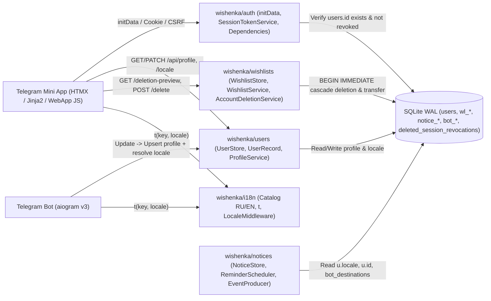

# Users Domain, i18n Synchronization, and Account Deletion

> [!NOTE]
> **Implementation Status (`WISHENKA-32`):** This document describes both the **implemented baseline** currently in the repository and the **agreed target contracts** decomposed in `WISHENKA-32` for implementation in **`WISHENKA-33`**, **`WISHENKA-34`**, and **`WISHENKA-35`**. Sections marked **Target (`WISHENKA-33/34/35`)** are not shipped in runtime code yet; do not assume their tables, endpoints, or services exist until the corresponding task lands.

---

## Overview

The `wishenka.users` subsystem manages durable Telegram user identity, profile synchronization, `RU`/`EN` localization state, notification preferences exposure, and transactional account deletion across the Telegram Mini App (TMA), `aiogram` bot, and asynchronous notification workers.

| Scope | Status | Responsibility |
| --- | --- | --- |
| Baseline (`wishenka/users/`) | Implemented | `users` table (imperatively created by `UserStore.initialize()`), `UserRecord`, `UserStore.upsert_user` / `get_by_telegram_id` / `get_by_id`, unconditional `language_code` sync. |
| `WISHENKA-33` | Target (Planned) | `RU`/`EN` i18n across TMA, Bot, and Outbox; Alembic revision from `add_idempotency_records` adding `locale` & `locale_source` (synced with `UserStore.initialize()`); `wishenka/i18n/`; `PATCH /api/profile/locale`; `LocaleMiddleware`. |
| `WISHENKA-34` | Target (Planned) | Extended profile (`TelegramUser.photo_url`, `avatar_url`, `birthday`, `birthday_source`, computed `display_name`), manual birthday override, best-effort `ChatFullInfo.birthdate` sync, Mini App settings UI (`GET /settings`) & profile/notification CRUD APIs, real member names/avatars in wishlist views. |
| `WISHENKA-35` | Target (Planned) | `AccountDeletionService` (`BEGIN IMMEDIATE` cascade), deterministic collaborative ownership transfer (`is_collaborative = 1` preserved), PII purge across `telegram_id` and `users.id` tables, `deleted_session_revocations`, auth liveness/revocation checks, `GET /api/profile/deletion-preview`, `POST /api/profile/delete`. |

> [!IMPORTANT]
> **Coordination with sibling tasks (`WISHENKA-73`, `WISHENKA-89`, and `WISHENKA-31`):** Any profile, settings, or role changes in the `WISHENKA-31` epic must build on the single `users` Alembic revision and the `UserRecord`/`locale`/`AccountDeletionService` contracts documented here rather than creating parallel profile tables or competing migrations.

---

## Architecture

### Baseline vs. Target Module Layout

| Component | Location | Status | Role |
| --- | --- | --- | --- |
| User models & store | `wishenka/users/models.py`, `wishenka/users/store.py` | Implemented (extended in `WISHENKA-33/34`) | `UserRecord` and async SQLite repository (`UserStore`). |
| Auth models & dependencies | `wishenka/auth/models.py`, `wishenka/auth/dependencies.py` | Implemented (extended in `WISHENKA-34/35`) | `TelegramUser.photo_url` extraction (`WISHENKA-34`); DB liveness and `deleted_session_revocations` checks (`WISHENKA-35`). |
| i18n catalog & helpers | `wishenka/i18n/` | Target (`WISHENKA-33`) | `resolve_telegram_locale()`, `RU`/`EN` dictionary, Jinja2 global `t()`, FastAPI `get_request_locale`, `aiogram` `LocaleMiddleware`. |
| Account deletion & cleanup | `wishenka/wishlists/deletion.py`, `wishenka/wishlists/cleanup.py` | Target (`WISHENKA-35`) | `AccountDeletionService` (`BEGIN IMMEDIATE` cascade + transfer) and expired revocation purge. |
| Notification workers | `wishenka/notices/store.py`, `wishenka/notices/reminders.py` | Implemented (updated in `WISHENKA-33`) | Reads `u.locale` with `'en'` fallback; already re-checks `JOIN users` + `JOIN bot_destinations` in `BEGIN IMMEDIATE` right before send. |
| Bot routers | `wishenka/bot/entry.py`, `capture.py`, `birthdays.py`, `support.py` | Implemented (updated in `WISHENKA-33/34`) | Outer `LocaleMiddleware` (`WISHENKA-33`) and best-effort `ChatFullInfo.birthdate` sync (`WISHENKA-34`). |
| Web / Mini App routes | `wishenka/web/` | Target (`WISHENKA-33/34/35`) | `GET /settings`, `/api/profile*`, `/api/notifications/settings`, `/api/wishlists/{wishlist_id}/notifications/settings`. |

### Target Interaction Flow (`WISHENKA-33/34/35`)



### Critical Schema Invariant: Identifier Split (`telegram_id` vs. `users.id`)

All tables live in a single SQLite WAL database (`settings.database_url`, `PRAGMA foreign_keys = ON`, `PRAGMA busy_timeout = 5000`), but historical schemas split user references across two keys:

| Identifier Key | Tables & Columns (Baseline) | Notes |
| --- | --- | --- |
| **`users.telegram_id`** | `wl_lists.owner_id`, `wl_members.user_id`, `wl_items.recipient_user_id`, `wl_reservations.user_id`, `wl_favorites.user_id`, `wl_view_history.user_id`, `wl_idempotency_records.actor_id`, `notification_outbox.giver_user_id`, `notice_receipt_keys.giver_user_id`, `user_notification_settings.user_id`, `wl_list_notification_settings.user_id`, `reminder_outbox.user_id` | Wishlist domain, notification preferences, and outbox rows. `wl_items` has no separate `created_by` column. |
| **`users.id`** (internal PK) | `bot_destinations.user_id`, `birthday_entries.owner_id`, `support_tickets.owner_id` (also has `telegram_id`) | Bot delivery, private birthdays, and support rate-limiting. |
| **Bot dialog state** | `birthday_input(owner_id, chat_id)`, `support_input(owner_id, chat_id)`, `bot_drafts(owner, chat)`, `bot_capture_order(owner, chat)` | `WISHENKA-35` deletion must clear these using the exact key conventions of `bot/birthdays.py`, `bot/support.py`, and `bot/capture.py`. |

---

## Data Model & Alembic Schema Delta

### Baseline vs. Target `users` Schema

Currently (`auth.md`), `users` is created imperatively in `UserStore.initialize()` with `id`, `telegram_id`, `first_name`, `last_name`, `username`, `language_code`, `is_premium`, `created_at`, `updated_at`.

Target DDL for `users` (`WISHENKA-33` + `WISHENKA-34`):

```sql
CREATE TABLE IF NOT EXISTS users (
    id INTEGER PRIMARY KEY AUTOINCREMENT,
    telegram_id INTEGER NOT NULL UNIQUE,
    first_name TEXT NOT NULL,
    last_name TEXT,
    username TEXT,
    avatar_url TEXT,
    birthday TEXT,
    birthday_source TEXT CHECK (birthday_source IS NULL OR birthday_source IN ('telegram', 'manual')),
    language_code TEXT,
    locale TEXT NOT NULL DEFAULT 'en' CHECK (locale IN ('ru', 'en')),
    locale_source TEXT NOT NULL DEFAULT 'auto' CHECK (locale_source IN ('auto', 'explicit')),
    is_premium INTEGER NOT NULL DEFAULT 0 CHECK (is_premium IN (0, 1)),
    created_at TEXT NOT NULL,
    updated_at TEXT NOT NULL
);
```

Target DDL for stateless session revocations (`WISHENKA-35`):

```sql
CREATE TABLE IF NOT EXISTS deleted_session_revocations (
    subject_hash TEXT PRIMARY KEY,
    revoked_before INTEGER NOT NULL,
    expires_at INTEGER NOT NULL
);
CREATE INDEX IF NOT EXISTS idx_deleted_session_revocations_expires
    ON deleted_session_revocations (expires_at);
```

- **`subject_hash`**: Hex digest of `HMAC-SHA256(settings.secret_key, f"deleted:{telegram_id}")`. Irreversible without `secret_key`, stores zero PII, and is purged by `wishenka/wishlists/cleanup.py` once `expires_at` (`now_epoch + session_ttl_seconds`) passes.

### Profile Field Contracts (`WISHENKA-34`)

- **`display_name`** (computed `@property` on `UserRecord` and `UserProfileDTO`, not a DB column): `f"{first_name} {last_name}".strip()` when `last_name` is non-empty, otherwise `first_name`. Wishlist member views display `UserRecord.display_name` (falling back to `f"User {user_id}"` only if a legacy test fixture omits a `users` row). `wl_lists.owner_name` is kept synchronized on list creation and ownership transfer.
- **`username`**: Synced on Telegram login and bot updates; cleared to `None` when omitted in subsequent updates.
- **`avatar_url`**: Populated only from validated `TelegramUser.photo_url` (`https://` scheme and length check). When `initData` omits `photo_url`, `avatar_url` is cleared to `NULL`. Bot updates (`aiogram.types.User`, which lacks `photo_url`) pass `sync_avatar=False` so an existing `avatar_url` is preserved. Bot API proxy URLs (`api.telegram.org/file/bot<TOKEN>/...`) must **never** be persisted to avoid leaking the bot token.
- **`birthday` & `birthday_source`**:
  - Accepted formats: `YYYY-MM-DD` (full date) and `--MM-DD` (month/day without year, matching Telegram `ChatFullInfo.birthdate(day, month, year | None)` and allowing `--02-29`).
  - Precedence rules:
    - When `birthday_source` is `NULL` or `'telegram'`, Telegram sync writes `(birthday, 'telegram')` or clears both to `NULL` if hidden/removed in Telegram.
    - When `birthday_source = 'manual'`, manual edits (including explicitly clearing the date, which keeps `birthday = NULL, birthday_source = 'manual'`) have absolute priority and are **never** overwritten or cleared by Telegram sync.
- **Notification settings linkage**: Existing tables `user_notification_settings(user_id, event_type, enabled, updated_at)` and `wl_list_notification_settings(user_id, wishlist_id, event_type, enabled, updated_at)` both key `user_id` on `users.telegram_id`, with list-level overrides taking precedence via `COALESCE`. Supported `event_type` values: `gift_received`, `wishlist_changes`, `reservation_changes` (opt-in, default `0`), `reminders`.

### Alembic Migration Strategy (`WISHENKA-33` / `WISHENKA-35`)

Currently, the Alembic head in `wishenka/wishlists/alembic/versions/` is `add_idempotency_records` (see [migrations.md](migrations.md)). The target schema migration builds linearly on `down_revision = "add_idempotency_records"`:

1. Idempotently create `users` (if absent in DBs initialized solely by `WishlistStore`), or inspect `PRAGMA table_info(users)` and add missing columns (`avatar_url`, `birthday`, `birthday_source`, `locale`, `locale_source`).
2. Backfill existing rows:

   ```sql
   UPDATE users
   SET locale = CASE
           WHEN lower(trim(coalesce(language_code, ''))) LIKE 'ru%' THEN 'ru'
           ELSE 'en'
       END,
       locale_source = 'auto'
   WHERE locale IS NULL OR locale NOT IN ('ru', 'en');
   ```

3. Create `deleted_session_revocations` and `idx_deleted_session_revocations_expires`.
4. Keep `UserStore.initialize()` strictly aligned on the same DDL and `PRAGMA table_info(users)` check so isolated unit tests that initialize `UserStore` without `WishlistStore.initialize()` get the identical schema.

---

## i18n Protocol (`RU` / `EN` Sync — Target `WISHENKA-33`)

> [!NOTE]
> **Baseline vs. Target:** Currently, `NoticeStore._eligible` defaults to `"ru"`, `claim_reminder`/`refresh_reminder` check `(language or "").lower().startswith("en")` with an implicit Russian fallback, `UserStore.upsert_user` unconditionally overwrites `language_code`, and `bot/entry.py` reads `language_code`. `WISHENKA-33` unifies all output channels onto `users.locale`.

### Normalization and Atomic Precedence

```python
SupportedLocale = Literal["ru", "en"]
LocaleSource = Literal["auto", "explicit"]


def resolve_telegram_locale(language_code: str | None) -> SupportedLocale:
    if language_code and language_code.strip().lower().startswith("ru"):
        return "ru"
    return "en"
```

- **Supported locales**: Only `"ru"` and `"en"`, with `"en"` as default fallback.
- **Automatic sync (`locale_source = 'auto'`)**: On `UserStore.upsert_user(...)` (Mini App login and Bot updates), raw `language_code` always updates, while `locale` updates atomically in SQL:
  `CASE WHEN users.locale_source = 'explicit' THEN users.locale ELSE excluded.locale END`.
- **Explicit switch (`locale_source = 'explicit'`)**: `PATCH /api/profile/locale` calls `UserStore.set_explicit_locale(telegram_id, locale)`, locking `locale_source = 'explicit'`. Subsequent Telegram logins/updates with a different client `language_code` do not overwrite `users.locale`.

### Channel Synchronization

1. **Telegram Mini App (SSR + HTMX)**:
   - `locale` is **never cached** in `SessionClaims` or cookies.
   - `get_request_locale` reads the live `users.locale` from SQLite WAL via `UserStore.get_by_telegram_id` for authenticated requests.
   - Anonymous visitors to public share links (`/s/{token}`) resolve locale via `resolve_telegram_locale` from `?lang=` or `Accept-Language` (fallback `'en'`).
   - `wishenka/i18n/` exposes `t(key, locale, **params)` as a Jinja2 global and for localized route responses.
   - `PATCH /api/profile/locale` returns `{"locale": ..., "locale_source": "explicit"}` and supports `HX-Refresh: true` for instant HTMX page re-render.
2. **Telegram Bot (`aiogram` v3)**:
   - A single outer `LocaleMiddleware` on `Dispatcher` (before `entry`, `capture`, `birthdays`, `support` routers) calls `UserStore.upsert_from_bot(event.from_user)` and injects `data["locale"]` and `data["t"]`.
   - When switching locale via `PATCH /api/profile/locale`, if an active `Bot` and `bot_destinations.chat_id` exist, a non-blocking best-effort call updates `bot.set_my_commands(..., scope=BotCommandScopeChat(chat_id=chat_id))`.
3. **Asynchronous Notices & Reminders**:
   - `NoticeStore._eligible` (`claim_next`, `refresh_claim`) and `claim_reminder` / `refresh_reminder` switch from `u.language_code` to `u.locale` with fallback `'en'`.
   - Because `refresh_claim` and `refresh_reminder` re-read `users` right before sending to Telegram, pending outbox items queued prior to a language switch are delivered in the newly selected language.

---

## Account Deletion & Session Revocation (`AccountDeletionService` — Target `WISHENKA-35`)

### Transaction & Locking Contract

All account deletion steps execute inside a **single `BEGIN IMMEDIATE` transaction** (`WishlistStore.transaction`) with `PRAGMA foreign_keys = ON` and `PRAGMA busy_timeout = 5000`, serializing deletion against concurrent reservations, gift receipts, `ReminderScheduler`, and `NoticeStore` workers. Any mid-transaction error rolls back completely.

At transaction start, the service resolves `tg_id = current_user.telegram_id`, `internal_user_id = users.id`, and any linked `bot_destinations.chat_id`.

### Six-Step Cascade Specification

1. **Idempotency guard**: Check `users` (and any residual `wl_lists`/`wl_members`/`wl_reservations` rows) for `tg_id`. If none exist, return `DeletionResultDTO(already_deleted=True)`.
2. **Cancel own reservations across others' wishlists**: `DELETE FROM wl_reservations WHERE user_id = :tg_id` (across all statuses: `active`, `purchased`, `cancelled`, `completed`).
   - Immediately reduces `occupied` and frees `available_quantity` for other gifters.
   - `wl_receipts` stores no `user_id` or `reservation_id` and stays intact.
   - Zero notifications are sent to list recipients (Surprise Invariant).
3. **Handle owned wishlists (`wl_lists WHERE owner_id = :tg_id`, all statuses)**:
   - **A. Soft-deleted (`status = 'deleted'`)**: Hard-delete `DELETE FROM wl_lists WHERE id = :wid` and explicitly delete non-FK rows in `wl_tokens`, `wl_invite_tokens`, and `reminder_outbox`.
   - **B. Personal (`is_collaborative = 0`) or solo collaborative (no other `wl_members`)**: Hard-delete `DELETE FROM wl_lists WHERE id = :wid` (FK `ON DELETE CASCADE` removes `wl_items`, other gifters' `wl_reservations`, `wl_receipts`, `wl_members`, `wl_favorites`, `wl_view_history`, `wl_list_notification_settings`, `notification_outbox`, and `notice_receipt_keys`), plus explicit cleanup of `wl_tokens`, `wl_invite_tokens`, and `reminder_outbox`.
   - **C. Collaborative with other members (`active` or `archived`)**:
     - Query `wl_members WHERE wishlist_id = :wid AND user_id != :tg_id` joined with `LEFT JOIN users u ON u.telegram_id = m.user_id`.
     - Select a single successor deterministically by ascending `(role_rank, joined_at_utc, user_created_at_utc, user_id)`:
       1. `role_rank`: `admin -> 1`, `coauthor` / `collaborator` (if present) `-> 2`, `member` / other `-> 3`.
       2. `joined_at_utc`: earliest `wl_members.joined_at` normalized to UTC `datetime`.
       3. `user_created_at_utc`: earliest `users.created_at` (`datetime.max` UTC if no `users` row in test fixtures).
       4. `user_id` (`telegram_id`): smallest numeric Telegram ID.
     - Update `wl_lists`: set `owner_id = successor.user_id`, `owner_name = successor_display_name`, `updated_at = :now`, and **keep `is_collaborative = 1`** even if no other members remain (otherwise `WishlistAccessPolicy.is_recipient_id` would treat the new owner as recipient of all wishes and violate surprise/visibility rules).
     - Remove successor (and outgoing owner if present) from `wl_members`.
     - Emit a neutral `membership_changed` event via `EventProducer` **only** to remaining participants (never mentioning the deleted user or reservations).
4. **Exit others' collaborative wishlists & anonymize wishes**:
   - `DELETE FROM wl_members WHERE user_id = :tg_id`.
   - `UPDATE wl_items SET recipient_user_id = NULL, recipient_name = NULL, updated_at = :now WHERE recipient_user_id = :tg_id`.
   - Wishes, other gifters' active/purchased reservations, and `wl_receipts` remain intact without revealing surprise data.
5. **Purge remaining PII & bot state**:
   - By `tg_id`: delete from `wl_favorites`, `wl_view_history`, `user_notification_settings`, `wl_list_notification_settings`, `notification_outbox` (`giver_user_id`), `notice_receipt_keys` (`giver_user_id`), `reminder_outbox` (`user_id`), and `wl_idempotency_records` (`actor_id`).
   - By `internal_user_id` / `tg_id` / `chat_id`: delete from `birthday_entries`, `birthday_input`, `bot_destinations`, `support_input`, `support_tickets`, `bot_drafts`, and `bot_capture_order`, then `DELETE FROM users WHERE telegram_id = :tg_id`.
6. **Revoke stateless sessions & allow instant re-registration**:
   - Insert `(subject_hash, revoked_before = now_epoch, expires_at = now_epoch + session_ttl_seconds)` into `deleted_session_revocations` inside the same transaction.
   - `get_optional_current_user` (`wishenka/auth/dependencies.py`) checks:
     - When `claims.user_id is not None`: `SELECT 1 FROM users WHERE id = :user_id AND telegram_id = :tg_id` (skipped only if `users` table does not exist in isolated route tests; otherwise returns `401 Unauthorized`). Because `users.id` uses `AUTOINCREMENT`, immediate re-registration assigns a fresh `users.id` while all pre-deletion tokens on every device remain permanently rejected.
     - When `claims.user_id is None` (legacy/direct tokens): checks `deleted_session_revocations` by `subject_hash` and returns `401` if `claims.iat <= revoked_before`.
   - `POST /api/profile/delete` calls `delete_session_cookie(response, settings)`.
   - In-flight outbox safety: `NoticeStore.refresh_claim` and `refresh_reminder` already re-check `JOIN users` + `JOIN bot_destinations` inside `BEGIN IMMEDIATE` prior to Telegram delivery and abort if the user was deleted.

---

## API / Usage (Target Contracts)

### Python Interfaces

- **`UserStore` (`wishenka/users/store.py`)**:
  - `upsert_user(user: TelegramUser, *, sync_avatar: bool = True) -> UserRecord` (`WISHENKA-33/34`)
  - `set_explicit_locale(telegram_id: int, locale: SupportedLocale) -> UserRecord` (`WISHENKA-33`)
  - `update_manual_birthday(telegram_id: int, birthday: str | None) -> UserRecord` (`WISHENKA-34`)
  - `sync_telegram_birthday(telegram_id: int, birthday: str | None) -> UserRecord | None` (`WISHENKA-34`)
- **`wishenka/i18n/` (`WISHENKA-33`)**:
  - `resolve_telegram_locale(language_code: str | None) -> SupportedLocale`
  - `t(key: str, locale: SupportedLocale, **kwargs: Any) -> str`
  - `get_request_locale(...) -> SupportedLocale` (FastAPI dependency)
  - `LocaleMiddleware` (`aiogram` outer middleware setting `data["locale"]`, `data["t"]`)
- **`AccountDeletionService` (`wishenka/wishlists/deletion.py`, `WISHENKA-35`)**:
  - `preview_account_deletion(telegram_id: int) -> DeletionPreviewDTO` (`personal_lists_count`, `collaborative_transferred_count`, `collaborative_deleted_count`, `reservations_count`; reveals no foreign booking/recipient data)
  - `delete_account(telegram_id: int, *, secret_key: str, session_ttl_seconds: int, now: datetime | None = None) -> DeletionResultDTO` (`already_deleted`, `deleted_lists`, `transferred_lists`, `cancelled_reservations`)

### Planned Mini App HTTP Endpoints

| Method & Path | Task | Purpose |
| --- | --- | --- |
| `PATCH /api/profile/locale` | `WISHENKA-33` | Switch `locale` (`ru` \| `en`) with `locale_source = "explicit"`, optional `HX-Refresh: true` + CSRF. |
| `GET /settings` | `WISHENKA-34` | HTML settings screen (profile, language, notifications, account deletion). |
| `GET /api/profile` | `WISHENKA-34` | Return current user profile DTO/HTML fragment. |
| `PATCH /api/profile` | `WISHENKA-34` | Update or clear manual `birthday` (`YYYY-MM-DD` \| `--MM-DD`, `birthday_source = "manual"`). |
| `PUT /api/notifications/settings` | `WISHENKA-34` | Update global `user_notification_settings`. |
| `PUT /api/wishlists/{wishlist_id}/notifications/settings` | `WISHENKA-34` | Update per-wishlist overrides in `wl_list_notification_settings`. |
| `GET /api/profile/deletion-preview` | `WISHENKA-35` | Aggregate counts of lists/reservations impacted by deletion. |
| `POST /api/profile/delete` | `WISHENKA-35` | Atomic account deletion (`confirm: true` + CSRF) and session cookie removal. |

---

## Configuration

Profile, i18n, and deletion rely on existing `Settings` fields (see [auth.md](auth.md) and [migrations.md](migrations.md)):

| Setting | Environment Variable | Role in `users` Domain |
| --- | --- | --- |
| `database_url` | `WISHENKA_DATABASE_URL` | Single SQLite WAL file shared by `UserStore`, `WishlistStore`, `NoticeStore`, and Bot state. |
| `secret_key` | `WISHENKA_SECRET_KEY` | Keys `HMAC-SHA256(secret_key, f"deleted:{telegram_id}")` for `deleted_session_revocations` and `subject_hash_prefix` log correlation. |
| `session_ttl_seconds` | `WISHENKA_SESSION_TTL_SECONDS` | Controls `expires_at` (`now + session_ttl_seconds`, default 30 days) for purging `deleted_session_revocations`. |
| `bot_token` | `WISHENKA_BOT_TOKEN` | Validates `initData`; never persisted via `avatar_url` (`api.telegram.org/file/bot<TOKEN>/...` blocked) and never logged. |

---

## Observability and Privacy Contract

> [!NOTE]
> The logging events, privacy invariants, and metric definitions below are the target contract from `ai-tasks/WISHENKA-32/50-observability.md` for `WISHENKA-33/34/35`.

Structured logging uses [`wishenka/logging.py`](../../wishenka/logging.py) (`configure_logging`, `JsonFormatter`). All target fields must be passed via `extra={...}` as flat scalar values (`str`, `int`, `float`, `bool`) avoiding reserved `LogRecord` `standard_fields` names (e.g., avoid `name`).

### Mandatory Privacy & Sanitization Invariants

1. **Zero PII in logs**: Never log `first_name`, `last_name`, `display_name`, `username`, `avatar_url`/`photo_url`, `birthday` (`YYYY-MM-DD`, `--MM-DD`, day/month/year), `support_tickets`, `bot_drafts`, or list/item titles.
2. **Pseudonymous deletion correlation**: `WISHENKA-35` deletion, transfer, and revocation events log `subject_hash_prefix` (first 12 hex characters of `HMAC-SHA256(settings.secret_key, f"deleted:{telegram_id}")`) instead of `telegram_id` or `users.id`.
3. **Zero secrets**: Never log `initData`, cookie/Bearer tokens, `secret_key`, CSRF tokens, bot tokens (including Bot API file URLs), or `wl_tokens`/`wl_invite_tokens`.
4. **Surprise Invariant**: Never log `(reservation_id, giver_user_id, recipient_user_id, item_id)` links during deletion or ownership transfer — emit aggregate counts only (`cancelled_reservations_count`, `anonymized_items_count`).

### Target Structured Log Events

| Task | Level | Logger | Event (`message`) | Safe `extra` Fields |
| --- | --- | --- | --- | --- |
| `WISHENKA-33` | `DEBUG` | `wishenka.i18n` / `wishenka.users.store` | `locale_auto_resolved` | `channel`, `resolved_locale`, `locale_source`, `changed`, `fallback_used` |
| `WISHENKA-33` | `INFO` | `wishenka.web.profile` / `wishenka.users.store` | `locale_explicit_updated` | `user_id`, `previous_locale`, `new_locale`, `previous_source`, `locale_source` |
| `WISHENKA-33` | `WARNING` | `wishenka.web.profile` | `locale_invalid_request` | `user_id`, `status_code` (`400` \| `422`) |
| `WISHENKA-33` | `WARNING` | `wishenka.i18n` | `i18n_missing_translation_key` | `i18n_key`, `locale`, `fallback_locale` (`en` \| `key`) |
| `WISHENKA-33` | `WARNING` | `wishenka.bot.i18n` | `bot_commands_locale_sync_failed` | `user_id`, `target_locale`, `error_type` |
| `WISHENKA-33` | `DEBUG` | `wishenka.notices.store` / `wishenka.notices.reminders` | `notice_locale_resolved` | `channel`, `locale`, `fallback_used` |
| `WISHENKA-34` | `WARNING` | `wishenka.auth.models` / `wishenka.users.store` | `profile_avatar_rejected` | `reason` (`invalid_scheme` \| `bot_token_url_blocked` \| `exceeds_max_length`) |
| `WISHENKA-34` | `DEBUG` | `wishenka.users.store` | `profile_telegram_synced` | `user_id`, `sync_avatar`, `has_username`, `has_avatar`, `username_cleared`, `avatar_cleared` |
| `WISHENKA-34` | `DEBUG` | `wishenka.users.store` | `profile_birthday_synced` | `user_id`, `outcome` (`updated` \| `cleared` \| `skipped_manual_override`), `birthday_source`, `has_year` |
| `WISHENKA-34` | `WARNING` | `wishenka.bot` | `profile_birthday_telegram_fetch_failed` | `user_id`, `error_type` |
| `WISHENKA-34` | `INFO` | `wishenka.web.profile` / `wishenka.users.store` | `profile_birthday_manual_updated` | `user_id`, `action` (`set` \| `cleared`), `birthday_source` (`manual`), `has_year` |
| `WISHENKA-34` | `WARNING` | `wishenka.web.profile` | `profile_birthday_invalid` | `user_id`, `error_code` (`invalid_birthday_format` \| `invalid_calendar_date`) |
| `WISHENKA-34` | `INFO` | `wishenka.web.profile` | `notification_settings_updated` | `scope` (`global` \| `wishlist`), `user_id`, `wishlist_id`, `event_type`, `enabled` |
| `WISHENKA-35` | `DEBUG` | `wishenka.wishlists.deletion` | `account_deletion_previewed` | `user_id`, `personal_lists_count`, `collaborative_transferred_count`, `collaborative_deleted_count`, `reservations_count` |
| `WISHENKA-35` | `INFO` | `wishenka.wishlists.deletion` | `account_deletion_started` | `subject_hash_prefix`, `confirmed` (`True`) |
| `WISHENKA-35` | `INFO` | `wishenka.wishlists.deletion` | `collaborative_wishlist_ownership_transferred` | `subject_hash_prefix`, `wishlist_id`, `wishlist_status`, `selected_role_rank`, `tie_breaker_level`, `is_collaborative` (`True`) |
| `WISHENKA-35` | `INFO` | `wishenka.wishlists.deletion` | `account_deletion_completed` | `subject_hash_prefix`, `already_deleted`, `deleted_lists_count`, `transferred_lists_count`, `cancelled_reservations_count`, `anonymized_items_count`, `revocation_recorded`, `duration_ms` |
| `WISHENKA-35` | `ERROR` | `wishenka.wishlists.deletion` | `account_deletion_failed` | `subject_hash_prefix`, `stage`, `error_type`, `rolled_back` (`True`), `duration_ms` |
| `WISHENKA-35` | `WARNING` | `wishenka.auth.dependencies` | `session_rejected_revoked_or_deleted` | `reason` (`user_not_found` \| `session_revoked`), `subject_hash_prefix`, `has_user_id_claim` |
| `WISHENKA-35` | `DEBUG` | `wishenka.notices.store` / `wishenka.notices.reminders` | `notice_aborted_user_deleted` | `channel` (`notice_outbox` \| `reminder_outbox`), `reason` (`user_or_destination_deleted`) |
| `WISHENKA-35` | `INFO` / `DEBUG` | `wishenka.wishlists.cleanup` | `session_revocations_purged` | `purged_count`, `duration_ms` |

### Target Metrics Contract (Low-Cardinality Labels)

No Prometheus/OpenTelemetry exporter is currently wired in the codebase; these canonical metric definitions govern `WISHENKA-33/34/35` instrumentation (via a metrics registry when enabled or log aggregation over `JsonFormatter`). Labels must never include `user_id`, `telegram_id`, `wishlist_id`, or `subject_hash_prefix`:

- **Latency (Histograms)**:
  - `wishenka_account_deletion_duration_seconds{outcome}` (`completed` | `already_deleted` | `error`)
  - `wishenka_deletion_preview_duration_seconds`
  - `wishenka_revocation_cleanup_duration_seconds`
- **Business Counters**:
  - `wishenka_i18n_locale_switches_total{from_locale, to_locale}`
  - `wishenka_i18n_auto_resolutions_total{locale, channel}`
  - `wishenka_profile_birthday_updates_total{source, action}`
  - `wishenka_notification_settings_updates_total{scope, event_type, enabled}`
  - `wishenka_account_deletions_total{outcome}`
  - `wishenka_account_deletion_entities_total{entity}` (`deleted_lists` | `transferred_lists` | `cancelled_reservations` | `anonymized_items`)
- **Health, Security & Outbox Counters**:
  - `wishenka_i18n_missing_keys_total{locale}`
  - `wishenka_telegram_best_effort_sync_errors_total{operation}` (`set_my_commands` | `get_chat_birthdate`)
  - `wishenka_profile_avatar_rejections_total{reason}`
  - `wishenka_auth_revoked_rejections_total{reason}`
  - `wishenka_notices_aborted_deleted_user_total{channel}`
  - `wishenka_revocation_table_expired_purged_total`
- **Alert triggers (target)**: any `account_deletion_failed` (`ERROR`), any `profile_avatar_rejected{reason="bot_token_url_blocked"}`, non-zero post-release `i18n_missing_translation_key`, or spikes in `bot_commands_locale_sync_failed` / `profile_birthday_telegram_fetch_failed`.

---

## Troubleshooting & Planned Test Suites

### Common Failure Modes (Design Guardrails)

- **Bot token exposure in `avatar_url`**: Rejected by design (`profile_avatar_rejected` with `reason="bot_token_url_blocked"`). Only `https://` URLs from verified `WebAppUser.photo_url` are accepted; never call `getFile` to build avatar URLs.
- **Manual birthday overwritten by Telegram**: Ensure `UserStore.sync_telegram_birthday` checks `birthday_source != 'manual'` before writing or clearing. Even after an explicit manual clear, `birthday_source` remains `'manual'`.
- **New owner loses gifter visibility after collaborative list transfer**: Never reset `is_collaborative = 0` when transferring ownership, even if `wl_members` becomes empty; `WishlistAccessPolicy.is_recipient_id` relies on `is_collaborative = 1` to avoid treating the new owner as the recipient of every wish.
- **Old tokens surviving instant re-registration**: Verify `get_optional_current_user` checks `users.id` (`AUTOINCREMENT`) alongside `telegram_id` and falls back to `deleted_session_revocations` when `claims.user_id is None`.
- **Schema drift in standalone unit tests**: Keep `UserStore.initialize()` DDL and `PRAGMA table_info(users)` column checks aligned with the Alembic revision in `wishenka/wishlists/alembic/versions/`.

### Planned Verification Suites (`WISHENKA-33/34/35`)

These test modules are specified in `ai-tasks/WISHENKA-32/20-architecture.md` and `50-observability.md` and are **not yet created** in `WISHENKA-32`:

- `tests/test_i18n_sync.py` (`WISHENKA-33`) — initial locale mapping, `explicit` vs `auto` precedence, immediate SSR/Bot/pending-outbox sync, and log assertions.
- `tests/test_profile_settings.py` (`WISHENKA-34`) — `username`/`avatar_url` clearing, `birthday_source="manual"` priority & `--MM-DD`, Bot API URL rejection, and global vs. list notification override priority.
- `tests/test_account_deletion.py` (`WISHENKA-35`) — personal list cascade & Surprise Invariant, deterministic collaborative transfer tie-breakers & `is_collaborative=1`, member exit anonymization, full PII purge, token revocation across devices & re-registration, `BEGIN IMMEDIATE` rollback atomicity, idempotency, and PII-free log verification.
