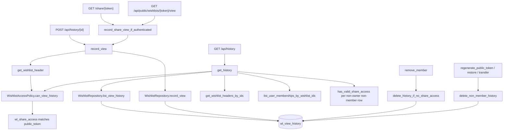

# Wishlists Domain: Roles, Permissions, Lifecycle, and Sharing

## Overview

The `wishenka.wishlists` module implements the core domain logic for wishlists in the
**Wishlist Service («Вишенка»)** Telegram Mini App.

It manages personal and collaborative wishlists, enforces role-based access control
(Contextual RBAC/ABAC), coordinates lifecycle transitions, protects the crucial
**Surprise Invariant** (zero-leak projections of reservations), and provides cryptographically
secure sharing tokens.

```text
+-----------------------------------------------------------------------------------------+
|                                Wishlist Aggregate Root                                  |
|  - id, owner_id, title, status (ACTIVE | ARCHIVED | DELETED)                            |
|  - format: PERSONAL | COLLABORATIVE  - time_type: ONGOING | EVENT                       |
|  - public_token (16B urlsafe)        - invite_token (24B urlsafe + TTL)                 |
+-----------------------------------------------------------------------------------------+
                    |                                                |
                    v 1..*                                           v 0..*
+---------------------------------------+       +-----------------------------------------+
|              WishItem                 |       |             WishlistMember              |
|  - id, wishlist_id, title, link       |       |  - user_id, role (OWNER|ADMIN|MEMBER)   |
|  - quantity, recipient_user_id        |       |  - joined_at                            |
+---------------------------------------+       +-----------------------------------------+
                    | 0..*
                    v
+---------------------------------------+
|             Reservation               |
|  - wish_item_id, user_id, quantity    |
|  - status: ACTIVE|COMPLETED|CANCELLED |
+---------------------------------------+
```

### Key Capabilities

1. **Contextual Role-Based Access Control**: Combines static wishlist roles (`Owner`, `Admin`,
   `Member`) with dynamic item-level recipient checks.
2. **Surprise Invariant (Zero-Leak Projection)**: Gift recipients are strictly prevented from
   viewing reservation counts, status, or gifter identities.
3. **Dual Sharing Token Architecture**: Separate, cryptographically secure tokens for public
   viewing (`public_token`) and collaborative onboarding (`invite_token`).
4. **Lifecycle Management**: Explicit state machine (`ACTIVE` <-> `ARCHIVED` -> `DELETED`)
   preventing mutation or reservation on archived and deleted wishlists.
5. **Structured Audit Logging**: Comprehensive security and operational event logging with
   zero leakage of sensitive raw tokens.
6. **Viewing History Access**: A view is recorded and listed only for the owner, a
   collaborative member, or a user with a share grant for the current `public_token`.
   Strangers receive the same not-found response as a missing list. See
   [Viewing History Access](#viewing-history-access-wishenka-303).

## Shared wishlist rule set

### Overview

`RepoWishlistOps` (`wishenka/wishlists/repo_ops.py`) is the only shared wishlist
rule set. It owns lists, wishes, membership, archive, delete, restore,
favorites, viewing history, and invite join. Mini App screens call those names
on a `RepoWishlistOps` built from the request repository.

A store-backed `WishlistService` forwards names that write through
`WishlistStore.run_repository`. That helper builds one `WishlistRepository`,
commits the immediate transaction, and flushes commit logs on that repository.
On failure it clears those logs. The seven one-wishlist openings forward
through `run_repository_read` and do not take the save lock.

Reservations and receipts stay on `WishlistStore.execute_wish` and
`execute_wish_idempotent`. A gift-receipt look takes the wishlist repository
the screen already has (`WISHENKA-324`). `receipts_ui._execute` builds
`RepoWishlistOps` on that repository. The hidden fallback that opened a shared
repository is gone. Opening a receipt, correction, or cancellation dialog
passes the `WishlistReadRepo` that screen already received. A quantity refusal
paints through `run_repository_read` after rollback. A successful save that
carries the repeat key still composes the list on that save. A true repeat
returns the stored answer. A save with no key calls `execute_wish`, then reads
the list through `run_repository_read`.

### Architecture

- **`RepoWishlistOps`**: the shared rule bodies. Screens in `wishlists.py`,
  `items.py`, `sharing.py`, `items_ui.py`, and the non-inventory reads in
  `receipts.py` and `receipts_ui.py` construct `RepoWishlistOps(repo)` from
  the request repository.
- **One-wishlist openings**: `get_wishlist_by_id`, `get_wishlist_view`,
  `get_members`, `get_wish_item`, `list_wish_items`, `list_gifted_items`, and
  `is_favorite`. A store-backed `WishlistService` sends those names through
  `_read_repository_forward` into `WishlistStore.run_repository_read`. That
  helper opens `read_transaction` (plain `BEGIN` and `PRAGMA query_only`),
  builds one `WishlistRepository`, and clears commit logs. It does not commit,
  flush logs, or enter `execute` / `_write`. The opening does not take the
  save lock. `query_only` rejects a write on that connection.
- **Pure-read HTTP GETs** use `WishlistReadRepo`
  (`get_wishlist_read_repository`), which yields the repository inside the
  same `read_transaction`. The dependency does not commit, flush logs, or map
  a busy error. `InventoryBusyError` from `read_transaction` propagates.
  Session lookup on a `WishlistStore` uses that same transaction, so the GET
  does not take the save lock before the handler runs. These handlers:
  `get_wishlist` (including `repo.is_favorite` in that request),
  `list_members`, `list_items`, `get_item`, `list_gifted`,
  `view_wishlist_detail`, `get_members_partial`, `get_item_card_partial`,
  `get_share_modal`, `get_new_item_modal`, `get_edit_item_modal`,
  `archive_confirm_ui`, `get_receipt_dialog`, `get_receipt_edit_dialog`, and
  `get_receipt_cancel_dialog`.
- **Saves and requests that also write** stay on `WishlistRepo`
  (`get_wishlist_repository`). `conn.begin()` has no `read_only` flag, so the
  listener emits `BEGIN IMMEDIATE`. On success the dependency commits and
  flushes commit logs. That includes create, update, archive, restore, delete,
  member changes, token reset, favorite mark or unmark, and reorder. `POST`
  restore of a deleted wishlist reads `repo.is_favorite` after the save, inside
  that write transaction. Member removal, item archive, and item restore read
  the list again on the same write repository. Public link and invite stay
  here (the share page records a view). Multi-wishlist reads stay on this
  write transaction. `GET /api/wishlists` (`list_accessible_wishlists`) still
  opens each list in full. Favorites, recently deleted lists, and recording
  a visit load list headers on that same transaction and do not read
  `wl_items` or `wl_reservations`. History listing and clearing stay on the
  existing visit-and-summary path.
- **`_repository_forward`**: when `WishlistService._store` is set, each name in
  `_SHARED_REPOSITORY_METHODS` calls the same name on `RepoWishlistOps` inside
  `run_repository` (`BEGIN IMMEDIATE`, then commit and flush). The wrapper does
  not enter `execute` or `_write`. The seven openings are not in that set.
- **In-memory fail closed**: when `_store` is `None`, shared methods and the
  six openings other than `is_favorite` log `wishlist_repository_path_required`
  (`WARNING`, field `operation` only) and raise `WishlistNotFoundError`.
  `is_favorite` with no store keeps the in-memory answer.
  `update_wishlist_settings` and `transfer_ownership` read the hydrated graph
  through `_lookup_wishlist`. Public `get_wishlist_by_id` still forwards and
  fail-closes when the service has no store.
- **Snapshot methods**: `_SINGLE_WISHLIST_METHODS` is
  `update_wishlist_settings` and `transfer_ownership`. Those two still use the
  snapshot wrapper. `is_favorite` is a read opening.
  `RepoWishlistOps.is_favorite` returns `False` for a missing person without a
  query, otherwise `WishlistRepository.is_favorite`.
- **Viewing history**: `WishlistRepository.record_view` upserts
  `(user_id, wishlist_id)` and does not delete older rows. `GET /api/history`
  still returns at most 20 rows. A visitor with no `users` row logs
  `view_history_user_missing` and raises `WishlistNotFoundError`.
  `record_share_view_if_authenticated` swallows that error, so
  `GET /share/{public_token}` still renders.
- **Bot capture**: `wishenka/bot/capture.py` save calls
  `RepoWishlistOps.add_wish_item` inside `store.run_repository`. The draft SQL
  shares that transaction.

### Usage

Store-backed forward:

```python
async def work(repo: WishlistRepository) -> WishItem:
    return await RepoWishlistOps(repo).add_wish_item(wishlist_id, actor, **fields)

item = await store.run_repository(work)
```

Screen handlers pass the request repository:

```python
result = await action(RepoWishlistOps(repo))
```

An in-memory shared call fail-closes:

```python
service = WishlistService.in_memory()
await service.record_view(user, wishlist_id)
```

That call logs `wishlist_repository_path_required` and raises
`WishlistNotFoundError`. Settings and ownership transfer on a hydrated service
read one list with `await service._lookup_wishlist(wishlist_id)`.

### Configuration

No new setting or environment variable. `WISHENKA_DATABASE_URL` still selects
the SQLite file. `run_repository` uses the store's existing `BEGIN IMMEDIATE`
and busy timeout. It does not snapshot the database and it does not retry
token collisions. The seven openings use `read_transaction` on that same file.

### Troubleshooting

- **`wishlist_repository_path_required`.** A shared method ran on
  `WishlistService.in_memory()` or any service whose `_store` is `None`. Call
  `RepoWishlistOps` inside `run_repository`, or use a store-backed
  `WishlistService`. The log field is `operation`. Arguments are omitted.
- **The share page rendered and history has no row for a signed-in visitor.**
  Look for `view_history_user_missing` (`WARNING`, `wishlist_id`, `user_id`).
  The visitor has no `users` row. The share page continues.
  `POST /api/history/{id}` still returns 404 for that visitor.
- **History lists fewer visits than were recorded.** `GET /api/history` applies
  `limit=20` after the access filter. Older rows stay in `wl_view_history`.
  `record_view` does not delete them.
- **A capture save and its draft disagree.** Save is the `run_repository`
  callback that calls `RepoWishlistOps.add_wish_item` together with the
  `bot_drafts` update. That add is not a second snapshot write.
- **A one-wishlist GET waited on a save.** That GET should be on
  `WishlistReadRepo` or `run_repository_read`. A handler that also writes stays
  on `get_wishlist_repository` and still takes `BEGIN IMMEDIATE`. A busy read
  logs `wishlist_read_busy` inside `read_transaction` and raises
  `InventoryBusyError`.

---

## HTTP API and persistent storage

The FastAPI wishlist routes in
[`wishenka.web.routes.wishlists`](../../wishenka/web/routes/wishlists.py) use the session
authentication described in [Authentication](auth.md). Authenticated routes require an active
session; the public route also accepts anonymous callers. A request with an invalid session may be
rejected by the optional authentication dependency.

- `POST /api/wishlists`: Authenticated user creates a list; returns 201. One request
  inserts one list. The body is `WishlistCreateInput`
  (`wishenka/web/routes/wishlists.py`). Create and edit share one name rule in
  `wishenka/wishlists/name_contract.py`. `name` is required. After the shared edge
  trim (`str.strip()`, the characters `str.isspace()` removes), it must be 1 to 255
  Unicode code points. The stored title is that trimmed string. A missing, `null`,
  blank, or invisible-only name is `422` with `detail[].type`
  `wishlist_name_required` and `loc` ending in `name`. The invisible marks are
  U+200B, U+2060, U+FEFF, U+200E, and U+200F; a long run of only those marks is
  still the required-name failure. A longer name is a different failure,
  `wishlist_name_too_long`, not the missing-name message. A non-string `name` is
  still rejected by the type check. `description` and `event_title` have no
  character ceiling. Empty or spaces-only means unset. An invalid `event_date`
  is `422` with `loc` `["body", "event_date"]`. Nothing is created on `422`. An
  empty `{}` body is not accepted (WISHENKA-296). After `create_wishlist` returns,
  `execute()` logs `wishlist_mutation_committed` with `operation=create_wishlist`,
  before `get_wishlist_repository()` commits. That record is not proof the commit
  succeeded, and a refused create does not write it. The Mini App sends this
  request only from one deliberate confirmation of the create form; opening the
  form does not call it ([miniapp.md](miniapp.md#1-wishlist-creation)).

- `GET /api/wishlists`: Lists the caller's active memberships. Set `include_archived=true` to
  include archived lists. `list_accessible_wishlists` still opens each list in
  full (`get_wishlist`: members, items, and reservations).

- `GET /api/wishlists/deleted`: Lists the caller's own soft-deleted wishlists that
  `is_retention_expired` still treats as restorable. The period is the shared
  `wishlist_retention_days` (usual value 30). Sorted by `updated_at` descending
  with `deleted_at`, `expires_at`, and `days_remaining`. Lists still inside the
  window load through `get_wishlist_headers_by_ids`. That read does not load
  membership, `wl_items`, or `wl_reservations`.

- `GET /api/wishlists/{id}`: Reads a list for a member, including archived lists.
  The handler is `get_wishlist` on `WishlistReadRepo`. The favorite mark in that
  same response is `repo.is_favorite` inside the same read-only transaction.

- `PATCH /api/wishlists/{id}`: Owner or admin updates an active list. The same
  name rule applies. A sent name goes through `normalize_wishlist_name`: `""`,
  `null`, spaces, or an invisible-only name is `wishlist_name_required`, and a
  name over 255 code points after the shared edge trim is `wishlist_name_too_long`.
  Neither failure writes the row. Omitting `name` leaves a stored title that
  already passes. Omitting `name` when the stored title is missing, blank, or
  invisible-only is `wishlist_name_required`. Omitting a stored name that is
  already over 255 code points is `wishlist_name_too_long`, not the required-name
  failure. That check is `classify_stored_name` inside `update_wishlist`, before
  any field is assigned. A stored empty name stays readable: `GET` returns
  `name` `""`, and the next save must supply a real name. Opening a list does
  not rewrite the title. `description` and `event_title` again have no character
  ceiling; empty or spaces-only means unset. The domain service still accepts an
  empty title, so an older row stays loadable. This task adds no migration.

- `POST /api/wishlists/{id}/archive`: Owner or admin archives an active list.

- `POST /api/wishlists/{id}/restore`: Owner or admin restores an archived list.

- `DELETE /api/wishlists/{id}`: Owner soft-deletes a list (WISHENKA-295); see
  [Owner delete route](#owner-delete-route-delete-apiwishlistsid).

- `POST /api/wishlists/{id}/restore-deleted`: Owner restores a soft-deleted list that
  is still inside the shared retention window, back to `active`, rotating
  `public_token` and `invite_token` (with a fresh `invite_token_expires_at`).
  An ended window is `410 Gone` (`code: "retention_expired"`).

- `POST /api/wishlists/{id}/share/reset`: Owner or admin rotates the public link on an active list.

- `POST /api/wishlists/{id}/invite/reset`: Owner or admin rotates the collaborator invite token.

- `GET /api/wishlists/{id}/members`: Lists active members and their roles
  (`list_members` on `WishlistReadRepo`). The read-only transaction does not
  take the save lock.

- `PATCH /api/wishlists/{id}/members/{user_id}/role`: Owner promotes or demotes a member.

- `DELETE /api/wishlists/{id}/members/{user_id}`: Owner or admin removes a member.

- `GET /api/invitations/preview`: Previews invitation details via `X-Invite-Token` header.

- `POST /api/invitations/accept`: Authenticated user joins wishlist via `X-Invite-Token` header.

- `GET /api/public/wishlists/{token}`: Reads the anonymous-safe public projection, including archived lists.

- `GET /api/public/wishlists/{token}/view`: Reads the role-specific public projection (`anonymous_safe` for unauthenticated callers, `recipient_safe` for recipients, `gifter` for authenticated non-recipients) without membership or invite secrets. An authenticated caller also records Viewing History for that list (`record_share_view_if_authenticated`). Anonymous callers do not.

- `GET /api/favorites`: Lists the caller's favorited wishlists in reverse-chronological
  order, filtered to non-deleted, non-owned lists where the caller is an active
  collaborator (`wl_members`) or holds an active share-link grant
  (`wl_share_access` matching `public_token`). Headers come from
  `get_wishlist_headers_by_ids`, plus this person's membership row where the
  role needs it. The listing does not read `wl_items` or `wl_reservations`.

- `POST /api/favorites/{id}`: Adds a wishlist to caller's favorites (requires non-owner, non-deleted list, and either active membership or valid `wl_share_access` grant; unauthorized or inaccessible non-owner lists return uniform `404` (`WishlistNotFoundError`, anti-enumeration), whereas attempting to favorite one's own wishlist raises `ValueError` and the route maps it to `400 Bad Request` so API consumers can distinguish self-favoriting from non-owner anti-enumeration).

- `DELETE /api/favorites/{id}`: Removes a wishlist from caller's favorites.

- `GET /api/history`: Lists up to 20 recently viewed wishlists the caller may still
  access (owner, member, or current share grant), newest first. Deleted lists and
  revoked rows are omitted. Each item is list metadata only: `id`, `name`,
  `description`, `event_title`, `event_date`, `viewed_at`, `is_favorite`, `role`.
  Reservation counts and buyer identities are not included.

- `POST /api/history/{id}`: Records or updates a view when `can_view_history` allows
  it. The write transaction loads `get_wishlist_header` (the `wl_lists` row
  only). That read writes nothing. A missing or deleted list does not load
  membership. A non-deleted list loads this person's membership before the
  permission check. Neither path reads `wl_items` or `wl_reservations`. A
  successful header load adds no new log. A missing, deleted, or inaccessible
  id returns `404` with `detail` `"Wishlist not found"`.

- `DELETE /api/history`: Clears all viewing history rows for the caller.

When view times differ, the newest time is still first. When view times are
equal, order is by `recorded_seq`, newest recording first. The response does
not include `recorded_seq`. See [Order (WISHENKA-304)](#order-wishenka-304).

- `Wish Items API` (`/api/wishlists/{wishlist_id}/items`): Full REST CRUD lifecycle suite for wish items, including atomic reordering (`PUT /reorder`), safe archiving (`POST /{item_id}/archive`), end-of-list restore (`POST /{item_id}/restore`), piece accounting ($1 \le Q \le 1000$), Reduction Lock invariant, collaborative member addressing, and zero-leak Surprise Invariant projections. Detailed specification, request/response models, and telemetry events are documented in [Items Domain Documentation](items.md).

Create and edit both require a `name` of 1 to 255 code points after the shared edge
trim (`wishenka/wishlists/name_contract.py`). An invisible-only name is
`wishlist_name_required`. A longer name is `wishlist_name_too_long`. Description
and event title stay optional, with no character ceiling; empty or spaces-only
means unset. A stored empty name stays readable, and the next save must supply a
real name. Opening a list does not rewrite the title. The HTTP representation includes list details and items; member responses include
`role` and `members`, and owner/admin responses also include `share_token` and `invite_token`.
The public projection uses an explicit allowlist and omits membership, tokens and
reservation-derived fields. It is returned even when an authenticated caller uses the public URL.
Projections for `/api/favorites` and `/api/history` strictly enforce the Surprise Invariant: they
return sanitized list metadata with roles and omit all reservation records, item availability
counts, and buyer details.
Unknown, deleted or inaccessible lists return 404; operations incompatible with the archived
state return 409. An ended retention window is 410 with `code` `retention_expired` on
`POST /api/wishlists/{id}/restore-deleted` and on a repeat `DELETE /api/wishlists/{id}`.
Delete, recently deleted, and restore share one period and one comparison; see
[Owner delete route](#owner-delete-route-delete-apiwishlistsid). Archive is
read-only until restored. State-changing requests from browser
sessions are protected by CSRF tokens and origin validation — see [miniapp.md](miniapp.md).
Soft deletion is exposed to the owner as `DELETE /api/wishlists/{id}` (WISHENKA-295).

A sharing token is a bearer capability. Rotation invalidates the old public link, and the persistent
issued-token registry prevents reuse. Do not put tokens in application logs, issue reports or
analytics. The application redacts public paths in request and Uvicorn access logs and sanitizes
storage exceptions. Configure reverse proxies and other infrastructure separately to avoid logging
capability URLs.

All public-link entry points — `GET /share/{public_token}`, `GET /api/public/wishlists/{token}`, and
`GET /api/public/wishlists/{token}/view` — call `RepoWishlistOps.get_wishlist_by_public_token` on the
request `WishlistRepository`. `sharing.py` builds that object in `_get_service`. `wishlists.py`
passes it from `execute`.

At the domain layer, `project_wish_item(item, None)` delegates directly to `recipient_view(item)`,
returning `WishItemRecipientViewDTO` so anonymous callers never receive reservation or giver fields.
Authenticated non-recipient callers receive `WishItemGifterViewDTO`, while recipients (personal
owners or collaborative item recipients) continue to receive `WishItemRecipientViewDTO`.

### Storage and configuration

The application factory creates one `WishlistStore` and exposes a store-backed `WishlistService` as
`app.state.domain_service`. Use that service for application domain operations. `WishlistService.__init__`
enforces an explicit persistent `WishlistStore` boundary: passing `store=None` (or calling bare
`WishlistService()`) logs `wishlist_service_store_required` and raises `ValueError`. For isolated
unit tests or transient `WishlistStore` hydration, construct the service explicitly via
`WishlistService.in_memory()`. Web routes (`wishenka/web/routes/wishlists.py`, `items.py`,
`sharing.py`, `receipts.py`, `items_ui.py`, `receipts_ui.py`) build `RepoWishlistOps` from
the request repository. A pure-read GET that opens one wishlist uses `WishlistReadRepo`
(`get_wishlist_read_repository` / `read_transaction`) and does not take the save lock. A
save, and any request that also writes, uses `WishlistRepo`
(`get_wishlist_repository`, `BEGIN IMMEDIATE`). Single-wish inventory, reservation, and
receipt mutations continue to use `WishlistStore.execute_wish` /
`execute_wish_idempotent`. See
[Shared wishlist rule set](#shared-wishlist-rule-set).

`WISHENKA_DATABASE_URL` selects the SQLite database and defaults to
`sqlite+aiosqlite:///data/wishenka.db`. The application initializes the normalized relational
schema during lifespan startup by running Alembic migrations to head (a recognized legacy database
is adopted without data loss, except two security remediations:
`add_share_access_and_purge_favorites` purges legacy non-member `wl_favorites` rows, and
`purge_legacy_non_member_view_history` purges unverified non-member `wl_view_history`
rows; see [migrations.md](migrations.md)), selects WAL mode in that
migration startup, creates parent directories for a file database, and disposes the engine at
shutdown (`WishlistStore.dispose()`). `WISHENKA_SQLITE_DB_PATH` is a separate setting and does not
configure this store. All workers must point to the same database file to share state. The store
applies a five-second SQLite busy timeout (`busy_timeout = 5000`) and serializes each mutation with
`BEGIN IMMEDIATE`. One-wishlist openings use `read_transaction` and do not take that lock.

For `:memory:` URLs (`sqlite+aiosqlite:///:memory:`), `WishlistStore.__init__` provisions an
isolated temporary SQLite file so synchronous Alembic migrations and async `aiosqlite` connections
share the same database. `WishlistStore.initialize()` enforces a cleanup-on-failure contract:
migration errors (`OSError`, `RuntimeError`, `ValueError`, `SQLAlchemyError`) are mapped to
`RuntimeError("Unable to initialize wishlist storage")`, and on any `BaseException` (including
mapped errors, unmapped exceptions, and `asyncio.CancelledError`), `initialize()` logs
`wishlist_store_init_failed` (`WARNING`), calls `await self.dispose()`, and re-raises.
`WishlistStore.dispose()` is idempotent: it disposes `self.engine` and, when the store owns a
temporary `:memory:` database, unlinks the temp file, `migration_lock_path(temp_path)`, and
`-wal`/`-shm`/`-journal` sidecars (`missing_ok=True`), logs `wishlist_store_temp_db_removed`
(`DEBUG`), and clears `_temporary_database_path` in a `finally` block (file-backed databases are
never unlinked).

As implemented in [WISHENKA-48](https://pypost.atlassian.net/browse/WISHENKA-48), persistence uses
a fully normalized relational schema (`wl_lists`, `wl_members`, `wl_items`, `wl_reservations`,
`wl_favorites`, `wl_share_access`, `wl_view_history`, `wl_tokens`, `wl_invite_tokens`, `wl_counters`) mapped via
SQLAlchemy 2.0 declarative models and queried through `WishlistRepository`. Destructive prototype
mass table truncations (`DELETE FROM <table>`) are replaced with snapshot diffing and row-level
mutations (`UPDATE`, `INSERT`, `DELETE WHERE id = :id`). See
[Persistence Architecture](#persistence-architecture-sqlite-wal--repositories) below for details.

If startup reports `Unable to initialize wishlist storage`, verify the database URL, directory
permissions and SQLite availability, then inspect the exception chain and the
`wishlist_migration_failed` log record (unsupported legacy schema, migration lock timeout; see
[migrations.md](migrations.md#troubleshooting)). A generic `Wishlist storage operation failed` indicates a
sanitized database failure; inspect storage health and contention without logging SQL parameters or
tokens. If a shared link returns 404, check whether it was rotated or the list was deleted; request
a new link from an owner or admin. A 409 on modification indicates an archived list or an invalid
state transition.

## HTMX Web Views & Sharing Endpoints

In addition to JSON REST endpoints, the wishlist module provides server-rendered HTML pages
and HTMX partials implemented in
[`wishenka.web.routes.sharing`](../../wishenka/web/routes/sharing.py). These routes power the
browser and Telegram Mini App web views for public gift selection, collaborator onboarding,
member management, and token rotation without client-side JavaScript SPA frameworks.

### Endpoints Reference

#### Public Gifter & Recipient Views

- `GET /share/{public_token}`:
  - **Description**: Renders the complete HTML page (`share_wishlist.html`) for a public wishlist.
  - **Authentication**: Optional session (`get_optional_current_user`). Resolves via
    `RepoWishlistOps.get_wishlist_by_public_token(public_token, current_user)` on the request
    repository. Unauthenticated guests receive `WishItemRecipientViewDTO` (via
    `project_wish_item(item, None)` -> `recipient_view(item)`),
    concealing reservation status. Authenticated non-recipient callers receive `WishItemGifterViewDTO`
    and can view availability and reservation controls. If accessed by the list recipient or owner,
    the Surprise Invariant strictly conceals all reservations.
  - **Parameters**: `public_token` (str) — 16-byte URL-safe public sharing token.
  - **Responses**:
    - `200 OK`: Full HTML view with wishlist details, owner name, and list of items.
    - `404 Not Found`: Returned when the wishlist does not exist or has been deleted.
  - **Observability**: Logs `wishlist_shared_view` with `wishlist_id`, `is_recipient`, and
    `is_collaborative`. On failure, logs `wishlist_shared_view_failed`. Access logs redact
    the token to `/share/{token}`.

- `GET /wishlists/{wishlist_id}/items/{item_id}/card`:
  - **Description**: Returns an HTMX partial (`partials/item_card.html`) representing a single
    gift item card. After a promise write other than HTTP 503, the giver-control script
    replaces `#item-card-{id}` with this partial. The handler renders the partial and writes
    no reservation event. Mutation logs stay on `wishenka.web.reservations`. See
    [Wish-card giver controls](reservations.md#6-wish-card-giver-controls).
  - **Authentication**: Optional session (`get_optional_current_user`).
  - **Parameters**: `wishlist_id` (int), `item_id` (int), optional `notice` (`shortage` or
    `refused`), `is_first` (bool), `is_last` (bool).
  - **Notice**: `notice` is passed to the template only when the item is
    `WishItemGifterViewDTO`. A recipient card omits it.
  - **Responses**:
    - `200 OK`: HTML fragment `<div class="card item-card" id="item-card-{id}">...</div>`.
    - `404 Not Found`: Wishlist or item not found.

#### Collaborator Invitation Flow

- `GET /invite/{invite_token}`:
  - **Description**: Previews a collaborator invitation before joining.
  - **Authentication**: None required.
  - **Parameters**: `invite_token` (str) — 24-byte URL-safe invite token.
  - **Responses**:
    - `200 OK`: Renders `invite_preview.html`. If the token is valid and active, displays
      wishlist title, owner name, and a "Join" HTMX button. If the token is invalid, expired,
      or associated with a deleted list, returns a friendly error card (`is_valid=False`) with
      HTTP 200 rather than raw JSON errors.
  - **Observability**: Logs `invite_preview_accessed` with status `valid`, `expired`, or
    `not_found`. Access logs redact the token to `/invite/{token}`.

- `POST /invite/{invite_token}/join`:
  - **Description**: Processes acceptance of the invitation by an authenticated user.
  - **Authentication**: Required session (`get_current_user`).
  - **Parameters**: `invite_token` (str).
  - **Responses**:
    - `200 OK`: On success, returns confirmation markup with response header
      `HX-Redirect: /share/{public_token}` triggering client navigation.
    - `200 OK` (Error Card): If token expired or list was deleted concurrently, returns
      the friendly error card template.
    - `429 Too Many Requests`: Returned by `PublicLinkRateLimitMiddleware` if the client exceeds
      the configured sliding-window limit.
  - **Observability**: Logs `invite_joined` with `wishlist_id`, `user_id`, and assigned role,
    or `invite_join_failed` on error. Access logs redact the path to `/invite/{token}/join`.

#### Public Link Rate Limiting

Unauthenticated and public capability routes are protected by
`PublicLinkRateLimitMiddleware` and `SlidingWindowRateLimiter` in
[`wishenka.web.rate_limit`](../../wishenka/web/rate_limit.py) (wired onto
`app.state.public_link_rate_limiter` in [`wishenka.web.app`](../../wishenka/web/app.py)):

- **Protected Routes** (`match_public_link_route`):
  - `GET` and `HEAD` `/share/{token}`
  - `GET` and `HEAD` `/invite/{token}`
  - `POST /invite/{token}/join` (`HEAD` on this three-segment path is not matched)
- **HEAD on the two-segment paths**: `HEAD` spends the same per-client window as `GET`.
  The matcher uppercases the method and runs `path.lstrip("/")` before splitting, so
  extra leading slashes do not skip the limit for `HEAD` or `GET`. The method is not
  rewritten to `GET`.
  - An in-budget `HEAD` is forwarded unchanged. Share and invite pages are
    `@router.get` handlers with no `HEAD` method, so the router returns
    `405 Method Not Allowed` (`Allow: GET`). That status does not reveal whether the
    token is valid, because the handler does not run.
  - An over-limit `HEAD` never reaches the router. The middleware returns the
    token-free `429` from `_build_rate_limit_response` and logs
    `public_link_rate_limited` with `method=HEAD` and route `/share/{token}` or
    `/invite/{token}`.
- **Algorithm & Bounds**: `SlidingWindowRateLimiter` maintains an in-memory per-client
  timestamp `deque` inside an `OrderedDict` (`max_requests` within `window_seconds`, bounded by
  `max_clients` with expired-bucket pruning and oldest-client eviction).
- **Client IP Resolution (`resolve_client_ip`)**: Uses `request.client.host` by default.
  `X-Forwarded-For` (leftmost IP) and `X-Real-IP` are consulted only when
  `public_rate_limit_trust_proxy_headers` is `True`.
- **429 Response (`_build_rate_limit_response`)**: Returns `429 Too Many Requests` with a
  `Retry-After` header and a localized RU/EN body (`web.rate_limit.title` and
  `web.rate_limit.message`, resolved via `?lang=` or `Accept-Language`). Returns JSON
  (`{"detail": ..., "retry_after": ...}`) when `Accept` includes `application/json`, or
  HTML-escaped markup otherwise, without echoing any token.

#### Member Administration

- `GET /wishlists/{wishlist_id}/members/partial`:
  - **Description**: Renders collaborator list partial (`partials/member_list.html`).
  - **Authentication**: Required session (`get_current_user`). Caller must be owner, admin, or
    member.
  - **Responses**:
    - `200 OK`: HTML fragment `<div id="member-list">...</div>` listing owner and members
      with role badges. If caller is owner, includes `hx-delete` removal buttons.
    - `403 Forbidden`: Caller lacks permission to view members.
    - `404 Not Found`: Wishlist not found or deleted.

- `DELETE /wishlists/{wishlist_id}/members/{user_id}/partial`:
  - **Description**: Removes a collaborator from the wishlist and returns updated member list.
  - **Authentication**: Required session (`get_current_user`). Only the wishlist owner can
    remove members.
  - **Responses**:
    - `200 OK`: Updated HTML fragment `#member-list` with target member removed.
    - `403 Forbidden`: Caller is not the wishlist owner.
    - `404 Not Found`: Wishlist not found.
  - **Observability**: Logs `member_removed` with `wishlist_id`, `removed_user_id`, and
    `removed_by`.

#### Share Drawer & Token Rotation

- `GET /wishlists/{wishlist_id}/share-modal`:
  - **Description**: Renders the share drawer dialog partial (`partials/share_modal.html`).
  - **Authentication**: Required session (`get_current_user`). Owner-only access.
  - **Responses**:
    - `200 OK`: HTML fragment `<div id="share-modal">...</div>` containing readonly inputs
      for `/share/{public_token}` and `/invite/{invite_token}`, accompanied by explanatory
      copy and a button to revoke/regenerate the invite link.
    - `403 Forbidden`: Caller is not the wishlist owner.
    - `404 Not Found`: Wishlist not found.

- `POST /wishlists/{wishlist_id}/invite/regenerate`:
  - **Description**: Revokes the existing invite token and generates a fresh token, returning
    the re-rendered modal.
  - **Authentication**: Required session (`get_current_user`). Owner-only access.
  - **Responses**:
    - `200 OK`: Updated `#share-modal` partial reflecting the newly generated invite token.
    - `403 Forbidden`: Caller is not the wishlist owner.
  - **Observability**: Logs `invite_regenerated` with `wishlist_id` and `user_id`.

---

### Jinja2 Template Architecture

Template rendering is configured in
[`wishenka.web.templates`](../../wishenka/web/templates.py) using
`fastapi.templating.Jinja2Templates` pointing to `wishenka/web/templates/`. The template
directory structure follows a modular component layout:

```text
wishenka/web/templates/
├── base.html             # Master layout with viewport, CSS, Telegram SDK, HTMX, deferred static JS
├── share_wishlist.html   # Full page public view for gifters and recipients
├── invite_preview.html   # Full page collaborator preview and friendly error screen
└── partials/
    ├── item_card.html    # Gift item card partial with Surprise Invariant
    ├── member_list.html  # Collaborator member list with owner removal actions
    └── share_modal.html  # Modal dialog for link sharing and regeneration

wishenka/web/static/
├── app.js                # Global CSRF, HTMX lifecycle, card/cabinet refresh, delegated modal/preview clicks (loaded by base.html)
├── miniapp.css           # Shared styles
├── miniapp.js            # Mini App SPA script (loaded only by the Mini App shell)
├── receipt.js            # Gift receipt dialog and focus trap (loaded by base.html)
├── settings.js           # Profile settings page controller (loaded by settings.html)
└── wishlist.js           # Card toggle, mouse and touch drag-and-drop reorder (loaded by base.html)
```

#### Template Specifications

1. **`base.html`**:
   - Master document providing HTML5 doctype, UTF-8 charset, responsive viewport metadata, and
     zero inline `<script>` blocks.
   - Loads Telegram Web App SDK (`telegram-web-app.js`), HTMX 1.9.12 (`htmx.org@1.9.12`), and
     `json-enc.js`, followed by deferred static scripts in order: `/static/app.js`,
     `/static/wishlist.js`, and `/static/receipt.js`.
   - `static/app.js` owns CSRF token preparation (`window.prepareCsrf`), HTMX reservation/modal
     hooks, `swapWishCard`, and delegated `[data-clear-target]` / `[data-qty-step][data-qty-target]`
     click handlers; `static/wishlist.js` owns the wish-card toggle and drag-and-drop reorder
     (reading `data-wishlist-id` on `#items-list` in `wishlist_detail.html` and `share_wishlist.html`).
     Details: [miniapp.md](miniapp.md#981-client-script-staticwishlistjs-wishenka-108) and
     [miniapp.md](miniapp.md#982-global-app-script-staticappjs-settings-script-staticsettingsjs-and-strict-csp-readiness-wishenka-140).
   - Provides Jinja2 template extension blocks: `` and ``.

2. **`share_wishlist.html`**:
   - Extends `base.html`.
   - Displays wishlist header (title, owner name, description, event title and date).
   - Iterates over `wishlist.items` and includes `partials/item_card.html` for each item;
     the list container is `<section id="items-list" data-wishlist-id="{{ wishlist.id }}">`.
   - Shows empty-state guidance if no items are present.

3. **`invite_preview.html`**:
   - Extends `base.html`.
   - Conditionally renders an invitation card (`is_valid=True`) or friendly error card
     (`is_valid=False`).
   - The valid card features wishlist metadata, inviter attribution, and an HTMX form:
     `<form hx-post="/invite/{{ token }}/join" hx-target="#invite-card" hx-swap="outerHTML">`.
   - The error card displays an explanatory message and a link back to the homepage (`/`).

4. **`partials/item_card.html`**:
   - Encapsulates an individual gift item inside
     `<div class="card item-card" id="item-card-{{ item.id }}">`.
   - The compact row is `.item-card-summary` (`aria-expanded="false"`). The expanded body is
     `.item-card-details`, rendered with `hidden`. The delegated toggle in `static/wishlist.js`
     clears `hidden` to expand the same card (no inline handlers on the card).
   - For owners and editors (`can_edit_wishlist`) the collapsed summary starts with the drag handle
     `.item-drag-handle` (`aria-hidden="true"`, `data-no-toggle`), the touch reorder grip
     (WISHENKA-109, [miniapp.md](miniapp.md#981-client-script-staticwishlistjs-wishenka-108)). The
     move up and move down buttons stay in the details as the keyboard path.
   - Displays item title, optional formatted price with currency, description, quantity, and
     external link (`rel="noopener noreferrer"`).
   - Giver controls are one `.item-giver` block in the summary, guarded by
     ``. The details do not repeat that block. Editor controls
     stay in the details. The control list, own line, refresh, and CSRF behavior are in
     [Wish-card giver controls](reservations.md#6-wish-card-giver-controls).

5. **`partials/member_list.html`**:
   - Renders container `<div id="member-list" class="member-list space-y-2">`.
   - Lists list owner with `Владелец` badge, followed by collaborators.
   - Displays role badges (`Администратор` or `Участник`).
   - If caller is owner (`is_owner=True`), renders an HTMX delete button:
     `<button hx-delete="..." hx-target="#member-list" hx-swap="outerHTML">`.

6. **`partials/share_modal.html`**:
   - Renders container `<div id="share-modal" class="share-modal">`.
   - Displays readonly input for public URL (`/share/{{ public_token }}`) for gifter access.
   - Displays readonly input for invite URL (`/invite/{{ invite_token }}`) for co-authoring.
   - Contains an HTMX regeneration button:
     `<button hx-post="..." hx-target="#share-modal" hx-swap="outerHTML">`.

---

### Surprise Invariant in Server-Rendered Templates

The Surprise Invariant is enforced at both the domain service layer and the template presentation
layer, providing defense-in-depth against data leakage:

1. **Domain DTO Projection**:
   - When `RepoWishlistOps.get_wishlist_by_public_token` or `get_wishlist_view` is called
     on the request repository,
     items for which the viewing user is a recipient (`is_recipient == True`) are projected as
     `WishItemRecipientViewDTO`.
   - For gifters (`is_recipient == False`), items are projected as `WishItemGifterViewDTO`.
   - `WishItemRecipientViewDTO` completely lacks reservation fields (`available_quantity`,
     `is_fully_reserved`, `is_reserved_by_me`, `my_reserved_quantity`,
     `my_latest_reservation_quantity`, `my_occupying_reservation_count`, and reservation lists).

2. **Template-Level Conditional Guard**:
   - In `partials/item_card.html`, the giver block is guarded by
     `` and lives in `.item-card-summary`:
     ```html
     
     <div class="item-giver mt-2 text-sm" data-no-toggle>
         <!-- availability, «Забронировано вами (N)», and the five promise controls -->
     </div>
     
     ```
   - When `item.is_recipient` is true, `.item-giver` is omitted from the HTML. On a personal
     list that includes the owner of a display-name-only wish. A recipient cannot infer
     reservation activity from HTML attributes, CSS classes, or DOM nodes. Availability and the
     own line are independent: a holder who took the last units still sees
     `Забронировано вами (N)` next to `Забронировано`. ` · Куплено` is added only when the
     latest occupying promise is bought and it is the only one. The full control and refresh
     contract is in [Wish-card giver controls](reservations.md#6-wish-card-giver-controls).

3. **Bearer Token Isolation**:
   - The private collaborator `invite_token` is strictly isolated to owner administrative views
     (`share_modal.html`).
   - Public views (`share_wishlist.html`) and item cards (`item_card.html`) never receive or
     render `invite_token`, preventing accidental elevation of gifters to collaborators.

4. **Access Log and URL Masking**:
   - Shared path sanitization helper `sanitize_log_path` (`wishenka/web/security.py`) redacts
     capability tokens and query strings from `/api/public/wishlists/{token}`, `/share/{token}`,
     `/invite/{token}`, and `/invite/{token}/join`.
   - `ShareTokenAccessFilter` (logging filter on `uvicorn.access`), `RequestLoggingMiddleware`,
     and `BrowserSecurityMiddleware` (CSRF rejection logs `csrf_origin_mismatch` /
     `csrf_token_invalid`) all use `sanitize_log_path` so raw bearer tokens are never leaked into
     disk logs or terminal outputs.
   - Both `TextFormatter` (default when `log_json=False`, appending structured `extra` fields as
     `key=value` pairs) and `JsonFormatter` (`log_json=True`, in `wishenka/logging.py`) preserve
     structured `extra` fields on emitted log records.

---

## Architecture & Domain Models

The domain models are defined in [`wishenka.wishlists.models`](../../wishenka/wishlists/models.py)
and pure access policies in [`wishenka.wishlists.policy`](../../wishenka/wishlists/policy.py).

### Enumerations

| Enum | Values | Description |
| --- | --- | --- |
| `WishlistRole` | `owner`, `admin`, `member` | Roles of collaborators in a wishlist. |
| `WishlistStatus` | `active`, `archived`, `deleted` | Lifecycle state of the wishlist aggregate. |
| `WishlistFormat` | `personal`, `collaborative` | Format: single owner vs collaborative members. |
| `WishlistTimeType` | `ongoing`, `event` | Temporal classification (event vs ongoing). |
| `ReservationStatus` | `active`, `completed`, `cancelled` | State of a gifter's item reservation. |

### Domain Models

- **`Wishlist`**: Aggregate root entity holding metadata, tokens, member list, and items.
- **`WishlistMember`**: Association between user (`user_id`) and wishlist with `WishlistRole`.
- **`WishlistFavorite`**: Association tracking a user's favorite (`user_id`, `wishlist_id`).
- **`ShareAccessGrant`**: Capability-bound access record (`user_id`, `wishlist_id`, `public_token`, `granted_at`) representing an authenticated non-owner's verified share-link visit.
- **`ViewHistoryEntry`**: One visit (`id`, `user_id`, `wishlist_id`, `viewed_at`,
  `recorded_seq`). At most one row per user and wishlist. `id` stays across a
  repeat. `recorded_seq` is the recording order.
- **`WishItem`**: An item desired by a recipient, with quantity and optional price.
- **`Reservation`**: Active allocation of a `WishItem`'s quantity created by a gifter.

### RBAC Policy: `WishlistAccessPolicy` & `UserWishlistContext`

Access decisions are evaluated purely through
`WishlistAccessPolicy.resolve_context(user, wishlist)`, returning a frozen `UserWishlistContext`:

```python
@dataclass(frozen=True)
class UserWishlistContext:
    is_owner: bool
    is_admin: bool
    is_member: bool
    role: WishlistRole | None
```

#### Privilege Matrix

| Action | Owner | Admin | Member | Gifter / Public Viewer |
| --- | :---: | :---: | :---: | :---: |
| View active wishlist | Yes | Yes | Yes | Yes (via public token) |
| Edit wishlist title / metadata | Yes | Yes | No | No |
| Add / Edit wish items | Yes | Yes | Yes | No |
| Invite / Remove regular members | Yes | Yes | No | No |
| Change member role (promote/demote) | Yes | No | No | No |
| Transfer ownership | Yes | No | No | No |
| Archive / Unarchive wishlist | Yes | Yes | No | No |
| Delete wishlist (soft-delete, `DELETE /api/wishlists/{id}`) | Yes | No | No | No |
| Regenerate sharing tokens | Yes | Yes | No | No |
| Reserve item (non-recipient) | Yes | Yes | Yes | Yes |
| Reserve item (as recipient) | **No** | **No** | **No** | **No** |
| Record and list Viewing History | Yes | Yes | Yes | Current share grant only |

*Note: Item recipients are strictly prohibited from reserving items designated for themselves. Per `WISHENKA-154` (`FR-1.2`, `FR-4` / Q11), a co-author (`Admin` or `Member`) who is also the recipient of a wish retains full author rights on that wish (edit, archive/restore, record/undo/correct receipt) with strict surprise protection, while acting as a normal gifter on other wishes in the same list.*

*Viewing History for the gifter column requires an authenticated user and a `wl_share_access` row whose `public_token` matches the list. An anonymous public viewer is not recorded and cannot list the wishlist. Strangers receive `404`.*

#### Role Precedence & Favorite Evaluation

Role assignment in API projections and UI badge rendering follows a strict four-level precedence:

```text
owner > admin > member > favorite
```

- **Collaborator Precedence**: Active collaborative membership (`owner`, `admin`, `member`)
  strictly takes precedence over `favorite` status. If an admin or member also favorites a wishlist,
  the system retains their operational collaborator role (`admin` or `member`) in all projections.
- **Pure Favorites**: If the user holds no collaborator membership on the wishlist but has
  favorited it, the projection assigns `role: "favorite"` and sets `is_favorite: true`.
- **Policy Rule**: `WishlistAccessPolicy.can_favorite(user, wishlist, *, has_share_access: bool = False)`
  controls favoriting eligibility: it requires an authenticated user (`user is not None`), rejects
  soft-deleted lists, enforces the self-favoriting guard (`wishlist.owner_id != user.telegram_id`),
  and requires either active collaborative membership (`ctx.is_member`) or a verified active
  share-link grant (`has_share_access=True` from `wl_share_access` matching `wishlist.public_token`).

### Viewing History Access (WISHENKA-303)

Viewing History is a personal index of wishlists the caller is still allowed to open.
It is not a directory of every list id they have guessed.

#### Overview

Recording (`POST /api/history/{id}` and authenticated share-link visits) and listing
(`GET /api/history`) succeed only when all of the following hold:

- The caller is authenticated.
- The wishlist is not `deleted`.
- The caller is the owner, a current collaborative member (`wl_members`), or holds
  `wl_share_access` whose `public_token` equals `wl_lists.public_token`.

Owners may record their own lists. Favorites reject self-favoriting; history does not.
A stranger (no membership and no matching grant) gets the same HTTP `404` as a missing
id, and no row is written. Listing never returns that wishlist's title or event fields.
Membership removal and share-link rotation delete history when no other valid path
remains. A one-way Alembic upgrade deletes legacy rows that fail the same test.

The history payload stays inside the Surprise Invariant: list title, description,
event fields, visit time, favorite flag, and role. No reservation rows, quantities,
or buyer identities.

#### Order (WISHENKA-304)

When view times differ, the newest time is still first. When view times are
equal, order is by `recorded_seq`, newest recording first. A repeat keeps the
same row id and still receives a new sequence, so it becomes the newest
recording. The row id is not the live tie-break. Existing rows were filled once
from the old id; later recordings replace that value. SQLite applies that
order before `LIMIT`.

`WishlistRepository.list_view_history` uses
`ORDER BY vh.viewed_at DESC, vh.recorded_seq DESC` and then `LIMIT`.
`record_view` does not delete older rows. An in-memory
`WishlistService.get_history` fail-closes and does not prune storage. See
[Shared wishlist rule set](#shared-wishlist-rule-set).
`GET /api/history` does not sort again and does not return `recorded_seq`.
The counter is `wl_counters.name = 'view_history_seq'`. Alembic revision
`add_view_history_recorded_seq` (`ROLLBACK_POLICY = "reversible"`) adds the
column. See [migrations.md](migrations.md).

#### Architecture



- **`WishlistAccessPolicy.can_view_history`** (`wishenka/wishlists/policy.py`): pure
  check. `False` when `user` is `None` or `wishlist.status` is `DELETED`. Otherwise
  `ctx.is_owner or ctx.is_member or has_share_access`. No I/O.
- **`RepoWishlistOps`**: enforces the policy in `record_view` and `get_history`.
  HTTP routes call that adapter on the request repository. A store-backed
  `WishlistService` forwards the same names through `run_repository`. An
  in-memory service fail-closes those names. `record_view` loads
  `get_wishlist_header` on that write transaction. The header read writes
  nothing. A missing or deleted list does not load membership. A non-deleted
  list loads this person's membership before the permission check. Neither
  path reads `wl_items` or `wl_reservations`. A successful header load adds
  no new log. Listing and clearing stay on the visit-and-summary path above.
- **Opening history (WISHENKA-325)**: `RepoWishlistOps.get_history` loads the
  capped visit list with `list_view_history`. When that list is empty it
  writes `view_history_listed` and returns without either batch. Otherwise
  it calls `get_wishlist_headers_by_ids` once (those headers keep `items`
  empty) and `list_user_memberships_by_wishlist_ids` once, then appends this
  person's membership before `resolve_context`. Order, roles, favorites
  (`GET /api/history` still calls `list_favorite_ids`), omissions, the cap,
  and stored rows stay. A missing header is skipped. A non-owner who is not
  a member still calls `has_valid_share_access` per remaining row. That
  leftover read is
  [WISHENKA-353](https://pypost.atlassian.net/browse/WISHENKA-353).
- **`WishlistRepository.list_view_history`**: SQL join keeps non-deleted lists where
  the user is owner, member, or grant holder, then
  `ORDER BY viewed_at DESC, recorded_seq DESC` before `LIMIT`.
  The limit applies to accessible rows, not to stale rows that would be dropped later.
- **`delete_history_if_no_share_access`**: used by `remove_member`. Deletes the user's
  row unless they are the owner, still a member, or still hold a grant for the
  current token.
- **`delete_non_member_history`**: used after share grants are revoked. Deletes rows
  whose user is neither `wl_lists.owner_id` nor in `wl_members`. Called from
  `RepoWishlistOps._revoke_share_access_and_favorites` (`regenerate_public_token`,
  `restore_deleted_wishlist`) and `WishlistService._revoke_share_access_for_wishlist`
  (those two plus `transfer_ownership`). `transfer_ownership` exists on
  `WishlistService` only. It demotes the previous owner to `admin` before the purge,
  so both the new owner and the former owner keep their rows.
- **Routes**: `POST /api/history/{wishlist_id}` delegates existence and access to
  `service.record_view`. `GET /share/{public_token}` (`sharing.py`) and
  `GET /api/public/wishlists/{token}/view` call `record_share_view_if_authenticated`
  after a successful resolve. That helper no-ops when `current_user` is `None` and
  swallows `WishlistNotFoundError`. Anonymous `GET /api/public/wishlists/{token}`
  passes `current_user=None` into token resolution and does not record a view.
  Opening the share link as a non-owner still writes `wl_share_access` first
  (WISHENKA-302), so the following `record_view` sees a valid grant.
- **History success logs**: `view_history_recorded` is written once, by the
  domain record operation, logger `wishenka.wishlists`. `view_history_listed`
  is written once, by the domain list operation, same logger. The history
  route does not write either event. A deleted wishlist on record uses
  `view_history_deleted_wishlist_denied`. It does not use
  `favorite_deleted_wishlist_denied`. `favorite_deleted_wishlist_denied` stays
  on adding a favorite. These handler events are not `HTTP request completed`.
  That middleware line is after `call_next` returns and before the response
  is returned, and it is not a commit.
- **Migration** `purge_legacy_non_member_view_history`: deletes `wl_view_history`
  rows that are not owner, member, or current-grant. `ROLLBACK_POLICY = "one-way"`.

#### Usage

```python
@staticmethod
def can_view_history(
    user: AuthenticatedUser | None,
    wishlist: Wishlist,
    *,
    has_share_access: bool = False,
) -> bool:
    """True when this user may record or see the wishlist in Viewing History."""
```

```python
async def record_view(
    self, user: AuthenticatedUser, wishlist_id: int
) -> ViewHistoryEntry: ...

async def get_history(
    self, user: AuthenticatedUser, limit: int = 20
) -> list[tuple[Wishlist, datetime]]: ...

async def delete_non_member_history(self, wishlist_id: int) -> int: ...

async def delete_history_if_no_share_access(
    self, user_id: int, wishlist_id: int, public_token: str
) -> int: ...

async def list_view_history(
    self, user_id: int, limit: int = 20
) -> list[ViewHistoryEntry]: ...
```

- `record_view` upserts `(user_id, wishlist_id)`, refreshes `viewed_at`, and
  writes a new `recorded_seq`. A repeat keeps the same row id.
- `get_history` returns accessible non-deleted lists at most `limit`. When view
  times differ, the newest time is still first. When view times are equal, order
  is by `recorded_seq`, newest recording first.
- `clear_history` / `DELETE /api/history` deletes every row for that user, including
  lists they can no longer open.
- A removed member who still holds the current share grant keeps the history row
  until the token rotates. After rotation they must open the new link while
  authenticated before the list appears again.
- `POST /api/public/wishlists/{token}/items/{item_id}/reservations` records a share
  grant for the booker. It does not by itself call `record_view`. History for that
  visit comes from the view or share page, or from `POST /api/history/{id}` once
  the grant exists.

#### Configuration

No new setting or environment variable. Access uses the existing `public_token` and
`wl_share_access` rows. Startup still runs Alembic to head. That upgrade applies
`purge_legacy_non_member_view_history` and then `add_view_history_recorded_seq`.
Database URL and WAL settings are in
[Storage and configuration](#storage-and-configuration) and
[migrations.md](migrations.md).

#### Troubleshooting

- **No `wishlist_repo_batch_read` on an empty history open.** An empty visit
  list still writes `view_history_listed` and does not call
  `get_wishlist_headers_by_ids` or `list_user_memberships_by_wishlist_ids`.
  Each of those methods also skips the debug line when its id list is empty.
  A non-empty open logs the event twice: `entity` `wishlist_header`, then
  `entity` `wishlist_member`. Share-only rows still call
  `has_valid_share_access` one by one
  ([WISHENKA-353](https://pypost.atlassian.net/browse/WISHENKA-353)).
- **`404` on `POST /api/history/{id}` with an id the caller believes is real.**
  The body is always `{"detail": "Wishlist not found"}` for a missing id, a deleted
  list, and a stranger. Check `view_history_access_denied` (`WARNING`, non-member
  without a current grant) or `view_history_deleted_wishlist_denied` (`WARNING`,
  soft-deleted). A deleted wishlist on record uses
  `view_history_deleted_wishlist_denied`. It does not use
  `favorite_deleted_wishlist_denied`. That favorites denial stays on
  `add_favorite`. Neither denial includes the title or `public_token`. A missing
  id raises `WishlistNotFoundError` without `view_history_access_denied`.
- **Share visit did not create a history row.** Anonymous
  `GET /api/public/wishlists/{token}` never records history. The caller must be
  authenticated on `GET /share/{public_token}` or
  `GET /api/public/wishlists/{token}/view`. Those routes call
  `record_share_view_if_authenticated`, which calls `record_view`. The helper
  does not write `view_history_recorded`. The domain record operation writes
  it once, on logger `wishenka.wishlists`, after the entry is stored.
  `RepoWishlistOps.record_view` writes
  it. The history route does not. A visitor with no `users` row logs
  `view_history_user_missing` and raises `WishlistNotFoundError`, which the
  share helper swallows, so the share page still renders. The HTML share route logs
  `wishlist_shared_view` (`INFO`, `wishlist_id`) before it builds the template
  response. The JSON route logs `public_entry_viewed` (`INFO`, `wishlist_id`,
  `identified` true) inside the action, before the repository dependency
  commits. Those
  events establish that the route reached that success log. They do not
  establish that the HTTP response was sent or that the transaction
  completed. Confirm the history row with `GET /api/history`. A refused write
  still logs `view_history_access_denied` or
  `view_history_deleted_wishlist_denied`. A deleted wishlist does not log
  `favorite_deleted_wishlist_denied`. The helper swallows
  `WishlistNotFoundError`, so the page can render without a history row.
- **List vanished from `GET /api/history` after a membership or share change.**
  `remove_member` deletes the row when the user is not the owner and has no grant
  for the current token (`view_history_access_revoked`, `reason="member_removed"`,
  after commit). Token rotation, restore, and ownership transfer delete non-member
  rows and log `share_access_revoked` with `revoked_history`. Those events are
  deferred until commit; a rolled-back transaction does not emit them. Re-open the
  current share link while authenticated, or rejoin via invite.
- **Old stranger rows still in the database.** Confirm startup logged
  `legacy_non_member_view_history_purged` (`rows`) from
  `purge_legacy_non_member_view_history`. Current head is
  `add_view_history_recorded_seq`. Listing also hides inaccessible
  rows if a purge was skipped. Do not downgrade the purge revision; restore a backup.
  See [migrations.md](migrations.md).
- **Two visits with the same time look unordered.** Compare `recorded_seq`, not
  `id`. The larger sequence is the newer recording and is listed first. A repeat
  keeps the row id and still receives a new sequence. Rows that already existed
  were filled once from the old id; the next recording replaces that value.
- **`view_history_recorded` and `view_history_listed` do not include titles or the
  full history.** Each is written once by the domain operation on
  `wishenka.wishlists`. The history route does not write them. Record fields
  are `wishlist_id` and `user_id`. List fields are `user_id` and `count`.
  `recorded_seq` is not on either event. These handler events are not
  `HTTP request completed`. That middleware line is after `call_next` returns
  and before the response is returned, and it is not a commit. A deleted
  wishlist on record uses `view_history_deleted_wishlist_denied`. It does not
  use `favorite_deleted_wishlist_denied`. That denial stays on adding a
  favorite.
- **History shows reservation or buyer data.** It must not. `GET /api/history`
  builds the allowlist in `get_history` (`wishenka/web/routes/wishlists.py`). Gift
  details stay on item and reservation endpoints, behind `is_recipient`.

### Surprise Invariant: Zero-Leak Projection Design

The **Surprise Invariant** guarantees that the recipient of a gift can never discover whether
an item has been booked, how many units remain, or who reserved it.

#### Enforcement Mechanism

1. **Policy Check**: `WishlistAccessPolicy.is_recipient(user, item)`:
   - A missing user is not a recipient.
   - On a personal list (`wishlist` is present and `is_collaborative` is false) the owner is
     the recipient of every wish, including a wish that has only a display name
     (`wishlist.owner_id == user.telegram_id`).
   - On a collaborative list the caller is the recipient only when
     `item.recipient_user_id == user.telegram_id`.
   - A display name is never compared to a user. A name alone does not make a recipient.
2. **DTO Projection**:
   - **`WishItemRecipientViewDTO`**: Returned when `is_recipient` is `True`. All reservation
     details (`reservations`, `available_quantity`, `is_fully_reserved`, `is_reserved_by_me`,
     `my_reserved_quantity`, `my_latest_reservation_quantity`,
     `my_occupying_reservation_count`) are omitted from the schema.
   - **`WishItemGifterViewDTO`**: Returned when `is_recipient` is `False`. Includes computed
     availability (`available_quantity`), the combined occupying quantity
     (`my_reserved_quantity`), the latest occupying row (`my_reservation_id`,
     `my_reservation_status`, `my_latest_reservation_quantity`), and
     `my_occupying_reservation_count`.
3. **Self-Reservation Guard**: Any attempt by a recipient to invoke `create_reservation` raises
   `SelfReservationError` and emits a warning audit log.
4. **Template Presentation Guard**: Server-rendered Jinja2 templates (`item_card.html`) wrap
   `.item-giver` in ``. For recipients, no availability line,
   own line, or promise control exists in the rendered HTML. See
   [Wish-card giver controls](reservations.md#6-wish-card-giver-controls).

### Fail-Closed Parent Wishlist Invariant

Every `WishItem` mutation that depends on parent wishlist lifecycle state or `WishlistAccessPolicy`
authorization must fail closed when `item.wishlist` is absent:

- **Guard Helper**: [`WishlistService._require_item_wishlist(item)`](../../wishenka/wishlists/service.py)
  returns `item.wishlist` as a non-optional `Wishlist`. If `item.wishlist is None`, it emits an
  `ERROR` structured log (`event="item_missing_parent_wishlist"`, `item_id`, `wishlist_id`) and
  raises `WishlistNotFoundError` (mapped to HTTP 404 by web routes) before any state mutation.
- **Guarded Entrypoints**:
  - `update_wish_item`
  - `create_reservation`
  - `record_item_fulfillment`
  - `cancel_item_receipt` (via `_validate_receipt_mutation_access`)
  - `correct_item_receipt` (via `_validate_receipt_mutation_access`)
- **Regression Coverage**: [`tests/test_wishlist_fail_closed_repro.py`](../../tests/test_wishlist_fail_closed_repro.py)
  verifies that detaching `item.wishlist = None` causes all five entrypoints to raise
  `WishlistNotFoundError` with zero state mutation.

---

## Usage / API

Screen handlers build `RepoWishlistOps` from the request repository. That path
is how `GET /share/{public_token}` and the public wishlist API resolve a list.
Those two stay on the write repository because the share page records a view.
A store-backed `WishlistService` forwards shared names that write through
`WishlistStore.run_repository`. The seven one-wishlist openings forward through
`run_repository_read`. The signatures below are those names.

### Service Methods

#### `create_wishlist`

Creates a new personal wishlist with secure random tokens.

```python
async def create_wishlist(
    self,
    owner: AuthenticatedUser,
    title: str,
    description: str | None = None,
    event_title: str | None = None,
    event_date: datetime | None = None,
    invite_token_expires_in: timedelta | None = None,
) -> Wishlist
```

- **Parameters**:
  - `owner`: Authenticated owner user.
  - `title`: Title of the wishlist.
  - `description`: Optional text description.
  - `event_title`: Optional event name (e.g. "День рождения").
  - `event_date`: Optional event timestamp.
  - `invite_token_expires_in`: TTL for the invite token (defaults to 7 days).
- **Returns**: Newly created `Wishlist` aggregate.
- **Validation**: the service itself accepts any title, including an empty title
  and a title already over 255 code points. That is why a stored empty name stays
  readable and why opening a list does not rewrite the title. The name rule
  (required, 1 to 255 code points after the shared edge trim; invisible-only is
  `wishlist_name_required`; a longer name is `wishlist_name_too_long`) is enforced
  on `POST` and `PATCH` by `wishenka/wishlists/name_contract.py`. See the route list.

#### `get_wishlist_by_public_token`

Resolves a wishlist by its capability `public_token` and delegates to `get_wishlist_view`.

```python
async def get_wishlist_by_public_token(
    self,
    public_token: str,
    current_user: AuthenticatedUser | None = None,
) -> WishlistDetailViewDTO
```

- **Raises**: `WishlistNotFoundError`, `WishlistDeletedError`.
- **Consolidated Projection**: `GET /share/{public_token}`, `GET /api/public/wishlists/{token}`,
  and `GET /api/public/wishlists/{token}/view` call this name on `RepoWishlistOps` for the
  request repository. Because `project_wish_item(item, None)` returns
  `recipient_view(item)` (`WishItemRecipientViewDTO`), anonymous callers (`current_user=None`)
  never receive reservation or giver fields.
- **Observability**: Emits `public_wishlist_resolved` (`INFO`) with `wishlist_id`, `identified`,
  `user_id`, `projection_mode` (`"anonymous_safe"`, `"recipient_safe"`, or `"gifter"`), and
  `items_count`, without logging `public_token`.

#### `get_wishlist_view`

Generates a role-aware projection (`WishlistDetailViewDTO`) tailored to the caller's context.

```python
async def get_wishlist_view(
    self,
    wishlist_id: int,
    user: AuthenticatedUser | None,
) -> WishlistDetailViewDTO
```

- **Raises**: `WishlistNotFoundError`, `WishlistDeletedError`.
- **Transaction**: a store-backed call uses `run_repository_read`. The detail
  page (`view_wishlist_detail`) uses `WishlistReadRepo` for the same opening.
- **Surprise Invariant**: For each item, selects `WishItemRecipientViewDTO` if caller is recipient,
  or `WishItemGifterViewDTO` otherwise.
- **Token Security**: The `invite_token` is exposed in the DTO only to `Owner` and `Admin` members;
  public viewers and regular members receive `invite_token = None`.

#### `add_member` / `change_member_role`

Adds a collaborator or updates their role.

```python
async def add_member(
    self,
    wishlist_id: int,
    actor: AuthenticatedUser,
    user_id: int,
    role: WishlistRole = WishlistRole.MEMBER,
) -> WishlistMember
```

- **Permissions**: `Owner` and `Admin` can add `MEMBER`s. Only `Owner` can assign or change `ADMIN`
  role (`can_change_member_role`).
- **Raises**: `PermissionDeniedError`, `WishlistArchivedError`, `WishlistDeletedError`.

#### `remove_member`

Removes a collaborator from the wishlist.

```python
async def remove_member(
    self,
    wishlist_id: int,
    actor: AuthenticatedUser,
    user_id: int,
) -> None
```

- **Permissions**: `Owner` can remove any member; `Admin` can remove regular `MEMBER`s; any member
  can remove themselves.

#### `join_by_invite`

Allows an authenticated user to join a collaborative wishlist using a valid invite token.

```python
async def join_by_invite(
    self,
    invite_token: str,
    user: AuthenticatedUser,
) -> WishlistMember
```

- **Raises**: `InvalidInviteTokenError` if token is non-existent, revoked, or expired.
- Automatically transitions wishlist format to `WishlistFormat.COLLABORATIVE`.

#### `regenerate_public_token` & `regenerate_invite_token`

Rotates sharing tokens when links need to be revoked or re-issued.

```python
async def regenerate_public_token(
    self,
    wishlist_id: int,
    actor: AuthenticatedUser,
) -> str

async def regenerate_invite_token(
    self,
    wishlist_id: int,
    actor: AuthenticatedUser,
    expires_in: timedelta = timedelta(days=7),
) -> str
```

- **Permissions**: `Owner` and `Admin`.
- **Returns**: The new raw token string.

#### `archive_wishlist` & `restore_wishlist` (`unarchive_wishlist`)

Toggles the wishlist between `ACTIVE` and `ARCHIVED` status.

```python
async def archive_wishlist(
    self,
    wishlist_id: int,
    actor: AuthenticatedUser,
) -> Wishlist

async def unarchive_wishlist(  # restore operation
    self,
    wishlist_id: int,
    actor: AuthenticatedUser,
) -> Wishlist
```

- **Permissions**: `Owner` and `Admin`.
- While `ARCHIVED`, adding items, editing metadata, and booking reservations are rejected with
  `WishlistArchivedError`.

#### `delete_wishlist`

Performs a soft delete of the wishlist (`WishlistStatus.DELETED`).

```python
async def delete_wishlist(
    self,
    wishlist_id: int,
    actor: AuthenticatedUser,
) -> None
```

- **Permissions**: Solely the `Owner` (`WishlistAccessPolicy.can_delete`); others get
  `PermissionDeniedError`. An `ARCHIVED` list raises `WishlistArchivedError`
  (`service.py:1093`).
- **Effects** (`service.py:1086-1132`): sets `status = DELETED`, refreshes `updated_at` (the start
  of the retention window) and cancels every `ACTIVE` and `PURCHASED` reservation of the list's
  items. It returns `None`. It does **not** touch `public_token` or `invite_token`: the links stop
  working because a `DELETED` list is not resolvable, and the tokens are rotated only by
  `restore_deleted_wishlist`.
- **Reservations are not restored**: the cancelled reservations stay cancelled after a restore.
  No shared event or notice is recorded for the giver (product decision of WISHENKA-295, Q5; see
  `ai-tasks/WISHENKA-295/60-tech-debt.md`, S-5). The confirmation texts say "cancelled reservations
  stay cancelled" without counts, states or names.
- Per `WISHENKA-154` (`FR-3` / Q8), deleting a wishlist permanently removes its «Подаренные» gifted history together with the wishlist and its wishes (no standalone long-term history is retained); archiving a wishlist preserves «Подаренные» in read-only mode.

##### Owner delete route (`DELETE /api/wishlists/{id}`)

`delete_wishlist` in `wishenka/web/routes/wishlists.py` (WISHENKA-295, WISHENKA-316).
Authenticated and CSRF-protected for cookie sessions, like the other mutations.

One period and one comparison decide whether a deleted list can still be
restored. The period is `wishlist_retention_days(settings)` in
`wishenka/wishlists/retention.py`. It reads `Settings.wishlist_retention_days`.
The field default is `DEFAULT_WISHLIST_RETENTION_DAYS` (30). The comparison is
`is_retention_expired`: the deletion moment is on or before
`now - timedelta(days=retention_days)`. The deletion moment is `updated_at`,
and a naive value is UTC. Delete, recently deleted, and restore look
`is_retention_expired` up on the `retention` module when they call it. Purge
does not call that function. It calls `purge_threshold` with the same period
and passes that cutoff to the repository. The cutoff is the same boundary.

Delete classifies before it writes. `classify_owner_delete` on `WishlistService`
and on `RepoWishlistOps` returns `OwnerDeleteDecision`. It does not mutate and
it does not log. The route maps `kind`:

- `missing`: `404 Wishlist not found`. The route logs `wishlist_delete_not_found`.
- `forbidden`: `404`, the same body as an unknown id. The route logs
  `wishlist_delete_denied`. `execute()` then logs `wishlist_permission_denied`
  with `operation` `delete_wishlist`. The client does not learn that the list
  exists.
- `expired`: `410` with `detail.code` `retention_expired`. The route raises
  `WishlistRetentionExpiredError` before any success log. The row stays until
  purge.
- `repeat`: `200` and the body below. The route does not call `delete_wishlist`.
  `updated_at` stays the original deletion moment. `outcome` is
  `already_deleted`.
- `apply`: `200` and the same body. The route calls `delete_wishlist`, then
  logs `outcome` `deleted`.

An archived list is `apply`. `delete_wishlist` still raises
`WishlistArchivedError`, and the client gets `409 Wishlist is archived`.

An ended window is HTTP 410 with `detail.code` `retention_expired`. Restore
uses that same status and code. `execute()` logs `wishlist_retention_expired`
with `operation` set to the handler name. The warning text still says
"restore" (WISHENKA-318). Read `operation` to tell delete from restore.

The success body does not depend on reservations:
`{"status": "deleted", "wishlist_id": <id>, "retention_days": <N>}`.
`N` is the period from the accessor. The Mini App shell writes that same int
as `data-retention-days`. Recently deleted and restore receive it too.

`execute()` writes `wishlist_mutation_committed` with `operation`
`delete_wishlist` when the handler action returns. A `repeat` emits it and
writes no row. The record is written before the repository commit. The
repository commits when `get_wishlist_repository()` resumes, after the
handler has returned. The event means the action returned. It is not evidence
that the commit succeeded. A commit or flush failure is after `execute` has
returned, so `execute` does not re-raise it. A busy failure is one WARNING
`wishlist_inventory_busy` (`event` only) and `InventoryBusyError` from
`get_wishlist_repository`, after the connection closes. A non-busy failure
is logged by `get_wishlist_repository` as ERROR `wishlist_store_error` with
`error_type`, then `RuntimeError("Wishlist storage operation failed")`.
Paths that raise before the action returns (`404`, `409`, `410`) do not
emit the event.

#### `list_deleted_wishlists` & `restore_deleted_wishlist`

Lists and restores an owner's soft-deleted wishlists while the shared comparison
still treats them as restorable. HTTP passes `wishlist_retention_days(settings)`.

```python
async def list_deleted_wishlists(
    self,
    actor: AuthenticatedUser,
    retention_days: int = DEFAULT_WISHLIST_RETENTION_DAYS,
    now: datetime | None = None,
) -> list[tuple[Wishlist, datetime, int]]

async def restore_deleted_wishlist(
    self,
    wishlist_id: int,
    actor: AuthenticatedUser,
    retention_days: int = DEFAULT_WISHLIST_RETENTION_DAYS,
    now: datetime | None = None,
) -> Wishlist
```

- **Permissions**: Solely the `Owner` via `WishlistAccessPolicy.can_restore_deleted`. Non-owners
  are excluded from `list_deleted_wishlists` and receive `PermissionDeniedError` (HTTP `404`)
  from `restore_deleted_wishlist`.
- **Retention boundary**: `is_retention_expired(updated_at, retention_days, now)`
  is the only comparison. A list is restorable while it returns false. When it
  returns true, `list_deleted_wishlists` omits the list and
  `restore_deleted_wishlist` raises `WishlistRetentionExpiredError` (HTTP `410`
  with `detail.code` `retention_expired`). The method default is
  `DEFAULT_WISHLIST_RETENTION_DAYS` (30) when a caller omits the period.
- **Listing output**: Returns `(wishlist, expires_at, days_remaining)` sorted by `updated_at`
  descending, with `days_remaining = max(1, math.ceil(remaining_seconds / 86400))`.
- **Load**: `list_deleted_owner_moments`, then drop moments
  `is_retention_expired` already rejects. Survivors load through
  `get_wishlist_headers_by_ids` (`items` stay empty). This listing does not
  read `wl_items`, `wl_reservations`, or this person's membership. An empty
  survivor list skips the header batch. A successful header load adds no new
  log. The existing `wishlist_repo_batch_read` line is unchanged.
- **Token rotation & state**: Restoring a `DELETED` list transitions it to `WishlistStatus.ACTIVE`,
  rotates both `public_token` and `invite_token` to fresh values distinct from prior tokens, and
  resets `invite_token_expires_at = effective_now + self._default_invite_ttl`. Calling
  `restore_deleted_wishlist` on an `ACTIVE` list is idempotent; calling it on an `ARCHIVED` list
  raises `WishlistArchivedError` (HTTP `409`).

#### `create_reservation`

Reserves one or more units of an item.

```python
async def create_reservation(
    self,
    item_id: int,
    user: AuthenticatedUser,
    quantity: int = 1,
) -> Reservation
```

- **Surprise Invariant**: Raises `SelfReservationError` if caller is the item's recipient.
- **Overbooking Prevention**: Raises `InsufficientQuantityError` if `quantity > available_quantity`.
- **Status Guards**: Raises `WishlistArchivedError` if wishlist is archived.

#### `add_favorite` & `remove_favorite`

Adds or removes a wishlist from the user's favorites, enforcing the Favorites access model.

```python
async def add_favorite(
    self,
    user: AuthenticatedUser,
    wishlist_id: int,
) -> WishlistFavorite

async def remove_favorite(
    self,
    user: AuthenticatedUser,
    wishlist_id: int,
) -> None
```

- **Share-Link Grant (`wl_share_access`)**: When an authenticated non-owner resolves a non-deleted
  wishlist via `get_wishlist_by_public_token(public_token, current_user)` (`GET /share/{token}`,
  `GET /api/public/wishlists/{token}/view`, or `POST /api/public/wishlists/{token}/items/{item_id}/reservations`),
  the service upserts a `wl_share_access` grant bound to `(user.telegram_id, wl.id, wl.public_token)`
  (including within scoped `WishlistStore.execute_wish` / `execute_wish_idempotent` transactions via
  `_load_wish` and `_persist_wish`). Anonymous `GET /api/public/wishlists/{token}` passes
  `current_user=None` and never records a grant.
- **Access & Anti-Enumeration**: Evaluates `WishlistAccessPolicy.can_favorite(user, wl, has_share_access=...)`:
  - Raises `ValueError("Cannot favorite own wishlist")` if `wishlist.owner_id == user.telegram_id`
    (logs `favorite_own_wishlist_denied`).
  - Raises `WishlistNotFoundError` (HTTP `404`) if the wishlist does not exist, is soft-deleted
    (logs `favorite_deleted_wishlist_denied`), or the non-owner lacks both `wl_members` membership
    and a valid `wl_share_access` grant matching `wl.public_token` (logs `favorite_access_denied`
    at `WARNING` with `wishlist_id` and `user_id` only). Returning `404` matches missing/deleted
    wishlists to prevent wishlist ID enumeration.
    `favorite_deleted_wishlist_denied` stays on adding a favorite. Recording a
    view of a deleted wishlist uses `view_history_deleted_wishlist_denied`.
- **Revocation Hooks**:
  - `remove_member`: After removing membership, deletes the user's `wl_favorites` row and
    `wl_view_history` row if they hold no valid `wl_share_access` grant for the current
    `public_token` (logs `favorite_access_revoked` and, when a history row was removed,
    `view_history_access_revoked`, both with `reason="member_removed"`).
  - `regenerate_public_token` and `restore_deleted_wishlist` (`RepoWishlistOps`; a
    store-backed `WishlistService` forwards those names), and `transfer_ownership`
    (snapshot `WishlistService`, which looks up the list through `_lookup_wishlist`):
    Rotating `public_token` deletes all `wl_share_access` grants for the wishlist and purges
    non-member `wl_favorites` and non-member `wl_view_history` rows (logs `share_access_revoked`
    with `reason` `"public_token_rotated"`, `"wishlist_restored"`, or `"ownership_transferred"`,
    plus `revoked_history`), preventing stale non-member rows from leaking.
    History rules: [Viewing History Access](#viewing-history-access-wishenka-303).
- **Idempotency**: Adding an existing favorite is an idempotent no-op.
- Synchronous `has_favorite(user_id, wishlist_id)` and async `is_favorite(user, wishlist_id)`
  allow quick lookups. A store-backed `is_favorite` is a read opening
  (`run_repository_read`). It does not rewrite the wishlist and does not take
  the save lock. `GET /api/wishlists/{id}` reads the mark on `WishlistReadRepo`
  in the same transaction as the list. Marking or unmarking
  (`POST` / `DELETE /api/favorites/{id}`) stays on `BEGIN IMMEDIATE`.

#### `list_favorites`

Lists favorited wishlists for an authenticated user.

```python
async def list_favorites(
    self,
    user: AuthenticatedUser,
) -> list[Wishlist]
```

- Returns active and archived wishlists favorited by the user, ordered reverse-chronologically by
  when they were added. Soft-deleted lists, owned lists, and any legacy rows lacking active
  membership (`wl_members`) or a token-matched `wl_share_access` grant (`sa.public_token = l.public_token`)
  are automatically filtered out.
- **Load**: `list_favorite_wishlist_ids`, then, when that id list is non-empty,
  `get_wishlist_headers_by_ids` and this person's
  `list_user_memberships_by_wishlist_ids`. Each returned list keeps `items`
  empty and carries this person's membership when that row exists. The read
  does not touch `wl_items` or `wl_reservations`. An empty id list skips both
  batches. A successful header load adds no new log.

#### `record_view`

Records or updates a wishlist visit in the user's viewing history.

```python
async def record_view(
    self,
    user: AuthenticatedUser,
    wishlist_id: int,
) -> ViewHistoryEntry
```

- **Access**: Same rule as [Viewing History Access](#viewing-history-access-wishenka-303).
  Denied calls raise `WishlistNotFoundError` and do not upsert.
- **Load**: Stays on the write transaction. `get_wishlist_header` reads the
  `wl_lists` row only, writes nothing, and logs nothing. A missing or deleted
  list does not load membership. A non-deleted list loads this person's
  membership (`list_user_memberships_by_wishlist_ids`) before
  `has_valid_share_access` and `can_view_history`, because the permission
  needs that row. The read does not touch `wl_items` or `wl_reservations`.
  A successful header load adds no new log.
- **Deduplication**: A previous row for this user and wishlist keeps its id,
  updates `viewed_at`, and receives a new `recorded_seq`, so the repeat is the
  newest recording.
- **Bound**: `GET /api/history` uses `limit=20`. SQL listing applies that limit
  after the access filter. `record_view` upserts the current row and does not
  delete older rows. An in-memory `WishlistService.record_view` fail-closes
  and does not prune storage. A visitor with no `users` row logs
  `view_history_user_missing` and raises `WishlistNotFoundError`. The share
  helper swallows that error.
- **Log**: `view_history_recorded` is written once, by this domain record
  operation, on logger `wishenka.wishlists`. `POST /api/history/{wishlist_id}`
  does not write it. A deleted wishlist uses
  `view_history_deleted_wishlist_denied` and does not use
  `favorite_deleted_wishlist_denied`. That favorites denial stays on
  `add_favorite`. This event is not `HTTP request completed`. That middleware
  line is after `call_next` returns and before the response is returned, and
  it is not a commit.

#### `get_history` & `clear_history`

Retrieves or clears the user's viewing history.

```python
async def get_history(
    self,
    user: AuthenticatedUser,
    limit: int = 20,
) -> list[tuple[Wishlist, datetime]]

async def clear_history(
    self,
    user: AuthenticatedUser,
) -> None
```

- `get_history`: Returns up to `limit` entries as `(Wishlist, datetime)` tuples.
  When view times differ, the newest time is still first. When view times are
  equal, order is by `recorded_seq`, newest recording first. SQLite applies
  that order before `LIMIT` in `list_view_history`. Omits soft-deleted
  lists and lists that fail `can_view_history` (not owner,
  not member, no current share grant). `RepoWishlistOps` loads that capped
  visit list, then one `get_wishlist_headers_by_ids` (items stay empty) and
  one `list_user_memberships_by_wishlist_ids`. An empty visit list skips both
  batches. The caller's membership is attached before `resolve_context`, so
  the role stays. Favorites stay on the route (`list_favorite_ids`). Stored
  rows stay. A missing header is skipped. A non-owner who is not a member
  still calls `has_valid_share_access` per remaining row
  ([WISHENKA-353](https://pypost.atlassian.net/browse/WISHENKA-353)).
  An in-memory `WishlistService.get_history`
  fail-closes.
  `view_history_listed` is written once, by this domain list operation, on
  logger `wishenka.wishlists`. `GET /api/history` does not write it. The event
  is not `HTTP request completed`. That middleware line is after `call_next`
  returns and before the response is returned, and it is not a commit.
- `clear_history`: Removes all viewing history entries for the authenticated user and logs
  `view_history_cleared` with `user_id` and `removed_count`. This is the only emitter: the
  `DELETE /api/history` route does not log it (WISHENKA-292). Screen:
  [miniapp.md](miniapp.md#8-viewing-history--automated-tracking).

---

## Persistence Architecture: SQLite WAL & Repositories

Wishenka stores wishlist aggregates in a fully normalized relational SQLite schema managed via
the SQLAlchemy 2.0 async engine (`sqlite+aiosqlite`). Prototype JSON blobs and destructive mass
table overwrites (`DELETE FROM <table>`) have been replaced with atomic, row-level persistence,
granular async queries, and relationship cascade deletion.

```text
+-----------------------------------------------------------------------------------------+
|                        WishlistStore (Unit of Work Boundary)                           |
|  - Manages SQLite connection lifecycle, foreign keys, and busy timeout (WAL: migrations)|
|  - BEGIN IMMEDIATE write transaction serialization and TokenCollision retries          |
|  - Snapshot diffing: computes row-level INSERT / UPDATE / DELETE sets                   |
+-----------------------------------------------------------------------------------------+
                                             |
                                             v
+-----------------------------------------------------------------------------------------+
|                    WishlistRepository (Granular Async SQL Operations)                   |
|  - Targeted queries: get_wishlist, get_by_public_token, get_by_invite_token, etc.      |
|  - Single-row mutations: upsert_wishlist, upsert_item, upsert_reservation, etc.         |
|  - Bidirectional entity converters: _row_to_wishlist, _row_to_member, _row_to_item      |
+-----------------------------------------------------------------------------------------+
                                             |
                                             v
+-----------------------------------------------------------------------------------------+
|                   SQLAlchemy 2.0 Declarative Models (db_models.py)                      |
|  - Typed Mapped[...] columns, unique constraints, and foreign key cascades              |
|  - wl_lists, wl_members, wl_items, wl_reservations, wl_favorites, wl_view_history,    |
|    wl_tokens, wl_invite_tokens, wl_counters                                            |
+-----------------------------------------------------------------------------------------+
```

### 1. Normalized Relational Database Schema

The persistence layer organizes domain entities into dedicated relational tables with explicit
data types, foreign keys, unique constraints, and indexes.

#### Schema DDL Specifications

```sql
-- 1. Wishlist Aggregate Root
CREATE TABLE IF NOT EXISTS wl_lists (
    id INTEGER PRIMARY KEY,
    owner_id INTEGER NOT NULL,
    owner_name TEXT NOT NULL DEFAULT '',
    title TEXT NOT NULL,
    description TEXT,
    event_title TEXT,
    event_date TEXT,
    is_collaborative INTEGER NOT NULL DEFAULT 0,
    status TEXT NOT NULL DEFAULT 'active',
    public_token TEXT NOT NULL,
    invite_token TEXT NOT NULL,
    invite_token_expires_at TEXT,
    created_at TEXT NOT NULL,
    updated_at TEXT NOT NULL
);
CREATE INDEX IF NOT EXISTS idx_wl_lists_owner ON wl_lists(owner_id);
CREATE UNIQUE INDEX IF NOT EXISTS idx_wl_lists_public_token ON wl_lists(public_token);
CREATE UNIQUE INDEX IF NOT EXISTS idx_wl_lists_invite_token ON wl_lists(invite_token);
CREATE INDEX IF NOT EXISTS idx_wl_lists_status ON wl_lists(status);

-- 2. Collaborative Members
CREATE TABLE IF NOT EXISTS wl_members (
    id INTEGER PRIMARY KEY,
    wishlist_id INTEGER NOT NULL REFERENCES wl_lists(id) ON DELETE CASCADE,
    user_id INTEGER NOT NULL REFERENCES users(telegram_id) ON DELETE CASCADE,
    role TEXT NOT NULL DEFAULT 'member',
    joined_at TEXT NOT NULL
);
CREATE UNIQUE INDEX IF NOT EXISTS idx_wl_members_unique ON wl_members(wishlist_id, user_id);
CREATE INDEX IF NOT EXISTS idx_wl_members_user ON wl_members(user_id);

-- 3. Wishlist Items
CREATE TABLE IF NOT EXISTS wl_items (
    id INTEGER PRIMARY KEY,
    wishlist_id INTEGER NOT NULL REFERENCES wl_lists(id) ON DELETE CASCADE,
    recipient_user_id INTEGER,
    recipient_name TEXT,
    title TEXT NOT NULL,
    description TEXT,
    link TEXT,
    price INTEGER,
    currency TEXT NOT NULL DEFAULT 'RUB',
    quantity INTEGER NOT NULL DEFAULT 1,
    received_quantity INTEGER NOT NULL DEFAULT 0,
    image_url TEXT,
    store_name TEXT,
    store_icon_url TEXT,
    priority TEXT NOT NULL DEFAULT 'medium',
    category TEXT,
    display_order INTEGER NOT NULL DEFAULT 0,
    is_archived INTEGER NOT NULL DEFAULT 0,
    created_at TEXT NOT NULL,
    updated_at TEXT NOT NULL
);
CREATE INDEX IF NOT EXISTS idx_wl_items_wishlist ON wl_items(wishlist_id);
CREATE INDEX IF NOT EXISTS idx_wl_items_recipient ON wl_items(recipient_user_id);
CREATE INDEX IF NOT EXISTS idx_wl_items_order ON wl_items(wishlist_id, display_order);

-- 4. Item Reservations
CREATE TABLE IF NOT EXISTS wl_reservations (
    id INTEGER PRIMARY KEY,
    wish_item_id INTEGER NOT NULL REFERENCES wl_items(id) ON DELETE CASCADE,
    user_id INTEGER NOT NULL,
    quantity INTEGER NOT NULL DEFAULT 1,
    status TEXT NOT NULL DEFAULT 'active',
    created_at TEXT NOT NULL,
    updated_at TEXT NOT NULL
);
CREATE INDEX IF NOT EXISTS idx_wl_reservations_item ON wl_reservations(wish_item_id);
CREATE INDEX IF NOT EXISTS idx_wl_reservations_user ON wl_reservations(user_id);
CREATE INDEX IF NOT EXISTS idx_wl_reservations_status ON wl_reservations(status);

-- 5. User Favorites
CREATE TABLE IF NOT EXISTS wl_favorites (
    user_id INTEGER NOT NULL REFERENCES users(telegram_id) ON DELETE CASCADE,
    wishlist_id INTEGER NOT NULL REFERENCES wl_lists(id) ON DELETE CASCADE,
    created_at TEXT NOT NULL,
    PRIMARY KEY (user_id, wishlist_id)
);
CREATE INDEX IF NOT EXISTS idx_wl_favorites_user ON wl_favorites(user_id);

-- 5b. Verified Share-Link Access Grants
CREATE TABLE IF NOT EXISTS wl_share_access (
    user_id INTEGER NOT NULL REFERENCES users(telegram_id) ON DELETE CASCADE,
    wishlist_id INTEGER NOT NULL REFERENCES wl_lists(id) ON DELETE CASCADE,
    public_token TEXT NOT NULL,
    granted_at TEXT NOT NULL,
    PRIMARY KEY (user_id, wishlist_id)
);
CREATE INDEX IF NOT EXISTS idx_wl_share_access_wishlist ON wl_share_access(wishlist_id);

-- 6. User Viewing History
CREATE TABLE IF NOT EXISTS wl_view_history (
    id INTEGER PRIMARY KEY AUTOINCREMENT,
    user_id INTEGER NOT NULL REFERENCES users(telegram_id) ON DELETE CASCADE,
    wishlist_id INTEGER NOT NULL REFERENCES wl_lists(id) ON DELETE CASCADE,
    viewed_at TEXT NOT NULL
);
CREATE UNIQUE INDEX IF NOT EXISTS wl_view_history_user_wl
    ON wl_view_history(user_id, wishlist_id);
CREATE INDEX IF NOT EXISTS idx_wl_view_history_user_time
    ON wl_view_history(user_id, viewed_at DESC);
-- recorded_seq is added later by add_view_history_recorded_seq.
-- That revision rebuilds the index as
-- (user_id, viewed_at DESC, recorded_seq DESC).

-- 7. Public Sharing Capability Token Registry
CREATE TABLE IF NOT EXISTS wl_tokens (
    token TEXT PRIMARY KEY,
    wishlist_id INTEGER NOT NULL REFERENCES wl_lists(id) ON DELETE CASCADE,
    active INTEGER NOT NULL DEFAULT 1
);
CREATE INDEX IF NOT EXISTS idx_wl_tokens_wishlist ON wl_tokens(wishlist_id, active);

-- 8. Collaborator Invite Capability Token Registry
CREATE TABLE IF NOT EXISTS wl_invite_tokens (
    token TEXT PRIMARY KEY,
    wishlist_id INTEGER NOT NULL REFERENCES wl_lists(id) ON DELETE CASCADE
);
CREATE INDEX IF NOT EXISTS idx_wl_invite_tokens_wishlist ON wl_invite_tokens(wishlist_id);

-- 9. Monotonic Sequence ID Counters
CREATE TABLE IF NOT EXISTS wl_counters (
    name TEXT PRIMARY KEY,
    value INTEGER NOT NULL
);
```

#### Foreign Key Constraints & Cascading Deletion
- Foreign key enforcement is enabled on every SQLite connection via `PRAGMA foreign_keys = ON`.
- Deleting a user from `users` cascades (`ON DELETE CASCADE` on `user_id` / `owner_id` / `telegram_id` → `users(telegram_id)`,
  added in Alembic revisions `add_user_fk_cascades` and `unify_user_keys_and_cascades`; see [migrations.md](migrations.md)) to:
  - All collaborative memberships in `wl_members`.
  - All user bookmark entries in `wl_favorites` and share-access grants in `wl_share_access`.
  - All user viewing history records in `wl_view_history`.
  - Bot delivery, birthday, support, and reminder rows (`bot_destinations`, `birthday_entries`, `birthday_input`, `support_input`, `support_tickets`, `reminder_outbox`).
  - Inserting rows into these tables with a user key not present in `users(telegram_id)` fails with `IntegrityError` when `PRAGMA foreign_keys = ON` is active.
  - `AccountDeletionService` (`wishenka/wishlists/deletion.py`) executes within `BEGIN IMMEDIATE`
    and `PRAGMA foreign_keys = ON`, transferring/deleting owned lists and deleting the `users` row
    so both explicit cleanup and `ON DELETE CASCADE` remove all user-linked records (including `wl_share_access`).
- Deleting a wishlist from `wl_lists` cascades (`ON DELETE CASCADE`) to:
  - All associated members in `wl_members`.
  - All contained items in `wl_items` (and subsequently all reservations in `wl_reservations`).
  - All user bookmark entries in `wl_favorites` and share-access grants in `wl_share_access`.
  - All user viewing history records in `wl_view_history`.
  - Capability token registry entries in `wl_tokens` and `wl_invite_tokens` (added in `unify_user_keys_and_cascades`).
  - Queued reminders in `reminder_outbox` (`list_id`, plus `item_id` on `wl_items` and `birthday_id` on `birthday_entries`).
- Deleting a wish item (`wl_items`) cascades to all its reservations (`wl_reservations`), its
  receipt records (`wl_receipts`) and its notice queue rows (`notification_outbox`).
- A soft-deleted list (`status = 'deleted'`) keeps its receipt records and queue rows: the cascade
  fires only when `purge_archived_wishlists` removes the list row. Until then the gifted read
  answers 404 `wishlist_not_active` and the notice worker settles queued rows as `skipped`
  (`target_gone`). The list-level settings table `wl_list_notification_settings` cascades with the
  list too. See [gift-receipt.md](gift-receipt.md).

#### Unique Constraints & Indexing Strategy
- **Unique Indexes**:
  - `idx_wl_lists_public_token`: Prevents duplication across public sharing capability tokens.
  - `idx_wl_lists_invite_token`: Prevents duplication across collaborator invite tokens.
  - `idx_wl_members_unique` on `(wishlist_id, user_id)`: Enforces exactly one membership record
    per user per wishlist.
  - `wl_view_history_user_wl` on `(user_id, wishlist_id)`: Prevents duplicate viewing entries,
    allowing deduplication via:
    `INSERT ... ON CONFLICT DO UPDATE` sets `viewed_at` and `recorded_seq`.
    The row id is not the live tie-break.
  - Primary key `(user_id, wishlist_id)` on `wl_favorites`: Guarantees single bookmark per list.
- **Lookup Indexes**:
  - `idx_wl_lists_owner` and `idx_wl_lists_status`: Accelerate owner dashboards and status filters.
  - `idx_wl_members_user`: Enables fast lookups of all collaborative wishlists for a user.
  - `idx_wl_items_wishlist` and `idx_wl_items_recipient`: Speed up queries by list and recipient.
  - `idx_wl_reservations_item`, `idx_wl_reservations_user`, `idx_wl_reservations_status`: Speed up
    reservation lookups, user reservation queries, and active booking counting.
  - `idx_wl_view_history_user_time` on
    `(user_id, viewed_at DESC, recorded_seq DESC)`: list order after
    `add_view_history_recorded_seq`. The baseline block above shows the original
    time-only index.

### 2. SQLAlchemy 2.0 Declarative Models

Declarative models in
[`wishenka.wishlists.db_models`](../../wishenka/wishlists/db_models.py) map relational tables
to typed Python structures using SQLAlchemy 2.0 `Mapped` and `mapped_column` constructs:

- **`Base`**: Subclass of `sqlalchemy.orm.DeclarativeBase`.
- **`UserRefRow`**: Minimal declarative reference to the `users` table (`id`, `telegram_id`) used
  so SQLAlchemy metadata resolves `ForeignKey("users.telegram_id", ondelete="CASCADE")` on
  user-linked wishlist tables.
- **`WishlistRow`**: Represents `wl_lists`. Configures bidirectional relationships with
  `cascade="all, delete-orphan"`:
  ```python
  members: Mapped[list["WishlistMemberRow"]] = relationship(
      back_populates="wishlist", cascade="all, delete-orphan"
  )
  items: Mapped[list["WishItemRow"]] = relationship(
      back_populates="wishlist", cascade="all, delete-orphan"
  )
  ```
- **`WishlistMemberRow`**: Represents `wl_members`. References `wl_lists.id` via
  `ForeignKey("wl_lists.id", ondelete="CASCADE")` and `users.telegram_id` via
  `ForeignKey("users.telegram_id", ondelete="CASCADE")`, and back-populates `members`.
- **`WishItemRow`**: Represents `wl_items`. References `wl_lists.id` and configures child cascade:
  ```python
  reservations: Mapped[list["ReservationRow"]] = relationship(
      back_populates="wish_item", cascade="all, delete-orphan"
  )
  ```
- **`ReservationRow`**: Represents `wl_reservations` with `ForeignKey(..., ondelete="CASCADE")`.
- **`WishlistFavoriteRow`**: Represents `wl_favorites` with composite key `(user_id, wishlist_id)`
  and `ForeignKey("users.telegram_id", ondelete="CASCADE")` /
  `ForeignKey("wl_lists.id", ondelete="CASCADE")`.
- **`ShareAccessRow`**: Represents `wl_share_access` with composite key `(user_id, wishlist_id)`,
  `public_token`, `granted_at`, and `ON DELETE CASCADE` foreign keys to `users.telegram_id` and
  `wl_lists.id`.
- **`ViewHistoryRow`**: Represents `wl_view_history` with autoincrement integer
  primary key `id`, `recorded_seq`,
  `ForeignKey("users.telegram_id", ondelete="CASCADE")`, and
  `ForeignKey("wl_lists.id", ondelete="CASCADE")`.
- **`WishlistTokenRow`** & **`InviteTokenRow`**: Represent capability registries `wl_tokens` and
  `wl_invite_tokens`.
- **`CounterRow`**: Represents `wl_counters` for monotonic sequence generation.

### 3. WishlistRepository: Granular Async Queries & Mutations

The `WishlistRepository` in
[`wishenka.wishlists.repository`](../../wishenka/wishlists/repository.py) provides isolated,
granular async operations over an active SQLAlchemy `AsyncConnection`.

#### Targeted Query Methods
- `get_wishlist(wishlist_id: int) -> Wishlist | None`: Loads a specific wishlist aggregate
  along with its active members, items, and item reservations in targeted parameter-bound queries
  (`WHERE id = :id` and `WHERE wish_item_id IN (...)`).
  `list_accessible_wishlists` still calls this once per id for
  `GET /api/wishlists`. Favorites, recently deleted lists, the bot list offer,
  and recording a visit do not.
- `get_wishlist_header(wishlist_id: int) -> Wishlist | None`: One `wl_lists`
  row, with `members=[]` and `items=[]`. Writes nothing and logs nothing. It
  does not read `wl_items` or `wl_reservations`. Recording a visit uses it.
- `get_by_public_token(token: str) -> Wishlist | None`: O(1) indexed lookup by public capability.
- `get_by_invite_token(token: str) -> Wishlist | None`: O(1) indexed lookup by invite capability.
- `list_by_owner(owner_id: int) -> list[Wishlist]`: Indexed fetch of wishlists owned by user.
- `list_collaborative(user_id: int) -> list[Wishlist]`: Joined query on `wl_members` returning
  only collaborative lists where caller is an active member.
- `get_item(item_id: int) -> WishItem | None`: Single-item fetch with its reservations.
- `get_items_by_ids(item_ids: Sequence[int]) -> dict[int, WishItem]`: Batch-loads `WishItem`
  records and their `wl_reservations` (`ORDER BY id ASC`) via `IN (...)` queries. Deduplicates
  IDs while preserving order and chunks into batches of `_ID_BATCH_SIZE = 500`
  (`_chunked_unique_ids`) to stay within SQLite bind-parameter limits.
- `get_wishlist_headers_by_ids(wishlist_ids: Sequence[int]) -> dict[int, Wishlist]`: Batch-loads
  `Wishlist` header rows from `wl_lists` via chunked `IN (...)` queries (`_ID_BATCH_SIZE = 500`).
  Each row is built with `members=[]` and `items=[]`. An empty id list returns `{}` and does
  not log. A completed read logs `wishlist_repo_batch_read` (`DEBUG`, `entity` `wishlist_header`).
- `list_user_memberships_by_wishlist_ids(user_id: int, wishlist_ids: Sequence[int]) -> dict[int, WishlistMember]`:
  This user's `wl_members` rows for the given ids, keyed by `wishlist_id`. The same 500-id
  chunks apply (`WHERE user_id = :uid AND wishlist_id IN (...)`). A wishlist with no row for
  this user is absent. An empty id list returns `{}` and does not log. A completed read logs
  `wishlist_repo_batch_read` (`DEBUG`, `entity` `wishlist_member`). Opening history calls this
  once after the header batch and appends each membership onto that header. An empty visit
  list does not call it. Favorites and the bot list offer call it after their
  header batch when the id list is non-empty. A non-deleted visit calls it
  because the permission needs this person's row. Recently deleted lists, and a
  missing or deleted visit, do not. See
  [Viewing History Access](#viewing-history-access-wishenka-303).
- `list_user_reservations(user_id: int) -> list[Reservation]`: Fetches active/purchased reservations
  created by the specified user.
- `list_favorites(user_id: int) -> list[WishlistFavorite]`: Ordered bookmarks for caller.
- `list_view_history(user_id: int, limit: int = 20) -> list[ViewHistoryEntry]`:
  Newest accessible visits. Joins `wl_lists`, skips `status = deleted`, and keeps
  rows where the user is owner, a `wl_members` row, or a `wl_share_access` grant
  matching `l.public_token`. Order is `viewed_at DESC, recorded_seq DESC` before
  `LIMIT`.

#### Row-Level Mutation Methods
- `upsert_wishlist(wishlist: Wishlist)`: Checks existence by ID and executes row-level `UPDATE`
  or `INSERT` without affecting any other wishlist rows.
- `delete_wishlist(wishlist_id: int)`: Executes `DELETE FROM wl_lists WHERE id = :id`. Engine
  foreign key cascade automatically cleans up child members, items, and reservations.
- `upsert_item(item: WishItem)`: Targeted `UPDATE` or `INSERT` for a single wish item row.
- `delete_item(item_id: int)`: Targeted `DELETE FROM wl_items WHERE id = :id`.
- `upsert_reservation(res: Reservation)`: Targeted `UPDATE` or `INSERT` for reservation rows.
- `delete_reservation(res_id: int)`: Targeted `DELETE FROM wl_reservations WHERE id = :id`.
- `upsert_favorite(fav)`: Uses `INSERT ... ON CONFLICT(user_id, wishlist_id) DO NOTHING`.
- `delete_favorite(user_id: int, wishlist_id: int)`: Targeted `DELETE FROM wl_favorites`.
- `upsert_share_access(grant: ShareAccessGrant) -> bool`: Upserts `wl_share_access` bound to
  `public_token` and returns `True` when a row was written.
- `has_valid_share_access(user_id: int, wishlist_id: int, public_token: str) -> bool`: Verifies an
  active `wl_share_access` row matching `public_token`.
- `revoke_share_access_for_wishlist(wishlist_id: int) -> int`: Deletes all `wl_share_access` grants
  for `wishlist_id` and returns the deleted row count.
- `delete_non_member_favorites(wishlist_id: int) -> int`: Deletes `wl_favorites` rows for
  `wishlist_id` where `user_id` is not in `wl_members` and returns the deleted row count.
- `delete_favorite_if_no_share_access(user_id: int, wishlist_id: int, public_token: str) -> int`:
  Deletes a single `wl_favorites` row when no matching `wl_share_access` grant exists and returns
  the deleted row count.
- `delete_non_member_history(wishlist_id: int) -> int`: Deletes `wl_view_history` rows
  for the list when the user is neither `wl_lists.owner_id` nor in `wl_members`.
- `delete_history_if_no_share_access(user_id, wishlist_id, public_token) -> int`:
  Deletes that user's row unless they are the owner, a member, or hold
  `wl_share_access` for `public_token`.
- `record_view(entry)`: `INSERT ... ON CONFLICT DO UPDATE` sets `viewed_at` and
  `recorded_seq` from `view_history_seq`. A repeat keeps the same row id.
- `clear_view_history(user_id: int)`: Deletes viewing history for a single user.

#### Maintenance & Cleanup Methods
- `cleanup_expired_tokens(now: datetime | None = None) -> int`:
  Revokes invite tokens whose expiration timestamp has passed (`invite_token_expires_at <= now`).
  Removes token from `wl_invite_tokens`, prepends `'revoked:'` to `invite_token` in `wl_lists`,
  and sets `invite_token_expires_at = NULL`. Returns the count of cleaned tokens.
- `purge_archived_wishlists(threshold: datetime) -> int`:
  Permanently purges soft-deleted wishlists (`status = 'deleted'`) whose `updated_at <= threshold`.
  Deletes capability tokens from `wl_tokens` and `wl_invite_tokens`, then deletes the rows from
  `wl_lists` with `PRAGMA foreign_keys = ON`. Foreign key cascades automatically remove child
  members (`wl_members`), items (`wl_items`), reservations (`wl_reservations`), receipt records
  (`wl_receipts`), notice queue rows (`notification_outbox`), favorites (`wl_favorites`), and
  history entries (`wl_view_history`). Returns the number of purged wishlists.
- `purge_deleted_wishlists(threshold: datetime) -> int`:
  Semantic alias forwarding directly to `purge_archived_wishlists`.

`WishlistStore` exposes matching async helper methods `cleanup_expired_tokens(now)` and
`purge_archived_wishlists(threshold)` (alias `purge_deleted_wishlists(threshold)`) that execute
repository operations inside dedicated write transactions (`BEGIN IMMEDIATE`) with foreign keys
and busy timeout configured.

#### Entity Converters
Bidirectional entity converters decouple database row representations from pure domain dataclasses:
- `_row_to_wishlist(row: Row[Any]) -> Wishlist`
- `_row_to_member(row: Row[Any]) -> WishlistMember`
- `_row_to_item(row: Row[Any]) -> WishItem`
- `_row_to_reservation(row: Row[Any]) -> Reservation`
- Datetime conversions parse ISO strings to timezone-aware UTC `datetime` objects via `_parse_dt`
  and serialize them to ISO format via `_format_dt`.

### Web Route DI & `RepoWishlistOps` (WISHENKA-80)

To avoid full-database snapshot hydration (`WishlistStore.execute(...)` / `WishlistStore._read()`)
on web requests, FastAPI routes use a dedicated dependency-injection layer and targeted domain
adapter:

#### 1. FastAPI Dependencies (`wishenka/web/dependencies.py`)
- `get_wishlist_store(request: Request) -> WishlistStore`: retrieves `request.app.state.wishlist_store`.
  If uninitialized, logs `wishlist_store_uninitialized` and raises
  `RuntimeError("WishlistStore is not initialized on app.state")`.
- `get_wishlist_repository(store: Annotated[WishlistStore, Depends(get_wishlist_store)]) -> AsyncIterator[WishlistRepository]`:
  opens a connection from `store.engine.connect()` and yields `WishlistRepository(conn)`.
  Saves and requests that also write use this dependency. The shared
  `busy_timeout` and `BEGIN IMMEDIATE` wait are unchanged. There is
  no second retry. `await conn.begin()`, the work after `yield`, and
  `await conn.commit()` sit in one `try`.
  - On clean exit: commits when a transaction is still open (`await conn.commit()`),
    then `repo.flush_commit_logs()`.
  - On a busy `SQLAlchemyError` (`is_sqlite_busy`): clears commit logs only when
    the repository exists, and rolls back only when a transaction is open. After
    the connection closes, logs one WARNING `wishlist_inventory_busy` (`event`
    only, no `error_type`, SQL parameters, or tokens) on `wishenka.web.dependencies`
    and raises `InventoryBusyError`.
  - On any other `SQLAlchemyError`: the same clear and rollback, then ERROR
    `wishlist_store_error` (`error_type` only, no SQL parameters or tokens) and,
    after the connection closes, `RuntimeError("Wishlist storage operation failed")`.
  - On any other `BaseException`: clears commit logs only when the repository
    exists, rolls back only when a transaction is open, and re-raises.
  `wishlists.execute` re-raises only the busy case, so that path is logged once
  in this dependency. A non-busy `SQLAlchemyError` that `execute` already caught
  on that route is still logged by the route, and this dependency does not log
  `wishlist_store_error` again. A non-busy commit or flush failure on the same
  route is logged by `get_wishlist_repository` as ERROR `wishlist_store_error`
  with `error_type`.
  `install_inventory_busy_handler` (`wishenka/web/app.py`) returns HTTP 503 with
  `detail` `str(exc)` and does not log.
- `get_wishlist_read_repository(store) -> AsyncIterator[WishlistRepository]`:
  yields `WishlistRepository` inside `WishlistStore.read_transaction` (plain
  `BEGIN` and `PRAGMA query_only`). It does not commit, flush commit logs, or
  map a busy error. `InventoryBusyError` from `read_transaction` propagates.
  Pure-read GETs that open one wishlist use this dependency and do not take
  the save lock. See [Shared wishlist rule set](#shared-wishlist-rule-set).
- `WishlistRepo = Annotated[WishlistRepository, Depends(get_wishlist_repository)]`: type alias used
  by handlers that save or also write.
- `WishlistReadRepo = Annotated[WishlistRepository, Depends(get_wishlist_read_repository)]`:
  type alias for the pure-read GETs listed above.

#### 2. Targeted Operations Adapter (`wishenka/wishlists/repo_ops.py`)
`RepoWishlistOps(repo: WishlistRepository)` implements wishlist domain operations directly over
targeted `WishlistRepository` queries without loading unrelated wishlists:
- **Wishlist & Sharing**: `get_wishlist_by_id`, `create_wishlist`, `get_wishlist_view`,
  `get_wishlist_by_public_token`, `get_wishlist_by_invite_token`, `archive_wishlist`,
  `unarchive_wishlist`, `get_wishlist_or_none`, `classify_owner_delete`,
  `delete_wishlist`, `list_deleted_wishlists`, `restore_deleted_wishlist`,
  `regenerate_public_token`, `regenerate_invite_token`.
- **Members & Invites**: `add_member`, `remove_member`, `get_members`, `join_by_invite`.
- **Items & Gifted View**: `add_wish_item`, `get_wish_item`, `list_wish_items`,
  `list_gifted_items`, `reorder_wish_items`, `archive_wish_item`, `restore_wish_item`.
- **Favorites & History**: `add_favorite`, `remove_favorite`, `list_favorites`, `record_view`,
  `get_history`, `clear_history`.
- **Outbox Integration**: `record_shared_event(...)` writes `SharedEvent` notifications via
  `EventProducer().record(self.repo.conn, ...)` inside the same repository transaction.

#### 3. Route Usage (`wishenka/web/routes/`)
- `wishlists.py`, `items.py`, `sharing.py`, `receipts.py`, `items_ui.py`, and `receipts_ui.py`
  execute targeted reads and mutations via `RepoWishlistOps(repo)`. A pure-read
  GET that opens one wishlist declares `repo: WishlistReadRepo`. A save, and a
  request that also writes, declares `repo: WishlistRepo`. A store-backed
  `WishlistService` forwards the seven openings through `run_repository_read`
  and the remaining shared names through `WishlistStore.run_repository`, which
  commits and then flushes commit logs on the repository it built.
- Wish-scoped inventory, reservation, and receipt mutations continue to use
  `WishlistStore.execute_wish` / `execute_wish_idempotent` (`BEGIN IMMEDIATE` serialization); in
  `receipts_ui.py`, single-item mutations (`_execute_receipt_mutation_ui`, `correct_receipt_ui`,
  `cancel_receipt_ui`) are separated from the receipt dialogs
  (`WishlistReadRepo` / `RepoWishlistOps`). Opening dialogs pass that read
  repository into `_execute`. A quantity refusal paints through
  `run_repository_read` after rollback. A successful save that carries the
  repeat key still composes the list on that save. A save with no key calls
  `execute_wish`, then reads the list through `run_repository_read`.

### 4. Concurrency & Transaction Management

#### Elimination of Destructive Bulk Overwrites
The legacy prototype wiped all database tables on every write via `DELETE FROM <table>`. In the
relational architecture, `WishlistStore` coordinates atomic row-level persistence using
**snapshot diffing**:

1. **Snapshot Capture**: At transaction start, `_read()` reads current state and captures a
   lightweight `_StorageSnapshot` containing existing entity ID sets:
   ```python
   @dataclass
   class _StorageSnapshot:
       wishlists: set[int]
       members: set[int]
       items: set[int]
       reservations: set[int]
       favorites: set[tuple[int, int]]
       history_ids: set[int]
   ```
2. **Domain Execution**: The caller's business operation executes against `WishlistService`.
3. **Differential Persistence**: During `_write()`, the store compares post-operation service
   state with the initial snapshot:
   - Entities in service but not in snapshot: executed via single-row `INSERT`.
   - Entities in both snapshot and service: executed via single-row `UPDATE ... WHERE id = :id`.
   - Entities in snapshot but not in service: executed via single-row `DELETE ... WHERE id = :id`.
   - All other rows across unrelated wishlists remain completely untouched.

#### SQLite WAL Mode & Lock Primitives
- **WAL Journaling (`PRAGMA journal_mode = WAL`)**: Allows concurrent reads to proceed concurrently
  with active write transactions without blocking or lock contention. It is persistent file state,
  selected once by the migration startup rather than on each connection.
- **Immediate Write Transactions (`BEGIN IMMEDIATE`)**: State mutations begin with `BEGIN IMMEDIATE`
  to acquire an SQLite write lock at the start of the transaction, eliminating mid-transaction
  upgrade deadlocks (`SQLITE_BUSY`).
- **Bounded Busy Timeout (`PRAGMA busy_timeout = 5000`)**: If SQLite encounters a transient write
  lock, it waits up to 5000 milliseconds before raising an operational error.
- **Capability Collision Retry**: If a concurrent worker or token generation collides with an
  existing capability token in `wl_tokens` or `wl_invite_tokens`, `WishlistStore.execute()` and
  `WishlistStore.execute_with_connection()` catch `TokenCollision` / `IntegrityError` and retry up
  to 5 times with newly generated cryptographic tokens.
- **Public Hybrid Transaction Seam (`WishlistStore.execute_with_connection`)**:
  `execute_with_connection(operation, *, wishlist_id=None)` accepts
  `Callable[[WishlistService, AsyncConnection], Awaitable[T]]` and runs both hydrated
  `WishlistService` domain operations and caller-scoped SQL on the same `AsyncConnection` inside
  one `BEGIN IMMEDIATE` transaction (sharing `_read`/`_write` snapshot diffing, token-collision
  retries, error mapping, and post-commit log flushing).
  `WishlistStore.execute(operation, *, wishlist_id=None)` delegates to `execute_with_connection()`.
  Callers outside the wishlist domain that need atomic cross-table writes alongside domain
  operations use `execute_with_connection()` instead of private `_read`/`_write` hooks.
  Bot capture save is not this seam: `wishenka.bot.capture` calls
  `RepoWishlistOps.add_wish_item` inside `WishlistStore.run_repository`.
- **Single-Wishlist Scoped Hydration (`WISHENKA-213`)**:
  `WishlistStore.execute(..., wishlist_id=...)`, `execute_with_connection(..., wishlist_id=...)`,
  `_read(..., wishlist_id=...)`, and `_write(..., wishlist_id=...)` support optional
  `wishlist_id: int | None = None`:
  - When `wishlist_id` is an `int`, `_read()` hydrates only the target wishlist (`wl_lists`), its
    members (`wl_members`), items (`wl_items`), reservations (`wl_reservations`), receipts
    (`wl_receipts`), scoped notification settings (`user_notification_settings` for owner, members,
    and reservers; `wl_list_notification_settings` for `wishlist_id`), and favorites
    (`wl_favorites`), while skipping `wl_view_history` completely (`_write()` also skips
    `wl_view_history` diffing when `wishlist_id is not None`).
  - Shared wishlist names that write (lists, wishes, membership, archive, delete,
    restore, favorites, viewing history, invite join) are forwarded by
    `_repository_forward` through `run_repository`. They are not in
    `_SINGLE_WISHLIST_METHODS` and they do not enter this snapshot path.
  - The seven one-wishlist openings are `_READ_REPOSITORY_METHODS`.
    `_read_repository_forward` sends them through `run_repository_read`. They
    do not enter this snapshot path and they do not take the save lock.
  - `_SINGLE_WISHLIST_METHODS` is `update_wishlist_settings` and
    `transfer_ownership`. `_wishlist_scope` extracts `wishlist_id` for those two
    inside `_transactional` and passes it to `execute`. Both read the hydrated
    list through the private `_lookup_wishlist`. A new public method that should
    share the repository rules belongs in `_SHARED_REPOSITORY_METHODS` or, when
    it only opens one wishlist, in `_READ_REPOSITORY_METHODS`.
- **Read-Only Deferred Transactions (`WishlistStore.read_transaction`)**:
  `read_transaction()` is an async context manager. It binds
  `execution_options(read_only=True)`, starts a deferred `BEGIN`, and executes
  `PRAGMA query_only = ON` before yielding the connection.
  `configure_immediate_transactions` checks `conn.get_execution_options().get("read_only")`
  in the `begin` listener and emits `BEGIN` instead of `BEGIN IMMEDIATE`.
  Callers that use it do not take the save lock: one-wishlist openings
  (`run_repository_read` and `get_wishlist_read_repository`), session lookup on
  a `WishlistStore`, `wishenka.bot.support` rate-limit checks and diagnostic
  collection, and the gifter reservation cabinet. SQLite rejects a SQL write on
  that connection with `OperationalError` (`readonly`). If a `SQLAlchemyError`
  satisfies `is_sqlite_busy(exc)`, `read_transaction` logs `wishlist_read_busy`
  (`WARNING`) and raises `InventoryBusyError`. In `finally`, it rolls back any
  open transaction (`conn.rollback()`), resets `PRAGMA query_only = OFF` via
  `raw_conn.execution_options(isolation_level="AUTOCOMMIT")` before returning
  the connection to the pool, and—if the reset raises `BaseException`—logs
  `wishlist_read_query_only_reset_failed` (`WARNING`, `error_type`), calls
  `await raw_conn.invalidate()` so the tainted connection is not reused, and
  re-raises only when no prior exception is active.
  `execute_read(work)` opens `read_transaction` and runs `work(conn)`. Cabinet
  reads stay on `execute_read`. Direct rollback, non-blocking WAL read behavior
  alongside an active `BEGIN IMMEDIATE` transaction, `query_only`
  enforcement/reset, `SQLITE_BUSY` mapping, and reset-failure invalidation are
  verified in `tests/test_wishlists_sqlite_repo.py` and
  [`tests/test_wishenka_254_execute_read_hardening_repro.py`](../../tests/test_wishenka_254_execute_read_hardening_repro.py).
- **Batched Reservation Cabinet Loading (`WishlistStore._cabinet_service`)**:
  `WishlistStore.get_user_reservations` and `WishlistStore.get_user_reservations_summary` run
  inside `WishlistStore.execute_read`, pinning a consistent WAL snapshot on the first `SELECT`
  (`repository.list_user_reservations(user_id)`) without blocking concurrent writers.
  `_cabinet_service(conn, user_id, *, include_items)` hydrates a transient
  `WishlistService.in_memory()` instance: when `include_items=False` (summary), it skips item and
  wishlist queries; when `include_items=True` and reservations exist, it batch-loads distinct items
  and their reservations via `WishlistRepository.get_items_by_ids` and distinct wishlist headers via
  `WishlistRepository.get_wishlist_headers_by_ids` (chunked at `_ID_BATCH_SIZE = 500`), keeping
  typical cabinet hydration to 4 `SELECT` queries instead of $1 + 2K + L$ per-entity round trips.

### 5. Observability & Security Guarantees

#### Structured Persistence Logging Events
Database operations emit structured audit logs under the `wishenka.wishlists` logger.
`get_wishlist_repository` logs `wishlist_inventory_busy` on
`wishenka.web.dependencies` with `event` only.

| Event (`event`) | Level | Trigger | Key Extra Attributes |
| --- | :---: | --- | --- |
| `wishlist_store_read` | `INFO` | State read into service | `scoped`, `wishlist_id`, `wishlists_count`, `items_count`, `reservations_count`, `members_count`, `favorites_count`, `history_count` |
| `wishlist_store_write` | `INFO` | Differential committed | `scoped`, `wishlist_id`, `wishlists_count`, `members_count`, `items_count`, `reservations_count`, `deleted_wishlists_count`, `deleted_members_count`, `deleted_items_count`, `deleted_reservations_count` |
| `wishlist_repo_mutation` | `INFO` | Repository mutation | `entity`, `operation`, `entity_id` |
| `wishlist_repo_batch_read` | `DEBUG` | Batched `IN (...)` read (`get_items_by_ids` entity `item`, `get_wishlist_headers_by_ids` entity `wishlist_header`, `list_user_memberships_by_wishlist_ids` entity `wishlist_member`) | `entity`, `requested_count`, `chunks_count`, `found_count` |
| `reservation_cabinet_read` | `DEBUG` | Cabinet hydrated in `_cabinet_service` | `include_items`, `reservations_count`, `items_count`, `wishlists_count` |
| `reservation_cabinet_busy` | `WARNING` | `SQLITE_BUSY` on cabinet read | `operation` |
| `reservation_cabinet_error` | `ERROR` | Non-busy `SQLAlchemyError` on cabinet read | `operation`, `error_type` |
| `wishlist_read_busy` | `WARNING` | `SQLITE_BUSY` in `read_transaction` | `event` |
| `wishlist_inventory_busy` | `WARNING` | Busy `SQLAlchemyError` after the shared `busy_timeout` | Shared repository (`wishenka.web.dependencies`): `event` only, after the connection closes. Store save (`wishenka.wishlists.store`): `event`, plus `item_id`, `reservation_id`, or `operation` when the store has them |
| `wishlist_read_query_only_reset_failed` | `WARNING` | `read_transaction` finally | `error_type` |
| `wishlist_store_init_failed` | `WARNING` | `WishlistStore.initialize()` failed before/during `dispose()` | `error_type`, `has_temporary_db` |
| `wishlist_store_temp_db_removed` | `DEBUG` | `WishlistStore.dispose()` unlinked owned `:memory:` temp DB and sidecars | `event` |
| `wishlist_token_collision_retry` | `WARNING` | Collision retry | `attempt` |
| `wishlist_store_error` | `ERROR` | Non-busy database error | `event`. `get_wishlist_repository` also sends `error_type`. `wishlists.execute` logs this event for a non-busy `SQLAlchemyError` and the dependency does not log it again |
| `wishlist_store_integrity_error` | `ERROR` | Constraint failure | `event` |

All cabinet and batch-read logs omit `user_id`, item/wishlist titles, raw SQL parameters, and
capability tokens (`public_token`, `invite_token`).

#### Zero Parameter & Token Leakage Guarantees
- **SQLAlchemy Parameter Redaction**: Engines are initialized with `hide_parameters=True`,
  ensuring that SQL parameters (including sharing tokens and private IDs) never appear in SQL
  exception traces or debug logs.
- **Driver Logging Redaction**: The low-level `aiosqlite` logger is explicitly configured to
  `logging.WARNING` (`logging.getLogger("aiosqlite").setLevel(logging.WARNING)`), suppressing
  aiosqlite DEBUG output that outputs raw parameter bindings.
- **Sanitized Domain Exceptions**: At `WishlistStore.execute()`, `SQLITE_BUSY` after
  `busy_timeout` is translated to `InventoryBusyError` before the generic storage mapping.
  The attempt changes nothing. Any other `SQLAlchemyError` on that path becomes
  `RuntimeError` (`"Wishlist storage operation failed"`). A non-token `IntegrityError` is
  still that same `RuntimeError`; token collisions retry. Internal SQLite table names, SQL
  syntax, and tokens stay out of those messages.

---

## Token Schemas & Security

Wishlists use two cryptographic token schemas generated via Python's `secrets.token_urlsafe`:

```text
1. Public Sharing Token (Gifter Access)
   - Generation: secrets.token_urlsafe(16)
   - Entropy: 128 bits (~22 URL-safe characters)
   - Scope: Read-only access to the public wishlist projection
   - URL: https://t.me/WishenkaBot/app?startapp=w_<public_token>

2. Invite Token (Collaborator Onboarding)
   - Generation: secrets.token_urlsafe(24)
   - Entropy: 192 bits (~32 URL-safe characters)
   - Scope: Join as co-author with MEMBER role
   - Expiration: invite_token_expires_at (TTL configured by invite_token_ttl_seconds,
     defaulting to 7 days / 604,800 seconds)
   - URL: https://t.me/WishenkaBot/app?startapp=i_<invite_token>
```

---

## Background Cleanup & Data Retention

The `wishenka.wishlists.cleanup` module implements asynchronous maintenance routines to enforce
collaborator token expirations and retention windows for soft-deleted wishlists without blocking
regular web request handling.

### Architecture & Components

```text
+-----------------------------------------------------------------------------------------+
|                  FastAPI Lifespan (wishenka.web.app.create_app)                         |
|  - Checks settings.background_cleanup_enabled                                           |
|  - Spawns background_cleanup_worker task on startup; cancels & awaits on shutdown       |
+-----------------------------------------------------------------------------------------+
                                             |
                                             v
+-----------------------------------------------------------------------------------------+
|            Background Worker Loop: background_cleanup_worker                            |
|  - Runs indefinitely while awaiting stop_event or cancellation                         |
|  - Wakes up every settings.background_cleanup_interval_seconds (default: 3600s)         |
+-----------------------------------------------------------------------------------------+
                                             |
                                             v
+-----------------------------------------------------------------------------------------+
|                Cleanup Cycle Runner: run_cleanup_cycle                                  |
|  1. store.cleanup_expired_tokens(now) -> revokes expired collaborator invite tokens     |
|  2. cutoff = purge_threshold(now, wishlist_retention_days(settings))                    |
|  3. store.purge_archived_wishlists(cutoff) -> permanently cascades soft-deleted lists   |
|  4. store.cleanup_expired_idempotency_records(now) -> purges expired idempotency keys   |
|  5. store.cleanup_expired_session_revocations(now) -> purges expired revocation markers |
|  6. NoticeStore.purge_finished(now - receipt_notice_retention_days, reminder_threshold=...)  |
|  7. NoticeStore.purge_retention_records(...) -> deleted birthdays, destinations, dedup keys|
|  8. Captures execution duration and returns CleanupStats(duration_ms, ...)              |
+-----------------------------------------------------------------------------------------+
```

### Module Functions & Data Structures

#### `CleanupStats`
Dataclass capturing operational metrics for a single execution cycle:
- `expired_tokens_cleaned: int`: Count of expired collaborator invite tokens revoked.
- `wishlists_purged: int`: Count of soft-deleted wishlists permanently removed past retention.
- `idempotency_records_cleaned: int`: Count of expired `wl_idempotency_records` rows removed.
- `session_revocations_cleaned: int`: Count of expired `deleted_session_revocations` markers purged (`AccountDeletionService` / `WISHENKA-35` — see [users.md](users.md)).
- `birthdays_purged: int`: Count of anonymized `deleted = 1` `birthday_entries` rows physically deleted past `birthday_retention_days` (with no pending/sending/uncertain reminders).
- `bot_destinations_purged: int`: Count of inactive (`active = 0`) `bot_destinations` rows physically deleted past `bot_destination_retention_days`.
- `receipt_keys_purged: int`: Count of `notice_receipt_keys` rows physically deleted past `receipt_dedup_retention_days` (with no remaining `notification_outbox` row).
- `duration_ms: float`: Execution duration of the cycle in milliseconds.
- `started_at: datetime`: UTC timestamp when the cycle began.
- `finished_at: datetime`: UTC timestamp when the cycle completed.

#### `run_cleanup_cycle`
```python
async def run_cleanup_cycle(
    store: WishlistStore,
    settings: Settings,
    now: datetime | None = None,
    notice_store: NoticeStore | None = None,
) -> CleanupStats
```
- Performs a complete cleanup cycle: revokes expired tokens and purges deleted wishlists at
  `purge_threshold(now, wishlist_retention_days(settings))`. That cutoff is the same boundary
  as `is_retention_expired`. When `notice_store` is given (the application always
  passes it) it also deletes finished `notification_outbox` rows older than
  `settings.receipt_notice_retention_days`, finished `reminder_outbox` rows older than
  `settings.reminder_retention_days` (preserving active-cycle `list`/`birthday` reminders), and
  expired retention records (`birthday_entries`, `bot_destinations`, `notice_receipt_keys`) via
  `NoticeStore.purge_retention_records`; a failure there is a WARNING `receipt_notice_purge_failed`
  and does not fail the cycle.
- Traps operational exceptions gracefully to prevent background loop termination, logging
  `background_cleanup_failed` with `exc_info=True`.
- Emits structured audit log `background_cleanup_completed` on success.

#### `background_cleanup_worker`
```python
async def background_cleanup_worker(
    store: WishlistStore,
    settings: Settings,
    stop_event: asyncio.Event | None = None,
) -> None
```
- Continuous background loop executing `run_cleanup_cycle` at the configured interval
  (`settings.background_cleanup_interval_seconds`, default: 3600s / 1h).
- Monitors optional `stop_event` or catches `asyncio.CancelledError` for graceful shutdown.
- Emits `background_worker_started` and `background_worker_stopped` structured logs.

### Application Lifecycle & Testing

#### Lifespan Integration
In `wishenka.web.app.create_app`:
- When `settings.background_cleanup_enabled` is `True`, an `asyncio.create_task` is scheduled
  during lifespan startup and stored on `app.state.background_cleanup_task`
  (and `app.state.cleanup_task`).
- During lifespan shutdown, the background task is cancelled via `task.cancel()` and awaited
  with `asyncio.CancelledError` suppressed.

#### Disabling Background Worker in Tests
In automated test suites and lightweight test environments, the background worker should be
disabled to prevent uncoordinated database mutations or test isolation leaks:

```python
settings = Settings(
    database_url="sqlite+aiosqlite:///:memory:",
    background_cleanup_enabled=False,
)
app = create_app(settings)
```
Or set the environment variable:
```bash
export WISHENKA_BACKGROUND_CLEANUP_ENABLED=false
```
When `background_cleanup_enabled = False`, `app.state.background_cleanup_task` is initialized
to `None`, and no recurring loop is started. Test suites can invoke
`run_cleanup_cycle(store, settings)` directly with custom timestamps (`now=...`) to test
retention and expiration deterministically.

---

## Configuration & Audit Logging

Structured logging is managed under the `wishenka.wishlists` logger namespace.

### Configuration Parameters

Settings in `wishenka.config.Settings` (prefixed with `WISHENKA_` in environment):

- **`invite_token_ttl_seconds`** (`int`, default: `604800` / 7 days):
  Colleague invite token lifetime. Environment: `WISHENKA_INVITE_TOKEN_TTL_SECONDS`.
- **`wishlist_retention_days`** (`int`, default: `30` days):
  The one retention period for owner delete, recently deleted, restore, the
  Mini App shell, and purge. `wishlist_retention_days()` in
  `wishenka/wishlists/retention.py` is the typed read. The field default is
  `DEFAULT_WISHLIST_RETENTION_DAYS`. Environment:
  `WISHENKA_WISHLIST_RETENTION_DAYS`.
- **`background_cleanup_interval_seconds`** (`int`, default: `3600` / 1 hour):
  Sleep interval between background cleanup runs.
  Environment: `WISHENKA_BACKGROUND_CLEANUP_INTERVAL_SECONDS`.
- **`background_cleanup_enabled`** (`bool`, default: `True`):
  Master flag to spawn cleanup worker in lifespan. Set `False` in test environments.
  Environment: `WISHENKA_BACKGROUND_CLEANUP_ENABLED`.
- **`public_rate_limit_enabled`** (`bool`, default: `True`):
  Enables `PublicLinkRateLimitMiddleware` for public share and invite routes.
  Environment: `WISHENKA_PUBLIC_RATE_LIMIT_ENABLED`.
- **`public_rate_limit_max_requests`** (`int`, default: `30`, range `1..10000`):
  Maximum requests allowed per client within the sliding window.
  Environment: `WISHENKA_PUBLIC_RATE_LIMIT_MAX_REQUESTS`.
- **`public_rate_limit_window_seconds`** (`int`, default: `60`, range `1..86400`):
  Sliding window duration in seconds.
  Environment: `WISHENKA_PUBLIC_RATE_LIMIT_WINDOW_SECONDS`.
- **`public_rate_limit_trust_proxy_headers`** (`bool`, default: `False`):
  When `True`, `resolve_client_ip` reads `X-Forwarded-For` (first IP) or `X-Real-IP` before
  falling back to `request.client.host`. Keep `False` unless behind a trusted reverse proxy.
  Environment: `WISHENKA_PUBLIC_RATE_LIMIT_TRUST_PROXY_HEADERS`.
- **`public_rate_limit_max_clients`** (`int`, default: `10000`, minimum `100`):
  Maximum number of client IP buckets retained in `SlidingWindowRateLimiter` memory.
  Environment: `WISHENKA_PUBLIC_RATE_LIMIT_MAX_CLIENTS`.

### Security Invariant

> [!IMPORTANT]
> **Zero Token Leakage**: Raw token values (`public_token`, `invite_token`) MUST NEVER appear
> in log messages or log `extra` fields. Auditing captures only resource identifiers
> (`wishlist_id`, `actor_id`, `user_id`).

### Audit Event Reference

`wishlist_created` is logged twice on one successful create: the service
(`wishenka.wishlists`, `wishlist_id`, `owner_id`, `format`, `time_type`,
`event_date`) and the route (`wishenka.web.wishlists`, `wishlist_id`,
`user_id`). Do not count creations with it.

`wishlist_mutation_committed` (`INFO`, logger `wishenka.web.wishlists`) means
the handler action returned. `execute()` writes it before it returns that
result, and before the repository commit. `get_wishlist_repository()` commits
when its yield resumes, after the handler has returned. The event is not
evidence that the commit succeeded. For creation the field is
`operation=create_wishlist`. For owner delete it is `operation=delete_wishlist`,
including a repeat inside the window that writes no row. A storage error
inside the handler does not emit it. A 422 or a missing session before the
handler does not emit it. A non-busy `SQLAlchemyError` inside the handler
does not emit it.
`execute` logs that case as ERROR `wishlist_store_error` and raises
`RuntimeError("Wishlist storage operation failed")`. The dependency does
not log `wishlist_store_error` again. `execute` re-raises only a busy
`SQLAlchemyError` from the handler, so that path is logged once in
`get_wishlist_repository` as one WARNING `wishlist_inventory_busy`
(`event` only) and `InventoryBusyError`, and this record is not written.
A commit or flush failure is after `execute` has returned, so `execute`
does not re-raise it. A busy failure after this record is that same
WARNING and `InventoryBusyError`, also from `get_wishlist_repository`.
A non-busy failure after this record is logged by
`get_wishlist_repository` as ERROR `wishlist_store_error` with
`error_type`, then `RuntimeError("Wishlist storage operation failed")`.

| Event (`event`) | Level | Trigger | Key Attributes |
| --- | :---: | --- | --- |
| `wishlist_created` | `INFO` | Service, then route. Do not count it | `wishlist_id` |
| `wishlist_mutation_committed` | `INFO` | Handler action returned | `operation` |
| `wishlist_status_changed` | `INFO` | Status changed | `wishlist_id`, `to_status` |
| `member_joined` | `INFO` | Collaborator joined | `wishlist_id`, `user_id` |
| `member_role_assigned` | `INFO` | Role updated | `wishlist_id`, `role` |
| `member_removed` | `INFO` | Member removed | `wishlist_id`, `user_id` |
| `ownership_transferred` | `INFO` | Owner ceded control | `wishlist_id`, `new_owner_id` |
| `public_token_regenerated`| `INFO` | Public token rotated | `wishlist_id`, `actor_id` |
| `invite_token_regenerated`| `INFO` | Invite token rotated | `wishlist_id`, `actor_id` |
| `reservation_created` | `INFO` | Item booked | `wishlist_id`, `quantity` |
| `access_denied` | `WARNING` | Action blocked | `wishlist_id`, `action` |
| `surprise_invariant_violation_attempt` | `WARNING` | Self-booking blocked | `item_id` |
| `invalid_invite_token` | `WARNING` | Bad invite token | None (token withheld) |
| `wishlist_shared_view` | `INFO` | Logged before the HTML template response is built; rendering may still fail | `wishlist_id`, `is_recipient` |
| `wishlist_shared_view_failed` | `WARNING` | Public view failed | None (token withheld) |
| `public_wishlist_resolved` | `INFO` | Public token resolved | `wishlist_id`, `identified`, `user_id`, `projection_mode`, `items_count` |
| `wishlist_service_store_required` | `ERROR` | `WishlistService` created without store | None (`ValueError` raised) |
| `wishlist_service_in_memory_created` | `DEBUG` | `WishlistService.in_memory()` created | None |
| `wishlist_repository_path_required` | `WARNING` | In-memory shared action refused | `operation` |
| `view_history_user_missing` | `WARNING` | View skipped: visitor has no `users` row | `wishlist_id`, `user_id` |
| `invite_preview_accessed` | `INFO` | Invite preview rendered | `wishlist_id`, `status` |
| `invite_joined` | `INFO` | Collaborator joined | `wishlist_id`, `user_id`, `role` |
| `invite_join_failed` | `WARNING` | Invite join failed | `user_id` |
| `invite_regenerated` | `INFO` | Invite token rotated | `wishlist_id`, `user_id` |
| `favorites_listed` | `INFO` | Favorites fetched | `user_id`, `count` |
| `favorite_added` | `INFO` | Favorite added | `wishlist_id`, `user_id` |
| `favorite_removed` | `INFO` | Favorite removed | `wishlist_id`, `user_id` |
| `favorite_own_wishlist_denied` | `WARNING` | Self-favorite blocked | `wishlist_id`, `user_id` |
| `favorite_deleted_wishlist_denied` | `WARNING` | Adding a favorite | `wishlist_id`, `user_id` |
| `favorite_access_denied` | `WARNING` | Non-owner lacks membership or valid `wl_share_access` grant (HTTP 404 returned) | `wishlist_id`, `user_id` |
| `share_access_granted` | `INFO` | Authenticated non-owner resolved active share link (committed) | `wishlist_id`, `user_id` |
| `favorite_access_revoked` | `INFO` | Removed member's favorite deleted due to no active share grant (committed) | `wishlist_id`, `user_id`, `actor_id`, `reason` (`member_removed`) |
| `share_access_revoked` | `INFO` | Share grants, non-member favorites, and non-member view history revoked on token rotation (committed) | `wishlist_id`, `actor_id`, `reason` (`public_token_rotated` / `wishlist_restored` / `ownership_transferred`), `revoked_grants`, `revoked_favorites`, `revoked_history` |
| `legacy_non_member_favorites_purged` | `INFO` | Legacy non-member `wl_favorites` rows purged in `add_share_access_and_purge_favorites` migration | `rows` |
| `legacy_non_member_view_history_purged` | `INFO` | Legacy unverified non-member `wl_view_history` rows purged by `purge_legacy_non_member_view_history` | `rows` |
| `view_history_listed` | `INFO` | Once by domain list. Route does not write | `user_id`, `count` |
| `view_history_recorded` | `INFO` | Domain record once. Route does not | `wishlist_id`, `user_id` |
| `view_history_access_denied` | `WARNING` | Non-member without a current share grant tried to record a view (HTTP 404) | `wishlist_id`, `user_id` |
| `view_history_deleted_wishlist_denied` | `WARNING` | Deleted record | `wishlist_id`, `user_id` |
| `view_history_access_revoked` | `INFO` | Member removal deleted history because no current share grant remained (committed) | `wishlist_id`, `user_id`, `actor_id`, `reason` (`member_removed`) |
| `view_history_cleared` | `INFO` | History cleared (once per delete) | `user_id`, `removed_count` |
| `wishlist_store_read` | `INFO` | State read | `scoped`, `wishlist_id`, `wishlists_count`, `items_count` |
| `wishlist_store_write` | `INFO` | Changes committed | `scoped`, `wishlist_id`, `wishlists_count`, `items_count` |
| `wishlist_repo_mutation` | `INFO` | Repo mutation | `entity`, `operation`, `count` |
| `background_worker_started` | `INFO` | Worker loop started | `interval_seconds` |
| `background_worker_stopped` | `INFO` | Worker loop stopped | None |
| `background_cleanup_completed` | `INFO` | Cleanup ok | `expired_tokens_cleaned`, `wishlists_purged`, `idempotency_records_cleaned`, `session_revocations_cleaned`, `birthdays_purged`, `bot_destinations_purged`, `receipt_keys_purged`, `duration_ms` |
| `background_cleanup_failed` | `ERROR` | Cleanup failed | `error`, `duration_ms` |
| `session_revocations_purged` | `INFO` | Expired revocations purged | `purged_count` |
| `account_deleted` | `INFO` | Account deleted (`AccountDeletionService`) | `subject_hash_prefix`, `deleted_lists`, `transferred_lists`, `cancelled_reservations`, `anonymized_items`, `duration_ms` |
| `account_deletion_already_deleted` | `INFO` | Idempotent delete | `subject_hash_prefix`, `duration_ms` |
| `account_deletion_failed` | `ERROR` | Delete rolled back | `subject_hash_prefix`, `error_class`, `duration_ms` |
| `wishlist_deleted_listed` | `INFO` | Deleted wishlists listed | `actor_id` / `user_id`, `count`, `retention_days` |
| `wishlist_restored_from_deleted` | `INFO` | Soft-deleted list restored | `wishlist_id`, `actor_id` / `user_id`, `from_status`, `to_status`, `retention_days` |
| `wishlist_restore_retention_expired` | `WARNING` | Service restore past retention | `wishlist_id`, `actor_id`, `retention_days` |
| `wishlist_retention_expired` | `WARNING` | HTTP 410 retention expired | `operation` |
| `wishlist_delete_not_found` | `WARNING` | `DELETE /api/wishlists/{id}` for an unknown id (client gets 404) | `wishlist_id`, `user_id` |
| `wishlist_delete_denied` | `WARNING` | `DELETE /api/wishlists/{id}` by a non-owner (client gets the same 404); server-side only, ids only; `execute()` also logs `wishlist_permission_denied` with `operation=delete_wishlist` | `wishlist_id`, `user_id` |
| `wishlist_deleted_by_owner` | `INFO` | Owner delete succeeded (also on an idempotent repeat) | `wishlist_id`, `user_id`, `retention_days`, `outcome` (`deleted` or `already_deleted`) |
| `public_link_rate_limited` | `WARNING` | Public share/invite link throttled (`wishenka.web.rate_limit`). `HEAD` and `GET` on `/share/{token}` and `/invite/{token}` share one bucket; an over-limit `HEAD` is logged here before routing | `route` (`/share/{token}`, `/invite/{token}`, `/invite/{token}/join`), `method` (`GET`, `HEAD`, or `POST`), `client_ip`, `retry_after` |
| `item_missing_parent_wishlist` | `ERROR` | `WishItem.wishlist` is `None` in `_require_item_wishlist` | `item_id`, `wishlist_id` |

`view_history_recorded` is written once, by the domain record operation, logger
`wishenka.wishlists`. `view_history_listed` is written once, by the domain list
operation, same logger. The history route does not write either event. A
deleted wishlist on record uses `view_history_deleted_wishlist_denied`. It does
not use `favorite_deleted_wishlist_denied`. `favorite_deleted_wishlist_denied`
stays on adding a favorite. Neither history event includes titles or the full
history. These handler events are not `HTTP request completed`. That middleware
line is after `call_next` returns and before the response is returned, and it
is not a commit.

Creation notes (WISHENKA-296): a rejected creation (`422`) has no dedicated event.
The service `wishlist_created` record logs the user-entered `event_date` (ISO
value, pre-existing); titles, descriptions and event titles are never logged.
The paths are pinned by `tests/test_wishlist_create_observability.py`.

A refused create or edit (WISHENKA-320) is the existing completed-request INFO
from `RequestLoggingMiddleware` in `wishenka/web/app.py`
(`HTTP request completed`, `extra` fields `method`, `path`, `status_code`
`422`, `duration_ms`). The middleware writes that line after `call_next`
returns and before it returns the response. That log is not a commit. It does
not include the name, the description, or the event title.
`wishlist_name_required` and `wishlist_name_too_long` stay in the HTTP body.
A sent name that fails stops in `WishlistCreateInput` or `WishlistInput` before
`create_wishlist` or `update_wishlist` runs. An edit that omits `name` while
the stored title fails raises `422` inside `update_wishlist` before any field
is assigned. Neither path writes `wishlist_mutation_committed`,
`wishlist_created`, or `wishlist_updated`.

---

## Troubleshooting & Domain Exceptions

All domain exceptions inherit from `WishlistError` in
[`wishenka.wishlists.exceptions`](../../wishenka/wishlists/exceptions.py).

```text
WishlistError
├── PermissionDeniedError
├── WishlistNotFoundError
├── WishlistArchivedError
├── WishlistDeletedError
├── WishlistRetentionExpiredError
├── InvalidInviteTokenError
├── SelfReservationError
├── ItemNotFoundError
└── ReservationError
    └── InsufficientQuantityError
```

### Common Issues and Resolutions

#### `PermissionDeniedError`
- **Root Cause**: Actor lacks required role (e.g. `Member` trying to archive wishlist or `Admin`
  trying to delete).
- **Resolution**: Verify user role via `WishlistAccessPolicy.resolve_context`. Only `Owner` can
  delete wishlists or promote/demote members to `Admin`.

#### `WishlistNotFoundError` (Missing Parent Wishlist Invariant)
- **Root Cause**: A `WishItem` was passed to `update_wish_item`, `create_reservation`,
  `record_item_fulfillment`, `cancel_item_receipt`, or `correct_item_receipt` with
  `item.wishlist is None`, triggering `WishlistService._require_item_wishlist(item)` and logging
  `item_missing_parent_wishlist` at `ERROR` level.
- **Resolution**: Ensure `WishItem` instances are hydrated or constructed with an attached
  `wishlist` reference before invoking mutation methods. Inspect `item_id` and `wishlist_id` in the
  `item_missing_parent_wishlist` log record.

#### `SelfReservationError`
- **Root Cause**: Recipient attempted to reserve an item designated for themselves.
- **Resolution**: Recipients cannot reserve their own gifts. Another collaborator or external gifter
  must reserve the item.

#### `WishlistArchivedError`
- **Root Cause**: Attempted to add/edit items or create reservations on an archived list.
- **Resolution**: Unarchive the wishlist via `unarchive_wishlist` prior to mutation.

#### `WishlistDeletedError`
- **Root Cause**: Requested wishlist has been soft-deleted.
- **Resolution**: Deleted wishlists cannot be viewed or modified. Within
  `WISHENKA_WISHLIST_RETENTION_DAYS`, the `Owner` can restore it via
  `WishlistService.restore_deleted_wishlist` (`POST /api/wishlists/{wishlist_id}/restore-deleted`);
  otherwise create a new wishlist.

#### `WishlistRetentionExpiredError`
- **Root Cause**: Delete or restore of a soft-deleted wishlist after the shared
  window ended (`is_retention_expired` is true). The period is
  `WISHENKA_WISHLIST_RETENTION_DAYS` (usual value 30).
- **Resolution**: HTTP routes return `410 Gone` with `code` `retention_expired`.
  The list can no longer be restored. Purge removes the row later. Create a
  new wishlist.

#### `InvalidInviteTokenError`
- **Root Cause**: Invite link has expired, was rotated via `regenerate_invite_token`, or token is
  corrupted.
- **Resolution**: Ask the wishlist `Owner` or `Admin` to share an updated invite link.

#### `InsufficientQuantityError`
- **Root Cause**: Requested reservation units exceed remaining `available_quantity`.
- **Resolution**: Reduce reservation quantity or select another wish item.

#### `ValueError` ("Cannot favorite own wishlist")
- **Root Cause**: Owner attempted self-favoriting (`POST /api/favorites/{id}` maps this `ValueError` to `400 Bad Request`).
- **Resolution**: Rejected by domain policy; owners already have access to their own lists.

#### `404` on `POST /api/favorites/{id}` or Wishlist Missing from `GET /api/favorites`

- **Root Cause**: A user's ability to favorite or retain a favorite requires either active membership (`wl_members`) or a valid `wl_share_access` grant matching the wishlist's current `public_token` on a non-deleted, non-owned list. Non-owner favorites or access grants are invalidated when:
  - **Membership removal**: Removing a collaborator without an active `wl_share_access` grant deletes their `wl_favorites` row (`delete_favorite_if_no_share_access`).
  - **Share-token rotation, restore, or ownership transfer**: Rotating the public token, restoring a soft-deleted wishlist, or transferring ownership revokes all `wl_share_access` grants and purges non-member `wl_favorites` rows (`share_access_revoked` with reason `public_token_rotated`, `wishlist_restored`, or `ownership_transferred`).
  - **Legacy non-member favorite purge**: The `add_share_access_and_purge_favorites` migration purged pre-existing non-member `wl_favorites` rows that lacked a `wl_share_access` grant (`legacy_non_member_favorites_purged`).
  - **Direct `POST /api/favorites/{id}` without prior share visit**: Non-members who have not visited the current active share link lack a `wl_share_access` grant, so `POST /api/favorites/{id}` raises `WishlistNotFoundError` (`404`, anti-enumeration).
- **Resolution**: For non-members who should still have access, ask the wishlist owner or admin for the current active share link and visit `/share/{public_token}` or `GET /api/public/wishlists/{token}/view` while authenticated to record a fresh `wl_share_access` grant, then re-favorite via `POST /api/favorites/{id}` (or re-join as a collaborator via a valid invite link). If the list was soft-deleted, only the owner can restore it within the retention window.

#### `404` on `POST /api/history/{id}` or a list missing from `GET /api/history`

- **Root Cause**: Recording and listing require the caller to be the owner, a current
  member, or the holder of `wl_share_access` for the list's current `public_token`,
  and the list must not be deleted. Removal without a remaining grant, and share-link
  rotation, restore, or ownership transfer, delete the history row. The migration
  `purge_legacy_non_member_view_history` already removed legacy stranger rows.
- **Resolution**: Open the current share link while authenticated, or rejoin by invite.
  Compare `view_history_access_denied` with a truly missing id (no such event).
  A deleted wishlist on record uses `view_history_deleted_wishlist_denied`.
  It does not use `favorite_deleted_wishlist_denied`.
  Details: [Viewing History Access](#viewing-history-access-wishenka-303).

#### `InventoryBusyError` from `get_wishlist_repository`
- **Root Cause**: A busy `SQLAlchemyError` after the unchanged `busy_timeout` /
  `BEGIN IMMEDIATE` wait. Commit logs are cleared only when the repository
  exists. Rollback runs only if a transaction is open. After the connection
  closes, the dependency logs one WARNING `wishlist_inventory_busy` (`event`
  only) and raises `InventoryBusyError`. There is no second retry.
- **Resolution**: `install_inventory_busy_handler` returns HTTP 503 with
  `detail` `str(exc)` and does not log. Repeat the request.
  `wishlists.execute` re-raises only this busy case, so that path is logged
  once in the dependency.

#### `RuntimeError` ("Wishlist storage operation failed")
- **Root Cause**: Any storage failure that is not a busy lock, including a
  non-token constraint violation. A busy `SQLAlchemyError` is
  `InventoryBusyError`, not this error.
- **Resolution**: Verify database file permissions and health. Error traces suppress sensitive SQL
  parameters to protect token secrecy. On `wishlists.execute`, this non-busy
  error is logged by the route as `wishlist_store_error`. The dependency logs
  that event, with `error_type`, only when the route did not already convert
  the `SQLAlchemyError`.

#### `429 Too Many Requests` on `/share/{token}` or `/invite/{token}`
- **Root Cause**: Client exceeded `WISHENKA_PUBLIC_RATE_LIMIT_MAX_REQUESTS` within
  `WISHENKA_PUBLIC_RATE_LIMIT_WINDOW_SECONDS`. `GET` and `HEAD` on these two paths share
  one per-client bucket. An over-limit `HEAD` is `429` before routing, with a token-free
  body, and is logged as `public_link_rate_limited` with `method=HEAD`. An in-budget
  `HEAD` stays `HEAD` and is `405` when the router has no `HEAD` handler.
  `POST /invite/{token}/join` uses the same limiter and is unchanged. Behind a reverse
  proxy, if `WISHENKA_PUBLIC_RATE_LIMIT_TRUST_PROXY_HEADERS` is `False`, all users may
  share the proxy's peer IP and trip the shared bucket.
- **Resolution**: Wait for the `Retry-After` interval, tune `WISHENKA_PUBLIC_RATE_LIMIT_*`
  settings, or enable `WISHENKA_PUBLIC_RATE_LIMIT_TRUST_PROXY_HEADERS=true` when deployed behind
  a trusted reverse proxy that sets `X-Forwarded-For` or `X-Real-IP`.
